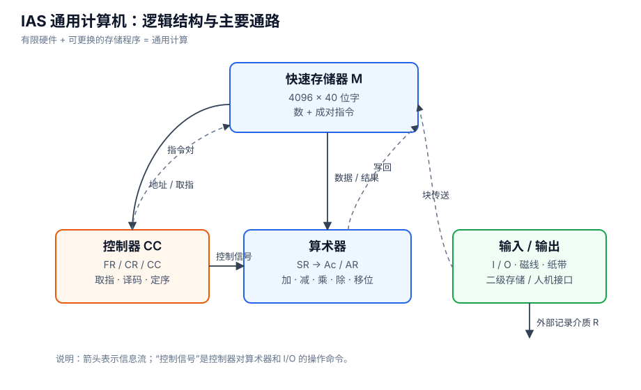

## 核心思想

核心是怎么造一台==通用计算机==，而不是专用计算机。要造一台通用计算机，那么应该怎么实现？

如果要实现通用计算机，那么任务必须被表示成可更换的执行序列。与之相对应的是专用计算，硬件只能进行单一专用的计算，无法更换。通用计算机要能实现自动执行，就必须能自动读取、解释和执行指令。所以，指令必须存在于机器可访问的存储中（存储器）。同时要有控制器，能够自动取指执行。执行指令，即要有基本的运算能力（能实现一组指令计算，例如加法、移位、访存指令等）。这里涉及到指令集，如何设计指令集才能实现通用计算需求。其他更高级的功能例如乘法除法可用基础指令（加法）完成。到这里，已经有了一个雏形。


1. ==如果机器要在不改变硬件的前提下执行不同任务，那么任务必须被表示成可更换的指令序列；== （引申出指令存储与表示问题）
2. ==如果机器要在开始后自动运行，那么这些指令必须能被机器自动读取、解释和执行；==（取指执行）
3. 因此，==指令==不能只是外部操作员临时拨动的开关，而==必须存在于机器可访问的存储中；== （引申出存储器，计算机必须要有存储部件）
4. 所以，==通用机必须具有程序存储和指令解释两个功能==；


一步一步推理出通用计算机的样子。

## 推理逻辑：从设计目标到机器结构

> 先限定论证类型：IAS 报告给出的是**工程设计论证**，不是形式化定理。它的推理形式是“目标/约束 → 必要功能 → 机制 → 具体参数”。其中有些结论是逻辑上必要的，有些只是 1946 年技术条件下的合理选择，二者不能混为一谈。

### 1. 先把“通用”变成可检验的目标

报告的目标不是“造一台更快的计算器”，而是：

> 对任何可以用数值形式表述的问题，机器都能通过**更换指令序列**来执行，而不必重新设计或重新接线硬件。

由此可以分解出五个约束：

| 编号 | 目标/约束 | 含义 |
| --- | --- | --- |
| R1 | 通用性 | 能执行任何可数值化表述的计算 |
| R2 | 自动性 | 计算开始后不依赖人工干预 |
| R3 | 有限硬件 | 只能用有限数量的元件和存储单元 |
| R4 | 高速 | 算术与控制必须足够快，否则通用性没有实际意义 |
| R5 | 可靠性 | 长序列计算必须可检查、可定位错误 |

后面的所有结构，都是在这五个约束下推出来的。

### 2. 从 R1 + R2 推出“存储程序”

推理可以写成一条必要条件的链条：

1. 如果机器要在不改变硬件的前提下执行不同任务，那么任务必须被表示成**可更换的指令序列**；
2. 如果机器要在开始后自动运行，那么这些指令必须能被机器**自动读取、解释和执行**；
3. 因此，指令不能只是外部操作员临时拨动的开关，而必须存在于机器可访问的存储中；
4. 所以，通用机必须具有**程序存储**和**指令解释**两个功能。

这一步得到的是“存储程序”的必要性，而不是某种具体实现。报告进一步指出：如果指令被编码成数字，并且机器能区分数与指令，那么程序和数据可以放在同一个存储器官中。

### 3. 从“存储程序”推出五个功能部件

把通用计算机拆成“必须完成的功能”，可以得到五个不可缺的部分：

| 必要功能 | 如果缺失会怎样 | 对应器官 |
| --- | --- | --- |
| 保存程序和数据 | 无法更换任务，也无法保存中间结果 | 存储器 M |
| 自动取指、译码、定序 | 程序只是被动数据，机器不会自动运行 | 控制器 CC |
| 执行算术与逻辑操作 | 只能存储和搬运，不能计算 | 算术器 CA |
| 把外部问题与数据送入机器 | 机器无法获得初始信息 | 输入 I |
| 把结果送出机器 | 计算结果无法被人使用 | 输出 O |

==这五个部件不是随意划分的，而是从“通用、自动、可计算”三个要求反推出来的功能分解。== IAS 报告随后进一步为每个器官指定了寄存器、字长、指令格式和时序。

### 4. 从控制流推出指令系统

仅有“存储器 + 控制器”还不够，控制器必须知道：

- **下一条指令在哪里**：正常情况按地址顺序前进，因此需要控制计数器 CC；
- **什么时候改变顺序**：循环和分支需要条件转移；
- **如何汇合两条分支**：需要无条件转移；
- **操作数在哪里**：指令中需要地址字段；
- **执行什么操作**：指令中需要操作码字段。

IAS 报告据此得到具体格式：

```text
40 位字 = 两条 20 位指令

一条指令：
┌──────────────────────┬──────────────────┐
│ 12 位地址             │ 8 位操作码        │
│ 指定 4096 个存储位置   │ 指定操作种类      │
└──────────────────────┴──────────────────┘
```

这不是任意设计，而是由三个数量关系共同决定的：

- 快速存储器有 $2^{12}=4096$ 个字，因此地址需要 12 位；
- 操作种类多于 $2^5$ 少于 $2^6$，因此至少需要 6 位，报告留到 8 位；
- 一个 40 位字正好容纳两条 20 位指令。

### 5. 从数据通路推出寄存器组织

五个器官还需要具体的寄存器来衔接。报告的组织可以概括为：



关键路径有三条：

1. **指令路径**：$M \to SR \to FR/CR \to CC$  
   控制器从存储器取出成对指令，译码后发出控制信号。
2. **数据路径**：$M \to SR \to Ac/AR \to M$  
   操作数先进入选数管寄存器 SR，再进入累加器 Ac 或算术寄存器 AR；结果写回 M。
3. **控制路径**：$CC \to$ 算术器、I/O  
   控制器不直接参与运算，而是规定“何时做、做什么、下一个状态是什么”。

这三条路径把“存储程序”从一个抽象说法变成了可执行的闭环：

```text
取指令 → 译码 → 取操作数 → 执行 → 写回 → 取下一条/转移
```

### 6. 从工程约束推出具体参数

逻辑结构确定后，还要在 1946 年的技术条件下选择具体参数。报告的选择可以分成两类：

| 设计问题 | 报告的选择 | 主要理由 |
| --- | --- | --- |
| 二进制还是十进制 | 二进制 | 触发器、选数管、磁线天然二值；乘除法更简单 |
| 字长多少 | 40 位（1 位符号 + 39 位数值） | 约相当于 10 位十进制精度，兼顾精度与设备量 |
| 并行还是串行 | 并行 | 40 支选数管并联，一次取出 40 位字，快 40 倍 |
| 快速存储器用什么 | 选数管 | 电子速度快，可随机访问，容量约 4096 字 |
| 大容量数据怎么办 | 磁线二级存储 + 死存储 | 快速存储太贵，必须分层 |
| 定点还是浮点 | 定点，浮点用程序实现 | 浮点增加存储、算术和控制复杂度 |
| 如何可靠 | 双机比较、单步时钟、指示灯 | 长序列计算必须能检错和定位 |

这些选择大多不是逻辑必然，而是“在速度、设备量、可靠性之间取平衡”的工程决策。

### 7. 必要性与设计选择的区分

为了让推理更严谨，必须区分三类结论：

| 结论 | 类型 | 说明 |
| --- | --- | --- |
| 通用机必须有程序存储和指令解释 | 逻辑必要 | 否则无法在不改硬件的情况下执行任意任务 |
| 数与指令可共用一个存储器 | 可行设计，不是唯一方案 | 哈佛结构也可以分离指令存储和数据存储 |
| 五个功能器官 | 功能必要 | 存储、控制、运算、输入、输出缺一不可 |
| 并行 40 位字 | 性能选择 | 串行机器也能计算，只是更慢 |
| 二进制 | 技术选择 | 十进制机器也可实现，只是电路更复杂 |
| 40 位字长、20 位指令 | 定量选择 | 由精度、地址空间和字长共同决定 |
| 选数管 | 当时的技术选择 | 延迟线、磁鼓等也可作为快速存储 |
| 定点而非浮点 | 复杂度选择 | 浮点可以用程序实现，但会牺牲速度 |

这一点很重要：IAS 报告的贡献不是证明“计算机只能长成这样”，而是给出了一组在 1946 年条件下**自洽、可实现、可检查**的设计决策。

### 8. 推理结论与边界

最终得到的逻辑是：

```text
通用性要求
  → 程序必须可更换
  → 指令必须可存储、可编码
  → 数与指令可共用一个存储器
  → 必须有控制器自动取指、译码、定序
  → 必须有算术器执行运算
  → 必须有 I/O 与存储层次连接外部世界
  → 用二进制、并行字和定点表示落实为工程参数
```

但也必须说明边界：

- 这里的“通用”是**通用目的计算机**意义上的通用，不是形式化证明意义上的“图灵完备”；快速存储只有 4096 个字，并不是无限纸带。
- 报告给出的是**逻辑设计**，不是完整电路实现；大量工程细节仍待后续报告和实验决定。
- “五个器官”是功能分解，不是唯一实现；同一功能可以用不同技术、不同总线、不同存储组织实现。

因此，更准确的概括是：

> IAS 报告从“通用、自动、高速、可靠”四个约束出发，推导出一个以统一存储器、存储程序、控制器和并行算术器为核心的工程架构；它证明了这种架构可以实现，但并没有声称它是唯一可能的通用计算机结构。

### 1. 通用计算机由五个器官组成

IAS 报告把计算机划分为五个主要部分：

- **算术器**：执行加、减、乘、除等运算；
- **存储器**：同时存放数和指令；
- **控制器**：取出指令、解释指令、控制执行顺序；
- **输入器**：把外部数据送入机器；
- **输出器**：把结果送出机器。

这与 EDVAC 报告的 CA、CC、M、I、O 一脉相承，但 IAS 报告进一步给出了更具体的工程化设计。

### 2. 指令和数据共用同一存储器

报告明确提出：

- 指令可以编码为数字；
- 机器必须能够区分数和指令；
- 因此同一个存储器官可以同时存储数和指令；
- 控制器按地址取指令，并可根据条件转移改变执行顺序。

这就是“存储程序”思想的具体化：==改变程序不需要改变硬件接线，只需要改变存储器中的指令序列==。

### 3. 选择并行机器，而不是串行机器

报告选择用 40 支**选数管**（Selectron）并联组成快速存储器：

- 每支选数管容量为 $2^{12}=4096$ 位；
- 40 支并联构成 $4096\times40$ 位的快速存储；
- 每次读出一个完整的 40 位字；
- 所有对应位同时运算，因此是**并行计算机**。

这与 EDVAC 的串行延迟线方案形成鲜明对比。报告认为，并行方案开关更简单，而且快 40 倍。

### 4. 存储器是分层系统

快速存储器容量有限，因此报告提出存储层次：

- **快速电子存储器**：40 支选数管，约 4096 个字；
- **二级存储器**：磁线或磁带，按块与快速存储器交换数据；
- **死存储**：可更换的磁线库，需要时才装入机器。

这说明“内存—外存”分层不是后来才有的工程习惯，而是早期存储程序计算机设计中的核心结构。

### 5. 二进制、定点、40 位字长

报告选择：

- **二进制**：适合触发器、选数管和磁线的二值特性；
- **40 位字长**：其中 1 位符号位，39 位数值；
- **定点表示**：二进制小数点固定在符号位之后；
- **补码表示负数**：便于加减法统一处理；
- **不把浮点做进第一台机器**：浮点会增加存储、算术和控制复杂度，必要时可用程序实现。

### 6. 指令格式与控制方式

报告设计了具体的指令格式：

- 12 位地址，用于指定 4096 个存储位置；
- 8 位操作码，用于指定操作；
- 每条指令 20 位，两条指令组成一个 40 位字；
- 控制器通常按顺序取下一条指令；
- 条件转移根据累加器中数的符号决定；
- 无条件转移直接修改控制计数器。

### 7. 工程折中：简单、可靠、可检查

报告反复强调工程权衡：

- 乘法、除法是否内建，要看速度收益是否值得增加设备；
- 开方器第一台机器不做，因为设备成本过高；
- 进位采用平均进位长度分析，避免最坏情况拖慢加法；
- 用双机并行比较、单步时钟和指示灯来检查和定位错误；
- 逻辑设计应独立于具体电路实现，但必须能为工程实现提供明确规格。

## 核心结论

1. **存储程序计算机是可行的**  
   报告给出了从存储器、算术器、控制器到输入输出的完整逻辑方案，说明通用计算机不只是理论构想，而是可以工程化的系统。

2. **快速存储器是系统核心**  
   4096 个 40 位字的快速存储、磁线二级存储和存储层次，决定了整机的规模、速度与成本。

3. **并行算术优于串行算术**  
   在选数管存储器条件下，并行取出 40 位字并同时运算，比串行逐位处理更快，也更适合开关设计。

4. **二进制与定点表示是合理选择**  
   二进制简化算术与逻辑；定点 40 位字长在精度、存储和电路复杂度之间取得平衡；浮点暂不作为硬件特性。

5. **除法可以用非恢复法高效实现**  
   非恢复除法特别适合二进制，且对除数和被除数的符号组合都适用；这是报告中最具体的算法设计之一。

6. **可靠性与可检查性必须进入逻辑设计**  
   双机比较、单步运行、停机保信息和指示灯，使机器不仅能算，还能被检查、调试和定位故障。

## 意义

- **它是 IAS 机器的直接设计蓝图**  
  报告中的 40 位字长、4096 字存储、并行运算、指令格式和控制方式，后来成为 IAS 计算机及一大批衍生机器的基础。

- **它把“冯·诺依曼架构”从思想变成了工程规格**  
  EDVAC 报告提出了存储程序思想；IAS 报告进一步给出了存储器、算术器、控制器和指令编码的具体组织方式。

- **它确立了“逻辑设计”这一层**  
  报告讨论的是机器应该有哪些寄存器、指令如何编码、数据如何表示、运算如何定时，而不是某一台机器的电路细节。这种分层后来成为计算机体系结构学科的基本方法。

- **它展示了工程权衡的方法论**  
  是否为乘法、除法、开方、浮点增加硬件，如何平衡速度、设备量和可靠性，这些问题在报告中都有明确分析，而不是凭直觉决定。

- **它影响了后续计算机与计算机科学**  
  存储程序、并行字组织、指令地址、条件转移、存储层次、双机检查等思想，至今仍是计算机体系结构和系统设计的基础语言。

## 一句话总结

==IAS 报告把“存储程序计算机”从哲学式的通用机器构想，落实为一套包含 40 位并行字、4096 字快速存储、20 位指令和完整控制流程的工程蓝图。==
