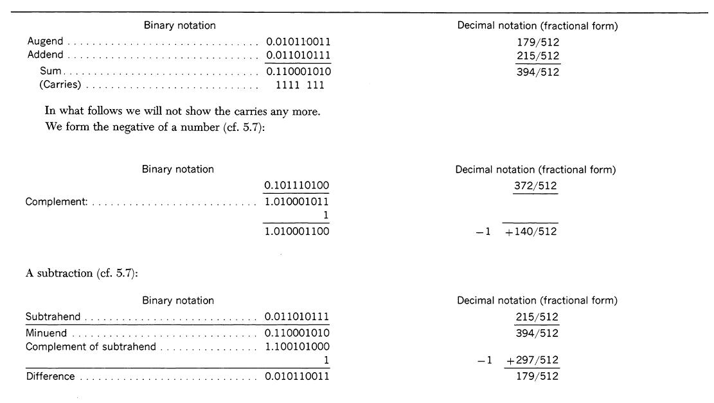

# 电子计算仪器逻辑设计的初步讨论

**Arthur W. Burks / Herman H. Goldstine / John von Neumann**

> **译者说明**：本文是 1946 年 6 月 28 日提交给美国陆军军械部、由普林斯顿高等研究院（Institute for Advanced Study, IAS）完成的报告 *Preliminary Discussion of the Logical Design of an Electronic Computing Instrument* 的全文中文翻译。该报告通常被称为 IAS 计算机报告或“冯·诺依曼架构”的进一步工程化文本。原文分为两部分：本报告是第一部分，讨论机器的总体逻辑设计；第二部分另以 *Planning and Coding of Problems for an Electronic Computing Instrument* 为题发表。译文保留原报告的结构、公式、表格与编号；公式图版取自公开转录版，表格另行译出。术语统一为：Selectron 译为“选数管”，Selectron Register 译为“选数管寄存器”，Accumulator 译为“累加器”，Arithmetic Register 译为“算术寄存器”，Control 译为“控制器”，order 译为“指令”，word 译为“字”，tetrad 译为“四位组”。

## 前言

本报告依据美国陆军军械部研究与发展局与普林斯顿高等研究院之间的合同 W-36-034-ORD-7481 编写。它计划作为两篇论文中的第一篇，讨论与电子计算机有关的总体逻辑考虑。第一篇即本报告的前半部分，试图给出当时正在考虑的仪器类型的一般图景；后半部分则研究如何把实际数学问题编码，也就是用机器能够理解的语言准备出来。

目前的打算是，随着项目各阶段工作的推进，不时发表报告。只要某一方面的逻辑或实验工作已经足够充分，值得报告，就会发表相应论文。

作者还要感谢普林斯顿大学的 John Tukey 博士，他在讨论中提出了许多有价值的建议。

普林斯顿高等研究院  
1946 年 6 月 28 日

Arthur W. Burks  
Herman H. Goldstine  
John von Neumann

## 1. 机器的主要部件

### 1.1 引言

由于最终完成的设备将是一台==通用计算机==，它应当包含与算术、存储、控制以及与人操作员联系有关的主要器官。机器应当是全自动的，也就是说，计算开始后不依赖人类操作员。关于这一点的进一步含义，将在第 3 节讨论。

### 1.2 指令的存储与执行

显然，机器必须能够以某种方式存储的不仅是给定计算所需的数字信息，例如边界值、函数表（如流体的状态方程）以及计算过程中可能需要保留不同时长的中间结果，而且还必须存储控制对数值数据执行何种实际程序的指令。==在专用机中，这些指令是设备的组成部分，构成其设计结构的一部分。对于通用机，必须能够指示设备执行任何可以用数值形式表述的计算。因此，必须有一个能够存储这些程序指令的器官。此外，还必须有一个能够理解这些指令并命令其执行的单元。==

### 1.3 同一存储器官同时存储指令和数

<u>从概念上说，上面讨论的是两种不同形式的存储器：数的存储和指令的存储。然而，如果机器的指令被归约为一种数字编码，并且机器能以某种方式区分数与指令，那么同一个存储器官就可以同时存储数和指令。</u> 把指令编码为数字形式的问题将在 6.3 节讨论。

### 1.4 控制器

<u>如果指令存储器只是一个被动的存储器官，那么就必须存在一个能够自动执行存储器中指令的器官。我们称这个器官为**控制器**（Control）。</u>

### 1.5 算术器官

由于该设备是一台计算机，它必须有一个能够执行某些基本算术运算的算术器官。因此，会有一个能够加、减、乘、除的单元。将在 6.6 节看到，它还能执行一些经常出现的附加运算。

机器视为“基本”的运算，显然就是那些硬连线到机器中的运算。举例来说，如果愿意把乘法看作一系列适当排序的加法，那么乘法就可以不作为基本过程存在于设备中。对除法也可作类似说明。一般来说，算术单元的内部经济性取决于两个愿望之间的折中：一是运算速度——非基本运算通常需要很长时间，因为它由控制器给出的一系列指令构成；二是机器的简单性或廉价性。

### 1.6 输入和输出器官

最后，必须有输入和输出器官，使人操作员与机器能够相互通信。下面 4.5 节将说明，这个器官构成一种二级自动存储器。

## 2. 关于存储器的初步讨论

### 2.1 引言

显然，存储器大小是设计一台令人满意的通用计算机时的关键考虑。下面讨论在各种类型的计算中，存储器应当存储哪些量。

### 2.2 各类问题的存储需求

在求解偏微分方程时，存储需求可能相当大。一般来说，不仅要记住初始条件、边界条件以及问题中出现的任意函数，还要记住大量中间结果。

(a) 对于含两个自变量的抛物型或双曲型方程，积分过程本质上是一个双重归纳。为了求出因变量在时刻 $t+\Delta t$ 的值，需要利用时刻 $t$ 的数据作为系数，关于 $x$ 从一个边界积分到另一个边界，从而定义这次积分的问题。

存储器不仅必须有足够空间存储这些中间数据，还必须提供某种安排，使这些数据随后可以被移除，即在 $(t+\Delta t)$ 周期结束时被移除，并替换为 $(t+2\Delta t)$ 周期的相应数据。当然，这种从存储器中移除数据并替换为新信息的过程必须在控制器指导下完全自动地完成。

(b) 对于常微分方程，存储需求显然与 (a) 类似，但更小。

(c) 通过迭代过程求解的问题，例如线性方程组或用松弛法处理的椭圆型偏微分方程，可能需要相当大的存储容量。这类问题的存储需求显然比 (a) 中大得多：在 (a) 中只需存储对应于一个变量（即 $t$）瞬时值的信息，而现在必须存储整个解（覆盖所有变量的所有值）。不过，这种量级上的明显差异可以通过使用更粗的积分网格部分抵消，因为这类问题允许比 (a) 中的情形粗得多的网格。

### 2.3 存储容量

目前建造一台能够方便处理比现有电子或机电机器复杂几个数量级的问题的机器是合理的。因此，我们计划设置一个全自动电子存储设施，容量约为 4,000 个 40 位二进制数。这对应于精度 $2^{-40}\approx0.9\times10^{-12}$，即约 12 位十进制数字。我们相信，这一存储容量比目前大多数问题所需容量高约 10 倍；其精度也安全地高于当前绝大多数问题的要求。此外，我们还计划设置一个容量大得多的辅助存储器，它同样是全自动的，采用磁线或磁带等介质。

## 3. 关于控制和编码的初步讨论

### 3.1 引言

用形式逻辑方法容易看出，存在一些编码，它们抽象地足以控制和引起机器中任何可单独执行的运算序列，而这些运算整体上可以被问题规划者设想出来。从当前观点看，选择编码时真正决定性的考虑更偏实用：编码所要求的设备简单性、它应用于实际重要问题时的清晰性，以及处理这些问题的速度。全面或从第一原理讨论这些问题会离题太远。因此，我们只限于分析目前为机器设想的编码类型。

### 3.2 算术指令

==当然必须有执行基本算术运算的指令==。这些指令的详细规格要等到算术单元稍微详细描述之后才能完全给出。

### 3.3 存储器替换指令

必须能够把数据从存储器送到算术器官，再送回来。把信息从算术器官送回存储器时，必须区分两种类型：作为数本身的转移，以及作为指令一部分的数的转移。第一种情况很明显，无需进一步解释；第二种情况更微妙，也正好说明该系统的通用性和简单性。

以插值问题为例。假设我们已经为在一组数据中执行 $n$ 阶插值编写了必要指令。括住所需函数值的 $(n+1)$ 个量在存储器中的确切位置，当然是自变量的函数。这个自变量很可能是在机器中计算出来的结果。因此，我们需要一条指令，能够把一个数代入给定指令中——在插值情形中，就是代入最接近所需值的那个自变量或那组自变量的位置。通过这样的指令，计算结果可以被引入控制该计算或另一计算的指令中。这使得同一指令序列可以用于存储在存储器不同位置的不同数值集合。

概括起来，写入存储器有两种：

- **完全替换**：清除原先存储的量，并用新的数替换；
- **部分替换**：把指令中包含存储器位置编号的那一部分，替换为新的存储器位置编号。这里我们假定存储器中的各个位置按存储器位置编号串行枚举。

### 3.4 指令的顺序

显然，必须能够在任何时刻从存储器的任何部分取得数。对于指令，处理可以更有条理，因为至少可以部分地把控制指令排成线性序列。因此，控制器将被构造成通常从存储器中的位置 $n$ 前进到位置 $n+1$ 取下一条指令。

### 3.5 控制转移

自动计算机的效用在于可以重复使用给定指令序列，重复次数可以预先指定，也可以依赖于计算结果。当迭代完成后，要执行另一条指令序列，因此在大多数情况下必须给出两条并行的指令序列，并在它们之前给出一条说明应走哪条路线的指令。这种选择可以依赖于某个数的符号（在机器用途中，零被算作正）。因此，我们引入一条**条件转移指令**，它根据给定数的符号，使两条路线中正确的一条被执行。

两条并行指令序列经常终止于一个公共程序。因此，希望控制器在两种情况下都转到公共程序的起点。这种**无条件转移**可以通过人为使用条件转移来实现，也可以引入一条显式的无条件转移指令。

### 3.6 输入输出指令

最后，我们需要把输入输出设备与机器整合起来的指令。这些将在 6.8 节简要讨论。

### 3.7 结论

现在我们转入对机器的更详细讨论。经验表明，一旦选定了某个部件作为基本存储单元，机器其余部分也就在很大程度上被决定了。因此，我们从存储器官的考虑开始。然而，对于计算机这样高度集成的设备，不可能在完成每个器官的描述之前就对它作详尽讨论；只有到最终的框图阶段，才能接近完整的单元描述。

下文使用的时间单位是：

下文使用的时间单位是：$1\,\mu\text{s}=1$ 微秒 $=10^{-6}$ 秒；$1\text{ ms}=1$ 毫秒 $=10^{-3}$ 秒。

## 4. 存储器官

### 4.1 存储器的类型

理想情况下，人们希望存储器容量无限大，使得任何特定的 40 位二进制数集合（即一个字，见 2.3）都能立即取得——也就是说，在一个比快速电子乘法器操作时间短一些或短得多的时间内取得。可以认为，实际水平约为 100 微秒。因此，存储器中一个字的可用时间应为 5–50 微秒。同样希望字能以大致相同的速率被新字替换。物理上似乎不可能达到这样的容量。因此，我们不得不承认建造存储层次的可能性：每一层比前一层容量更大，但访问速度更慢。

电路中最常见的存储形式是触发器或触发电路、充气管和机电继电器。要实现 $n$ 个字的存储器，当然需要约 $40n$ 个这样的元件，还不包括开关元件。我们前面看到（见 2.2），对于通用仪器来说，几千个字的快速存储器完全合理。因此，大约需要 $10^5$ 个触发器或类似元件！这当然完全不切实际。

因此，必须寻找比上面提到的更基本的电信息存储方法。这种存储介质的一个标准是：单个存储器官（每个只容纳一个二进制数字）不应是宏观元件，而应是某个合适器官的微观元件。这样，它们当然不再通过通常的宏观导线连接来识别和切换，而是通过对该器官进行某种功能性操作来访问。

一种显著具有这种性质的器件是**光电析像管**（iconoscope）。在其常规形式中，它具有约五百分之一的线性分辨率。这对应于 $500\times500=2.5\times10^5$ 的（二维）存储容量。于是人们考虑在阴极射线管内的介质板上存储电荷的可能性。实际上，这样的管子不过是由电子束连接到电路中的无数个电容器。

实际上，上述高分辨率及相应存储容量只有在电视图像存储的条件下才现实，而电视图像存储对单个标记可靠性的要求远低于计算机存储所能接受的要求。在后一种情况下，按熟悉路线建造的设备，二十分之一到一百分之一的分辨率，即 400 到 10,000 的存储容量，似乎更合理。

目前，美国无线电公司（RCA）普林斯顿实验室正在开发一种上述类型的存储管——**选数管**（Selectron）。这种管还计划采用非幅度敏感的开关系统，使电子束能在不到一毫秒的很小一部分时间内指向板上的给定点。由于存储管是本报告所设想机器的关键部件，我们非常幸运地获得了 RCA 小组在这项工作以及其他各种开发工作中的合作。

另一种快速存储器官是 EDVAC 各种报告中所描述的声反馈延迟线。（EDVAC 是宾夕法尼亚大学摩尔电气工程学院为美国陆军军械部开发的电子计算机。）由于那些论文已经清楚描述了该器件，我们不再进一步讨论。物质在电子或光子存在下还有其他物理和化学性质可以考虑，但由于它们都还处于早期讨论阶段，我们不再提及。

### 4.2 选择选数管

因此，在本报告的其余部分，我们假定选数管是以电子速度存储字的模式。按目前的计划，这种管将具有 $2^{12}=4,096\approx4,000$ 个二进制数字的容量。为了实现约 4,000 个字的总电子存储，我们建议使用 40 支选数管，从而得到 $2^{12}$ 个 40 位二进制字的存储器（再参见 2.3）。

### 4.3 数的并行表示

在选数管存储器中存储一个特定的字——事实上，在延迟线存储器或幅度敏感偏转的存储管中也是如此——有两种可能方式。一种方式是把整个字存储在一支给定的管中，然后以串行方式逐位取出；另一种方式是在 40 支管的对应位置各存储该字的一位。在后一种方案中，从存储器取出一个字需要一个开关机构，所有 40 支管并联到该机构。这种开关方案似乎比串行系统所需的技术更简单，而且当然快 40 倍。因此我们采用并行方案，从而考虑所谓的**并行机器**，它与 EDVAC 正在考虑的串行原理相对照。（在 EDVAC 中，声延迟线的特殊性质以及其他各种考虑似乎证明串行方案是合理的。细节见 4.1 所引报告。）这两种系统的本质区别在于执行加法的方法：在并行机器中，所有对应数字对同时相加；在串行机器中，这些数字对按时间串行相加。

### 4.4 并行切换

概括起来，我们假定快速电子存储器由 40 支选数管组成，它们通过一个公共开关装置并联切换。开关的输入由控制器控制。

### 4.5 磁带存储器的要求

由于许多非常重要的问题类别需要比 $2^{12}$ 个字大得多的总存储器，我们现在考虑存储层次的下一级。尽管偏微分方程的求解经常涉及成千上万个字，但这些数据通常只需要按块处理，而每块都远在电子存储器 $2^{12}$ 的容量之内。因此，我们的第二种存储形式必须是一种把字块送入电子存储器的介质。它应由计算机控制器控制，因而成为系统的组成部分，不需要人工干预。

上面显然提出了两个不同问题。人们可以选择某种给定介质来存储，例如电传纸带、磁线或磁带、电影胶片或类似介质；但还剩下如何使这种存储介质与机器自动集成的问题。这种集成在逻辑上通过向编码中引入适当指令来实现，这些指令可以命令机器在该介质上读写、把它移动给定距离，或移动到具有给定特征的位置。我们将在 6.8 节更详细地讨论这个问题。

现在回到二级存储介质应具有哪些性质的问题。它显然应能把信息存储足够长的时间，使得只有总计算时间的百分之几用于重新登记正在“衰减”的信息。信息能够被擦除并替换为新数据，当然是可取的，尽管并非绝对必要。介质应能被控制，即自动向前和向后移动。这一考虑使某些介质（如穿孔卡片）不适用。卡片当然可以由某台机器通过适当指令打印或读取，但它们不适合输出数据直接反馈回机器、且所需顺序相对于卡片顺序非单调的问题。介质应能以比电子器件低得多的价格记住极大量的数据。它还必须足够快，以致即使在问题中频繁使用，也不会把大部分求解时间花在把数据送入送出该介质以及实现所需定位上。如果这一条件不能相当好地满足，机器高速电子化的优势就会大部分丧失。

光敏或电子敏感胶片以及由伺服机构控制运动的磁线或磁带，似乎都能相当好地满足我们的需要。我们暂定使用磁线，因为我们已经在这种介质上以约 25,000 脉冲/秒及更高的速率实现了可靠性能。

### 4.6 磁带库

最后，我们的存储层次需要大量**死存储**，即不与机器集成的存储。这一存储需求可以通过一个线库来满足：需要时把线引入机器，此时它自动受控。因此，我们的死存储实际上只是二级存储介质的延伸，区别仅在于机器对它的可用性。

### 4.7 人工读写

我们对二级存储器还提出一个额外要求：人必须能够把字写到线或其他所用物质上，并读出机器写上的字。这样，人就能控制机器的功能。现在清楚，二级存储介质实际上不过是输入输出系统的一部分，见 6.8.4 对实现这一点的机构的描述。

### 4.8 图形显示

输入输出还有一个非常重要的部分，我们此时只提及一下，即某种以图形方式查看给定计算结果的手段。这当然可以由类似选数管的管子实现：当电子束把数据写到其上时，屏幕发光。

### 4.9 选数管寄存器

为后续讨论的确定性，我们假定每支选数管的输出端都关联一个触发器。这 40 个触发器的集合称为**选数管寄存器**（Selectron Register，SR）。

## 5. 算术器官

### 5.1 引言

本节讨论我们认为机器算术部分应当具有的特性。我们给出暂定结论：哪些算术运算应内建到机器中，哪些应通过程序实现；最后描述算术单元的框图。

### 5.2 二进制系统的选择

讨论计算机的算术器官时，自然会考虑采用何种数系。尽管数字机器长期传统上采用十进制，我们仍强烈赞成我们的设备==采用二进制系统==。我们的基本存储单元自然适合二进制，因为我们并不试图测量选数管某一点的电荷梯度，而只满足于==区分两种状态==；触发器也是真正的二进制器件。在磁线、磁带和声延迟线存储器中，人们同样满足于识别脉冲的有无，或（如果使用载频）脉冲串的有无，或脉冲的符号。（这里不讨论正—负—无脉冲三种状态的可能性及其与可靠性和检查问题的关系，也不讨论载频调制这一非常有趣的可能性。）因此，如果考虑用光电析像管或延迟线存储器实现十进制系统，就不得不对十进制进行二进制编码——每个十进制数字至少用一个四位组（tetrad）的二进制数字表示。这样，十位十进制精度至少需要 40 位二进制数字；而在真正的二进制表示中，约 33 位就足以达到 $10^{-10}$ 的精度。因此，使用二进制比十进制更节省设备。

然而，==二进制相对于十进制的主要优点，是基本运算更简单、更快速==。以重复加法实现乘法为例：在二进制乘法中，乘数的某一位与被乘数的乘积，根据该位是 1 还是 0，要么等于被乘数，要么为零；而在十进制中，这个乘积有从零到九倍被乘数共十种可能值。当然，同样精度的十进制数只有二进制数约 $\log_{10}2\approx0.3$ 倍的位数，但即便如此，十进制乘法仍比二进制乘法长得多。可以通过复杂化电路来加速十进制乘法，但这一点与上述论点无关，因为二进制乘法同样可以通过增加设备来加速。其他运算也有类似情况。

还有一点值得强调：机器的一个重要部分不是算术性的，而是逻辑性的。逻辑是“是—否”系统，本质上是二值的。因此，算术器官采用二进制安排，非常有助于使整台机器更加同质、更易集成、更有效率。

从人的角度看，二进制的一个缺点是转换问题。然而，由于数制之间的转换方法完全已知，并且可以完全通过通常的算术过程实现，计算机本身没有理由不能完成这种转换。有人可能认为这是耗时的操作，但事实并非如此。（参见第二部分 9.6、9.7 节；第二部分是以 *Planning and Coding of Problems for an Electronic Computing Instrument* 为题发表的报告。）事实上，作为科学研究工具的通用计算机，通常要对相对少量的输入数据进行大量乘法，因此十进制到二进制转换所消耗的时间只占总计算时间的极小百分比。输出数据也有类似情况。

在上述讨论中，我们默认以十进制引入和取出数据是可取的。然而我们认为，在科学仪器中，以 10 为底甚至可能不会成为永久特征，因此我们可能会尝试训练自己使用以 2、8 或 16 为底的数。选择 8 或 16 的理由是：8 和 16 都是 2 的幂，转换为二进制很简单；同时它们的大小接近 10，比二进制更少违反我们的习惯。（参见第二部分 9.4 节。）

### 5.3 浮点二进制小数点

国内和英国正在建造或计划建造的若干数字计算机将包含所谓的“浮点十进制小数点”。这是一种把每个字表示为阶码和尾数的机制，例如 $123.45$ 在机器中表示为 $(0.12345,03)$，其中 3 是与该数关联的 10 的指数。浮点系统似乎有两个主要目的，二者都源于一个字中的位数是固定的这一事实。第一个目的是在和或积中尽可能保留有效数字；第二个目的是使人类操作员不必估算并插入“比例因子”——用来把数保持在机器范围内的乘法常数。

当然不可否认，安排合适的比例因子会消耗人的时间。我们只是认为，这些时间只占我们为机器准备一个有趣问题所花总时间的很小百分比。浮点的第一个优点，我们觉得有些虚幻。为了拥有这样的浮点，必须浪费本来可以用来让每个字携带更多位数的存储容量。因此，我们完全不清楚浮点二进制小数点的有限优点是否能抵消存储容量的损失以及算术和控制电路复杂性的增加。

当然，在我们的设备范围内，确实有一些问题需要高于 $2^{-40}$ 的精度。为了处理这类问题，我们希望按长度为 40 的某个固定整数倍的字来规划，并通过对机器编程，对相应的 40 位字组作适当处理。此时必须把加法或乘法看作由若干基本加法或乘法程序化而成的复合运算（参见第二部分第 9 章）。在带浮点二进制小数点的仪器中，这样的过程似乎会带来相当大的额外困难。

读者可能会注意到，我们在决定机器的各种可能特性时，时而激进，时而保守。然而，我们希望读者在仔细考察后会同意：我们在判断任何想法的价值时，遵循的是一条一致而合理的原则。我们只愿意把这样的逻辑概念以电路形式纳入机器：它们要么是构成完整系统所必需的，要么由于其出现频率高、在相关数学情形中影响大而极为方便。

### 5.4 内建算术运算的选择

基于这一标准，我们明确希望把能够形成两个 40 位二进制数之和的电路内建到机器中。我们作此决定，不是因为加法在逻辑上是基本概念，而是因为如果每次加法都由更简单的“与”“或”“非”操作程序化实现，机器和操作员都会慢得无法接受。减法同样如此。类似地，我们拒绝通过加法程序化来形成乘积，详细动机与加法和减法基本相同。除法与开方的情形则远不如前者清楚。

众所周知，一个数 $a$ 的倒数可以通过迭代方案达到任意所需精度。一种方案是改进估计值 $X$，形成

$$X'=2X-aX^2.$$

于是新误差 $1-aX'$ 等于 $(1-aX)^2$，即前一次估计误差的平方。注意，在形成 $X'$ 时有两次真正的乘法——我们不把乘以 2 视为真正的乘积，因为我们将有在一两个脉冲时间内左右移位的设施。因此，如果能在某种程度上把 $1/a$ 估计到 $2^{-5}$ 的精度，6 次乘法即 3 次迭代就足以给出精确到 $2^{-40}$ 的最终结果。相应地，可以用一个 $2^4$ 项的小表来获得 $1/a$ 的初始估计。这样，倒数 $1/a$ 可在 6 次乘法时间内形成，因而商 $b/a$ 可在 7 次乘法时间内形成。于是，是否建造除法器，实际上取决于它相对于上述迭代方法能快多少：为了证明其存在合理，除法器必须在大大少于 7 次乘法的时间内完成一次除法。然而，我们已经设想出一种比这 7 次乘法时间快得多的除法器，因此认为有理由建造它，特别是因为它比乘法器所需增加的设备并不多。

当然，也可以用迭代技术处理平方根。事实上，如果 $X$ 是 $a^{1/2}$ 的估计值，那么

$$X'=\frac12\left(X+\frac{a}{X}\right)$$

是更好的估计。可以看出，这个方案每次迭代需要一次除法。下面更详细考察算术器官时将看到，我们的计划中不包括开方器，因为这种设备所需的设备量超过我们希望在第一个模型中投入的程度。（关于开方的迭代方法，参见第二部分 8.10 节。）

### 5.5 累加器

算术器官的第一部分在此无需多讨论。它应是一个并行存储器官，能够接收一个数并将其加到已有内容上，也能清除其内容并传出所存内容。我们称这样的器官为**累加器**（Accumulator）。

这在过去和现在各种类型的计算机中都是相当常规的原理，例如台式乘法器、标准 IBM 计数器、较现代的继电器计算机以及 ENIAC。当然，建造这样的二进制累加器有许多方式。我们区分两大类：静态累加器和动态或脉冲型累加器。它们将在 5.11 节讨论，但首先需要对二进制加法的算术作几点说明。在并行累加器中，加法的第一步是把加数的每一位加到被加数的对应位；第二步是执行进位，而进位必须按顺序进行，因为一个进位可能产生另一个进位。最坏情况下会发生 39 次进位。显然，如果让第二步（执行进位）花费的时间是第一步（数字相加）的 39 倍，那是低效的。因此，要么必须加速进位，要么必须利用平均进位长度，或者两者兼用。

### 5.6 进位序列的平均长度

我们将证明：对于两个长度为 $n$ 的二进制字之和，最长进位序列的平均长度不超过 ${}^2\log n$。令 $p_n(v)$ 表示两个长度为 $n$ 的二进制字相加时，出现长度至少为 $v$ 的进位序列的概率。那么显然 $p_n(v)-p_n(v+1)$ 是最大进位序列长度恰为 $v$ 的概率，而加权平均值

$$
\begin{aligned}
a_n&=\sum_{v=0}^{n}v\big[p_n(v)-p_n(v+1)\big]\\
&=\sum_{v=1}^{n}p_n(v)
\end{aligned}
$$

就是这种进位的平均长度。注意

$$\sum_{v=0}^{n}\big[p_n(v)-p_n(v+1)\big]=1,$$

因为当 $v>n$ 时 $p_n(v)=0$。由此容易推出

$$a_n=\sum_{v=1}^{n}p_n(v).$$

现在我们证明

$$p_n(v)\le\min\left[1,\frac{n-v+1}{2^{v+1}}\right].$$

首先观察到

$$p_n(v)=p_{n-1}(v)+\frac{1-p_{n-v}(v)}{2^{v+1}}\qquad (v\le n).$$

事实上，$p_n(v)$ 是两个 $n$ 位二进制数之和包含长度为 $v$ 的进位序列的概率。这个概率由两个互斥情形的概率相加得到：

第一，两个数的前 $n-1$ 位本身包含长度为 $v$ 的进位序列，其概率为 $p_{n-1}(v)$。

第二，两个数的前 $n-1$ 位本身不包含长度为 $v$ 的进位序列。此时，总长度为 $n$ 的数中任何长度为 $v$ 的进位序列都必须以最后两位结束，因此这两位必须构成组合 $1,1$；接下来的 $v-1$ 位必须传播进位，因此每一位必须构成组合 $1,0$ 或 $0,1$（组合 $1,1$ 和 $0,0$ 不传播进位）。组合 $1,1$ 的概率为 $1/4$，两种备选组合 $1,0$ 或 $0,1$ 的概率为 $1/2$。因此这一序列的总概率为

$$\frac14\left(\frac12\right)^{v-1}=\left(\frac12\right)^{v+1}.$$

剩余的 $n-v$ 位不能包含长度为 $v$ 的进位序列，其概率为 $1-p_{n-v}(v)$。因此第二种情形的概率为

$$\frac{1-p_{n-v}(v)}{2^{v+1}}.$$

合并两种情形，即得上述关系。$v>n$ 时 $p_n(v)=0$ 是平凡的。

借助上面证明的公式，我们看到 $p_n(v)-p_{n-1}(v)$ 总是 $1/2^{v+1}$，因此和

$$\sum_{i=v}^{n}\big[p_i(v)-p_{i-1}(v)\big]=p_n(v)$$

不超过 $(n-v+1)/2^{v+1}$，因为和中恰有 $n-v+1$ 项；此外，每个 $p_n(v)$ 都是概率，不大于 1。因此

$$p_n(v)\le\min\left[1,\frac{n-v+1}{2^{v+1}}\right].$$

最后，我们求 $a_n=\sum_{v=1}^{n}p_n(v)$ 的上界。选择 $K$ 使 $2^K\le n\le2^{K+1}$。于是

$$
\begin{aligned}
a_n&=\sum_{v=1}^{K-1}p_n(v)+\sum_{v=K}^{n}p_n(v)\\
&\le\sum_{v=1}^{K-1}1+\sum_{v=K}^{n}\frac{n}{2^{v+1}}\\
&=K-1+\frac{n}{2^K}.
\end{aligned}
$$

最后这个表达式在区间 $2^K\le n\le2^{K+1}$ 上显然是 $n$ 的线性函数，并且在 $n=2^K$ 时等于 $K$，在 $n=2^{K+1}$ 时等于 $K+1$，也就是说，在该区间两端都等于 ${}^2\log n$。由于 ${}^2\log n$ 处处凹向下，可知该表达式在整个区间内不超过 ${}^2\log n$。因此 $a_n\le{}^2\log n$。这对所有 $K$ 即所有 $n$ 成立，正是我们要证明的不等式。

在我们的情形中 $n=40$，有 $a_n\approx{}^2\log40\approx5.3$，即最长进位序列的平均长度约为 5。（$a_{40}$ 的实际值为 4.62。）

### 5.7 负数与减法

讨论了加法之后，现在转向减法。此时方便讨论我们对负数的处理；为了正确做到这一点，有必要对一般的数的处理作一些观察。

我们的数是 40 位数字组，最左位是符号位，其余是真正的二进制数字，其位值从右到左分别为 $2^{-1},2^{-2},\ldots,2^{-39}$。然而，我们的累加器也把符号位当作位值为 $2^0$ 的二进制数字——至少当它作为加法器工作时如此。对于 0 与 1 之间的数，这显然没问题：最左位将是 0；如果此处的 0 表示正号，那么该数就正确地用其符号和 39 位二进制数字表示出来了。

现在考虑一个或多个不受限制的 40 位二进制数。累加器会把它们相加，数字相加和进位机制在全部 40 个位置正常且相同地工作。但有一个保留：如果进位从最左位置产生，它就无处可去（左边没有更多位置），因而“丢失”。这当然意味着，两个都在 0 与 2 之间的加数产生的和超过了 2，而累加器无法表示位值为 $2^1$ 的数字，于是丢掉了 2。也就是说，和是正确的，但可能有一个 2 的误差。如果连续进行多次这样的加法，最终误差可能是 2 的任意整数倍。也就是说，累加器是一个允许误差为 2 的整数倍的加法器——它是一个**模 2 加法器**。

应注意，我们把二进制小数点放在最左位右侧的约定，与加法器的结构无关。为更清楚说明这一点，下面更详细讨论二进制小数点定位的可能性。

我们从左到右枚举数的 40 位，使用索引 $h=1,\ldots,40$。我们也可以把二进制小数点放在第 $j$ 位与第 $j+1$ 位之间，$j=0,\ldots,40$。注意，$j=0$ 对应最左位置（不存在 $h=j=0$ 的数字）；$j=40$ 对应最右位置（不存在 $h=j+1=41$ 的位置）；$j=1$ 对应我们上面的选择。无论选择哪个 $j$，都不影响累加器加法的正确性。（减法同样如此，见下文；但乘法和除法不是这样，见 5.8。）事实上，我们只是把所有数乘以 $2^{j-1}$（相对于此前的约定），而这种“尺度改变”对加法和减法没有影响。不过，此时累加器是一个允许误差为 $2^j$ 的整数倍的加法器，即模 $2^j$ 加法器。我们提到这一点，是因为偶尔方便按二进制小数点在数字组右端的约定思考。此时 $j=40$，我们的数是整数，累加器是模 $2^{40}$ 加法器。但必须强调，所有这一切，即对 $j$ 的所有赋值，纯粹是约定——它只是数学家对机器功能的解释，而不是机器的物理特征。这个约定将要求通过机器的实际物理特征来落实；只有当我们讨论乘法器官时，这个约定才成为物理和工程现实。

我们将采用 $j=1$ 的约定，即我们的数位于 0 与 2 之间，累加器按模 2 相加。

既然如此，这些 0 与 2 之间的数可以用来表示所有模 2 的数。任何实数 $x$ 都模 2 与唯一一个 0 与 2 之间的数 $\tilde x$ 同余——更准确地说，$0\le\tilde x<2$。由于我们的加法按模 2 运作，累加器可以用来表示并按模 2 相加数。

这就决定了负数的表示：若 $x<0$，则必须找到唯一的 2 的整数倍 $2s$（$s=1,2,\ldots$），使得 $0\le\tilde x=x+2s<2$（即 $-2s\le x<2(1-s)$），并用 $\tilde x$ 的数字表示 $x$。

然而，这样一来最左位的符号位性质就丢失了：对于 $x\ge0$ 和 $x<0$，它都可能是 0 或 1，因此最左位置的 0 不再能与 $x$ 的正号关联。这似乎是该系统的一个严重缺陷，但很容易补救——至少补救到足以满足我们的目的。做法如下：

我们通常处理 $-1$ 与 1 之间的数——更准确地说，$-1\le x<1$。现在，满足 $0\le\tilde x<2$ 且与 $x$ 相差 2 的整数倍的 $\tilde x$ 有如下行为：若 $x\ge0$，则 $0\le x<1$，故 $\tilde x=x$，于是 $0\le\tilde x<1$，$\tilde x$ 的最左位为 0；若 $x<0$，则 $-1\le x<0$，故 $\tilde x=x+2$，于是 $1\le\tilde x<2$，$\tilde x$ 的最左位为 1。因此，$\tilde x$ 的最左位现在是 $x$ 的符号的精确等价物：0 对应正，1 对应负。

概括起来：累加器可以表示所有模 2 的实数，并按模 2 相加。若 $x$ 位于 $-1$ 与 1 之间（准确说 $-1\le x<1$）——这几乎是我们使用机器时的全部情形——则最左位表示符号：0 为正，1 为负。

现在考虑负数 $x$，$-1\le x<0$。令 $x=-y$，$0<y\le1$。我们用 $x+2=2-y=1+(1-y)$ 表示 $x$。也就是说，$x=-y$ 的最左（符号）位如其所应，为 1；其余 39 位是 $y=-x=|x|$ 的补码，即 $1-y$ 的各位。于是我们被引向熟悉的用补码表示负数的方法。

现在容易给出 $x$ 与 $-x$ 各位数字之间的关系。对任意 $x\ge0$，$-x$ 等价于

$$2-x=\big\{(2^1-2^{-39})-x\big\}+2^{-39}=\left(\sum_{i=0}^{39}2^{-i}-x\right)+2^{-39}.$$

（这里数字索引 $i=1,\ldots,39$ 与此前的数字索引 $h=1,\ldots,40$ 通过 $i=h-1$ 相关联。实际上最好把 $i$ 的定义域看作包含附加值 $i=0$——此时 $i=0$ 对应 $h=1$，即符号位。无论如何，它比 $h$ 更简单地表示所指数字的位值：该位值为 $2^{-i}=2^{-(h-1)}$。注意，如果我们像前面讨论的那样把二进制小数点更一般地放在 $j$ 与 $j+1$ 之间，这个位值就会是 $2^{-(h-j)}$。现在如前所述，$j=1$。）因此，$-x$ 的各位由从 1 中减去 $x$ 的每一位——即对每一位取补，把 0 换成 1、1 换成 0——然后在最右位置加 1（并执行由此可能引起的所有进位）得到。（注意，最左位作为符号位，按此过程应被反转，而它确实被反转了。）

因此，减法 $x-y$ 由累加器 Ac 如下执行：形成 $x+y'$，其中 $y'$ 在 $y$ 为 1 或 0 的位置分别为 0 或 1，然后在最右位置加 1。最后这个操作可以通过向 Ac 的最右级注入一个进位来完成——因为该级永远不会从其他来源接收进位（右边没有更多位置）。

### 5.8 乘法

根据 5.7 的讨论，乘法需要特别小心，因为此时整个模 2 过程不再成立。事实上，假设要计算乘积 $xy$，而其中一个因子比如 $x$ 被改变了 2 的整数倍，比如增加了 2，那么得到 $(x+2)y$，它与所需 $xy$ 相差 $2y$。然而 $2y$ 一般不是 2 的整数倍，因为 $y$ 一般不是整数。

因此，我们从乘法讨论一开始就消除这类困难，假定两个因子 $x,y$ 都位于 0 与 1 之间——准确说 $0\le x<1$，$0\le y<1$。

为实现这样的乘法，首先把乘数 $x$ 送入**算术寄存器**（Arithmetic Register，AR），它本质上是一组 40 个触发器，其特性将在下面讨论。我们把被乘数 $y$ 放入选数管寄存器 SR（见 4.9），并用累加器 Ac 形成和存储部分积。我们建议以串行方式，用乘数的相继数字乘以整个被乘数。当然有两种做法：从最低位即 $2^{-39}$ 位开始，或从最高位即 $2^{-1}$ 位开始，然后分别向左或向右推进。从我们的观点看，从乘数最右位开始有一些优点，因此描述这一方案。

乘法分 39 步进行，对应乘数 $x=0.x_1x_2\ldots x_{39}$ 的 39 个非符号位，按反向枚举：$x_{39},\ldots,x_2,x_1$。

假设前 $k-1$ 步（$k=1,\ldots,39$）已经完成，即已用乘数最后 $k-1$ 位 $x_{39},\ldots,x_{41-k}$ 乘以被乘数 $y$；现在处于第 $k$ 步，涉及乘数倒数第 $k$ 位 $x_{40-k}$。再假设 Ac 现在含有量 $p_{k-1}$，即前 $k-1$ 步的结果（第 $k-1$ 个部分积；对 $k=1$，显然 $p_0=0$）。现在形成

$$2p_k=p_{k-1}+y_k,\qquad
y_k=\begin{cases}
0, & \xi_{40-k}=0,\\
y, & \xi_{40-k}=1.
\end{cases}\qquad (1)$$

也就是说，根据 $x_{40-k}=0$ 还是 1，我们什么也不做，或者加上 $y$。然后通过把 $2p_k$ 减半得到 $p_k$。

注意，加 (1) 不会在 $2^0$ 位置即符号位之外产生进位：$0\le p_h<1$ 对 $h=0$ 成立；若它对 $h=k-1$ 成立，则由于 $0\le y<1$，(1) 也把它扩展到 $h=k$。因此 (1) 中的和在 0 与 2 之间，不会产生越过 $2^0$ 位置的进位。

因此，$p_k$ 由 $2p_k$ 通过简单右移得到，并在右移空出的符号位中填入 0。这个右移由 Ac 中的电子移位器完成。

现在

$$p_{39}=2^{-1}\big[2^{-1}[2^{-1}\{\cdots(2^{-1}\xi_{39}y+\xi_{38}y)\cdots\}+\xi_2y]+\xi_1y\big]
=\sum_{i=1}^{39}2^{-i}\xi_i y=xy.$$

因此这个过程产生所需的乘积 $xy$。注意这个 $xy$ 是 $x$ 与 $y$ 的精确乘积。

由于 $x$ 与 $y$ 是 39 位二进制数，它们的精确乘积 $xy$ 是 78 位二进制数（我们始终忽略符号位）。然而 Ac 只能容纳其中 39 位，显然这是 $xy$ 的左边 39 位。$xy$ 的右边 39 位在 39 步即 39 次右移过程中逐位从 Ac 中丢失。后面将看到，这右边 39 位应当也将会被保存（参见本节末尾、5.12 末尾以及 6.6.3 节）。留在 Ac 中的左边 39 位还应舍入，但这里不讨论（参见前引处和第二部分 9.9 节）。

为完整描述乘法技术，还必须考虑如何感知乘数的各个数字。有两种方案。一种是在 AR 的每个触发器上关联一个门管，使该门在数字为 1 时打开、为零时关闭。这样就需要一个 39 级计数器作为开关，依次刺激这些门管反应。更高效的方案是在 AR 中内建移位电路，使 AR 在每次 Ac 移位时右移一级，并感知 AR 最右触发器中的数字值。移位器本身每级需要一个门管。此外还需要一个计数器来数出乘法的 39 步，但这可以用一个六级二进制计数器实现。因此后者更节省电子管，并且从我们的观点看还有一个额外优点，将在下一段讨论。

选择 40 位字长（包括符号位）可能对大多数计算问题足够，但肯定会出现需要更高精度即更长字的情形。一个简单例子是计算 $\pi$ 到比现在已知更多的小数位（约 700 位十进制，即约 2,300 位二进制）。更重要的例子是求解 $N$ 个变量、$N$ 个线性方程，当 $N$ 很大时；当 $N$ 超过 20 到 40 之间的某个界限时，额外精度可能成为必要。这个估计的合理性需要基于详细的数值矩阵求逆理论，将在后续报告中给出。因此，希望通过程序指令处理 $39k$ 位数字加符号的数。一种实现方式是用 $k$ 个字表示一个 $39k$ 位带符号数。（这样每个 40 位字中使用 39 位，但除第一个符号位外，所有符号位显然都浪费了；但参见第二部分第 9 章对双精度数的处理。）当然，在这种情况下必须指示机器按照把 $k$ 个字组解释为单个数的约定来执行基本算术运算（参见第二部分 9.8–9.10 节）。为了能以这种方式处理数，希望乘积中保留的不是 39 位而是 78 位；这将在下面 6.6.3 节更详细讨论。为实现这一点（保存 78 位乘积），我们通过移位电路把 Ac 的最右位与 AR 的最左非符号位连接起来。这样，当乘法过程中命令移位时，Ac 的最后一位被转移到乘数移位后空出的 AR 位置。

### 5.9 正数乘法的二进制小数点

为结束关于正数乘法的讨论，我们注意以下几点：

如上所述，乘法器为 39 位乘数 $x$ 和 39 位被乘数 $y$ 形成 78 位乘积 $xy$。我们假定 $x\ge0$、$y\ge0$，因此 $xy\ge0$，并且只在 5.10 中偏离这些假设。除此之外，我们还假定 $x<1$、$y<1$，即 $x,y$ 的二进制小数点都紧接在符号位右侧，这蕴含 $xy$ 也如此。有人可能质疑这些额外假设的必要性。

初看起来，它们可能只是约定，只影响数学家对机器功能的解释，而不是机器的物理特征（参见 5.7 中加法和减法的相应情形）。事实上，如果 $x$ 的二进制小数点位于从左数第 $j$ 与第 $j+1$ 位之间（参见 5.7 关于 $j$ 的讨论；它也适用于下面的 $k$），$y$ 的二进制小数点位于第 $k$ 与第 $k+1$ 位之间，那么上述乘法方法仍会给出正确结果 $xy$，只要适当指定 $xy$ 中二进制小数点的位置。具体地说：设 $xy$ 的二进制小数点位于第 $l$ 与第 $l+1$ 位之间。$x$ 的二进制小数点位于第 $j$ 与第 $j+1$ 位之间，其符号位为 0，因此范围为 $0\le x<2^{j-1}$；类似地，$y$ 的范围为 $0\le y<2^{k-1}$，$xy$ 的范围为 $0\le xy<2^{l-1}$。现在 $x,y$ 的范围蕴含 $xy$ 的范围必然是 $0\le xy<2^{j-1}2^{k-1}=2^{j+k-2}$。因此 $l=j+k-1$。这样看来，我们实际把二进制小数点放在符号位右侧即 $j=k=1$，似乎仍只是约定。

因此重要的是要认识到，事实并非如此：$j$ 和 $k$ 的选择实际上对应非常真实的物理和工程决策。理由如下：希望机器的运行基于一个唯一、一致的数学解释，因此希望所有算术运算在 Ac 中以完全相同的二进制小数点位置执行。把这一原则应用于 $x$ 和 $y$，得到 $j=k$。于是 $xy$ 的二进制小数点位置由 $j+k-1=2j-1$ 给出。如果这要与 $x,y$ 相同，则 $2j-1=j$，即 $j=1$；这就是我们上述把二进制小数点放在符号位右侧的选择。

有一种可能的规避办法：不把 $xy$ 的左边 39 位（不计符号位 0）放入 Ac，而放入从左数第 $j$ 到第 $j+38$ 位。这样 $xy$ 的二进制小数点位置为 $(2j-1)-(j-1)=j$，与 $x,y$ 相同。这种做法意味着丢掉 $xy$ 的左边 $j-1$ 位和右边 $40+j$ 位，把中间 39 位留在 Ac 中。注意，二进制小数点这样定位意味着 $x<2^{j-1}$、$y<2^{j-1}$，并且只有当 $xy<2^{j-1}$ 时才能使用；而假设只保证 $xy<2^{2j-2}$。因此 $xy$ 必须比它可能达到的值小 $2^{j-1}$ 倍。这正是上面所说的、通过让被丢掉的左边 $j-1$ 位消失所保证的事情。

如果我们想采用这种过程，并且真的保留那些被丢掉的左边 $j-1$ 位，即 $j>1$，那么就必须为它们在别处保存作物理安排。此外，机器的总体数学规划肯定会复杂化，因为 Ac 现在只保存 $xy$ 的 78 位中相当任意选取的中间 39 位。另一种做法是不作这种安排，但这要求在规划每个问题时确保所有乘积都小于其先验最大值的 $2^{j-1}$ 倍。这样的注意并非不可能；事实上，其他运算也有类似的不可避免之处（例如正数加法或异号数减法中的因子 2；另见 5.12 第一部分关于保持“在范围内”的评论）。然而，这会损失有效数字，而选择 $j=1$ 使乘法中不必如此。

因此，我们选择 $j=1$，即二进制小数点紧接在符号位右侧，作为后续所有讨论的约束。

### 5.10 带符号乘法

现在转向乘数 $x$ 和被乘数 $y$ 可以各自取正号或负号，即符号任意组合的情形。

不能简单地把 5.8 的方法扩展到包含 $x,y$ 的符号位。事实上，我们假定 $-1\le x<1$、$-1\le y<1$，而所讨论的乘法过程明确基于 $x,y$ 的非负解释。因此，如果 $x<0$，它实际上使用的是 $x+2$；如果 $y<0$，它实际上使用的是 $y+2$。于是：

- 对 $x<0,y\ge0$，它形成 $(x+2)y=xy+2y$；
- 对 $x\ge0,y<0$，它形成 $x(y+2)=xy+2x$；
- 对 $x<0,y<0$，它形成 $(x+2)(y+2)=xy+2x+2y+4$，或者由于可以模 2 处理，形成 $xy+2x+2y$。

因此，对 $x<0$、$y<0$ 分别需要校正项 $-2y$、$-2x$（二者可单独或同时需要）。

这本来是一种可行过程，但有一个困难：当 $xy$ 形成时，乘数 $x$ 的 39 位逐渐从 AR 中丢失，被 $xy$ 的右边 39 位取代（参见 5.8 末尾）。除非愿意再建一个 40 级寄存器保存 $x$，否则在乘法结束时 $x$ 已不可用。因此，不能把 $x$ 用于 $xy$ 的校正项 $-2x$，而 $y<0$ 时需要这一项。因此，$x<0$ 的情形可以按上述路线处理，但 $y<0$ 的情形不行。

尽管如此，仍可发展出适当过程，下面就来讨论。整个过程保持假设 $-1\le x<1$、$-1\le y<1$，分几个相继步骤进行。

**第一步：** 假设 $y<0$ 所需的校正已处理，因此允许 $y\ge0$；考虑 $x<0$ 所需的校正。

忽略 $x$ 的符号位（它为 1），即把它替换为 0。于是 $x$ 变为 $x'=x-1$；由于 $-1\le x<0$，这个 $x'$ 实际上会表现为 $(x-1)+2=x+1$。因此乘法过程将产生

$$x'y=(x+1)y=xy+y,$$

所以最后需要校正 $-y$。（注意我们没有按常规方式使用 $x$ 的符号位。若按常规使用，如上面所见，就需要校正 $-2y$。）

因此我们看到：考虑 $x\ge0$。先执行形成 $x'y$（$y\ge0$）所需的所有步骤，但尚未到达 $x$ 的符号位（即把 $x$ 当作非负）。当 $x$ 的数字 $x_0$ 必须生效时——即在 $x_1$ 生效之后、经过 39 次移位之后（参见 5.8 末尾）——此时 Ac 含有比如说 $\bar p$（对应 5.8 中的 $p_{39}$）。然后形成

$$\bar p=\begin{cases}
\bar p, & \xi_0=0,\\
\bar p-y, & \xi_0=1.
\end{cases}$$

这个 $\bar p$ 就是 $xy$。（注意最后形成 $\bar p$ 的步骤与 5.8 中前 39 步形成 $p_1,p_2,\ldots,p_{39}$ 的区别。）

**第二步：** 处理完 $x<0$ 后，现在可以假定 $x\ge0$。在此假设下处理所有 $y\le0$ 的情形。由于 $y\ge0$ 完全回到 5.8 的熟悉情形，只需考虑 $y<0$。

令 $y'$ 为忽略 $y$ 的符号位（它为 1）即把它替换为 0 后得到的数。同样，$y'$ 不是表现为 $y-1$，而是表现为 $(y-1)+2=y+1$。因此 5.8 的乘法过程将产生

$$xy'=x(y+1)=xy+x,$$

所以需要校正 $x$。（注意，与上面第一种情形非常相似，抑制 $y$ 的符号位把先前认识的校正 $-2x$ 变成了现在的 $-x$。）如前面所观察，这个校正 $-x$ 不能在最后加到已完成的 $xy'$ 上，因为那时 $x$ 已不可用。因此必须逐位施加校正 $-x$：当每一位最后出现在 AR 中时将其减去，并使其以正确的位值生效。

**第三步：** 考虑 $x=0.x_1x_2\ldots x_{39}$。$x$ 的 39 位 $x_1\ldots x_{39}$ 在 5.8 乘法过程的 39 次移位中从右到左逐渐丢失。于是第 $k+1$ 步操作（$k=0,1,\ldots,38$，见 5.8）在 AR 的最右级找到 $x_{39-k}$，使用它，然后通过最后的右移（Ac 和 AR 同时右移）丢失它。这一步之后还有 $39-(k+1)=38-k$ 步即移位，因此在其自身最后的移位之前还有 39 次移位。所以此时的位值比最终位值高 $2^{39-k}$ 倍。$x_{39-k}$ 最终应以负号和位值 $2^{-(39-k)}$ 出现在校正项 $-x$ 中。因此我们可以在第 $k+1$ 步（其移位之前）以负号和位值 1 注入它，也就是说，把 $-x_{39-k}$ 放入符号位。

然而这是不可接受的。事实上，$x_{39-k}$ 可能引起进位（若 $x_{39-k}=1$），而符号位之外无处可去（左边没有更多位置）。这个错误在起源处是 2 的整数倍，但随后的 $39-k$ 次移位把它降低 $2^{39-k}$ 倍，因此它可能给最终结果贡献 $2^{-(38-k)}$ 的任意整数倍，这是真正的错误。

因此，把 $1-x_{39-k}$ 加到符号位，即当 $x_{39-k}$ 为 1 或 0 时分别加 0 或 1。下面将证明，按此过程不会产生不可接受的进位。暂且接受这一点，看看总效果。我们不是用 $-x$ 校正，而是用

$$\sum_{i=1}^{39}2^{-i}-x=1-2^{-39}-x.$$

因此最后需要校正 $-1+2^{-39}$。由于这在最后（所有移位之后）进行，可以模 2 处理，即必须加 $1+2^{-39}$，也就是在两个极端位置各加 1。在最右位置加 1 的效果与 5.7 末尾（减法）讨论相同，等价于向 Ac 的最右级注入一个进位。在最左位置即符号位加 1，会产生 1，因为该位必然为 0。（事实上，最后一次操作以移位结束，从而空出了符号位，见下。）

**第四步：** 现在考虑上述 39 步过程中可能产生的进位问题。为此，描述第 $k$ 步（$k=1,\ldots,39$），它是 5.8 中正数乘法第 $k$ 步的变体。也就是说，看看 5.8 的公式 (1) 变成了什么。它显然是

$$2p_k=p_{k-1}+y_k'',\qquad
y_k''=\begin{cases}
1, & \xi_{40-k}=0,\\
y', & \xi_{40-k}=1.
\end{cases}\qquad (2)$$

也就是说，根据 $x_{40-k}=0$ 还是 1，我们加 1（$y$ 的符号位）或 $y'$（去掉符号位的 $y$）。然后 $p_k$ 仍由 $2p_k$ 减半得到。

现在 (2) 的加法不会在 $2^0$ 位置之外产生进位，理由与 5.8 中 (1) 的加法相同：$0\le p_h<1$ 对 $h=0$ 成立；若对 $h=k-1$ 成立，则由于 $0\le y'_k\le1$，(1) 也把它扩展到 $h=k$。因此 (2) 中的和在 0 与 2 之间，不会产生越过 $2^0$ 位置的进位。

**第五步：** 在上述最后三项观察中，我们假定 $y<0$。现在恢复 $y\ge0$ 的完全一般性。于是可以把 5.8 的方程 (1)（对 $y\ge0$ 有效）和上面的方程 (2)（对 $y<0$ 有效）用单一公式描述：

$$2p_k=p_{k-1}+y_k'',\qquad
y_k''=\begin{cases}
1, & \xi_{40-k}=0,\\
y', & \xi_{40-k}=1.
\end{cases}\qquad (3)$$

因此我们关于 (2) 的文字表述在这里也适用：根据 $x_{40-k}=0$ 还是 1，加 $y$ 的符号位或去掉符号位的 $y$。所有 $p_k$ 都在 0 与 1 之间，且 (3) 的加法从不在 $2^0$ 位置之外产生进位。$p_k$ 由 $2p_k$ 通过右移得到，符号位填 0。（但参见第二部分表 2 中另一种显式形式的右移，即作为一条指令的右移。）

对于 $y\ge0$，$xy=p_{39}$；对于 $y<0$，$xy$ 由 $p_{39}$ 通过向 Ac 最右级注入进位并把 1 放入 Ac 符号位得到。

**第六步：** 这一过程适用于 $x\ge0$。对于 $x<0$，也应使用它，因为它只使用 $x$ 的非符号位；但最后必须从结果中减去 $y$。

这种二进制乘法方法将在 5.15 的一些例子中说明。

### 5.11 静态与动态累加器

为完成关于机器乘法器官的讨论，必须回到 5.5 中提到的累加器类型。

静态累加器通过同时向其两个输入施加静态电压来充当加法器——每个输入对应一个被加数。当达到稳态时，总和连同所有进位一起形成。对这种累加器，上述讨论基本完整；只需说明这种电路完成一次进位最多需要 39 个上升时间。实际上，这些相继上升的持续时间可能正比于 39 的较低次幂，而不是第一次上升。

动态累加器的每一级由一个用于寄存数字的二进制计数器和一个用于暂存进位的触发器组成。如果要在此位加 1，计数器就接收一个脉冲；如果这使计数器从 1 变为 0，就发生了进位，因而置位进位触发器。然后执行进位。每个触发器都关联一个门，门的输出连接到左边下一个二进制计数器。通过给所有进位门加脉冲来启动进位。现在一个进位可能产生另一个进位，因此必须重复该过程，直到所有进位触发器都寄存 0。这可以通过一个连接到每个进位触发器的感测管电路检测。5.6 已表明，平均需要五个脉冲时间（触发器反应时间）来完成进位。另一种方案是把一个门管连接到每个二进制计数器，用以检测输入进位脉冲是否会产生进位，若会，则把该输入进位脉冲直接传到下一级。这种电路完成进位最多需要 39 个上升时间（实际上更少，见上）。

目前静态累加器的研制即将完成。初步测试表明，它将在约 5 微秒内加两个数，并在约 1 微秒内左右移位。

现在回到乘法操作。在静态累加器中，我们对 39 步中的每一步同时命令：加上去掉符号位的被乘数或被乘数的符号位（见 5.10）、完成一次完整进位，然后移位。在刚描述的第二类动态累加器中，我们依次命令：加上去掉符号位的被乘数或被乘数的符号位、完成一次完整进位、移位，共 39 步。在第一类动态累加器中，我们可以避免在 39 步的每一步都损失完成进位所需的时间（平均 5 个脉冲时间，见上）。我们命令加上去掉符号位的被乘数或被乘数的符号位，然后命令给进位门加一次脉冲，最后移位数字计数器和进位触发器的内容。这个过程重复 39 次。一个简单的算术分析（可在后续报告中给出）表明，在这些中间阶段的每一步，一次进位就足够，只有最后才需要完整进位。然后执行补码校正，仍不命令完整的进位操作。当所有这些校正完成并经过下面描述的舍入后，再命令上述完整进位。

### 5.12 舍入规则

此时讨论舍入到 $n$ 位的规则是合适的。为了正确评估各种可能方案，特别是“无偏性”概念的作用，必须设想需要舍入的条件。

计算机器中出现的每个数 $x$，都是另一个数 $x'$ 的近似；如果计算绝对严格地进行，本应出现 $x'$。这里所说的近似，不是由数值—数学设置中显式引入的近似造成的，例如用（离散）差分方程代替（连续）微分方程。这类近似的影响应由为机器规划问题的人用数学方法评估，不应是机器的直接关切。事实上，它必须由数学家处理，机器无法处理，因为其性质、复杂性和难度可能因问题而异，可能是任何种类。这里关心的近似是：即使机器必须把真正的（可能是超越的）问题化归到的那些基本算术运算，机器也不能严格精确地执行。机器处理 $n$ 位数字，而无论 $n$ 多大，都必须是固定量。（我们为机器假定 40 位，包括符号位，即 $n=39$。）两个 $n$ 位数的和与差仍是 $n$ 位数，但它们的乘积和商一般不是（一般分别有 $2n$ 位或无限多位）。因此，乘法和除法不可避免地必须由机器用两种不同的运算代替，这些运算在所有情况下都必须产生 $n$ 位，并在此限制下尽可能接近真正乘法和除法的结果。可以把它们称为伪乘法和伪除法；但公认的术语是带舍入的乘法和除法。（我们现在的说法可能给人印象：加法和减法完全没有这类缺点。这只在它们不像乘除法那样在右边产生新数字的意义上成立。然而，它们可以在左边产生新数字，即让数“超出范围”。这种当然众所周知的复杂情况，通常由规划者通过数学安排和估计使数“保持在范围内”来应付。由于我们建议机器处理 $-1$ 与 1 之间的数，乘法绝不会使它们“超出范围”；除法当然也可能造成这种复杂情况。因此规划者必须确保每次除法中除数的绝对值大于被除数。）

因此，舍入的目的是为两个 $n$ 位数的乘积 $xy$ 和商 $x/y$ 产生令人满意的 $n$ 位近似。对舍入有两点要求：(1) 近似应良好，即它与“真正”的 $xy$ 或 $x/y$ 的方差应尽可能小；(2) 近似应无偏，即其均值应等于“真正”的 $xy$ 或 $x/y$。

然而，这些要求必须结合一些进一步评论来考虑。具体而言：(a) $x$ 和 $y$ 本身很可能是类似舍入的直接或间接结果，即 $x,y$ 本身应被视为“真正”值 $x',y'$ 的无偏 $n$ 位近似；(b) 谈论“方差”和“均值”时，我们引入了统计概念。现在这里考虑的近似并非真正统计性质，而是由算术和数字表示的特殊性（从我们的观点看是不足）造成的，因此实际上是严格且唯一确定的。然而，在目前的数学科学状态下，试图严格处理这些问题似乎相当无望。此外，某种统计方法虽然不完全合理，却一直给出足够的实际结果。这种方法把那些不希望在后续计算中单独使用的数字视为具有等概率数字值的随机变量，并把任意两个这样的数字视为统计独立（除非这明显为假）。

理解了这些之后，现在可以讨论舍入过程，并认识到必须把它们应用于乘法和除法。

设 $x=(.x_1\ldots x_n)$，$y=(.y_1\ldots y_n)$ 是 $x'$ 和 $y'$ 的无偏近似。那么“真正”的

$$xy=(.x_1\ldots x_nx_{n+1}\ldots x_{2n})$$

和“真正”的

$$x/y=(.w_1\ldots w_nw_{n+1}w_{n+2}\ldots)$$

（后者无限延续！）分别是 $x'y'$ 和 $x'/y'$ 的近似。

在讨论如何舍入之前，必须知道“真正”的 $xy$ 和 $x/y$ 本身是否是 $x'y'$ 和 $x'/y'$ 的无偏近似。$xy$ 确实是 $x'y'$ 的无偏近似，即 $xy$ 的均值等于 $x$（$=x'$）的均值乘以 $y$（$=y'$）的均值，这归功于我们上面所作的独立性假设。然而，如果 $x$ 和 $y$ 紧密相关，例如 $x=y$ 即平方时，就有偏差。其量级为 $x-x'$ 的均方，即 $x$ 的方差。由于 $x$ 有 $n$ 位，这个方差约为 $1/2^{2n}$（如果 $x'$ 超过 $n$ 位的数字完全未知，则我们最初的假设给出方差 $1/12\cdot2^{2n}$）。其次，$x/y$ 可以写成 $x\cdot y^{-1}$，既然已经讨论了乘积的偏差，现在只需考虑倒数 $y^{-1}$。如果 $y$ 是 $y'$ 的无偏估计，那么 $y^{-1}$ 不是 $y'^{-1}$ 的无偏估计，即 $y$ 的倒数的均值不是 $y$ 的均值的倒数。差值约为 $y^{-3}$ 乘以 $y$ 的方差，即与上述平方情形中发现的偏差本质上同量级。

由这一切可知，试图避免 $1/2^{2n}$ 或更小量级的偏差是徒劳的。（上面的因子 $1/12$ 似乎会改变所讨论的量级；但真正重要的是方差的平方根，而 $1/\sqrt{12}\approx0.3$ 是中等因子。）由于我们建议 $n=39$，因此 $1/2^{78}$（约 $3\times10^{-24}$）是临界情形。注意这个可能的偏差水平是我们最后有效数字 $1/2^{39}$（约 $2\times10^{-12}$）的多少倍。因此，我们将为“真正”的 $xy=(.x_1\ldots x_nx_{n+1}\ldots x_{2n})$ 和 $x/y=(.w_1\ldots w_nw_{n+1}w_{n+2}\ldots)$ 寻找舍入到 $n$ 位的规则。我们前面提出的要求 (1)，即方差应小，仍然有效；但要求 (2)，即偏差应为零，根据上述只需强制到 $1/2^{2n}$ 量级。

可用于此的舍入过程分为两大类。第一类的特征是忽略第 $n$ 位以后的所有数字，甚至把第 $n$ 位本身也替换为 1。第二类的特征是给第 $n+1$ 位加一个单位，执行由此可能引起的进位，然后只保留前 $n$ 位。

当应用于形如 $(.v_1\ldots v_nv_{n+1}v_{n+2}\ldots)$（无限延续！）的数时，两种过程的效果都容易估计。第一种情况下，可以说我们处理的是 $(.v_1\ldots v_{n-1})$ 加上一个形如 $(.0\ldots0v_nv_{n+1}v_{n+2}\ldots)$ 的随机数，即在区间 $0,1/2^{n-1}$ 内随机。与舍入后的 $(.v_1v_2\ldots v_{n-1}1)$ 比较，因此差值在区间 $-1/2^n,1/2^n$ 内随机。于是其均值为 0，方差为 $\frac13\cdot2^{-2n}$。第二种情况下，我们处理的是 $(.v_1\ldots v_n)$ 加上一个形如 $(.0\ldots00v_{n+1}v_{n+2}\ldots)$ 的随机数，即在区间 $0,1/2^n$ 内随机。舍入后的值将是 $(.v_1\ldots v_n)$ 增加 0 或 $1/2^n$，取决于该随机数位于区间 $0,1/2^{n+1}$ 还是 $1/2^{n+1},1/2^n$。因此与“舍入后”值比较，差值在区间 $0,1/2^{n+1}$ 和 $0,-1/2^{n+1}$ 内随机，即在 $-1/2^{n+1},1/2^{n+1}$ 内。于是其均值为 0，方差为 $\frac1{12}2^{-2n}$。

如果要舍入的数形如 $(.v_1\ldots v_nv_{n+1}v_{n+2}\ldots v_{n+p})$（$p$ 有限），这些结果会略有变化。方差的量级保持不变；实际上对于大的 $p$，即使其相对变化也可忽略。均值差可能偏离 0，其量级容易估计为 $1/2^n\cdot1/2^p=1/2^{n+p}$。

在除法中，我们遇到第一种情形，$x/y=(.w_1\ldots w_nw_{n+1}w_{n+2}\ldots)$，即 $p$ 无限。在乘法中，我们遇到第二种情形，$xy=(.x_1\ldots x_nx_{n+1}\ldots x_{2n})$，即 $p=n$。因此对除法，两种方法都可直接使用；对乘法，可能引入 $1/2^{2n}$ 量级的偏差。我们已经看到，坚持消除这种大小的偏差毫无意义，因此乘法中也使用未修改的方法。

应注意，乘法情形的偏差可以通过各种方式消除；但基于上述理由，我们不会通过引入这类校正来复杂化机器。

于是我们有两种标准的“舍入”方法，二者在我们所需的程度上都是无偏的，方差分别为 $\frac13\cdot2^{-2n}$ 和 $\frac1{12}2^{-2n}$，即离散度分别为 $(1/\sqrt3)(1/2^n)\approx0.58$ 个最后数字单位和 $(1/\sqrt{12})(1/2^n)\approx0.29$ 个最后数字单位。第一种不需要进位设施，第二种需要。

由于我们建议在累加器中形成乘积 $x'y'$，而累加器有进位设施，没有理由不采用上述离散度较小的舍入方案，即可能引起进位的方案。然而在除法中，我们希望避免导致进位的方案，因为商是在算术寄存器中形成的，而算术寄存器不允许进位操作。因此我们采用的方案是把 $w_n$ 替换为 1。这种方法有一个决定性优点：一旦知道商的前 $n-1$ 位，就能写下近似商。下面 5.14 和 6.6.4 将说明，我们形成两个数的商的过程总会给出按刚才决定正确舍入的结果。我们不认为除法舍入方案的离散度是乘法的两倍是个严重问题，因为除法是远不频繁的运算。

最后还要说明，偶尔可能需要超过 $n=39$ 位。我们的逻辑控制足够灵活，允许把 $k$（$=2,3,\ldots$）个字当作一个数处理，从而实现 $n=39k$。在这种情况下，舍入必须另行处理，参见第二部分第 9 章。乘法器产生 39 位乘 39 位乘法的全部 78 位：前 39 位在 Ac 中，后 39 位在 AR 中。然后必须以适当方式处理它们（细节参见 6.6.3 和第二部分 9.9–9.10）。除法器只对 39 位工作：在形成 $x/y$ 时，即使 $x,y$ 有 $39k$ 位，也必须各只用 39 位，结果也是 39 位。最方便的是把此结果作为一系列逐次逼近的第一步，然后通过各种方式逐步改进。一种方式是用众所周知的迭代公式（见 5.4）。对 $k=2$ 需要一次这样的步骤；对 $k=3,4$ 需要两次；对 $k=5,6,7,8$ 需要三次，依此类推。另一种过程是：用近似的 39 位商以及完整的 $39k$ 位除数、被除数计算余数；再用近似的 39 位除数除这个余数，从而本质上得到商的下 39 位；重复此过程，直到获得所需的全部 $39k$ 位商。

### 5.13 浮点二进制小数点的代价

此时可以提到引入浮点二进制小数点时出现的一个复杂情况。加法运算通常最多只占乘法时间的 $1/10$，但在带浮点二进制的机器中会变得长得多，因为除了加法还必须执行移位和舍入。在这种情况下，把加法时间定为乘法时间的 $1/3$ 到 $1/2$ 似乎是合理的。按这一速率，问题中加法的次数与乘法的次数对总求解时间同样重要。（关于浮点二进制小数点的进一步细节，参见 6.6.7。）

### 5.14 除法

我们以除法操作方法的描述结束算术单元的讨论。执行除法时，我们希望把被除数存入 SR，把部分余数存入 Ac，把部分商存入 AR。在进一步讨论之前，先考虑所谓的**恢复法**和**非恢复法**除法。为了便于比较，我们对一般基数 $m=2,3$ 来讨论。

暂时假设除数和被除数都为正。普通除法过程是：从部分余数（过程开始时当然就是被除数）中减去除数，重复此操作直到前者小于后者。对于商中任何固定的位值，在一次执行良好的除法中，这一步最多需要 $m-1$ 次。如果在恰好 $k=0,1,\ldots,m-1$ 次重复后，部分余数确实变得小于除数，就把数字 $k$ 放入商中（在所考虑的位置），把部分余数左移一位，并对下一位重复整个过程，等等。注意，上述大小比较只需在 $k=0,1,\ldots,m-2$ 时进行，即第 1 步之前以及第 1 步到第 $m-2$ 步之后。如果达到 $k=m-1$，即第 $m-1$ 步之后，那么在一次执行良好的除法中，可以不经任何测试就认为部分余数已经小于除数，因而所考虑位置的操作可以结束。（在二进制系统中，$m=2$，因此只有一步，且在这一步之前只有一次大小比较。）这样，这种称为恢复法的方案最多需要 $m-1$ 次比较，并在商的每一位使用数字 $0,1,\ldots,m-1$。对机器而言，该方案的困难在于：通常比较两个数大小的唯一经济方法是从一个数中减去另一个数。如果部分余数 $r_n$ 小于除数 $d$，那么就必须把 $d$ 加回 $r_n-d$ 以恢复余数。因此每一阶段都会执行一次不必要的操作。

不恢复余数则可得到更对称的方案。在这种方法中（从此以后不必假设除数和被除数为正），比较 $r_n$ 与 $d$ 的符号；若同号，则从余数中反复减去除数，直到符号相反；若异号，则反复把除数加到余数上，直到符号再次相同。在这种方案中，商中某一位可能出现的数字显然是 $+1,+2,\ldots,+(m-1)$，正数字对应减法，负数字对应把除数加到余数上。

于是我们有 $2(m-1)$ 个数字，而不是通常的 $m$ 个。在十进制中这意味着 18 个数字而不是 10 个。这是一种冗余记数法。因此，商的标准形式必须通过从其正数字总和减去负数字总和来恢复。这要求存储商的地方具有进位设施。

我们建议把商存入 AR，而 AR 没有进位设施。因此，如果使用十进制，就不能采用这个方案。

对任何基数 $m$，只要所讨论的数字表示是冗余的，即 $2(m-1)>m$，同样的反对意见就适用。当 $m>2$ 时总有 $2(m-1)>m$，但 $m=2$ 时 $2(m-1)=m$。因此，使用我们目前考虑的寄存器，这种除法方案从一开始就肯定被排除，除非使用二进制。

现在考察二进制中的情况。我们问：能否用非恢复方案并使用数字 $1,0$ 而不是 $1,-1$ 来获得一个准商？或者说，我们必须问：这个准商与真商之间是否有简单关系？

暂且假设这个问题可以肯定回答，并描述除法过程。我们把除数初始存入 Ac，把被除数存入 SR，希望在 AR 中形成商。现在根据 Ac 与 SR 中的符号相反还是相同，把 SR 的内容加到 Ac 或从 Ac 中减去，并在 AR 最右位置相应插入 0 或 1。然后利用作为这两个部件一部分的电子移位器，把 Ac 和 AR 都左移一位。

此时中断讨论，注意：乘法要求 Ac 和 AR 都能右移（见 5.8）；现在发现除法同样要求 Ac 和 AR 都能左移。因此两个器官都必须能电子地双向移位。由于这些能力是乘法和除法的隐含需要，不妨以显式指令的形式明确利用它们。这就是表 1 和第二部分表 2 中的第 20、21 号指令。然而，当这些移位在指令控制下显式出现时，对其细节作某些安排会更为方便，因为这些细节与乘除法隐含控制下的移位不同。（关于这些，参见 5.8 末尾和下面第三点关于移位的讨论，以及第二部分 7.2 第三点。）

现在继续除法讨论。上述过程必须重复与我们要产生的商位数相同的次数。这很可能是 39 或 40；下面将确定确切数字。

在这个过程中，当商位实际上应为 $x_i=-1$ 或 1 时，我们形成了 $x_i'=0$ 或 1，其中 $x_i=2x_i'-1$。因此，基于 $x_i$ 的真商 $z$ 与基于 $x_i'$ 的准商 $z'$ 之间存在差异，但同时存在一一对应关系。直接建立 $z'$ 与 $z$ 之间的代数表达式很容易，但最好把这作为同时澄清除法过程所有其他问题的讨论的一部分。

先作一些一般性说明：

第一：设 $x$ 为被除数，$y$ 为除数。我们当然假定 $-1\le x<1$、$-1\le y<1$。将会发现，我们目前的除法过程完全不受 $x,y$ 符号的影响，因此在这方面不需要进一步限制。

另一方面，商 $z=x/y$ 也必须满足 $-1\le z<1$。虽然完全没有必要，但为了本讨论，排除 $z=-1$ 并要求 $z<1$ 似乎稍简单。用被除数 $x$ 和除数 $y$ 来说，这意味着排除 $x=-y$ 并假定 $x<y$。

第二：除法分 $n$ 步进行，对应准商 $z'$ 的 $n$ 位 $x_1',\ldots,x_n'$；$n$ 尚待确定（大概是 39 或 40）。假设前 $k-1$ 步（$k=1,\ldots,n$）已完成，产生了前 $k-1$ 位 $x_1',\ldots,x_{k-1}'$；现在处于第 $k$ 步，产生第 $k$ 位 $x_k'$。再假设 Ac 现在含有量 $r_{k-1}$，即前 $k-1$ 步的结果（第 $k-1$ 个部分余数；对 $k=1$，显然 $r_0=x$）。然后形成

$$r_k=2r_{k-1}\oplus y,$$

其中 $\oplus$ 表示：若 $r_{k-1}$ 与 $y$ 同号则为减号，若异号则为加号。

现在看看此过程中可能产生哪些进位。可以如下论证：$r_h<y$ 对 $h=0$ 成立（$r_0=x<y$）；若它对 $h=k-1$ 成立，则由于 $r_{k-1}$ 与 $y$ 异号，(4) 也把它扩展到 $h=k$。这一点可以进一步说明：由于符号相反，

$$r_k=2r_{k-1}-y<2y-y=y.$$

因此总有 $r_k<y$，从而更有 $r_k<1$，即 $-1<r_k<1$。

因此，在方程 (4) 中，一个和数必然大于 $-2$、小于 2，另一个在 $-1$ 与 1 之间，和大于 $-1$、小于 1。于是可以按模 2 执行 (4) 中的操作，忽略越过 $2^0$ 位置的任何进位，所得的 $r_k$ 将自动正确（在 $-1,1$ 范围内）。

第三：然而注意，$r_{k-1}$ 的符号在 (4) 中起重要作用，而只有当由之导出的数在 $-1<1$ 范围内时，才能从符号位正确确定该符号（参见 5.7 的讨论）。如上所见，$r_{k-1}$ 满足这一要求，但 $2r_{k-1}$ 不一定满足。因此，(4) 所需的 $r_{k-1}$ 的符号（即其符号位）必须在 $r_{k-1}$ 加倍之前感知。

理解了这一点，$r_{k-1}$ 的加倍可以作为简单左移执行，其中允许最左位（符号位）丢失——这对应于忽略越过 $2^0$ 位置的进位，我们上面已确认这在 (4) 中是允许的。（但参见第二部分表 2 中另一种显式形式的左移，即作为一条指令的左移。）

第四：现在考虑 (4) 的确切含义。$x_i'=1$ 或 0 分别对应减号或加号。因此 (4) 可写成

$$r_k=2r_{k-1}+(1-2\xi_k')y.$$

也就是说，

$$2^{-k}r_k=2^{-(k-1)}r_{k-1}+(2^{-k}-2^{-(k-1)}\xi_k')y.$$

对 $k=1,\ldots,n$ 求和，得到

$$2^{-n}r_n=x+\left\{(1-2^{-n})-\sum_{k=1}^{n}2^{-(k-1)}\xi_k'\right\}y,$$

即

$$x=\left(-1+\sum_{k=1}^{n}2^{-(k-1)}\xi_k'+2^{-n}\right)y+2^{-n}r_n.$$

这表明，$\bar z=-1+\sum_{k=1}^{n}2^{-(k-1)}\xi_k'+2^{-n}$ 对应于真商 $z=x/y$ 加上余数 $2^{-n}r_n$，绝对误差小于 $2^{-n}|y|\le2^{-n}$。因此，如果暂时忽略 $-1$ 项，$\xi_1'\xi_2'\ldots\xi_n'$ 中的 1 就是可用作真商的前 $n+1$ 位数字，符号位也属于这个序列。

第五：如果我们不想卷入超出唯一可用加法器 Ac 直接能力的更复杂舍入过程，上述结果提示应取 $n+1=40$，$n=39$。此时 $x_1',\ldots,x_{39}'$ 是商的 39 位数字，包括符号位，但不包括最右位。最右位通过在 Ac 的最右级放入 1 来处理。

此时，支持我们在此采用的过程的另一个论据变得明显：该过程（无需任何进一步校正）与 5.12 中讨论的第二种舍入过程一致。

还剩 $-1$ 项。由于它适用于最终结果，且其后不再有右移，越过 $2^0$ 位置的进位可以忽略。因此这实际上相当于改变商的符号位：把 0 或 1 分别替换为 1 或 0。

除法方案的讨论到此结束。不过，我们想再次强调它的两个非常独特的特征：

第一：这种除法方案同样适用于除数和被除数的任何符号组合。这是非恢复除法方案的特征，而任何简单的已知乘法方案都不具备这一特征。特别要记住，我们 5.9 的乘法过程必须为任一或两个因子为负的情形包含特殊校正步骤。

第二：这种除法方案只在二进制系统中可行；它对任何其他基数都没有类似物。

这种二进制除法方法将在 5.15 的一些例子中说明。

### 5.15 二进制算术示例

下面给出前几节讨论的二进制算术运算的一些说明性例子。

尽管加法没有困难或歧义，似乎最好从加法例子开始。

注意，这个结果与正确值 $-3/8$ 相差 $1/64$，即最右位置的一个单位。这是我们舍入规则的结果，该规则在所有情况下都强制最右位为 1。这偶尔会产生不熟悉甚至令人烦恼的结果（例如形成 $0:y$ 或 $y:y$ 这样的商时），但基于我们的一般原则，这仍是无可反对且自洽的。

## 6. 控制器

### 6.1 引言

前面已经说明，计算机将包含一个称为控制器的器官，它能够自动执行存储在选数管中的指令。实际上，由于 6.3 将说明的原因，本计算机的指令长度不到 40 位二进制数的一半，因此指令在选数管存储器中成对存放。

考虑控制器在指导计算时执行的例行程序。控制器必须知道要执行的那对指令在选数管存储器中的位置；它必须命令选数管把这对指令送到选数管寄存器，再送到控制器自身；然后必须命令执行两条指令中第一条所指定的操作。在这些指令中，我们可以立即描述两大类型：第一类指令首先把存储在指定存储器位置的数从选数管送到选数管寄存器，然后命令算术单元对这个数（通常与算术单元中已有的另一个数一起）执行某些算术运算，并把结果保留在算术单元中。第二类指令把算术单元中保持的数送到选数管寄存器，再从那里送到选数管中指定的存储器位置。（也可能允许直接从算术单元送到选数管。）另一类指令是 3.5 的转移指令；还有控制机器输入输出的指令。然后必须对指令对中的第二条重复本段开头描述的过程。整个例行程序重复进行，直到问题结束。

### 6.2 存储器的切换

从上述可以清楚看出，控制器必须有一种手段，切换到选数管存储器中的指定位置，以便取出计算所需的数和指令对。由于（暂定计划的）选数管存储器将容纳 $2^{12}=4,096$ 个 40 位字（一个字要么是一个数，要么是一对指令），12 位二进制数就足以标识一个存储器位置。因此需要一个开关机构，在接收到 12 位二进制数时选择相应的存储器位置。

我们为此目的建议使用的电路类型称为**译码器**或**多对一函数表**。它已由 J. Rajchman [Rajchman, 1943] 和 P. Crawford [Crawford, 19??] 以各种形式独立研制。它由 $n$ 个触发器组成，寄存一个 $n$ 位二进制数；它最多有 $2^n$ 根输出线。触发器激活一个矩阵，矩阵中输入线与输出线的互连方式使得 $2^n$ 根输出线中恰有一根被选中（即被施加正电压）。这些互连可以用电阻或非线性元件（如二极管或整流器）实现；所有这些方法都在研究中。选数管的设计要求四个这样的函数表开关，每个有 3 位输入和 8 个（$2^3$）输出。为了切换，从选数管引出四组、每组八根线；通过使一根线相对于其余线为正，选择特定位置。由于全部 40 支选数管并联切换，这四组线可以直接连接到四个函数表输出。

### 6.3 指令译码

由于大多数计算机操作至少涉及一个位于选数管存储器中的数，合理的做法是采用这样的编码：每条指令的 12 位二进制数字用于指定一个选数管位置。在那些不需要从选数管取出或送入数的指令中，这些数字位置不使用。

虽然尚未最终决定计算机将内建多少种操作（即控制器必须理解多少种不同指令），但下面将看到，可能多于 $2^5$ 而肯定少于 $2^6$。因此，分配 6 位二进制数字给操作码是可行的。这样，每条指令必须包含 18 位二进制数字：前 12 位标识存储器位置，后 6 位指定操作。现在可以解释为什么指令在存储器中成对存放。由于本计算机中同一个存储器官既用于指令又用于数，使二者长度大致相当是高效的。但 18 位二进制数对于本机要解决的问题来说精度不够；至少需要 $10^{-10}$ 或 $2^{-33}$ 的精度。因此，最好让数足够长，以容纳两条指令。

正如 2.3 所述并在 4.2 及以下、5.7 及以下使用的那样，我们的数实际上各有 40 位二进制数字。这允许每条指令有 20 位，即 12 位指定存储器位置，另外 8 位指定操作性质（而不是上面提到的至少 6 位）。如 6.8.2 和第二部分第 9 章所示，方便的是把这些二进制数字按**四位组**（tetrad）分组，即每 4 位一组。因此整个字由 10 个四位组组成，半字即指令由 5 个四位组组成，其中 3 个指定存储器位置，其余 2 个指定操作性质。在机器外部，每个四位组可以用一个 16 进制数字表示。（16 进制数字最好用 10 个十进制数字 0 到 9 以及 6 个附加符号表示，例如字母 a 到 f。参见第二部分第 9 章。）这些 16 个字符应出现在机器的打字输入和打印输出中。（关于这些安排的进一步细节，见前引处。）

指令所涉及操作性质的说明以二进制形式出现，因此需要另一个多对一即译码函数来译码指令。这个函数表将有 6 个输入触发器（指令剩余 2 位不需要）。由于不会有 64 种不同指令，不必提供全部 64 个输出。然而，也许值得把未用指令可能性对应的输出连接到一个检查电路，每当输入触发器中收到控制器无法理解的码字时就给出指示。

刚刚描述的函数表为每种不同编码操作激活一根不同的输出线。后面将说明，执行不同指令所涉及的许多步骤是重叠的（例如加法、乘法、除法以及从选数管到寄存器的传送都包括把数从选数管送到选数管寄存器）。因此，最好再有一组控制线，其中每根线由不同编码数字的特定组合激活。这可以通过取多对一函数表的输出线，用它们操作电子管，再由电子管操作一个一对多（即编码）函数表来实现。这样的函数表像前面一样由一个矩阵组成，但此时只有一根输入线被激活。这个特定表可称为**重编码函数表**。

用于选择选数管位置的四个函数表的 12 个触发器，以及用于译码指令的函数表的 6 个触发器，合称**函数表寄存器**（Function Table Register，FR）。

### 6.4 指令传送到控制器

接下来考虑把一对指令从选数管传到控制器的过程。这些指令首先进入 SR。下一条要使用的指令可以直接送到 FR。指令对中的第二条必须从 SR 移出（因为执行第一条指令时可能使用 SR），但此时还不能放入 FR，因此为它提供临时存储。这种存储手段称为**控制寄存器**（Control Register，CR），由 20 个（也可能 18 个）触发器组成，能够从 SR 接收一个数并向 FR 发送一个数。

如前所述（6.1），控制器必须知道它要从选数管存储器取得的那对指令的位置。正常情况下，这个位置就是刚执行的两条指令所在位置之后的位置。也就是说，除非收到另行指示，控制器将按顺序从选数管取指令。因此，指令位置可以记忆在一个 12 级二进制计数器中（能够计数 $2^{12}$），每执行一对指令就加 1。这个计数器称为**控制计数器**（Control Counter，CC）。

从选数管取得一对指令的详细过程如下：把 CC 的内容复制到 FR，选择适当的选数管位置，把选数管内容送到 SR；然后清除 FR，把 SR 内容送到 FR 和 CR；CC 加 1，使控制器准备好从存储器选择下一对指令。（不过，对于所谓的转移指令，最后这条规则有例外，见 3.5。转移指令可以以不同方式馈送 CC，见下一段。）先执行 FR 中的指令，然后把 CR 中的指令送到 FR 并执行。应注意，所有这些操作都由控制器自身指挥——不仅是送到 FR 的控制字所指定的操作，还包括把正确指令送到那里所需的自动操作。

既然已经描述了控制器按顺序从存储器取指令对的方法，剩下的只是考虑控制器如何根据 3.5 所述操作，从一个控制指令序列转移到另一个序列。执行这些操作相对简单。要求执行这类操作的指令，包含 12 位的目的位置说明，这些数字将出现在 FR 左侧 12 个触发器中。要转移控制，只需把这些触发器的内容送到 CC。当控制器下一次到选数管取指令对时，就会转到如此传送的数所指定的位置。无条件转移时，这种传送自动进行；条件转移时，只有当累加器的符号计数器寄存零时才进行。

### 6.5 同步控制电路

本报告只讨论控制器执行特定指令的一般方法，细节留待以后。已经解释过（5.5），当设计电路完成某个特定基本操作（如加法）时，必须在静态型和动态型电路之间作出选择。设计控制器时也会出现同样的选择。控制器的功能是指导计算机各电路（包括控制器自身电路）中发生的一系列操作。考虑指导一个操作涉及什么：控制器必须发出操作开始信号，必须提供指定该特定操作所需的各种信号，并且必须以某种方式知道操作何时完成，以便开始下一操作。因此，控制电路必须能够为操作定时。应注意，无论执行操作的电路是静态还是动态，都需要定时。对于静态型电路，控制器必须提供静态控制信号足够长时间，使输出电压达到稳态；对于动态型电路，控制器必须按适当间隔向该电路发送各种脉冲。

如果计算机的所有电路都是静态的，控制定时电路也可以是静态的，系统中不需要脉冲。然而，虽然我们计划的计算机有些电路将是静态的，但可能并非全部如此，因此控制器必须向计算机其余部分提供脉冲以及静态信号。从称为**时钟**的中央源导出这些脉冲有许多优点。定时可以通过计数时钟脉冲的计数器完成，也可以通过电延迟线完成（RC 电路在这里被视为简单延迟线）。由于整个计算机的定时由单一脉冲源支配，计算机电路将被称为以同步系统方式运行。

时钟在检测和定位计算机错误方面也起重要作用。正在考虑的一种检查方法是让两台相同的计算机并行运行并自动比较彼此结果。两台机器由同一时钟控制，因此绝对同步运行。不必比较一台机器的每个触发器与另一台机器的对应触发器。由于所有数和控制字在使用前不久或不久后都要经过选数管寄存器或累加器，只需检查选数管寄存器的触发器以及累加器中寄存该数的触发器；事实上，似乎可以只检查累加器（参见 6.6.2 末尾）。检查电路在出现差异时停止时钟，或者在异步系统中以更直接的方式停机。每台计算机的每个触发器都将位于方便的位置。事实上，所有氖灯都装在一块面板上，两台机器的对应氖灯并排成行，这样（停机后）一眼就能看出差异在哪里。

任何检查系统的优点都必须与其成本权衡。建造两台机器可能显得昂贵，但由于科学计算机的大部分成本在于研制而非生产，这一考虑并不像乍看起来那么重要。经验可能表明，对大多数问题，两台机器不必并行运行。事实上，在大多数情况下，纯数学的外部检查是可能的：结果的平滑性、各种差分的行为、适当恒等式的有效性、冗余计算等。所有这些方法通常足以整体上揭示错误的有无；其缺点只是可能完全不允许或不容易详细诊断和定位错误。当一个问题第一次运行因而需要特别小心时，或者已知存在错误且必须定位时，通常才需要两台机器并行使用。因此，大多数时间它们可以作为独立机器使用。这种检查方法的本质特征在于：它在每一点检查计算（因而既能检测瞬态错误，也能检测稳态错误），并在错误发生时停机，从而大大简化故障定位过程。仅复制计算机的算术部分，或在每个操作后跟一个补操作（乘法后用除法等），只能部分获得这些优点，因为这不能检查存储器或控制器（控制器是机器中最复杂、虽然不是最大的部分）。

错误定位方法，无论是否使用复制机器，都需要进一步讨论。计划这样设计计算机的所有电路（包括控制器电路）：如果在脉冲之间停止时钟，计算机将在触发器中保留全部信息，从而在时钟重新启动时计算可以原样继续。这一原理已在 ENIAC 中证明有用。它使机器可以在低于某个最大值的任何时钟速度下计算，只要时钟发出形状恒定的脉冲，而不管脉冲间隔如何。特别地，脉冲间隔可以无限大。时钟将提供一种工作模式：每当操作员指示时，它发出单个脉冲。通过这种方式，操作员可以让机器逐步执行一个操作，并通过连接到触发器的指示灯检查结果。应注意，这一设计原理并不排除使用延迟线获得延迟，只要这些延迟线只用于为一个步骤的组成操作定时，而不参与决定机器的运行重复率。用延迟线实现定时重合是被排除的，因为这要求恒定脉冲率。

### 6.6 内部操作指令

控制器理解的指令可以分为两组：指定计算机内部执行操作的指令，以及指定把数据送入和送出计算机所涉及操作的指令。目前，内部操作比输入输出操作计划得更完整，因此将比后者（在 6.8 中简要讨论）更详细地讨论。暂定采用的内部操作列于表 1。已经指出，并非所有这些操作在逻辑上都是基本的，许多可以用其他操作编程实现。对其中某些操作，把其内建到控制器中的理由已经给出；本节将给出把其他操作内建的理由，并解释控制器执行每种操作必须做什么。

为了清楚掌握下文引入符号的精确数学含义，读者除了阅读正文解释外，还应查阅报告末尾的符号表。

### 6.6.1 加法

下文中 $S(x)$ 将表示选数管中的第 $x$ 号存储器位置。因此 $S(x)$ 中的 $x$ 是按 6.2 意义的 12 位二进制数。八个加法操作

$$
S(x)\to Ac+,\quad S(x)\to Ac-,\quad S(x)\to Ah+,\quad S(x)\to Ah-,
$$
$$
S(x)\to AcM,\quad S(x)\to Ac-M,\quad S(x)\to AhM,\quad S(x)\to Ah-M
$$

涉及以下四个可能步骤：

第一：清除 SR，并把 $S(x)$ 处的数送入其中。

第二：如果指令含有符号 $C$，则清除 Ac；如果指令含有符号 $h$，则不清除 Ac。

第三：把 SR 中的数或其负数（在目前系统中即其关于 $2^1$ 的补码）加到 Ac 中。如果指令不含符号 $M$，则根据指令含 $+$ 还是 $-$ 使用 SR 中的数或其负数；如果指令含 $M$，则根据 SR 中数的符号与指令中 $+$ 或 $-$ 是否一致，使用 SR 中的数或其负数。

第四：执行完整进位。把最后四个加法操作（含符号 $M$ 的那些）内建到控制器中相当简单：只需额外比较一次（比较 SR 中符号与指令中 $+$ 或 $-$，见上面第三步），因此只比前四个加法操作（不含 $M$ 的那些）多几个电子管。这些事实本身似乎就足以证明加入这些操作是合理的：加和减绝对值。但应注意，这些操作可以用表 1 中其他操作以相应较少的指令编程实现（绝对值三条指令，减绝对值五条指令），因此还需要进一步理由。绝对值指令经常与 $L$、$R$ 指令（见 6.6.7）一起使用，而减绝对值指令通过只检测 $-N$ 的符号使零的检测非常简单。（如果 $-N\ge0$，则 $N=0$。）

### 6.6.2 寄存器传送

操作 $S(x)\to R$ 包括以下两步：

第一：清除 SR，并把 $S(x)$ 送到其中。

第二：清除 AR，并把选数管寄存器中的数加到其中。

操作 $R\to Ac$ 值得更详细讨论，因为从 AR 取出数有不同方式。这样的数可以直接送到选数管，也可以送到 Ac；可以并行、串行或串并行地送到 Ac。应该记得，进入 AR 的大多数数来自选数管，因此不必送回选数管；但除法的结果和乘积的右边 39 位出现在 AR 中。因此，虽然需要一个从 AR 取出数的操作，但相对不频繁，不必特别快。因此我们考虑至少部分串行传送，并利用 Ac 和 AR 的移位特性。

通过累加器把数送到选数管也是可取的，如果采用双机检查法，因为这意味着即使只在数通过累加器时检查它们，进入选数管的每个数在放入之前也都已检查过。

### 6.6.3 乘法指令

操作 $S(x)\to R\to Ac$ 包括以下六步：

第一：清除 SR，并把 $S(x)$（被乘数）送入其中。

第二：39 步，每步包括以下两部分：(a) 根据 AR 最右位是 0 还是 1，把 SR 的符号位加到 Ac 中的部分积上，或者把 SR 除符号位外的全部数字加到 Ac 中的部分积上，并执行适当的进位。(b) 把 Ac 和 AR 右移，Ac 的符号位填 0，AR 中紧邻符号位右侧的数字（位值 $2^{-1}$）填入 Ac 原先的最右位。（当 AR 最右位为 0 时，有办法合并这两个操作以节省时间，但这里不详细讨论。）

第三：如果 SR 的符号位为 1（即负），则向 Ac 的最右级注入一个进位，并把 1 放入 Ac 的符号位。

第四：如果 AR 原来的符号位为 1（即负），则从 Ac 中减去 SR 的内容。

第五：如果主过程中使用了部分进位系统，则最后需要一次完整进位。

第六：执行适当的舍入。（细节参见第二部分第 9 章，那里还解释了算术寄存器的符号位如何作为舍入过程的一部分处理。）

应注意，由于过程开始时 Ac 中持有的任何数都会逐渐移入 AR，不把各个乘积临时存入选数管，就不可能把乘积和累加在 Ac 中。这无疑是一个缺点，但不建额外寄存器就无法消除，而目前看来不值得这样做。

另一方面，保存答案右边 39 位只需很少额外设备，因为这只是在移位操作期间把 Ac 的 $2^{-39}$ 级连接到 AR 的 $2^{-1}$ 级。保存这些数字的优点是简化了机器中任意位数数的处理（参见 5.12 末尾）。任意 $39k$ 位二进制数加符号（$k$ 为整数）都可以分成 $k$ 部分，每部分放在一个单独的选数管位置。这样的数的加减可以通过对 39 位部分进行一系列加减来编程，进位通过 $Cc\to S(x)$ 和 $Cc'\to S(x)$ 指令编程。（如果两个 39 位部分相加后 Ac 的 $2^0$ 级寄存负数，则发生了进位，因此必须把 $2^{-39}$ 加到下一部分的和上。）如果像计划的那样保留两个 39 位部分乘积的全部 78 位，乘法也可采用类似过程（细节参见第二部分第 9 章）。由于为保存和使用 78 位被除数作准备会使计算机大大复杂化，计划按 5.12 末尾所述方式之一编程实现 $39k$ 位除法。

### 6.6.4 除法指令

操作 $Ac\to S(x)\to R$ 包括以下四步：

第一：清除 SR，并把 $S(x)$（除数）送入其中。

第二：清除 AR。

第三：39 步，每步包括以下三部分：(a) 感知 Ac（部分余数）和 SR 中内容的符号，并感知它们是否一致。(b) 把 Ac 和 AR 左移。在此过程中 Ac 原先的符号位丢失。移位后 Ac 的最右位填 0，移位前 AR 的最右位根据 (a) 中是不一致还是一致填 0 或 1。(c) 根据与上面相同的选择，把 SR 的内容加到 Ac 或从 Ac 中减去。

第四：把 AR 的最右位填 1，并改变其符号位。

为了给除法涉及的 39 步定时，控制器中将内建一个六级计数器（能够计数到 $2^6=64$）。同一个计数器也用于给乘法 39 步定时，并可能用于在数与磁带之间双向传送时控制 Ac（见 6.8）。

### 6.6.5 存储器替换指令

三个替换操作 [$At\to S(x)$、$Ap\to S(x)$、$Ap'\to S(x)$] 涉及把 Ac 中持有的全部或部分数送到选数管。这通过连接到 Ac 寄存触发器的门管完成。完全替换 $At\to S(x)$ 需要 40 个这样的门管。部分替换 $Ap\to S(x)$ 和 $Ap'\to S(x)$ 要求把 Ac 中数的左边 12 位分别替换到左指令和右指令的适当位置。这可以通过额外门管完成，也可以通过移位 Ac 中的数并使用 $At\to S(x)$ 所需的门管完成。（当发出替换的指令和接受替换的指令是同一个字的两个相继半字时，这一方案需要一些额外细化；也就是说，当后者在前者在 CR 中生效时已经位于 FR 中，以致在选数管中实施的替换来得太晚，不能改变已经到达 CR、将在下一步进入 FR 生效的指令。有多种方法处理这一复杂情况，可以增加设备，也可以在编码中作适当规定。这里不再详细讨论，因为这方面的决定仍未确定。）

部分替换操作的重要性怎么估计也不过分。前面已经指出（3.3），它们使计算机能够执行否则不便执行的操作，例如利用存储在选数管存储器中的函数表。此外，这些操作大大减轻了编写问题编码的人的负担，因为它们使得可以为一类问题编写编码，而不是为每个单独问题分别编码。由于有 $Ap\to S(x)$ 和 $Ap'\to S(x)$，任何程序序列都可以用一般形式表述（即不指定被操作数的选数管位置），而在使用该序列时再替换被操作数的选数管位置。例如，考虑一个预先制定的通用编码，用于对 $m$ 个常微分方程进行 $n$ 阶积分、独立变量 $t$ 取 $p$ 步。每当需要为计算机编写使用该规则的问题时，就可以把通用积分序列插入问题陈述中，并附上编码指令，告诉该序列它在存储器中的位置（以便把适当的 $S(x)$ 标志插入 $Cu\to S(x)$ 等指令中）。每当计算机要使用该序列时，它会自动把 $m,n,p$ 和 $\Delta t$ 的正确值，以及边界条件的位置和微分方程的描述，代入通用序列。（关于这一特定过程的细节，参见第二部分第 13 章。）将建立这样的通用序列库，并提供方便地把其中任何一个插入问题编码陈述中的设施（参见 6.8.4）。使用这种方案时，只需编码问题的独特特征。

### 6.6.6 控制转移指令

控制转移操作 [$Cu\to S(x)$、$Cu'\to S(x)$、$Cc\to S(x)$、$Cc'\to S(x)$] 的实现方式已在 6.4 中讨论，无需进一步说明。

### 6.6.7 单位移位与浮点二进制小数点

建造计算机之前必须决定的一个基本问题是：机器是否要有所谓的浮点二进制（或十进制）小数点。虽然浮点二进制小数点无疑在编写问题时非常方便，但把它内建到计算机会大大增加复杂性，因此对此必须仔细考虑。然而，首先应注意，通常考虑的两种选择（建造带浮点二进制小数点的机器，还是用定点二进制小数点完成所有计算）并不穷尽所有可能，因此通常为浮点二进制小数点提出的论据只有有限的有效性。这些论据忽视了这样的事实：对于任何特定操作（某些基本操作除外），选择并不是“把它内建到计算机中”与“完全不用它”之间，而是“把它内建到计算机中”与“用已内建的操作编程实现它”之间。（5.13 中已简短提到浮点二进制小数点。）

把浮点二进制小数点内建到计算机中，不仅会使控制器复杂化，还会增加数的长度，从而增加存储器和算术单元的规模。每个数实际上都变大了，即使许多情况下并不需要浮点二进制小数点。此外，浮点二进制小数点记法有相当多的冗余，因为每个数都带有一个比例因子，而一般来说，一个比例因子对于可能很大的一组数就足够了。用本报告已经描述的操作，可以编程实现浮点二进制小数点。虽然这需要额外存储容量，但它可能比内建浮点二进制小数点所需容量更少，因为不必为每个数记住不同的比例因子。

编程实现浮点二进制小数点，涉及检测 Ac 中一个数的第一个零出现在哪里。由于 Ac 有移位设施，最好用它们来完成。用前面描述的操作来说，这需要把给定数从 Ac 取出并对其执行适当的算术操作：对于（多次）右移，使用乘法；对于（多次）左移，使用一次除法，或使用与移位级数一样多的加倍（即加法）。然而，这些操作不方便且耗时，因此我们建议引入两条指令（$L$ 和 $R$），以便直接完成这种单次左移和右移。这些指令利用 Ac 中已有的设施，因此只给计算机增加很少设备。应注意，在许多情况下，编程实现浮点二进制小数点时，一次使用 $L$ 以及可能一次使用 $R$ 就足够了。因为如果乘法中的两个因子没有多余的零，乘积最多只有一个多余的零（若 $1/2\le X<1$、$1/2\le Y<1$，则 $1/4\le XY<1$）。除法中类似（若 $1/4\le X<1/2$、$1/2\le Y<1$，则 $1/4<X/Y<1$）。加法和减法中超出范围的数也可以类似处理。在这些情况下变小的数，即开头出现一串零的数，实际上在数学上正在损失精度。因此，在这种情况下省略形式上的重新调整是完全恰当的。（事实上，这种真正的精度损失无法通过任何形式过程消除，只能通过问题的不同数学表述来避免，如果可能的话。）

### 6.7 定时电路

表 1 表明，控制器要执行的许多操作有共同要素。例如，加法、减法、乘法和除法都涉及把数从选数管送到 SR。因此，把某些操作分解为更基本的操作可以简化控制器。每个基本操作将配有一个定时电路，执行一条指令将涉及一个或多个这样的电路。基本操作的确切选择取决于算术单元如何建造。

除了执行表 1 指令所需的定时电路外，还需要两个这样的电路，用于把指令从选数管寄存器送到 CR 和 FR、以及把指令从 CR 送到 FR 的自动操作。在正常计算机操作中，这两个电路交替使用，因此需要一个二进制计数器来记住下一个用哪个。在 $Cu'\to S(x)$ 和 $Cc\to S(x)$ 操作中，指令对的第一条被忽略，因此二进制计数器必须相应改变。

执行一串指令涉及按顺序使用各种定时电路。当一个给定定时电路完成其操作时，它发出一个脉冲，该脉冲应送到下一个要使用的定时电路。由于这取决于正在执行的特定操作，这些脉冲根据从译码和重编码函数表收到的信号路由，而函数表由指定指令的 6 位二进制数字激活。

### 6.8 输入输出指令

本节考虑必须给控制器增加什么，以便它能指挥把数据送入和送出计算机的机构，并描述这些机构本身。计划了三种不同的输入输出机构：

第一：若干磁线存储单元，由计算机控制的伺服机构操作。

第二：一些用于图形显示结果的查看管。

第三：一台用于把数据直接送入计算机的打字机，不要与用于准备磁线和从磁线打印的设备混淆。按目前计划，后者将由改进的电传打字设备组成，参见 6.8.2 和 6.8.4。

#### 6.8.1 磁线指令

由于已经存在在选数管和 Ac 之间传送数的方法，Ac 可以用来把数送入磁线或从中取出。后一种传送将串行进行，并利用 Ac 的移位设施。用 Ac 完成这一目的，排除了同时计算和从磁线读取或写入的可能性。然而，计算机与输入输出器官同时运行需要额外临时存储，并引入同步问题，因此第一个模型不考虑。

由于问题开始时计算机是空的，控制器中必须内建设施：当操作员按下手动开关时，从磁线读取一组数。每当一个数从磁线读入 Ac，控制器必须把它送到选数管中的适当位置。CC 可以用来按顺序计数这些位置，因为它能把内容送到 FR。CC 上的检测电路在指定数量的数被放入存储器后停止该过程，然后控制器转到位于选数管存储器第一个位置的指令。

已经说明，磁线的全部存储设施应能在无需人工干预的情况下供计算机使用。这意味着控制器必须能够从经过的数中选择适当的一组。因此，编码中需要额外指令。这里和以前一样，面临两种选择。我们可以让控制器能够执行如下形式的指令：从第 $k$ 号磁线的位置 $p$ 到 $p+s$ 取数，并把它们放入选数管位置 $v$ 到 $v+s$。或者，我们可以让控制器执行一些较简单的操作，这些操作与已有控制指令一起，足以编程实现第一种选择中的传送操作。由于后者更简单，我们暂采用它。

计算机必须有某种方法在磁线上找到特定的数。一种安排是让每个数携带自己的位置标志。更节省磁线存储容量的方法是利用选数管存储设施记住每条磁线的位置。例如，计算机将保存数 $t_1$，指定磁线上哪个数处于可读取位置。如果控制器被指示读取该磁线上位置 $p_1$ 的数，它就把 $p_1$ 与 $t_1$ 比较；若不同，就使磁线向适当方向移动。磁线上每经过一个数，就给 $t_1$ 加 1 或减 1，并重复比较。当 $p_1=t_1$ 时，数将从磁线转移到累加器，再转移到存储器中的适当位置。然后 $t_1$ 和 $p_1$ 都增加 1，并重复从磁线到累加器再到存储器的传送。如此迭代，直到达到 $t_1+s$ 和 $p_1+s$，此时控制器命令磁线停止。

在这种系统下，控制器必须能够对每条磁线执行以下指令：启动磁线正转、启动磁线反转、停止磁线、从磁线传到 Ac、从 Ac 传到磁线。此外，磁线必须在读取每个数字时以及到达一个数末尾时向控制器发信号。反过来，当进行记录时，控制器必须有办法为从 Ac 发往磁线的信号定时，并计数数字。用于乘法和除法的 $2^6$ 计数器可用于后者，但前者需要其他定时电路。

如果采用两台计算机同时运行的检查方法，并且每台机器都建成能独立于另一台运行，那么每台都将有单独的输入输出机构。为计算机制作磁线的工作必须重复，这样制作磁线的人的工作就可以被检查。由于磁线伺服机构不能由中央时钟同步，使用磁线时两台计算机的同步就出现问题。把磁线馈送同步到给定数字以内可能不实际，但这没有必要，因为进入两个 Ac 器官的数不必在单个数字到达时检查，只需在存入选数管存储器之前检查。

#### 6.8.2 二进制—十进制转换

由于计算机以二进制运行，非常希望有某种十进制—二进制和二进制—十进制转换手段。已经考虑了处理这个问题的各种替代方法。一般来说，我们认识到两大类解决方案。

第一：转换问题可以看作简单的算术过程，并用机器中已有指令编程为子程序。这些程序的细节以及更完整的讨论在第二部分第 9 章给出；那里还说明，一个字的转换约需 5 毫秒。因此转换时间与一个字的读取或取出时间（约 2 毫秒）相当，而相对于计算机要处理的问题的求解时间则是微不足道的。应注意，那里提出的处理只假定呈现给计算机或从计算机接收的十进制数据是按四位组表示的，每个四位组是一个十进制数字的二进制编码——一个十进制数字所代表的信息（精度）实际上相当于 3.3 位二进制数字。把十进制数字编码为二进制数字的四位组，以及从这种四位组打印十进制数字，可以通过稍加修改的电传设备相当简单、自动地完成，参见下面 6.8.4。

第二：转换问题可以看作独特问题，由单独的转换设备处理，这些设备要么并入计算机本身，要么与准备磁线和从磁线打印的机构关联。这样的转换器实际上不过是专用数字计算机。它们似乎只对那些主要打算解决计算时间相对于输入输出时间很小的问题的计算机才是合理的，而我们的计算机不属于这一类。

#### 6.8.3 查看管

可以使用各种类型的阴极射线管，特别是选数管作为查看管；在这种情况下，为查看操作编程相当简单。查看选数管可以由切换存储选数管的同一函数表切换。通过替换操作 $Ap\to S(x)$ 和 $Ap'\to S(x)$，可以把指定点横坐标和纵坐标的六位数字（六位二进制数字表示 $1/2^6=1/64$ 即约 1.5% 的精度，在这种部件中似乎合理）代入该指令，从而指定激活某一特定查看选数管。

#### 6.8.4 打字机与打印机

如上所述，至少第一个模型用于准备磁线和从磁线打印的机构，将是改进的电传设备。我们非常幸运地获得了国家标准局军械发展处的充分合作，来制造这些改进并设计和建造一些相关设备。

通过这种改进的电传设备，操作员首先准备一条经过检查的纸带，然后命令设备把信息从纸带转移到磁线。类似地，磁线可以将其内容转移到纸带，纸带可用于操作电传打字机。（正在研究设计消除使用纸带必要性的设备。）

如 6.6.5 所示，在磁线上陈述一个新问题，涉及该问题特有的数据与先前准备好的纸带或磁线上已有数据交错。上一段讨论的设备使操作员能够方便地把这些数据组合到一条准备插入计算机的磁线上。

在不制作新磁线的情况下把数据引入计算，常常非常方便。因此计划建造一台简单打字机，作为计算机的组成部分。通过这台打字机，操作员可以停止计算，键入存储器位置（将送到 FR），键入一个数（将送到 Ac，然后放入前述位置），并重新启动计算。

#### 6.8.5 完成信号

控制器还需要执行一条指令。计算机应能以某种方式向操作员发出信号，表示计算已经结束，或计算已达到预先确定的点。因此需要一条指令，告诉计算机停止并闪灯或响铃。

## 表 1：内部操作指令汇总

| 编号 | 完整符号 | 缩写 | 操作 |
| --- | --- | --- | --- |
| 1 | $S(x)\to Ac+$ | $x+$ | 清除累加器，并把选数管中位置 $x$ 的数加进去。 |
| 2 | $S(x)\to Ac-$ | $x-$ | 清除累加器，并减去选数管中位置 $x$ 的数。 |
| 3 | $S(x)\to AcM$ | $xM$ | 清除累加器，并把位置 $x$ 的数的绝对值加进去。 |
| 4 | $S(x)\to Ac-M$ | $x-M$ | 清除累加器，并减去位置 $x$ 的数的绝对值。 |
| 5 | $S(x)\to Ah+$ | $xh$ | 把位置 $x$ 的数加到累加器已有内容上。 |
| 6 | $S(x)\to Ah-$ | $xh-$ | 从累加器中减去位置 $x$ 的数。 |
| 7 | $S(x)\to AhM$ | $xhM$ | 把位置 $x$ 的数的绝对值加到累加器已有内容上。 |
| 8 | $S(x)\to Ah-M$ | $x-hM$ | 从累加器中减去位置 $x$ 的数的绝对值。 |
| 9 | $S(x)\to R$ | $xR$ | 清除寄存器，并把位置 $x$ 的数加进去。 |
| 10 | $R\to A$ | $A$ | 清除累加器，并把寄存器中的数移入其中。 |
| 11 | $S(x)\times R\to A$ | $xX$ | 清除累加器，把位置 $x$ 的数与寄存器中的数相乘，答案左边 39 位放入累加器，右边 39 位放入寄存器。 |
| 12 | $A\div S(x)\to R$ | $x\div$ | 清除寄存器，用位置 $x$ 的数除累加器中的数，余数留在累加器，商放入寄存器。 |
| 13 | $Cu\to S(x)$ | $xC$ | 把控制转移到位置 $x$ 处指令对的左指令。 |
| 14 | $Cu'\to S(x)$ | $xC'$ | 把控制转移到位置 $x$ 处指令对的右指令。 |
| 15 | $Cc\to S(x)$ | $xCc$ | 如果累加器中的数 $\ge0$，按 $Cu\to S(x)$ 转移控制。 |
| 16 | $Cc'\to S(x)$ | $xCc'$ | 如果累加器中的数 $\ge0$，按 $Cu'\to S(x)$ 转移控制。 |
| 17 | $At\to S(x)$ | $xS$ | 把累加器中的数转移到位置 $x$。 |
| 18 | $Ap\to S(x)$ | $xSp$ | 用累加器中的左边 12 位替换位置 $x$ 处左指令的左边 12 位。 |
| 19 | $Ap'\to S(x)$ | $xSp'$ | 用累加器中的左边 12 位替换位置 $x$ 处右指令的左边 12 位。 |
| 20 | $L$ | $L$ | 把累加器中的数乘以 2，即左移。 |
| 21 | $R$ | $R$ | 把累加器中的数除以 2，即右移。 |

> 表中“寄存器”指算术寄存器 AR。

## 参考文献

- Burks, A. W., 1962a, 1962b.
- Crawford, P., 19??.
- Goldstine, H. H., and von Neumann, J., 1963a, 1963b, 1963c, 1963d.
- Rajchman, J., 1943.

> **版本说明**：本报告为 1946 年 6 月 28 日提交的 IAS 报告第一部分。报告的第二部分 *Planning and Coding of Problems for an Electronic Computing Instrument* 由 Goldstine 与 von Neumann 另行发表，本文未包含。原文中的公式图版与表 1 已按公开转录版整理；表 1 已译出。

