# 通信的数学理论

**C. E. 香农（C. E. SHANNON）**

> 本文是 Claude E. Shannon 1948 年论文 *A Mathematical Theory of Communication* 的全文中文翻译。原文分两部分发表于 *The Bell System Technical Journal* Vol. 27, pp. 379–423 与 623–656（1948 年 7 月、10 月），此处依据经过校正的重印版全文翻译。公式统一使用 LaTeX，图 1–12 与表 I 从 PDF 原版裁剪。术语统一为：information source 信源，transmitter 发送器，channel 信道，receiver 接收器，destination 信宿，entropy 熵，equivocation 含糊度，channel capacity 信道容量，transducer 变换器，stochastic process 随机过程，Markoff process 马尔可夫过程，ergodic 遍历，redundancy 冗余，entropy power 熵功率，fidelity evaluation 保真度评价。

## 引言

调制方法（如 PCM、PPM）的近期发展，用带宽换取信噪比，使人们对一般通信理论产生了更强烈的兴趣。Nyquist 和 Hartley 的重要论文已经为这种理论提供了基础。在本文中，我们将把该理论扩展到若干新因素，特别是信道噪声的影响、原始消息统计结构可能带来的节省，以及信息最终目的地性质的影响。

通信的基本问题，是在一点精确地或近似地再现另一点所选择的消息。消息常常具有意义，即它们按照某种系统与某些物理或概念实体相关或对应。这些语义方面与工程问题无关。重要的方面是：实际消息是从一组可能消息中选出的。系统设计必须针对每一种可能的选择，而不仅仅针对实际会被选中的那一种，因为在实际设计时尚不知道会选中哪一个。

如果集合中消息的数量有限，那么这个数或该数的任意单调函数，都可看作从集合中选中一条消息时产生的信息量，前提是各选择等概率。正如 Hartley 所指出的，最自然的选择是对数函数。尽管当考虑消息统计影响以及消息具有连续范围时，这个定义必须大幅推广，但我们在所有情况下都将使用本质上的对数度量。

采用对数度量较为方便，原因如下：

1. **实际上更有用**。工程上重要的参数，如时间、带宽、继电器数量等，往往与可能性数目的对数线性变化。例如，给一组继电器增加一个继电器，会使可能状态数翻倍，并使该数的以 2 为底的对数增加 1。时间加倍大致会使可能消息数平方，或者使对数加倍，等等。
2. **更符合直觉**。这与 (1) 密切相关，因为我们直觉上用与共同标准的线性比较来度量实体。例如，人们觉得两张穿孔卡片的信息存储容量应是一张的两倍，两条相同信道的传输容量也应是一条的两倍。
3. **数学上更合适**。许多极限运算用对数表示很简单，而用可能性数目表示则需要笨拙的改写。

对数底的选择对应于信息计量单位的选择。若使用以 2 为底，所得单位可称为二进制数字，或简称为**比特**（bit），这个词由 J. W. Tukey 建议。一个具有两个稳定位置的装置，如继电器或触发器电路，可以存储 1 比特信息。$N$ 个这样的装置可以存储 $N$ 比特，因为可能状态总数为 $2^N$，且 $\log_2 2^N=N$。若使用以 10 为底，单位可称为十进制数字。由于

$$\log_2 M=\frac{\log_{10}M}{\log_{10}2}=3.32\log_{10}M,$$

一个十进制数字约等于 $3\frac13$ 比特。台式计算机上的数字轮有十个稳定位置，因此存储容量为一位十进制数字。在涉及积分和微分的分析工作中，以 $e$ 为底有时有用，所得信息单位称为自然单位。从底 $a$ 变换到底 $b$ 只需乘以 $\log_b a$。

我们所说的通信系统，是图 1 所示类型的系统，基本由五部分组成。

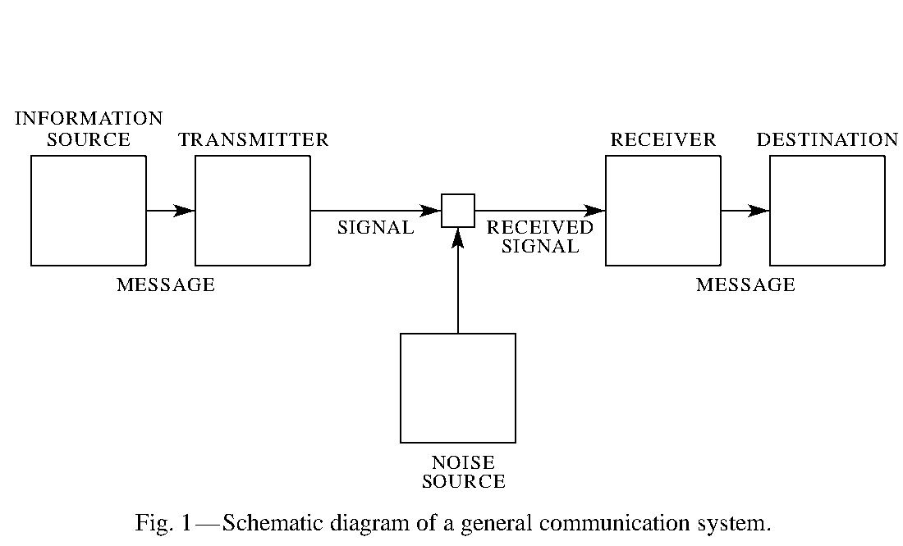

1. **信源**：产生一条消息或待传送到接收端的消息序列。消息可以有多种类型：(a) 电报或电传系统中的字母序列；(b) 无线电或电话中的单一时间函数 $f(t)$；(c) 黑白电视中的时间与其它变量的函数，例如 $f(x,y,t)$，表示摄像管板上点 $(x,y)$ 在时刻 $t$ 的光强；(d) 两个或多个时间函数 $f(t),g(t),h(t)$，例如“三维”声音传输，或系统为多个独立信道复用服务；(e) 多个变量的多个函数，例如彩色电视中的消息由定义在三维连续域上的三个函数 $f(x,y,t),g(x,y,t),h(x,y,t)$ 构成，也可视为该区域中向量场的三个分量；若干黑白电视源也会产生由多个三变量函数组成的消息；(f) 还会出现各种组合，例如带伴音的电视。
2. **发送器**：以某种方式处理消息，生成适合在信道上传输的信号。电话中，这一步只是把声压变成成比例的电流；电报中，是把消息编码为点、划和间隔的序列；在多路 PCM 系统中，不同语音函数必须采样、压缩、量化、编码，最后适当交织以构造信号。声码器系统、电视和调频也是对消息施加复杂操作以得到信号的例子。
3. **信道**：把信号从发送器传输到接收器的介质。它可以是双绞线、同轴电缆、一段无线电频段、一束光等。
4. **接收器**：通常执行发送器的逆操作，从信号中重构消息。
5. **信宿**：消息所面向的人或物。

我们希望考虑涉及通信系统的若干一般问题。为此，首先必须把各要素表示为数学实体，并从其物理对应物中适当理想化。通信系统大致可分为三类：离散、连续和混合。离散系统指消息和信号都是离散符号序列，例如电报，其中消息是字母序列，信号是点、划和间隔序列。连续系统指消息和信号都视为连续函数，例如无线电或电视。混合系统指同时出现离散和连续变量，例如语音的 PCM 传输。

我们先考虑离散情形。这种情形不仅适用于通信理论，也适用于计算机器理论、电话交换机设计等领域。此外，离散情形构成论文后半部分将讨论的连续和混合情形的基础。

# 第一部分：离散无噪声系统

## 1. 离散无噪声信道

电传和电报是离散信道传输信息的两个简单例子。一般地，离散信道指这样一种系统：从有限个基本符号 $S_1,S_2,\ldots,S_n$ 中作出的一系列选择可以从一点传送到另一点。每个符号 $S_i$ 假定具有确定持续时间 $t_i$ 秒（不同符号不一定相同，例如电报中的点和划）。并不要求所有可能的 $S_i$ 序列都能在该系统上传输；只允许某些序列，它们是该信道的可能信号。例如在电报中假设符号为：(1) 点，由线路闭合一个时间单位再断开一个时间单位构成；(2) 划，由闭合三个时间单位再断开一个时间单位构成；(3) 字母间隔，例如断开三个时间单位；(4) 单词间隔，断开六个时间单位。我们可以对联序列施加限制：不允许两个间隔相连（因为两个字母间隔与一个单词间隔相同）。现在要问的是，如何度量这种信道传输信息的能力。

在电传情形中，所有符号持续时间相同，并且允许 32 个符号的任意序列，答案很简单：每个符号表示 5 比特信息。如果系统每秒传输 $n$ 个符号，自然可说信道容量为每秒 $5n$ 比特。这并不意味着电传信道总以该速率传输信息——这是最大可能速率；实际速率是否达到最大，取决于馈入信道的信息源，见后文。

在符号长度不同、允许序列有约束的更一般情形中，作如下定义：

**定义**：离散信道的容量 $C$ 为

$$C=\lim_{T\to\infty}\frac{\log N(T)}{T},$$

其中 $N(T)$ 是持续时间为 $T$ 的允许信号数。

容易看出，在电传情形中这退化为前述结果。可以证明，在多数有意义的情形中，该极限作为有限数存在。假设允许符号 $S_1,\ldots,S_n$ 的所有序列，这些符号持续时间为 $t_1,\ldots,t_n$。若 $N(t)$ 表示持续时间为 $t$ 的序列数，则

$$N(t)=N(t-t_1)+N(t-t_2)+\cdots+N(t-t_n).$$

总数等于以 $S_1,S_2,\ldots,S_n$ 结尾的序列数之和，分别为 $N(t-t_1),N(t-t_2),\ldots,N(t-t_n)$。根据有限差分中的一个著名结果，对于大的 $t$，$N(t)$ 渐近于 $X_0^t$，其中 $X_0$ 是特征方程

$$X^{-t_1}+X^{-t_2}+\cdots+X^{-t_n}=1$$

的最大实根。因此

$$C=\log X_0.$$

即使允许序列存在限制，我们仍常能得到这种差分方程，并由特征方程求出 $C$。在上述电报情形中

$$N(t)=N(t-2)+N(t-4)+N(t-5)+N(t-7)+N(t-8)+N(t-10),$$

这是通过按最后一个或倒数第二个符号计数得到的。因此 $C=-\log X_0$，其中 $X_0$ 是方程 $1=X^{-2}+X^{-4}+X^{-5}+X^{-7}+X^{-8}+X^{-10}$ 的正根。求解得 $C=0.539$。

一种非常一般的序列限制可描述如下。设想有若干可能状态 $a_1,a_2,\ldots,a_m$。对每个状态，只允许从符号集 $S_1,\ldots,S_n$ 中发送某些符号（不同状态对应不同子集）。当其中一个符号被发送后，状态根据旧状态和所发送的具体符号变为新状态。电报情形就是简单例子：有两个状态，取决于最后发送的是否为间隔。若是，则下一步只能发送点或划，且状态总是改变；若不是，则可发送任意符号，发送间隔时状态改变，否则保持不变。这些条件可用图 2 所示的线性图表示。节点对应状态，连线表示某状态下可能的符号及结果状态。附录 1 表明，若允许序列的条件可用这种形式描述，则 $C$ 存在，并可按以下结果计算。

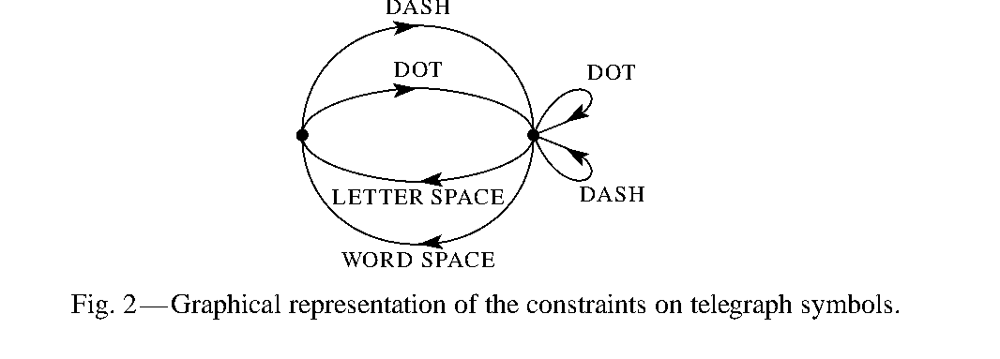

**定理 1**：设 $b_{ij}^{(s)}$ 是在状态 $i$ 中允许并导向状态 $j$ 的第 $s$ 个符号的持续时间。则信道容量 $C=\log W$，其中 $W$ 是行列式方程

$$\left|\sum_s W^{-b_{ij}^{(s)}}-\delta_{ij}\right|=0$$

的最大实根，且当 $i=j$ 时 $\delta_{ij}=1$，否则为 0。

例如在电报情形（图 2）中，行列式为

$$\begin{vmatrix}
W^{-3}+W^{-6}-1 & W^{-2}+W^{-4}\\
W^{-2}+W^{-4} & W^{-2}+W^{-4}-1
\end{vmatrix}=0.$$

展开即得上面给出的方程。

## 2. 离散信息源

我们已经看到，在非常一般的条件下，离散信道中可能信号数的对数随时间线性增长。传输信息的能力可通过这个增长率来规定，即指定所用特定信号所需的每秒比特数。

现在考虑信源。如何用数学描述信源，以及给定信源每秒产生多少比特信息？核心问题是：通过适当编码，关于信源的统计知识能减少所需信道容量多少。例如在电报中，待传输消息由字母序列组成，但这些序列并非完全随机；一般它们形成句子，具有英语的统计结构。字母 E 比 Q 更常见，序列 TH 比 XP 更常见，等等。这种结构的存在，使得通过将消息序列适当编码为信号序列，可以节省时间或信道容量。电报中已经有限度地利用了这一点：最短的信道符号“点”用于最常见的英文字母 E，而少见字母 Q、X、Z 用较长的点划序列表示。某些商业代码更进一步，把常用词和短语表示为四字母或五字母码组，从而显著节省平均时间。现在使用的标准问候电报和纪念日电报，把这种做法推向极端：把一两句话编码成相对较短的数字序列。

可以把离散信源看作逐符号生成消息。它根据某些概率选择相继符号，这些概率一般既取决于当前符号，也取决于先前选择。一个产生这种由一组概率支配的符号序列的物理系统，或这种系统的数学模型，称为**随机过程**。因此，离散信源可表示为随机过程。反之，任何产生从有限集合中选出的离散符号序列的随机过程，都可视为离散信源。这包括：

1. 自然语言，如英语、德语、汉语；
2. 经某种量化过程变成离散的连续信源，例如 PCM 发送器的量化语音或量化电视信号；
3. 数学情形，即抽象定义一个产生符号序列的随机过程。

例子如下。

(A) 五个字母 A、B、C、D、E 各以概率 $0.2$ 被选择，相继选择独立。典型序列为：

```text
BDCBCECCCADCBDDAAECEEA
ABBDAEECACE EBAEECBC EAD
```

（原文序列按换行排印。）这是用随机数表构造的。

(B) 同样五个字母，概率分别为 $0.4,0.1,0.2,0.2,0.1$，相继选择独立。典型消息为：

```text
AAACDCBDCEAADADACEDA
EAD CABEDADDC ECAAAAAD
```

(C) 若相继符号不独立，其概率依赖前面的字母，就会得到更复杂结构。最简单情形是选择只依赖前一个字母，而不依赖更早字母。统计结构可用一组转移概率 $p_i(j)$ 描述，即在字母 $i$ 后出现字母 $j$ 的概率。另一种等价描述是给出“二元组”概率 $p(i,j)$，即二元组 $ij$ 的相对频率。字母频率 $p(i)$、转移概率 $p_i(j)$ 与二元组概率 $p(i,j)$ 的关系为：

$$p(i)=\sum_j p(i,j)=\sum_j p(j,i)=\sum_j p(j)p_j(i),$$

$$p(i,j)=p(i)p_i(j),$$

$$\sum_j p_i(j)=\sum_i p(i)=\sum_{i,j}p(i;j)=1.$$

具体例子：三个字母 A、B、C 的概率表为

$$
p_i(j)=
\begin{array}{c|ccc}
i\backslash j & A & B & C\\
\hline
A & 0 & 0.45 & 0.55\\
B & 0.12 & 0.21 & 0.67\\
C & 0.12 & 0.52 & 0.36
\end{array}
$$

并有相应字母频率和二元组频率表。典型消息为：

```text
ABBABABABABABABBBABBBBBABABABABABBBACACAB
BABBBBABBA BACBBBABACBBACABBBABBBBBAC
```

复杂度再增加一步就是三元组频率，但仅此而已：一个字母的选择依赖前两个字母，但不依赖更早消息。需要三元组频率 $p(i,j,k)$，或等价地转移概率 $p_{ij}(k)$。继续下去，在一般 $n$ 元语法情形中，需要一组 $n$ 元语法概率 $p(i_1,\ldots,i_n)$，或等价的转移概率 $p_{i_1,\ldots,i_{n-1}}(i_n)$，来规定统计结构。

(D) 也可定义产生由“词”序列组成文本的随机过程。假设五个字母 A、B、C、D、E 和 16 个“词”及其概率为：

```text
.10 A      .04 ADEB    .05 ADEE    .01 BADD
.16 BEBE   .04 BED     .02 BEED    .05 CA
.11 CABED  .05 CEED    .08 DAB     .04 DAD
.04 DEB    .15 DEED    .01 EAB     .05 EE
```

相继“词”独立选择，并由空格分隔。典型消息为：

```text
DAB EE A BEBE DEED DEB ADEE ADEE EE DEB BEBE BEBE BEBE ADEE BED DEED
DEED CEED ADEE A DEED DEED BEBE CABED BEBE BED DAB DEED ADEB.
```

若所有词长度有限，这个过程等价于前面某种类型，但用词义结构和概率描述可能更简单。这里也可推广，引入词间转移概率等。

这些人工语言有助于构造简单问题和例子，说明各种可能性。也可用一系列简单人工语言近似自然语言。零阶近似：所有字母等概率且独立选择。一阶近似：相继字母独立，但每个字母按其在自然语言中的概率选择。例如在英语一阶近似中，E 以概率 $0.12$ 选择，W 以概率 $0.02$ 选择，但相邻字母之间没有影响，也没有形成 TH、ED 等优选二元组的倾向。

## 3. 英语的各级近似序列

为了直观展示这一系列过程如何逼近语言，下面给出英语近似的典型序列。所有情形都采用 27 个符号的“字母表”，即 26 个字母加一个空格。

1. 零阶近似（符号独立且等概率）：

```text
XFOML RXKHRJFFJUJ ZLPWCFWKCYJ FFJEYVKCQSGHYD QPAAMKBZAACIBZLHJQD.
```

2. 一阶近似（符号独立，但具有英文文本的字母频率）：

```text
OCRO HLI RGWR NMIELWIS EU LL NBNESEBYA TH EEI ALHENHTTPA OOBTTVA
NAH BRL.
```

3. 二阶近似（具有英语中的二元组结构）：

```text
ON IE ANTSOUTINYS ARE T INCTORE ST BE S DEAMY ACHIN D ILONASIVE TUCOOWE AT TEASONARE FUSO TIZIN ANDY TOBE SEACE CTISBE.
```

4. 三阶近似（具有英语中的三元组结构）：

```text
IN NO IST LAT WHEY CRATICT FROURE BIRS GROCID PONDENOME OF DEMONSTURES OF THE REPTAGIN IS REGOACTIONA OF CRE.
```

5. 一阶词近似。与其继续四元组、$\ldots$、$n$ 元组结构，不如跳到词单位。这里独立选择词，但按其适当频率：

```text
REPRESENTING AND SPEEDILY IS AN GOOD APT OR COME CAN DIFFERENT NATURAL HERE HE THE A IN CAME THE TO OF TO EXPERT GRAY COME TO FURNISHES THE LINE MESSAGE HAD BE THESE.
```

6. 二阶词近似。词的转移概率正确，但不包括更进一步结构：

```text
THE HEAD AND IN FRONTAL ATTACK ON AN ENGLISH WRITER THAT THE CHARACTER OF THIS POINT IS THEREFORE ANOTHER METHOD FOR THE LETTERS THAT THE TIME OF WHO EVER TOLD THE PROBLEM FOR AN UNEXPECTED.
```

在以上每一步中，与普通英语文本的相似性都明显增加。注意这些样本在其构造所考虑范围之外约两倍长度内，仍具有相当合理结构。例如在 (3) 中，统计过程保证两个字母序列合理，但样本中的四字母序列通常也能嵌入好句子。在 (6) 中，四个或更多词的序列也容易放入句子而显得不别扭。十个词的序列 “attack on an English writer that the character of this” 完全不荒唐。看来，足够复杂的随机过程能给出离散信源的满意表示。

前两个样本使用随机数表并结合字母频率表构造。类似方法本可用于 (3)、(4)、(5)，因为二元组、三元组和词频表都可获得，但使用了更简单且等价的方法。以构造 (3) 为例：随机翻开一本书，在页面上随机选一个字母并记录；再翻到另一页，读直到遇到这个字母，记录其后的字母；再翻到另一页搜索第二个字母并记录后继，如此继续。(4)、(5)、(6) 用类似过程。若能构造更高阶近似会很有趣，但下一步工作量变得巨大。

## 4. 马尔可夫过程的图示表示

上述随机过程在数学上称为离散马尔可夫过程，文献中已广泛研究。一般情形可描述如下：系统存在有限个可能“状态” $S_1,S_2,\ldots,S_n$；另有一组转移概率 $p_i(j)$，即系统处于状态 $S_i$ 时下一步进入状态 $S_j$ 的概率。要使这个马尔可夫过程成为信源，只需假定每次从一个状态转移到另一个状态时产生一个字母。状态对应于先前字母留下的“影响残余”。这种情形可用图 3、4、5 表示。“状态”是图中的节点，转移产生的概率和字母标在相应连线旁。图 3 对应第 2 节例 B，图 4 对应例 C。图 3 只有一个状态，因为相继字母独立；图 4 的状态数与字母数相同。若构造三元组例子，最多有 $n^2$ 个状态，对应选择当前字母前可能出现的字母对。图 5 是例 D 中词结构的图，其中 S 表示“空格”符号。

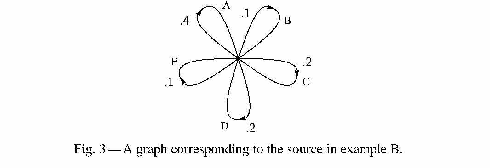

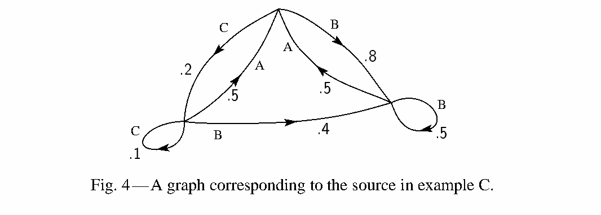

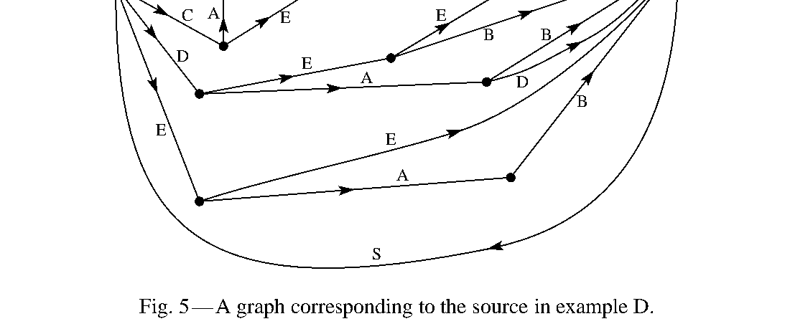

## 5. 遍历信源与混合信源

如上所述，离散信源可视为马尔可夫过程。在所有离散马尔可夫过程中，有一类具有通信理论中重要的特殊性质，称为**遍历过程**，相应信源称为遍历信源。遍历过程的严格定义稍复杂，但基本思想简单：在遍历过程中，过程产生的每个序列在统计性质上相同。也就是说，从特定序列得到的字母频率、二元组频率等，随序列长度增加会趋近于与特定序列无关的确定极限。事实上并非每个序列都如此，但使其不成立的序列集合概率为零。粗略说，遍历性意味着统计齐性。

上面给出的所有人工语言例子都是遍历的。这个性质与图的两个条件有关：

1. 图不能由两个孤立部分 A 和 B 构成，使得不可能沿箭头方向从 A 的节点走到 B 的节点，也不可能从 B 的节点走到 A 的节点。
2. 图中所有箭头方向一致的闭合线路称为“回路”，回路“长度”是其中连线数。要求图中所有回路长度的最大公约数为 1。

若第一个条件满足但第二个条件不满足，最大公约数为 $d>1$，序列具有某种周期结构。各种序列分为 $d$ 类，各类除原点移位外统计相同。简单例子：三个字母 $a,b,c$，$a$ 后接 $b$ 或 $c$ 的概率分别为 $1/3$、$2/3$，$b$ 或 $c$ 后总接 $a$。典型序列为：

```text
abacacacabacababacac
```

这种情形对我们的工作不太重要。

若第一个条件不满足，图可分为若干子图，每个满足第一个条件；再假设每个子图满足第二个条件。此时得到由若干纯分量组成的**混合信源**，各分量对应各子图。若分量为 $L_1,L_2,L_3,\ldots$，可写为

$$L=p_1L_1+p_2L_2+p_3L_3+\cdots,$$

其中 $p_i$ 是分量信源 $L_i$ 的概率。

物理上，这表示有几个不同信源 $L_1,L_2,L_3,\ldots$，每个具有齐性统计结构即遍历性。我们事先不知道使用哪一个，但一旦序列从某个纯分量 $L_i$ 开始，它就永远按该分量的统计结构继续。例如取上述两个过程，令 $p_1=0.2$、$p_2=0.8$，混合信源

$$L=0.2L_1+0.8L_2$$

的序列通过先以概率 $0.2$、$0.8$ 选择 $L_1$ 或 $L_2$，再生成相应序列得到。

除非特别声明，我们假定信源是遍历的。该假设使我们能把沿一个序列的平均值与在所有可能序列集合上的平均值等同起来（差异概率为零）。例如，特定无限序列中字母 A 的相对频率，概率为 1 地等于序列集合中 A 的相对频率。

若 $P_i$ 是状态 $i$ 的概率，$p_i(j)$ 是到状态 $j$ 的转移概率，则过程平稳时 $P_i$ 必须满足平衡条件

$$P_j=\sum_i P_i p_i(j).$$

在遍历情形中可证明，无论初始条件如何，经过 $N$ 个符号后处于状态 $j$ 的概率 $P_j(N)$ 随 $N\to\infty$ 趋近于平衡值。

## 6. 选择、不确定性与熵

我们已把离散信源表示为马尔可夫过程。能否定义一个量，以某种方式度量这个过程“产生”多少信息，或更好，信息产生的速率？

设有一组可能事件，其发生概率为 $p_1,p_2,\ldots,p_n$。这些概率已知，除此之外对哪个事件会发生一无所知。能否找到一个度量，表示选择中涉及多少“选择”，或我们对结果的不确定程度？若存在这样的度量 $H(p_1,\ldots,p_n)$，合理要求是：

1. $H$ 对 $p_i$ 连续；
2. 若所有 $p_i$ 相等，$p_i=1/n$，则 $H$ 应是 $n$ 的单调增函数。等概率事件越多，选择或不确定性越大；
3. 若一个选择可分解为两个相继选择，则原 $H$ 应等于各 $H$ 值的加权和。图 6 说明了这一点：左边有三个可能，概率为 $p_1=1/2,p_2=1/3,p_3=1/6$；右边先在两个各 $1/2$ 的可能中选择，若第二个发生，再以 $1/3,2/3$ 作第二次选择。最终结果概率与之前相同。我们要求在此特例中

$$H\left(\frac12,\frac13,\frac16\right)
=H\left(\frac12,\frac12\right)+\frac12H\left(\frac23,\frac13\right).$$

系数 $1/2$ 是因为第二次选择只发生一半时间。

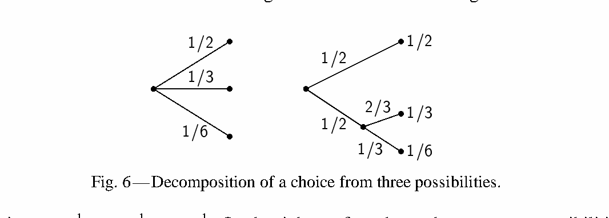

附录 2 证明：

**定理 2**：满足上述三个假设的唯一 $H$ 形式为

$$H=-K\sum_{i=1}^n p_i\log p_i,$$

其中 $K$ 是正常数。

该定理及其证明所需假设，对本理论并非必要。给出它主要是为了使我们后面的定义显得合理；这些定义的真正理由在于其蕴含的结果。

形如 $H=-\sum p_i\log p_i$ 的量（常数 $K$ 只相当于单位选择）在信息论中作为信息、选择和不确定性的度量起核心作用。这个形式可识别为统计力学某些表述中的熵定义，其中 $p_i$ 是系统处于相空间第 $i$ 个单元格的概率；此时 $H$ 就是玻尔兹曼著名 H 定理中的 H。我们称 $H=-\sum p_i\log p_i$ 为概率集合 $p_1,\ldots,p_n$ 的**熵**。若 $x$ 是随机变量，写其熵为 $H(x)$；这里 $x$ 不是函数自变量，而是一个标号，用来区别于随机变量 $y$ 的熵 $H(y)$。

两可能情形，概率为 $p$ 和 $q=1-p$，其熵

$$H=-(p\log p+q\log q)$$

随 $p$ 的变化画在图 7 中。

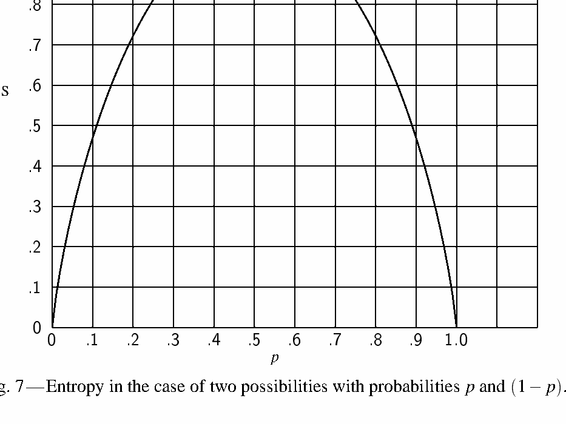

量 $H$ 有若干有趣性质，进一步证实它是选择或信息的合理度量。

1. 当且仅当除一个 $p_i$ 为 1 外其余全为 0 时，$H=0$。因此只有结果确定时 $H$ 才为 0，否则为正。
2. 给定 $n$，当所有 $p_i$ 相等即 $1/n$ 时，$H$ 最大且等于 $\log n$。这直观上也是最不确定的情形。
3. 设两个事件 $x,y$，第一个有 $m$ 种可能，第二个有 $n$ 种可能。令 $p(i,j)$ 为第一个取 $i$、第二个取 $j$ 的联合概率。联合事件熵为

$$H(x,y)=-\sum_{i,j}p(i,j)\log p(i,j),$$

而

$$H(x)=-\sum_{i,j}p(i,j)\log\sum_j p(i,j),$$

$$H(y)=-\sum_{i,j}p(i,j)\log\sum_i p(i,j).$$

容易证明

$$H(x,y)\le H(x)+H(y),$$

等号仅当事件独立即 $p(i,j)=p(i)p(j)$ 时成立。联合事件的不确定性小于或等于各不确定性之和。

4. 任何使概率 $p_1,\ldots,p_n$ 趋于均等的变化都会增加 $H$。例如若 $p_1<p_2$，把 $p_1$ 增加、$p_2$ 等量减少使二者更接近，则 $H$ 增加。更一般地，若对 $p_i$ 施加形式

$$p_i'=\sum_j a_{ij}p_j$$

的“平均”操作，其中 $\sum_i a_{ij}=\sum_j a_{ij}=1$ 且所有 $a_{ij}\ge0$，则 $H$ 增加（除该变换只是 $p_j$ 的置换、$H$ 当然不变的特殊情形）。

5. 设两个随机事件 $x,y$ 如上，不一定独立。对 $x$ 的任一特定值 $i$，$y$ 取值 $j$ 的条件概率为

$$p_i(j)=\frac{p(i,j)}{\sum_j p(i,j)}.$$

我们定义 $y$ 在已知 $x$ 下的条件熵 $H_x(y)$ 为，对每个 $x$ 值下 $y$ 的熵按该 $x$ 出现概率加权的平均：

$$H_x(y)=-\sum_{i,j}p(i,j)\log p_i(j).$$

它度量已知 $x$ 后平均而言对 $y$ 还有多不确定。代入 $p_i(j)$ 得

$$H_x(y)=-\sum_{i,j}p(i,j)\log p(i,j)+\sum_{i,j}p(i,j)\log\sum_j p(i,j),$$

即

$$H_x(y)=H(x,y)-H(x),$$

或

$$H(x,y)=H(x)+H_x(y).$$

联合事件 $x,y$ 的不确定性（熵）等于 $x$ 的不确定性加上已知 $x$ 时 $y$ 的不确定性。

6. 由 3 和 5 得

$$H(x)+H(y)\ge H(x,y)=H(x)+H_x(y),$$

因而

$$H(y)\ge H_x(y).$$

已知 $x$ 绝不会增加 $y$ 的不确定性；除非 $x,y$ 独立，否则会减少。

## 7. 信源的熵

考虑上述有限状态型离散信源。对每个可能状态 $i$，产生各种可能符号 $j$ 的概率为 $p_i(j)$，因此每个状态有熵 $H_i$。信源的熵定义为这些 $H_i$ 按状态出现概率加权的平均：

$$H=\sum_i P_i H_i=-\sum_{i,j}P_i p_i(j)\log p_i(j).$$

这是每单位文本符号的信源熵。若马尔可夫过程以确定时间速率进行，还有每秒熵

$$H'=\sum_i f_i H_i,$$

其中 $f_i$ 是状态 $i$ 的平均频率（每秒出现次数）。显然

$$H'=mH,$$

其中 $m$ 是每秒产生的平均符号数。$H$ 或 $H'$ 度量信源每符号或每秒产生的信息量；若对数以 2 为底，它们分别表示每符号或每秒比特数。

若相继符号独立，则 $H=-\sum_i p_i\log p_i$。此时考虑长度为 $N$ 的长消息，它高概率包含约 $p_1N$ 个第一符号、$p_2N$ 个第二符号等。因此该特定消息的概率约为

$$p=p_1^{p_1N}p_2^{p_2N}\cdots p_n^{p_nN},$$

或

$$\log p^{-1}=N\sum_i p_i\log\frac1{p_i},$$

$$H=\frac{\log p^{-1}}{N}.$$

因此，对于典型长序列，$H$ 近似等于其概率倒数的对数除以序列中符号数。该结果对任意信源也成立。更精确地说（见附录 3）：

**定理 3**：给定任意 $\epsilon>0$ 和 $\delta>0$，可找到 $N_0$，使得任意长度 $N\ge N_0$ 的序列可分为两类：

1. 总概率小于 $\epsilon$ 的集合；
2. 其余序列，其概率满足

$$\left|\frac{\log p^{-1}}{N}-H\right|<\delta.$$

换言之，当 $N$ 大时，我们几乎必然有 $\log p^{-1}/N$ 非常接近 $H$。

一个密切相关结果涉及不同概率序列的数目。考虑长度 $N$ 的序列，按概率递减排列。定义 $n(q)$ 为从最可能序列开始，为累积总概率 $q$ 所需取出的序列数。

**定理 4**：

$$\lim_{N\to\infty}\frac{\log n(q)}{N}=H$$

当 $q\ne0,1$ 时成立。

若只考虑总概率为 $q$ 的最可能序列，可把 $\log n(q)$ 解释为指定该序列所需比特数，则 $\log n(q)/N$ 是每符号指定所需比特数。定理说明，当 $N$ 大时，这与 $q$ 无关并等于 $H$。合理可能序列数的对数增长率由 $H$ 给出，无论我们怎样解释“合理可能”。由于这些结果（在附录 3 证明），大多数用途中可把长序列看作恰有 $2^{HN}$ 个，每个概率为 $2^{-HN}$。

下面两个定理表明，$H$ 和 $H'$ 可通过只对消息序列统计作极限操作直接确定，而无需参考状态和状态间转移概率。

**定理 5**：令 $p(B_i)$ 为来自信源的符号序列 $B_i$ 的概率。令

$$G_N=-\frac1N\sum_i p(B_i)\log p(B_i),$$

其中对所有含 $N$ 个符号的序列 $B_i$ 求和。则 $G_N$ 是 $N$ 的单调递减函数，且

$$\lim_{N\to\infty}G_N=H.$$

**定理 6**：令 $p(B_iS_j)$ 为序列 $B_i$ 后接符号 $S_j$ 的概率，$p_{B_i}(S_j)=p(B_iS_j)/p(B_i)$ 为 $B_i$ 后 $S_j$ 的条件概率。令

$$F_N=-\sum_{i,j}p(B_iS_j)\log p_{B_i}(S_j),$$

其中对所有长度 $N-1$ 的块 $B_i$ 和所有符号 $S_j$ 求和。则 $F_N$ 是 $N$ 的单调递减函数，

$$F_N=NG_N-(N-1)G_{N-1},$$

$$G_N=\frac1N\sum_{n=1}^N F_n,$$

$$F_N\le G_N,$$

且 $\lim_{N\to\infty}F_N=H$。

这些结果在附录 3 中推导。它们表明，通过只考虑延伸 $1,2,\ldots,N$ 个符号的统计结构，可得到 $H$ 的一系列近似。$F_N$ 是更好的近似；事实上，$F_N$ 是上述类型第 $N$ 阶信源近似的熵。若没有超过 $N$ 个符号的统计影响，即在已知前 $N-1$ 个后，再知道更早符号不改变下一符号条件概率，则 $F_N=H$。$F_N$ 当然是已知前 $N-1$ 个符号时下一符号的条件熵，而 $G_N$ 是长度 $N$ 符号块的每符号熵。

信源熵与仍限于同一符号时它可能具有的最大值之比，称为**相对熵**。这是编码到同一字母表时可能的最大压缩率。1 减相对熵是**冗余度**。普通英语的冗余度，在只考虑约 8 个字母以内统计结构时，约为 50%。这意味着我们写英语时，一半由语言结构决定，一半自由选择。50% 这个数字由几种独立方法得到，结果都在附近。一种方法是计算英语各级近似的熵；第二种方法是从英文文本样本中删去一定比例字母，让人尝试恢复；若能恢复删去的 50%，冗余度必大于 50%；第三种方法依赖密码学中某些已知结果。

英语散文中冗余度的两个极端是基础英语和 James Joyce 的《芬尼根的守灵夜》。基础英语词汇限于 850 词，冗余度很高，这反映在把段落译成基础英语时的膨胀。另一方面，Joyce 扩大词汇量，据称实现语义内容压缩。语言的冗余度与填字游戏的存在有关。若冗余为 0，任意字母序列都是该语言的合理文本，任意二维字母阵列都构成填字游戏；若冗余太高，语言施加的约束太多，大型填字游戏不可能。更细分析表明，若假设语言约束具有相当混乱随机性质，当冗余为 50% 时大型填字游戏恰好可能；若冗余为 33%，三维填字游戏应当可能，等等。

## 8. 编码与解码操作的表示

还需数学表示发送器和接收器在编码、解码信息时执行的操作。任一此类操作都称为**离散变换器**。变换器输入是输入符号序列，输出是输出符号序列。变换器可有内部记忆，使其输出不仅依赖当前输入符号，还依赖过去历史。我们假定内部记忆有限，即存在有限个 $m$ 个可能状态，输出是当前状态和当前输入符号的函数；下一状态是这两个量的另一个函数。因此变换器可由两个函数描述：

$$y_n=f(x_n,\sigma_n),\qquad \sigma_{n+1}=g(x_n,\sigma_n),$$

其中 $x_n$ 是第 $n$ 个输入符号，$\sigma_n$ 是引入第 $n$ 个输入符号时变换器状态，$y_n$ 是在状态 $\sigma_n$ 下引入 $x_n$ 时产生的输出符号（或输出符号块）。

若一个变换器的输出符号可与另一个变换器的输入符号认同，它们可串联，结果仍是变换器。若存在第二个变换器作用于第一个的输出并恢复原输入，则第一个称为**非奇异的**，第二个称为其逆。

**定理 7**：由有限状态统计源驱动的有限状态变换器，其输出是有限状态统计源，且每单位时间熵小于或等于输入熵。若变换器非奇异，则二者相等。

证明思路：令 $\sigma$ 表示产生符号序列 $x_i$ 的源状态，$\tau$ 表示在其输出中产生符号块 $y_j$ 的变换器状态。组合系统可由状态对 $(\sigma,\tau)$ 的“积空间”表示。若 $\sigma_1$ 能产生一个把 $\tau_1$ 变为 $\tau_2$ 的 $x$，则空间中两点 $(\sigma_1,\tau_1)$ 与 $(\sigma_2,\tau_2)$ 由一条线连接，并赋予该 $x$ 的概率。该线标注变换器产生的 $y_j$ 符号块。输出熵可按状态加权求和计算。先对 $\tau$ 求和时，每项小于或等于对应 $\sigma$ 项，故熵不增加。若变换器非奇异，把其输出接到逆变换器，令 $H_1',H_2',H_3'$ 分别为源、第一变换器、第二变换器的输出熵，则 $H_1'\ge H_2'\ge H_3'=H_1'$，因此 $H_1'=H_2'$。

假设有一类如图 2 所示的线性图表示的序列约束系统。若给连接状态 $i$ 到状态 $j$ 的各条线赋予概率 $p_{ij}^{(s)}$，它就成为信源。有一种特殊概率分配使所得熵最大（见附录 4）。

**定理 8**：设所考虑约束系统作为信道的容量为 $C=\log W$。若分配

$$p_{ij}^{(s)}=W^{-\ell_{ij}^{(s)}}\frac{B_j}{B_i},$$

其中 $\ell_{ij}^{(s)}$ 是从状态 $i$ 到状态 $j$ 的第 $s$ 个符号持续时间，且 $B_i$ 满足

$$B_i=\sum_{s,j}B_jW^{-\ell_{ij}^{(s)}},$$

则 $H$ 最大且等于 $C$。

即通过适当分配转移概率，可使信道上符号熵达到信道容量。

## 9. 无噪声信道的基本定理

现在证明把 $H$ 解释为最有效编码所需信道容量的合理性。

**定理 9**：设信源熵为 $H$（每符号比特），信道容量为 $C$（每秒比特）。则可对信源输出编码，使其在信道上以平均速率 $C/H-\epsilon$ 符号每秒传输，其中 $\epsilon$ 任意小；不可能以大于 $C/H$ 的平均速率传输。

定理的反向部分，即 $C/H$ 不可超过，可如下证明：信道输入每秒熵等于信源熵，因为发送器必须非奇异；该熵也不能超过信道容量。因此 $H'\le C$，每秒符号数 $\nu=H'/H\le C/H$。

定理第一部分可用两种方法证明。第一种考虑信源产生的长度 $N$ 序列全集。当 $N$ 大时，可将其分为两组：一组少于 $2^{(H+\eta)N}$ 个元素，另一组少于 $2^{RN}$ 个元素（$R$ 为不同符号数的对数），且总概率小于 $\epsilon$。随着 $N$ 增大，$\epsilon,\eta$ 可趋近 0。持续时间 $T$ 的信道信号数大于 $2^{(C-\theta)T}$，其中 $\theta$ 在 $T$ 大时很小。若选

$$T=\frac{NH}{C}+\delta N,$$

则当 $N,T$ 足够大时，信道符号序列数足以高概率组一一编码，并有额外序列。高概率组任意一一编码到该集合；其余序列用较长序列表示，以未用于高概率组的序列开始和结束，该特殊序列充当不同编码的起止信号。中间留出足够时间，为所有低概率消息提供足够不同序列。这需要

$$T_1=\frac{RN+\delta' N}{C},$$

其中 $\delta'$ 很小。平均传输速率大于

$$\frac{T}{(1-\epsilon)T_1+\epsilon N}
\approx \left(1-\epsilon-\frac{\delta C}{H}\right)\frac{C}{H}+\lambda+\epsilon\frac{CR}{H},$$

当 $N$ 增大时 $\epsilon,\eta$ 趋近 0，速率趋近 $C/H$。

第二种编码方法如下。把长度 $N$ 消息按概率递减排列，概率为 $p_1\ge p_2\ge\cdots\ge p_n$。令 $P_s=\sum_{i=1}^{s-1}p_i$，即到但不含 $p_s$ 的累积概率。先编码为二进制。消息 $s$ 的二进制码由 $P_s$ 的二进制展开得到，展开到 $m_s$ 位，其中 $m_s$ 是满足

$$\frac1{2^{m_s}}\le p_s<\frac1{2^{m_s-1}}$$

的整数。于是高概率消息码短，低概率消息码长。由这些不等式得

$$\frac1{2^{m_s}}\le p_s<\frac2{2^{m_s}}.$$

$P_s$ 的码与所有后续码在至少一位不同，因为其余 $P_i$ 至少大 $2^{-m_s}$，二进制展开的前 $m_s$ 位不同。因此所有码不同，可由码恢复消息。若信道序列尚非二进制数字序列，可任意赋予二进制数，再把二进制码转换为适合信道的信号。

原消息每符号使用的平均二进制位数为

$$H'=\frac1N\sum_s m_sp_s.$$

又

$$\log_2\frac1{p_s}\le m_s<\log_2\frac1{p_s}+1,$$

因此

$$G_N\le H'<G_N+\frac1N.$$

当 $N$ 增大时，$G_N$ 趋近信源熵 $H$，$H'$ 也趋近 $H$。

可见，当只使用有限延迟 $N$ 符号时，编码低效不大于 $1/N$ 加上真熵 $H$ 与长度 $N$ 序列熵 $G_N$ 之差。因此所需额外时间百分比小于

$$\frac{G_N}{H}-1+\frac1{HN}.$$

这种方法本质上与 R. M. Fano 独立发现的方法相同。他的方法是把长度 $N$ 消息按概率递减排列，分成概率尽量相等的两组；若消息在第一组，首位二进制数字为 0，否则为 1；再类似分组决定第二位，直到每组只含一条消息。除末位小差别外，这与上述算术过程相同。

## 10. 讨论与例子

为了从发电机向负载获得最大功率传输，通常需引入变压器，使从负载看发电机具有负载电阻。这里情形大致类似。执行编码的变换器应在统计意义上使信源与信道匹配。从信道经变换器看信源，应具有与最大化信道熵的信源相同的统计结构。定理 9 的内容是：虽然一般不可能精确匹配，但可任意接近。实际传输速率与容量 $C$ 之比称为编码系统效率，等于信道符号实际熵与最大可能熵之比。

一般地，理想或近理想编码要求发送器和接收器有长延迟。在无噪声情形中，延迟主要作用是使概率与相应序列长度较好匹配。好编码中，长消息概率倒数的对数应与相应信号持续时间成比例，即除少量长消息外，

$$\frac{\log p^{-1}}{T}-C$$

应很小。

若信源只能产生一个特定消息，其熵为 0，不需要信道。例如设定计算 $\pi$ 连续数字的计算机会产生确定序列，没有偶然元素，不需要把该序列“传输”到另一点；可在另一点构造第二台机器计算同一序列。但这可能不实际。此时可选择忽略关于信源的部分或全部统计知识。可把 $\pi$ 的数字视为随机序列，构造能发送任意数字序列的系统。类似地，可只使用部分英语统计知识构造编码，而不使用全部。此时考虑在希望保留的统计条件下具有最大熵的信源；该信源熵决定必要且充分的信道容量。例如只保留所有数字从集合 $0,1,\ldots,9$ 中选取这一事实；对英语可希望利用字母频率带来的统计节省，但不利用其它。最大熵信源即英语一阶近似，其熵决定所需容量。

一个简单例子：信源从 A、B、C、D 中独立选取字母，概率分别为 $1/2,1/4,1/8,1/8$。有

$$H=-\frac12\log\frac12-\frac14\log\frac14-2\cdot\frac18\log\frac18=\frac74\text{ 比特/符号}.$$

因此可构造编码，把该信源消息编码为二进制数字，平均每符号 $7/4$ 位。事实上可用以下码达到极限：

$$
\begin{array}{c|c}
A&0\\
B&10\\
C&110\\
D&111
\end{array}
$$

长度 $N$ 序列平均使用二进制位数为

$$N\left(\frac12\cdot1+\frac14\cdot2+\frac18\cdot3+\frac18\cdot3\right)=\frac74N.$$

容易看出二进制数字 0、1 的概率各为 $1/2$，编码序列熵为每符号 1 比特。由于平均每原字母 $7/4$ 个二进制符号，时间基熵相同。原集合最大可能熵为 $\log4=2$，当 A、B、C、D 等概率时达到，故相对熵为 $7/8$。可通过下表把二进制序列转回原符号集合，实现二对一转换：

$$
\begin{array}{c|c}
A0&00\\
B0&01\\
C0&10\\
D0&11
\end{array}
$$

这个双重过程把原消息编码为相同符号，但平均压缩比为 $7/8$。

第二个例子：信源产生 A、B 序列，A 概率 $p$，B 概率 $q=1-p$。若 $p\ll q$，则

$$H=-p\log p-(1-p)\log(1-p)\approx p\log\frac ep.$$

此时可在 0、1 信道上构造相当好的编码：对稀少符号 A 发送特殊序列如 0000，再发送一个表示其后 B 个数的序列。表示数时把含特殊序列的数删去；16 以下按通常二进制表示，16 用不含四个 0 的下一个二进制数即 $17=10001$，等等。可证明当 $p\to0$ 时，只要适当调整特殊序列长度，编码接近理想。

# 第二部分：有噪声的离散信道

## 11. 有噪声离散信道的表示

现在考虑信号在传输中或在终端之一受到噪声扰动的情况。这意味着接收信号不一定与发送器发出的信号相同。可区分两种情形。若某个特定发送信号总产生同一接收信号，即接收信号是发送信号的函数，则这种影响可称为失真。若该函数有逆，即无两个发送信号产生同一接收信号，则原则上可通过对接收信号执行逆运算校正失真。

我们关心的情形是：信号在传输中并不总经历同样变化。此时可假定接收信号 $E$ 是发送信号 $S$ 与第二变量噪声 $N$ 的函数：

$$E=f(S,N).$$

噪声与消息一样视为随机变量，一般可用适当随机过程表示。我们将考虑的最一般有噪声离散信道，是前述有限状态无噪声信道的推广。假定存在有限个状态和一组概率

$$p_{\beta\beta'}(i,j).$$

这是指信道处于状态 $\beta$、发送符号 $i$ 时，接收符号 $j$ 且信道离开时处于状态 $\beta'$ 的概率。$\beta,\beta'$ 取所有可能状态，$i$ 取可能发送信号，$j$ 取可能接收信号。若相继符号被噪声独立扰动，则只有一个状态，信道由转移概率 $p_i(j)$ 描述，即发送符号 $i$ 被接收为 $j$ 的概率。

若信源馈入有噪声信道，有两个统计过程起作用：信源和噪声。因此可计算多个熵。首先是信源或信道输入的熵 $H(x)$（若发送器非奇异，二者相等）。信道输出即接收信号的熵记为 $H(y)$。无噪声时 $H(y)=H(x)$。输入输出联合熵为 $H(x,y)$。最后还有两个条件熵 $H_x(y)$ 与 $H_y(x)$，分别表示已知输入时输出的熵和已知输出时输入的熵。这些量之间有关系

$$H(x,y)=H(x)+H_x(y)=H(y)+H_y(x).$$

所有这些熵都可按每秒或每符号度量。

## 12. 含糊度与信道容量

若信道有噪声，一般不可能通过对接收信号 $E$ 的任何操作确定性地重建原消息或发送信号。但存在对抗噪声最优的信息传输方式，这就是现在的问题。

假设有两个可能符号 0 和 1，以每秒 1000 符号的速率传输，概率 $p_0=p_1=1/2$。信源以每秒 1000 比特产生信息。传输中噪声引入错误，平均每 100 个有 1 个接收错误。信息传输速率是多少？当然少于 1000 比特每秒，但第一反应说 990 比特每秒并不合适，因为它没有考虑接收者不知道错误发生在哪里。极端情形：噪声大到接收符号与发送符号完全独立。无论发送什么，接收 1 的概率都是 $1/2$，0 也如此。于是约一半接收符号靠偶然正确；若给系统记 500 比特每秒，实际上根本没有信息传输，完全不用信道而在接收端抛硬币也能得到同样“好”的传输。

显然，对传输信息量的正确修正，是从信息量中减去接收信号中缺失的信息量，或等价地，已知接收信号后对实际发送内容的不确定性。根据前面把熵作为不确定性度量的讨论，用已知接收信号条件下消息的条件熵作为这种缺失信息的度量是合理的；后面将证明这是正确定义。按此思路，实际传输速率 $R$ 由产生速率即信源熵减去条件熵平均速率得到：

$$R=H(x)-H_y(x).$$

为方便起见，条件熵 $H_y(x)$ 称为**含糊度**（equivocation），它度量接收信号的平均模糊性。

上例中，若收到 0，则事后发送 0 的概率为 $0.99$，发送 1 的概率为 $0.01$；收到 1 时相反。因此

$$H_y(x)=-[0.99\log0.99+0.01\log0.01]=0.081\text{ 比特/符号},$$

即每秒 81 比特。可说系统以 $1000-81=919$ 比特每秒传输。极端情况下，收到 0 或 1 与发送无关，后验概率各 $1/2$，

$$H_y(x)=-\frac12\log\frac12-\frac12\log\frac12=1\text{ 比特/符号},$$

即每秒 1000 比特，传输速率为 0，理应如此。

下面定理给出含糊度的直接直观解释，并证明它是唯一合适度量。考虑一个通信系统及一个能同时看到发送内容和恢复内容（含噪声错误）的观察者。观察者记录恢复消息中错误，并通过“校正信道”把数据送到接收端，使接收器能校正错误，如图 8。

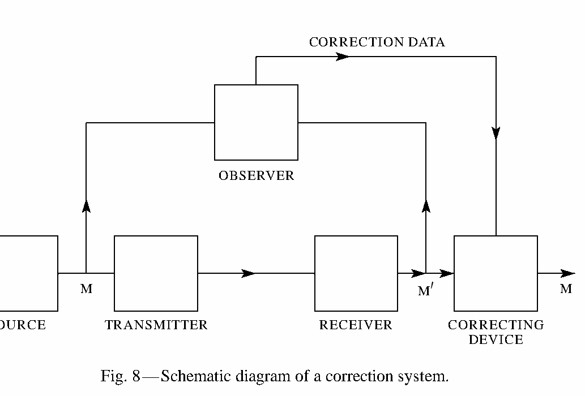

**定理 10**：若校正信道容量等于 $H_y(x)$，则可编码校正数据，通过该信道发送并校正除任意小比例外所有错误；若容量小于 $H_y(x)$，则不可能。

粗略说，$H_y(x)$ 是每秒必须在接收端提供的额外信息量，用于校正接收消息。证明第一部分：考虑接收消息 $M'$ 及对应原消息 $M$ 的长序列。对每个 $M'$，合理可能产生它的 $M$ 有 $\approx 2^{TH_y(x)}$ 个。因此每 $T$ 秒需为每个 $M'$ 发送 $TH_y(x)$ 个二进制位；在容量为 $H_y(x)$ 的信道上可做到错误频率任意小。第二部分可用不等式证明：对任意离散随机变量 $x,y,z$，

$$H_y(x,z)\ge H_y(x).$$

展开得

$$H_y(z)+H_{yz}(x)\ge H_y(x),$$

$$H_{yz}(x)\ge H_y(x)-H_y(z)\ge H_y(x)-H(z).$$

把 $x$ 视为信源输出，$y$ 视为接收信号，$z$ 视为校正信道发送信号，则右边是含糊度减去校正信道传输速率。若校正信道容量小于含糊度，右边大于 0，故 $H_{yz}(x)>0$；已知接收信号和校正信号后发送内容仍有不确定性，错误频率不可能任意小。

例子：二进制数字序列中错误随机发生，某位出错概率 $p$，正确概率 $q=1-p$。若知道错误位置，就能校正。因此校正信道只需发送位置信息，相当于从概率 $p$ 为 1（错误）、$q$ 为 0（正确）的信源传输，所需容量为

$$-[p\log p+q\log q],$$

正是原系统的含糊度。

传输速率 $R$ 还可写成两种形式：

$$R=H(x)-H_y(x)
=H(y)-H_x(y)
=H(x)+H(y)-H(x,y).$$

第一式是发送信息量减去对发送内容的不确定性；第二式是接收信息量减去其中由噪声造成的部分；第三式是两者之和减去联合熵，因此在某种意义上表示两者每秒共同的比特数。三种表达都有直观意义。

有噪声信道容量 $C$ 应是最大可能传输速率，即信源与信道正确匹配时的速率。因此定义

$$C=\max\big[H(x)-H_y(x)\big],$$

最大值对所有可能用作输入的信源取。无噪声时 $H_y(x)=0$，该定义等价于此前定义，因为信道最大熵即其容量。

## 13. 有噪声离散信道的基本定理

既然有噪声信道永远不能确定发送信息，为何还可定义确定容量 $C$？因为通过冗余发送可降低错误概率。例如多次重复消息，并对不同接收版本作统计研究，错误概率可很小。人们可能预期，为使错误概率趋近 0，编码冗余必须无限增加，传输速率趋近 0。这并不成立。若成立，就不存在明确定义的容量，只存在给定错误频率或给定含糊度下的容量，且错误要求越严容量越低。实际上上述 $C$ 有明确意义：通过适当编码，可以以速率 $C$ 发送信息，并使错误频率或含糊度任意小；任何大于 $C$ 的速率都不可能。若试图以 $C+R_1$ 发送，则含糊度至少等于 $R_1$。自然以这种方式索取代价：我们并未真正得到超过 $C$ 的正确信息。

图 9 说明了这种情形。横轴为进入信道的信息速率，纵轴为含糊度。阴影区域中粗线以上的点可达，以下不可达。线上点一般不可达，但通常有两个点可达。

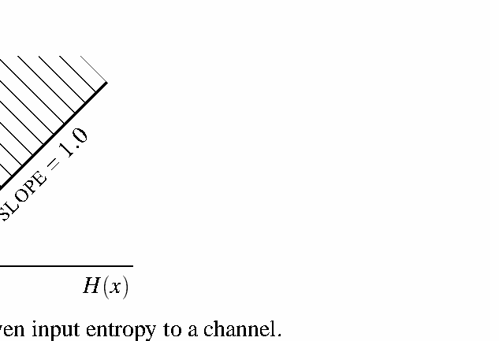

这些结果证明 $C$ 定义的合理性。

**定理 11**：设有噪声离散信道容量为 $C$，离散信源每秒熵为 $H$。若 $H\le C$，存在编码系统使信源输出通过该信道传输时错误频率或含糊度任意小。若 $H>C$，可编码信源使含糊度小于 $H-C+\epsilon$，其中 $\epsilon$ 任意小；不存在使含糊度小于 $H-C$ 的编码。

证明第一部分不是构造具体码，而是证明某类码中必存在这样的码。我们在这类码上平均错误频率，证明平均值可小于 $\epsilon$，从而其中至少一个码小于 $\epsilon$。

有噪声信道容量定义为

$$C=\max\big[H(x)-H_y(x)\big],$$

最大对所有可能输入信源取。令 $S_0$ 为达到容量 $C$ 的信源；若最大值未实际达到，取逼近最大速率的信源。以 $S_0$ 输入信道，考虑长时间 $T$ 的可能发送和接收序列：

1. 发送序列分两类：高概率组约 $2^{TH(x)}$ 个，其余总概率小；
2. 接收序列同理，高概率组约 $2^{TH(y)}$ 个；
3. 每个高概率输出可由约 $2^{TH_y(x)}$ 个输入产生；其它情形总概率小。

“小”和“约”所隐含的 $\epsilon,\delta$ 随 $T$ 增大及 $S_0$ 接近最大化信源而趋近 0。图 10 总结了这一情形：左侧输入序列为点，右侧输出序列为点，扇形交叉线表示典型输出的可能原因范围。

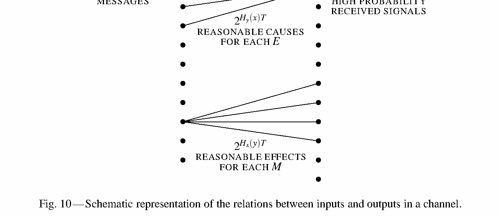

现在假设另一个信源以速率 $R<C$ 产生信息。在 $T$ 内它有 $2^{TR}$ 个高概率消息。希望把这些消息与信道输入的一个选择关联，使错误频率小。我们在所有可能方式中建立这种关联（但只使用由 $S_0$ 确定的高概率输入组），并对这一大类编码系统的错误频率取平均。这等价于随机关联持续 $T$ 的消息和信道输入。若观察到某个输出 $y_1$，其可能原因集合中有多于一条消息的概率是多少？有 $2^{TR}$ 条消息随机分布在 $2^{TH(x)}$ 个点上，某点成为一条消息的概率为 $2^{T(R-H(x))}$。扇形中除真实源消息外没有其它消息的概率为

$$P=\left[1-2^{T(R-H(x))}\right]^{2^{TH_y(x)}}.$$

由于 $R<H(x)-H_y(x)$，有 $R-H(x)=-H_y(x)-\eta$，其中 $\eta>0$。于是

$$P=\left[1-2^{-TH_y(x)-T\eta}\right]^{2^{TH_y(x)}}\to 1-2^{-T\eta}\to1\quad (T\to\infty).$$

故错误概率趋近 0，第一部分得证。

第二部分很简单：只从信源每秒发送 $C$ 比特，完全忽略其余信息。接收端被忽略部分产生含糊度 $H(x)-C$，已传输部分只需加 $\epsilon$。该界限也可由许多其它方式达到。

定理最后一句是 $C$ 定义的简单推论。假设能把 $H(x)=C+a$ 的信源编码，使 $H_y(x)=a-\epsilon$（$\epsilon>0$），则 $R=H(x)=C+a$，且 $H(x)-H_y(x)=C+\epsilon$，与 $C$ 作为最大值矛盾。

实际证明比定理陈述更强：若一组数平均值比最大值小 $\epsilon$，则最多 $\epsilon/\delta$ 比例的数会离最大超过 $\delta$。由于 $\epsilon$ 可任意小，几乎所有系统都任意接近理想。

## 14. 讨论

定理 11 的证明虽非纯存在性证明，但仍有存在性证明的某些缺陷。按证明方法获得理想编码的良好近似通常不实际。事实上，除某些平凡情形和极限情形外，尚未找到理想编码近似的显式描述。这可能并非偶然，而与显式构造良好随机序列近似困难有关。

理想近似具有这样的性质：若信号被噪声作合理改变，仍可恢复原信号；换言之，改变通常不会使它比原信号更接近另一合理信号。这是以编码中一定冗余为代价实现的。冗余必须以适当方式引入，以对抗特定噪声结构。然而，信源中的任何冗余若在接收端利用，通常都有助于抗噪。特别地，若信源已有冗余，而在与信道匹配时不消除它，该冗余将帮助抗噪。例如无噪声电报信道中，通过适当编码可节省约 50% 时间；实际并未这样做，英语大部分冗余保留在信道符号中。但这允许信道有较大噪声：相当比例字母可接收错误而仍由上下文恢复。许多情况下，这可能是相当不错的理想近似，因为英语统计结构相当复杂，合理英语序列在定理所需意义上离随机选择不太远。

与无噪声情形一样，接近理想编码一般需要延迟。现在延迟还有附加功能：在接收端对原消息作判断前，让大样本噪声影响信号。增大样本总是使统计断言更尖锐。

定理 11 及其证明可换一种说法，更清楚显示与无噪声情形的联系。考虑持续时间 $T$ 的可能信号，假设选择一个子集使用，子集中各信号等概率，接收器在收到扰动信号时，从子集中选最可能原因作为原信号。定义 $N(T,q)$ 为可选信号的最大数，使错误解释概率 $\le q$。

**定理 12**：

$$\lim_{T\to\infty}\frac{\log N(T,q)}{T}=C,$$

其中 $q\ne0,1$。

换言之，无论怎样设定可靠性界限，当 $T$ 足够大时，都能可靠区分足够多消息，对应约 $CT$ 比特。定理 12 可与第 1 节无噪声信道容量定义比较。

## 15. 离散信道例子及其容量

图 11 给出一个简单离散信道。有三个可能符号，第一个从不受噪声影响，第二和第三各有概率 $p$ 无扰动通过，概率 $q$ 变成另一者。令 $H=-[p\log p+q\log q]$，$P,Q$ 分别为使用第一、第二符号的概率。

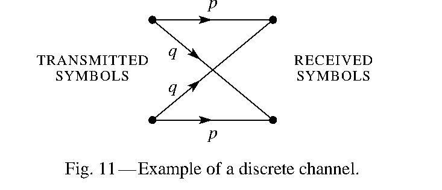

有

$$H(x)=-P\log P-2Q\log Q,\qquad H_y(x)=2QH.$$

希望在约束 $P+2Q=1$ 下选择 $P,Q$ 最大化 $H(x)-H_y(x)$。考虑

$$U=-P\log P-2Q\log Q-2QH+\lambda(P+2Q),$$

令 $\partial U/\partial P=0$、$\partial U/\partial Q=0$，消去 $\lambda$ 得 $\log P=\log Q+H$，即 $P=Qe^H=Q/p$。结合 $P+2Q=1$ 得

$$Q=\frac{p}{p+2},\qquad P=\frac1{p+2}.$$

信道容量为

$$C=\log(p+2)-\frac{H}{p+2}.$$

检验显然：若 $p=1$，则 $H=0$，$C=\log3$，此时信道无噪声且有三个符号；若 $p=1/2$，则 $H=1$，$C=\log2$，此时第二、第三符号完全不可区分，合起来像一个符号。第一符号使用概率 $P=1/2$，第二、第三合起来概率 $1/2$，可在二者间任意分配仍达最大容量。中间 $p$ 值对应容量在 $\log2$ 和 $\log3$ 之间。第一符号因无噪声而使用稍频繁。

## 16. 某些特殊情形下的信道容量

若噪声独立影响相继信道符号，可用转移概率 $p_{ij}$ 描述：发送 $i$ 时接收 $j$ 的概率。最大信道速率由

$$-\sum_{i,j}P_ip_{ij}\log\sum_iP_ip_{ij}+\sum_{i,j}P_ip_{ij}\log p_{ij}$$

在 $\sum P_i=1$ 下取最大给出。用拉格朗日乘子法得到方程

$$\sum_s p_{sj}\log\sum_iP_ip_{ij}=\mu\quad (j=1,2,\ldots),$$

乘以 $P_s$ 并求和得 $\mu=C$。令 $p_{sj}$ 的逆（若存在）为 $h_{st}$，使 $\sum_sh_{st}p_{sj}=\delta_{tj}$。则

$$\sum_{s,j}h_{st}p_{sj}\log p_{sj}-\log\sum_iP_ip_{it}=C\sum_sh_{st}.$$

因此

$$\sum_iP_ip_{it}=
\exp\left[-C\sum_sh_{st}+\sum_{s,j}h_{st}p_{sj}\log p_{sj}\right],$$

或

$$P_i=\sum_t h_{it}\exp\left[-C\sum_sh_{st}+\sum_{s,j}h_{st}p_{sj}\log p_{sj}\right].$$

这是确定最大化 $P_i$ 的方程组，$C$ 由 $\sum P_i=1$ 确定。

若每个输入符号发出线路的概率集合相同，每个输出符号亦然，容量容易计算。图 12 给出例子。此时 $H_x(y)$ 与输入符号概率分布无关，由 $-\sum_jp_j\log p_j$ 给出。容量为

$$C=\max H(y)+\sum_jp_j\log p_j.$$

$H(y)$ 最大显然为 $\log m$，其中 $m$ 是输出符号数，可通过令输入符号等概率实现。因此

$$C=\log m+\sum_jp_j\log p_j.$$

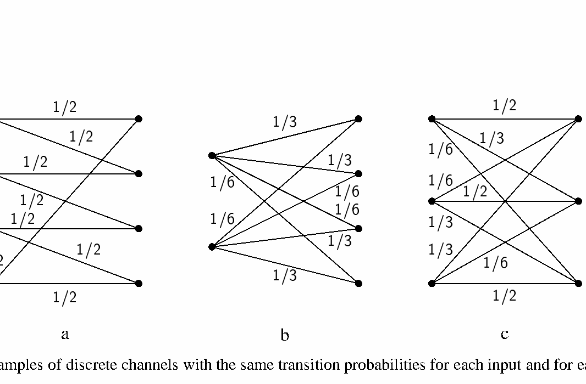

图 12a 中 $C=\log4-\log2=\log2$，可只用第 1 和第 3 符号达到。图 12b 中

$$C=\log4-\frac23\log3-\frac13\log6=\log4-\log3-\frac13\log2=\log\frac{5}{3^{2/3}}.$$

图 12c 中

$$C=\log3-\frac12\log2-\frac13\log3-\frac16\log6=\log\frac{3}{2^{1/2}3^{1/3}6^{1/6}}.$$

假设符号分为若干组，噪声从不使一组符号误认为另一组符号。令第 $n$ 组只使用其符号时容量为 $C_n$。则容易证明，为最佳使用整个集合，第 $n$ 组所有符号总概率应为

$$P_n=\frac{2^{C_n}}{\sum_n2^{C_n}}.$$

组内概率分布与只有这些符号时相同。信道容量为

$$C=\log\sum_n2^{C_n}.$$

## 17. 高效编码例子

下面例子虽有些不现实，却是可与有噪声信道精确匹配情形。有两个信道符号 0 和 1，噪声以 7 个符号为块作用。一个 7 符号块要么无误传输，要么其中恰有一个符号错误，这八种可能等概率。有

$$C=\max[H(y)-H_x(y)]=\frac17\left[7+\frac18\log8\right]=\frac47\text{ 比特/符号}.$$

由 Hamming 方法可得到一种高效码，能完全校正错误并以速率 $C$ 传输：

设 7 符号块为 $X_1,X_2,\ldots,X_7$。其中 $X_3,X_5,X_6,X_7$ 是消息符号，由信源任意选择；其余三个冗余，计算如下：

$$
\begin{aligned}
X_1&=X_3+X_5+X_6+X_7 \quad(\text{使和为偶}),\\
X_2&=X_2+X_3+X_6+X_7 \quad(\text{使和为偶}),\\
X_4&=X_1+X_3+X_5+X_7 \quad(\text{使和为偶}).
\end{aligned}
$$

收到 7 符号块后，重新计算三个校验；偶数记为 0，奇数记为 1。所得二进制数给出错误 $X_i$ 的下标；若为 0 则无错误。

# 附录 1：有限状态条件下符号块数目的增长

令 $N_i(L)$ 为长度 $L$ 且终止于状态 $i$ 的符号块数，则

$$N_j(L)=\sum_{i,s}N_i\big(L-b_{ij}^{(s)}\big),$$

其中 $b_{ij}^{(1)},\ldots,b_{ij}^{(m)}$ 是在状态 $i$ 中选择并导向状态 $j$ 的符号长度。这些是线性差分方程，故 $L\to\infty$ 时行为必为

$$N_j=A_jW^L.$$

代入差分方程：

$$A_j=\sum_{i,s}A_iW^{-b_{ij}^{(s)}},$$

即

$$\sum_i\left[\sum_s W^{-b_{ij}^{(s)}}-\delta_{ij}\right]A_i=0.$$

要存在非零解，行列式

$$D(W)=\left|\sum_sW^{-b_{ij}^{(s)}}-\delta_{ij}\right|$$

必须为 0，这决定 $W$，即 $D=0$ 的最大实根。于是

$$C=\lim_{L\to\infty}\frac{\log\sum_jA_jW^L}{L}=\log W.$$

我们还注意到，若要求所有块从同一任意选择状态开始，生长性质相同。

# 附录 2：$H=-\sum p_i\log p_i$ 的推导

令 $H(1/n,\ldots,1/n)=A(n)$。由条件 3，可把从 $s^m$ 个等概率可能中的选择，分解为 $m$ 次从 $s$ 个等概率可能中的选择，得到

$$A(s^m)=mA(s).$$

类似地 $A(t^n)=nA(t)$。

可选任意大 $n$，并找 $m$ 使

$$s^m\le t^n<s^{m+1}.$$

取对数并除以 $n\log s$：

$$\frac{m}{n}\le\frac{\log t}{\log s}<\frac{m+1}{n},$$

故 $m/n$ 与 $\log t/\log s$ 之差任意小。由 $A(n)$ 单调性，

$$A(s^m)\le A(t^n)\le A(s^{m+1}),$$

$$mA(s)\le nA(t)\le(m+1)A(s).$$

除以 $nA(s)$：

$$\frac{m}{n}\le\frac{A(t)}{A(s)}\le\frac{m+1}{n},$$

因此 $A(t)/A(s)=\log t/\log s$，即

$$A(t)=K\log t,$$

其中 $K>0$ 以满足单调性。

现在假设从 $n$ 个可能中选择，概率为可公度 $p_i=n_i/\sum n_i$，其中 $n_i$ 为整数。可把从 $\sum n_i$ 个可能中的选择分解为：先以概率 $p_1,\ldots,p_n$ 从 $n$ 个可能中选，再在第 $i$ 个被选后从 $n_i$ 个中等概率选择。由条件 3，

$$K\log\sum n_i=H(p_1,\ldots,p_n)+K\sum p_i\log n_i.$$

因此

$$H=K\sum p_i\log\sum n_i-K\sum p_i\log n_i
=-K\sum p_i\log\frac{n_i}{\sum n_i}
=-K\sum p_i\log p_i.$$

若 $p_i$ 不可公度，可用有理数逼近，并由连续性假设得同一表达式一般成立。系数 $K$ 只是单位选择。

# 附录 3：遍历信源定理

若从任意概率 $P_i>0$ 状态可沿概率 $p_{ij}>0$ 路径到任意其它状态，则系统遍历，可用强大数定律。在长度 $N$ 长序列中，给定路径 $p_{ij}$ 被经过次数约为 $P_ip_{ij}N$。若 $N$ 足够大，百分比误差 $\pm\delta$ 的概率小于 $\epsilon$，故除小概率集合外，实际次数在 $(P_ip_{ij}\pm\delta)N$ 内。因此几乎所有序列的概率为

$$p=\prod p_{ij}^{(P_ip_{ij}\pm\delta)N},$$

且

$$\frac{\log p}{N}=\sum(P_ip_{ij}\pm\delta)\log p_{ij},$$

故

$$\left|\frac{\log p}{N}+\sum P_ip_{ij}\log p_{ij}\right|<\eta.$$

这证明定理 3。

定理 4 可由基于定理 3 中 $p$ 可能范围计算 $n(q)$ 上下界直接推出。

在混合（非遍历）情形，若

$$L=\sum p_iL_i,$$

且分量熵 $H_1\ge H_2\ge\cdots\ge H_n$，则

$$\lim_{N\to\infty}\frac{\log n_N(q)}{N}=\varphi(q),$$

其中 $\varphi(q)$ 是递减阶梯函数，在区间 $\sum_{i=1}^{s-1}p_i<q<\sum_{i=1}^sp_i$ 上等于 $H_s$。

为证明定理 5、6，先注意 $F_N$ 单调递减，因为增加 $N$ 给条件熵加下标。代入 $p_{B_i}(S_j)$ 可得

$$F_N=NG_N-(N-1)G_{N-1},$$

对所有 $N$ 求和得

$$G_N=\frac1N\sum_{n=1}^NF_n.$$

故 $G_N\ge F_N$ 且 $G_N$ 单调递减。二者必趋近同一极限；由定理 3 知 $\lim G_N=H$。

# 附录 4：约束系统速率的最大化

假设对符号序列有一组有限状态型约束，可由线性图表示。令 $\ell_{ij}^{(s)}$ 为从状态 $i$ 到状态 $j$ 时可能出现的第 $s$ 个符号长度。什么状态概率 $P_i$ 和选择概率 $p_{ij}^{(s)}$ 使约束下信息产生速率最大？

约束定义离散信道，最大速率必小于或等于信道容量 $C$，因为若所有长块等概率，就产生该速率，若可能则最佳。下面证明可通过适当选择 $P_i$ 和 $p_{ij}^{(s)}$ 达到该速率。

所考虑速率为

$$M=\frac{-\sum_{i,j,s}P_ip_{ij}^{(s)}\log p_{ij}^{(s)}}{\sum_{i,j,s}P_ip_{ij}^{(s)}\ell_{ij}^{(s)}}.$$

令 $\ell_{ij}=\sum_s\ell_{ij}^{(s)}$。可通过拉格朗日乘子得到

$$p_{ij}^{(s)}=A_iB_jD^{-\ell_{ij}^{(s)}}.$$

由 $\sum_jp_{ij}=1$ 得

$$A_i^{-1}=\sum_jB_jD^{-\ell_{ij}},$$

于是

$$p_{ij}^{(s)}=\frac{B_jD^{-\ell_{ij}^{(s)}}}{\sum_sB_sD^{-\ell_{is}}}.$$

正确的 $D$ 是容量 $C$，$B_j$ 满足

$$B_i=\sum_jB_jC^{-\ell_{ij}},$$

因为此时

$$p_{ij}^{(s)}=\frac{B_j}{B_i}C^{-\ell_{ij}^{(s)}}$$

且

$$\sum_{i,j,s}P_ip_{ij}^{(s)}\frac{B_j}{B_i}=P_j.$$

于是若 $P_i$ 满足

$$\sum_i\lambda_iC^{-\ell_{ij}}=\lambda_j,$$

取

$$P_i=\frac{B_i\lambda_i}{\sum_jB_j\lambda_j},$$

两组方程都可满足，因为 $C$ 满足

$$\left|C^{-\ell_{ij}}-\delta_{ij}\right|=0.$$

此时速率为

$$M=C-\frac{\sum P_ip_{ij}(\log B_j-\log B_i)}{\sum P_ip_{ij}\ell_{ij}}=C,$$

因为

$$\sum_{i,j}P_ip_{ij}(\log B_j-\log B_i)=\sum_jP_j\log B_j-\sum_iP_i\log B_i=0.$$

故速率为 $C$，且不可能超过，因此是最大值。

# 第三部分：数学预备

在本文最后一部分，我们考虑信号或消息或二者连续变化的情形，与迄今假设的离散性质相对。在相当大程度上，连续情形可通过离散情形的极限过程得到：把消息和信号连续统分割为大量但有限的小区域，并在离散基础上计算各参数；当区域大小减小时，这些参数一般趋近连续情形的适当值。但也会出现少数新效应，并且一般重点会转向把结果专门化到具体情形。

在连续情形中，我们不力求以最大一般性或纯数学的极端严格性获得结果，因为那会涉及大量抽象测度论，并模糊分析主线。不过初步研究表明，该理论可用完全公理化且严格的方式表述，同时包括连续、离散及其它许多情形。本文中对极限过程偶尔采取的自由处理，在所有实际有意义的情形中都可证明合理。

## 18. 函数集合与函数系综

连续情形中需处理函数集合与函数系综。函数集合顾名思义只是函数类或函数收集，通常是一个变量即时间的函数。它可通过显式表示集合中各函数来规定，也可隐式通过给出集合中函数具有而其它函数不具有的性质来规定。例子：

1. 函数集合 $f_\theta(t)=\sin(t+\theta)$。每个特定 $\theta$ 值确定集合中一个函数。
2. 所有不含超过每秒 $W$ 周频率的时间函数集合。
3. 所有带宽限于 $W$、振幅限于 $A$ 的函数集合。
4. 所有作为时间函数的英语语音信号集合。

函数系综是一个函数集合连同概率测度，借此可确定集合中函数具有某些性质的概率。例如对集合 $f_\theta(t)=\sin(t+\theta)$，可给出 $\theta$ 的概率分布 $P(\theta)$，于是集合成为系综。更多例子：

1. 有限函数集 $f_k(t)$（$k=1,2,\ldots,n$），$f_k$ 的概率为 $p_k$。
2. 有限维函数族 $f(\alpha_1,\ldots,\alpha_n,t)$，参数有概率分布 $p(\alpha_1,\ldots,\alpha_n)$。例如

$$f(a_1,\ldots,a_n,\theta_1,\ldots,\theta_n,t)=\sum_{i=1}^na_i\sin i(\omega t+\theta_i),$$

其中振幅 $a_i$ 正态且独立分布，相位 $\theta_i$ 在 $0$ 到 $2\pi$ 上均匀且独立分布。
3. 系综

$$f(a_i,t)=\sum_{n=-\infty}^{+\infty}a_n\frac{\sin\pi(2Wt-n)}{\pi(2Wt-n)},$$

其中 $a_i$ 正态独立，标准差均为 $N$。这是带宽限制在 0 到 $W$ 周每秒、平均功率为 $N$ 的“白噪声”表示。
4. 点按泊松分布分布在 $t$ 轴上，在每个选定点放置函数 $f(t)$ 并相加：

$$\sum_{k=-\infty}^{\infty}f(t+t_k),$$

其中 $t_k$ 是泊松分布的点。这可视为所有脉冲相同的脉冲噪声或散粒噪声。
5. 具有普通使用中出现频率所给概率测度的英语语音函数集合。

若把所有函数在时间上平移任意固定量后得到同一系综，则函数系综 $f(t)$ 是**平稳的**。若 $\theta$ 在 $0$ 到 $2\pi$ 均匀分布，$f_\theta(t)=\sin(t+\theta)$ 的系综平稳。若把每个函数平移 $t_1$，得到 $f_\theta(t+t_1)=\sin(t+t_1+\theta)=\sin(t+\theta')$，$\theta'$ 仍均匀分布。每个函数改变，但整体系综在平移下不变。上面其它例子也是平稳的。

若系综平稳，且集合中不存在概率既非 0 也非 1 的平稳子集，则称为**遍历的**。$ \sin(t+\theta)$ 的系综是遍历的；这些函数中不存在概率 $0\ne p\ne1$ 的子集在所有时间平移下变为自身。另一方面，$a\sin(t+\theta)$ 中 $a$ 正态、$\theta$ 均匀时平稳但非遍历；例如 $a$ 在 0 到 1 之间的子集是平稳的。

上述例子中，3 和 4 遍历，5 可认为遍历。若系综遍历，大致可说集合中每个函数都是系综的典型。更精确地说，已知对于遍历系综，任何统计量在系综上的平均等于（概率 1）集合中特定函数的时间平移平均。粗略说，每个函数随时间推移会以适当频率经历集合中任何函数的各种呈现。

正如对数字或函数可施加运算得到新数字或函数，也可对系综施加运算得到新系综。例如有函数系综 $f(t)$ 和算子 $T$，对每个 $f(t)$ 给出 $g(t)=Tf(t)$。通过 $f(t)$ 的测度定义 $g(t)$ 集合的概率测度：某 $g$ 函数子集的概率等于在 $T$ 下产生该子集的 $f$ 函数子集概率。物理上，这对应让系综通过某装置，如滤波器、整流器或调制器；输出函数形成系综 $g(t)$。

若平移输入只平移输出，即 $g(t)=Tf(t)$ 蕴含对所有 $f(t)$、$t_1$ 有 $g(t+t_1)=Tf(t+t_1)$，则装置或算子 $T$ 称为**不变的**。容易证明（附录 5），若 $T$ 不变且输入系综平稳，则输出系综平稳；若输入遍历，输出也遍历。

滤波器和整流器在所有时间平移下不变。调制操作不不变，因为载波相位给出某种时间结构；但调制在载波周期整数倍的平移下不变。Wiener 指出物理装置在时间平移下的不变性与傅里叶理论密切相关；他表明，若装置线性且不变，傅里叶分析就是处理问题的适当数学工具。

函数系综是连续信源产生的消息、发送器产生的信号及扰动噪声的适当数学表示。通信理论恰当地关注的是函数系综上的操作，而不是特定函数上的操作。通信系统不是为某个特定语音函数、更不是为正弦波设计的，而是为语音函数系综设计的。

## 19. 带限函数系综

若时间函数 $f(t)$ 限于 0 到 $W$ 周每秒的频带，则可完全由相隔 $1/(2W)$ 秒的一系列离散点上的纵坐标决定。

**定理 13**：若 $f(t)$ 不含超过 $W$ 的频率，则

$$f(t)=\sum_{n=-\infty}^{+\infty}X_n\frac{\sin\pi(2Wt-n)}{\pi(2Wt-n)},$$

其中

$$X_n=f\left(\frac{n}{2W}\right).$$

在这个展开中，$f(t)$ 表示为正交函数之和。各项系数 $X_n$ 可视为无限维“函数空间”中的坐标；该空间中每个函数对应一个点，每个点对应一个函数。

若所有在时间间隔 $T$ 外的纵坐标 $X_n$ 为零，可认为函数基本限于时间 $T$。此时除 $2TW$ 个坐标外其余为零。因此带宽 $W$、持续时间 $T$ 的函数对应 $2TW$ 维空间中的点。

带宽 $W$、持续时间 $T$ 的函数子集对应该空间中的一个区域。例如总能量不超过 $E$ 的函数对应于半径 $r=\sqrt{2WE}$ 的 $2TW$ 维球内点。有限持续时间、有限带宽的函数系综由相应 $n$ 维空间中的概率分布 $p(x_1,\ldots,x_n)$ 表示。若系综不限于时间，可把给定区间 $T$ 内的 $2TW$ 个坐标看作基本表示该区间内函数部分，并由 $p(x_1,\ldots,x_n)$ 给出这种持续时间下系综的统计结构。

## 20. 连续分布的熵

离散概率集合 $p_1,\ldots,p_n$ 的熵定义为

$$H=-\sum p_i\log p_i.$$

类似地，定义密度分布函数 $p(x)$ 的连续分布熵为

$$H=-\int_{-\infty}^{+\infty}p(x)\log p(x)\,dx.$$

对 $n$ 维分布 $p(x_1,\ldots,x_n)$：

$$H=-\int\cdots\int p(x_1,\ldots,x_n)\log p(x_1,\ldots,x_n)\,dx_1\cdots dx_n.$$

若有两个变量 $x,y$（本身可多维），$p(x,y)$ 的联合熵和条件熵为

$$H(x,y)=-\iint p(x,y)\log p(x,y)\,dx\,dy,$$

$$H_x(y)=-\iint p(x,y)\log\frac{p(x,y)}{p(x)}\,dx\,dy,$$

$$H_y(x)=-\iint p(x,y)\log\frac{p(x,y)}{p(y)}\,dx\,dy,$$

其中

$$p(x)=\int p(x,y)\,dy,\qquad p(y)=\int p(x,y)\,dx.$$

连续分布熵具有离散情形的大多数（但非全部）性质：

1. 若 $x$ 限于其空间某体积 $v$ 内，则当 $p(x)=1/v$ 为常数时 $H(x)$ 最大且等于 $\log v$。
2. 对任意 $x,y$，

$$H(x,y)\le H(x)+H(y),$$

等号当且仅当独立即 $p(x,y)=p(x)p(y)$（除概率零集合外）。
3. 考虑广义平均操作

$$p'(y)=\int a(x,y)p(x)\,dx,$$

其中 $\int a(x,y)\,dy=1$，$\int a(x,y)p(x)\,dx=1$，$a(x,y)\ge0$。则平均分布 $p'(y)$ 的熵大于等于原分布 $p(x)$ 的熵。
4. 有

$$H(x,y)=H(x)+H_x(y)=H(y)+H_y(x),$$

且 $H_x(y)\le H(y)$。
5. 令 $p(x)$ 为一维分布。在标准差固定为 $\sigma$ 条件下使 $p(x)$ 熵最大的形式是高斯分布。需在约束

$$\sigma^2=\int p(x)x^2\,dx,\qquad 1=\int p(x)\,dx$$

下最大化

$$H(x)=-\int p(x)\log p(x)\,dx.$$

变分法要求最大化

$$\int[-p(x)\log p(x)+\lambda p(x)x^2+\mu p(x)]\,dx,$$

条件为

$$-1-\log p(x)+\lambda x^2+\mu=0,$$

调整常数得

$$p(x)=\frac1{\sqrt{2\pi}\sigma}e^{-x^2/2\sigma^2}.$$

类似地，在 $n$ 维中，若二阶矩

$$A_{ij}=\int\cdots\int x_ix_jp(x_1,\ldots,x_n)\,dx_1\cdots dx_n$$

固定，则最大熵由具有二阶矩 $A_{ij}$ 的 $n$ 维高斯分布给出。
6. 标准差为 $\sigma$ 的一维高斯分布熵为

$$H(x)=\log\sqrt{2\pi e}\,\sigma.$$

计算：

$$p(x)=\frac1{\sqrt{2\pi}\sigma}e^{-x^2/2\sigma^2},$$

$$-\log p(x)=\log\sqrt{2\pi}\sigma+\frac{x^2}{2\sigma^2},$$

$$H(x)=\int p(x)\log\sqrt{2\pi}\sigma\,dx+\frac1{2\sigma^2}\int p(x)x^2\,dx
=\log\sqrt{2\pi}\sigma+\frac12
=\log\sqrt{2\pi e}\sigma.$$

类似地，带二次型 $a_{ij}$ 的 $n$ 维高斯分布

$$p(x_1,\ldots,x_n)=\frac{|a_{ij}|^{1/2}}{(2\pi)^{n/2}}
\exp\left[-\frac12\sum a_{ij}x_ix_j\right]$$

熵为

$$H=\log\left[(2\pi e)^{n/2}|a_{ij}|^{-1/2}\right].$$

7. 若 $x$ 限于半直线（$x\le0$ 时 $p(x)=0$）且一阶矩固定为 $a$：

$$a=\int_0^\infty p(x)x\,dx,$$

则最大熵在

$$p(x)=\frac1a e^{-x/a}$$

时达到，且等于 $\log ea$。

8. 连续与离散熵有一个重要区别。离散情形中，熵以绝对方式度量随机变量随机性；连续情形中，度量依赖坐标系。若变为坐标 $y_1,\ldots,y_n$，新熵为

$$H(y)=H(x)-\int\cdots\int p(x_1,\ldots,x_n)\log J_{xy}\,dx_1\cdots dx_n,$$

其中 $J_{xy}$ 是坐标变换雅可比。新熵等于旧熵减去雅可比期望对数。连续熵可视为相对于某假定标准的随机性度量，即所选坐标系中每个小体积元 $dx_1\cdots dx_n$ 赋等权。改变坐标系后，新系综在该系综中小体积元 $dy_1\cdots dy_n$ 赋等权。

尽管依赖坐标系，熵概念在连续情形中与离散情形同样重要。这是因为导出的信息速率和信道容量概念依赖两个熵之差，而该差不依赖坐标系，两项变化量相同。连续分布熵可为负；测量尺度设置任意零点，对应于单位体积上的均匀分布。比这更集中的分布熵较小且可为负；但速率和容量总非负。

坐标变换的一个特例是线性变换

$$y_j=\sum_i a_{ij}x_i.$$

此时雅可比就是行列式 $|a_{ij}|^{-1}$，故

$$H(y)=H(x)+\log|a_{ij}|.$$

旋转坐标或任何保测变换下 $J=1$，$H(y)=H(x)$。

## 21. 函数系综的熵

考虑限于带宽 $W$ 的遍历函数系综。令 $p(x_1,\ldots,x_n)$ 为在 $n$ 个相继采样点振幅 $x_1,\ldots,x_n$ 的密度分布函数。定义每个自由度的系综熵为

$$H'=-\lim_{n\to\infty}\frac1n\int\cdots\int p(x_1,\ldots,x_n)\log p(x_1,\ldots,x_n)\,dx_1\cdots dx_n.$$

也可定义每秒熵 $H$，不是除以 $n$，而是除以 $n$ 个样本对应时间 $T$ 秒。由于 $n=2TW$，

$$H=2WH'.$$

白热噪声时 $p$ 为高斯，有

$$H'=\log\sqrt{2\pi e N},$$

$$H=W\log 2\pi eN.$$

给定平均功率 $N$ 时，白噪声具有最大可能熵，这由前述高斯分布最大化性质推出。

连续随机过程的熵有许多类似于离散过程的性质。离散情形中，熵与长序列概率对数、合理可能长序列数有关；连续情形中，熵以类似方式与长串样本概率密度对数、函数空间中高概率体积有关。

更精确地说，若假设 $p(x_1,\ldots,x_n)$ 对所有 $n$ 和所有 $x_i$ 连续，则只要 $n$ 足够大，

$$\left|-\frac{\log p}{n}-H'\right|<\epsilon$$

对除总概率小于 $\delta$ 的集合外所有 $(x_1,\ldots,x_n)$ 成立，其中 $\epsilon,\delta$ 任意小。若把空间分成大量小格，这由遍历性推出。

熵与体积的关系可表述如下：在相同假设下，考虑对应 $p(x_1,\ldots,x_n)$ 的 $n$ 维空间。令 $V_n(q)$ 为内部包含总概率 $q$ 的最小体积。则

$$\lim_{n\to\infty}\frac{\log V_n(q)}{n}=H',$$

其中 $q\ne0,1$。这些结果说明，对大 $n$，存在一个相当明确的高概率体积（至少对数意义上），且该体积内概率密度相对均匀（同样对数意义上）。

白噪声情形分布为

$$p(x_1,\ldots,x_n)=(2\pi N)^{-n/2}\exp\left[-\frac1{2N}\sum x_i^2\right].$$

它只依赖 $\sum x_i^2$，等概率密度面为球面，整体分布球对称。高概率区域是半径 $\sqrt{nN}$ 的球。当 $n\to\infty$，落在半径 $\sqrt{n(N+\epsilon)}$ 球外的概率趋近 0，且 $1/n$ 乘以球体积对数趋近 $\log\sqrt{2\pi eN}$。

连续情形中，不用系综熵 $H$，而用导出量**熵功率**更方便。它定义为与原系综同频带、同熵的白噪声功率。若 $H'$ 是系综熵，则熵功率为

$$N_1=\frac1{2\pi e}\exp(2H').$$

几何上，这相当于用与高概率体积相同的球半径平方来度量该体积。由于白噪声在给定功率下熵最大，任何噪声的熵功率小于或等于实际功率。

## 22. 线性滤波器中的熵损失

**定理 14**：若带宽 $W$、每自由度熵为 $H_1$ 的系综通过特性为 $Y(f)$ 的滤波器，则输出系综熵为

$$H_2=H_1+\frac1W\int_0^W\log|Y(f)|^2\,df.$$

滤波器操作本质上是线性坐标变换。若把不同频率分量看作原坐标系，新频率分量只是旧分量乘以因子；变换矩阵在该坐标系中本质对角化。对 $n$ 个正弦和 $n$ 个余弦分量，雅可比

$$J=\prod_{i=1}^n|Y(f_i)|^2,$$

其中 $f_i$ 在频带 $W$ 中等间隔。极限下变为

$$\exp\left[\frac1W\int_0^W\log|Y(f)|^2\,df\right].$$

由于 $J$ 为常数，其平均值相同；应用坐标变换熵变化定理即得结果。也可用熵功率表述：若第一系综熵功率为 $N_1$，第二为

$$N_1\exp\left[\frac1W\int_0^W\log|Y(f)|^2\,df\right].$$

最终熵功率等于初始熵功率乘以滤波器几何平均增益。若增益以分贝度量，输出熵功率增加频带 $W$ 上的算术平均分贝增益。

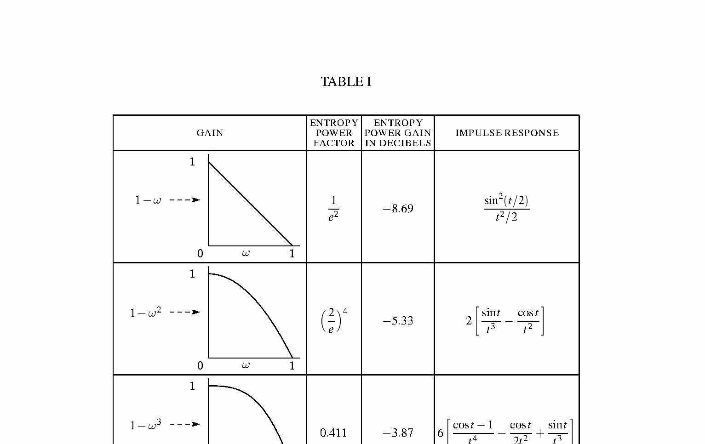

表 I 计算了若干理想增益特性的熵功率损失（并用分贝表示），还给出这些滤波器的脉冲响应，取 $W=1/2$ 且相位为 0。很多其它情形的熵损失可由这些结果得到。例如第一种情况的熵功率因子 $1/e^2$ 也适用于任何由 $1-\omega$ 经频率轴保测变换得到的增益特性；特别地，线性增长增益 $G(\omega)=\omega$ 或 0 到 1 之间的锯齿特性具有相同熵损失；互逆增益有互逆因子；增益提升到幂次则因子也提升到该幂次。

## 23. 两个系综之和的熵

若有两个函数系综 $f(t),g(t)$，可通过“加法”形成新系综。设第一系综密度函数 $p(x_1,\ldots,x_n)$，第二 $q(x_1,\ldots,x_n)$，则和系综密度由卷积给出：

$$r(x_1,\ldots,x_n)=\int\cdots\int p(y_1,\ldots,y_n)q(x_1-y_1,\ldots,x_n-y_n)\,dy_1\cdots dy_n.$$

物理上，这对应把原系综表示的噪声或信号相加。附录 6 推导：

**定理 15**：设两个系综平均功率为 $N_1,N_2$，熵功率为 $N'_1,N'_2$。则和系综的熵功率 $N'_3$ 满足

$$N'_1+N'_2\le N'_3\le N_1+N_2.$$

白色高斯噪声有特殊性质：它能吸收任何加到它上的其它噪声或信号系综，所得熵功率约等于白噪声功率与信号功率之和（信号功率从平均值度量，通常为 0），条件是信号功率在某种意义下相对噪声较小。

从几何上看，白噪声对应函数空间中的球形高斯分布，信号系综对应另一个不一定高斯或球形分布。设该分布围绕重心的二阶矩为 $a_{ij}$。若 $p(x_1,\ldots,x_n)$ 是密度函数，

$$a_{ij}=\int\cdots\int p(x_i-\bar x_i)(x_j-\bar x_j)\,dx_1\cdots dx_n.$$

$a_{ij}$ 是正定二次型，可旋转坐标系使其对角化为 $b_{ii}$。要求每个 $b_{ii}$ 相对球形分布半径平方 $N$ 较小。

此时噪声与信号的卷积产生近似高斯分布，其二次型为 $N+b_{ii}$。该分布熵功率为

$$\left[\prod_{i=1}^n(N+b_{ii})\right]^{1/n}\approx N+\frac1n\sum b_{ii},$$

最后一项是信号功率，第一项是噪声功率。

# 第四部分：连续信道

## 24. 连续信道的容量

在连续信道中，输入或发送信号是某集合中连续时间函数 $f(t)$，输出或接收信号是其受扰动版本。我们只考虑发送和接收信号都限于某频带 $W$ 的情形。这样，在时间 $T$ 内它们可由 $2TW$ 个数规定，其统计结构由有限维分布函数规定。发送信号统计由

$$P(x_1,\ldots,x_n)=P(x)$$

决定，噪声统计由条件概率分布

$$P_{x_1,\ldots,x_n}(y_1,\ldots,y_n)=P_x(y)$$

决定。连续信道的信息传输率类似离散信道定义：

$$R=H(x)-H_y(x),$$

其中 $H(x)$ 是输入熵，$H_y(x)$ 是含糊度。信道容量 $C$ 是在所有可能输入系综上变化时的 $R$ 最大值。在有限维近似中，需变化 $P(x)=P(x_1,\ldots,x_n)$ 并最大化

$$C=\lim_{T\to\infty}\max_{P(x)}\frac1T\iint P(x,y)\log\frac{P(x,y)}{P(x)P(y)}\,dx\,dy.$$

这里利用了

$$\iint P(x,y)\log P(x)\,dx\,dy=\int P(x)\log P(x)\,dx.$$

因此容量也可表达为

$$C=\iint P(x,y)\log\frac{P(x,y)}{P(x)P(y)}\,dx\,dy.$$

显然，这种形式下 $R$ 和 $C$ 不依赖坐标系，因为当 $x,y$ 经任意一一变换时，对数中分子分母乘以相同因子。该积分表达式比 $H(x)-H_y(x)$ 更一般；正确解释下（见附录 7）它总存在，而 $H(x)-H_y(x)$ 某些情形可能取 $\infty-\infty$ 不定形式，例如 $x$ 在 $n$ 维近似中限于维数少于 $n$ 曲面时。

若计算 $H(x)$、$H_y(x)$ 使用以 2 为底，则 $C$ 是每秒可通过信道发送且含糊度任意小的二进制数字最大数，与离散情形一样。物理上，可把信号空间分成大量小单元，小到使信号 $x$ 被扰动到点 $y$ 的概率密度 $P_x(y)$ 在单元内基本恒定。若把单元视为不同点，情形本质与离散信道相同，离散情形证明适用。只要区域足够小，这种把体积量化为点的做法在任何实际情形中都不会显著改变最终答案。因此容量是离散细分容量的极限，正是上面定义的连续容量。

数学上可先证明（见附录 7）：若 $u$ 是消息，$x$ 是信号，$y$ 是接收信号（受噪声扰动），$v$ 是恢复消息，则

$$H(x)-H_y(x)\ge H(u)-H_v(u)$$

无论对 $u$ 作何操作得到 $x$，或对 $y$ 作何操作得到 $v$。因此无论如何把二进制数字编码为信号、如何解码接收信号恢复消息，二进制数字离散速率不超过定义的信道容量。另一方面，在非常一般条件下，可找到编码系统以速率 $C$ 传输二进制数字，含糊度或错误频率任意小。例如，若对信号函数取有限维近似空间，$P(x,y)$ 除概率零集合外对 $x,y$ 都连续，则成立。

一个重要特例：噪声加到信号上且概率意义独立。此时 $P_x(y)$ 只依赖差 $n=y-x$：

$$P_x(y)=Q(y-x),$$

并可赋予噪声确定熵（与信号统计无关），即分布 $Q(n)$ 的熵 $H(n)$。

**定理 16**：若信号与噪声独立且接收信号为发送信号与噪声之和，则传输速率为

$$R=H(y)-H(n),$$

即接收信号熵减去噪声熵。信道容量为

$$C=\max_{P(x)}[H(y)-H(n)].$$

因为 $y=x+n$，

$$H(x,y)=H(x,n).$$

展开左边并利用 $x,n$ 独立：

$$H(y)+H_y(x)=H(x)+H(n),$$

故

$$R=H(x)-H_y(x)=H(y)-H(n).$$

由于 $H(n)$ 与 $P(x)$ 无关，最大化 $R$ 等价于最大化接收信号熵 $H(y)$。若对发送信号系综有某些约束，则在这些约束下最大化接收信号熵。

## 25. 平均功率限制下的信道容量

定理 16 的简单应用：噪声为白热噪声，发送信号限于某平均功率 $P$。接收信号平均功率为 $P+N$，其中 $N$ 是平均噪声功率。当接收信号也形成白噪声系综时熵最大，因为这是功率 $P+N$ 下可能的最大熵，并可通过适当选择发送信号达到，即使发送信号为功率 $P$ 的白噪声系综。此时接收系综每秒熵为

$$H(y)=W\log 2\pi e(P+N),$$

噪声熵为

$$H(n)=W\log2\pi eN.$$

信道容量为

$$C=H(y)-H(n)=W\log\frac{P+N}{N}.$$

总结：

**定理 17**：带宽 $W$、受功率 $N$ 白热噪声扰动且平均发送功率限于 $P$ 的信道容量为

$$C=W\log\frac{P+N}{N}.$$

这意味着通过足够复杂的编码，可以每秒

$$W\log_2\frac{P+N}{N}$$

比特速率传输二进制数字，错误频率任意小；任何编码系统若以更高速率传输，必然有明显正错误频率。

要接近该极限速率，发送信号必须在统计性质上近似白噪声。接近理想速率的系统可描述如下：构造 $M=2^s$ 个白噪声样本，每个持续 $T$，赋予二进制编号 $0$ 到 $M-1$。发送端把消息序列分成 $s$ 位组，每组发送相应噪声样本作为信号。接收端已知 $M$ 个样本，把实际接收信号（受噪声扰动）与每个比较，选择均方误差最小的样本作为发送信号，并恢复相应二进制数。这相当于选择最大后验概率信号。

样本数 $M$ 取决于可容忍错误频率，但对几乎所有样本选择，

$$\lim_{\epsilon\to0}\lim_{T\to\infty}\frac{\log M(\epsilon,T)}{T}=W\log\frac{P+N}{N}.$$

因此无论 $\epsilon$ 多小，只要 $T$ 足够大，就能在时间 $T$ 内发送任意接近 $TW\log\frac{P+N}{N}$ 的二进制数字。

公式 $C=W\log\frac{P+N}{N}$ 的白噪声情形也由其他作者独立发展，虽解释略有不同，如 N. Wiener、W. G. Tuller、H. Sullivan。

对任意扰动噪声（不必白热噪声），确定容量 $C$ 的最大化问题似乎不能显式解决。但可用平均噪声功率 $N$ 和噪声熵功率 $N_1$ 为 $C$ 设置上下界；实际情形中这些界限足够接近，给出满意解。

**定理 18**：带宽 $W$、受任意噪声扰动的信道容量满足

$$W\log\frac{P+N_1}{N_1}\le C\le W\log\frac{P+N}{N_1},$$

其中 $P$ 为平均发送功率，$N$ 为平均噪声功率，$N_1$ 为噪声熵功率。

这里受扰动信号平均功率为 $P+N$。该功率下最大熵发生在接收信号为白噪声时，为 $W\log2\pi e(P+N)$；这可能达不到，但至少给出 $H(y)$ 上界。因此

$$C=\max H(y)-H(n)\le W\log2\pi e(P+N)-W\log2\pi eN_1,$$

即定理上界。下界可由发送信号取功率 $P$ 白噪声得到。此时接收信号熵功率至少为功率 $P+N_1$ 白噪声的熵功率，因为两个系综之和熵功率大于等于各熵功率之和。故

$$\max H(y)\ge W\log2\pi e(P+N_1),$$

$$C\ge W\log2\pi e(P+N_1)-W\log2\pi eN_1=W\log\frac{P+N_1}{N_1}.$$

随 $P$ 增大，上下界相互接近，渐近速率为

$$W\log\frac{P+N}{N_1}.$$

若噪声本身白，$N=N_1$，退化为前述公式。若噪声高斯但频带 $W$ 内谱不一定平坦，$N_1$ 是噪声功率在频带内几何平均：

$$N_1=\exp\left[\frac1W\int_W\log N(f)\,df\right].$$

**定理 19**：若给定发送功率 $P$ 时把容量写作

$$C=W\log\frac{P+N-\eta}{N_1},$$

则 $\eta$ 随 $P$ 单调递减并趋近 0。

证明略：给定 $P_1$ 时容量如上，说明最佳信号分布加噪声分布所得接收分布的熵功率为 $P_1+N-\eta_1$。把功率增至 $P_1+P$ 等价于给信号增加功率 $P$ 白噪声；由和熵功率最小定理，接收信号熵至少为 $W\log2\pi e(P_1+N-\eta_1+P)$。故最大分布熵至少如此，且 $\eta$ 单调递减。为证 $\eta\to0$，取大 $P$ 白噪声信号；无论扰动噪声如何，只要 $P$ 足够大，接收信号近似白噪声，熵功率趋近 $P+N$。

## 26. 峰值功率限制下的信道容量

某些应用中发送器受峰值瞬时功率而非平均功率限制。此时问题是在系综中所有函数 $f(t)$ 对所有 $t$ 满足 $|f(t)|\le S$ 的约束下最大化

$$H(y)-H(n).$$

这种约束数学上不如平均功率限制好处理。目前所得最好是下界、大 $S/N$ 下的渐近上界，以及小 $S/N$ 时的渐近值。

**定理 20**：带宽 $W$、受功率 $N$ 白热噪声扰动的信道容量满足

$$C\ge W\log\frac{2}{e}\sqrt{\frac{3S}{eN}},$$

其中 $S$ 是允许峰值发送功率。对足够大 $S/N$，

$$C\le W\log\pi e\sqrt{\frac{S+N}{N}}(1+\epsilon),$$

其中 $\epsilon$ 任意小。当 $S/N\to0$（且频带 $W$ 从 0 开始）时，

$$\frac{C}{W\log(1+S/N)}\to1.$$

我们希望最大化接收信号熵。若 $S/N$ 大，这几乎等价于最大化发送系综熵。渐近上界通过放宽条件获得：假设功率不在每一时刻而只在采样点限于 $S$。此时最大熵肯定不小于原条件。放宽问题容易解：若不同采样独立且在 $-\sqrt S$ 到 $+\sqrt S$ 上均匀分布，发送系综熵最大，为 $W\log4S$。接收信号熵小于

$$W\log(4S+2\pi eN)(1+\epsilon),$$

其中 $S/N\to\infty$ 时 $\epsilon\to0$。减去白噪声熵 $W\log2\pi eN$ 得

$$W\log(4S+2\pi eN)(1+\epsilon)-W\log(2\pi eN)
=W\log\pi e\frac{S+N}{N}(1+\epsilon),$$

即所需上界。

下界用同一函数系综，但让其通过三角形转移特性的理想滤波器：频率 0 增益 1，频率 $W$ 增益线性降至 0。先说明输出函数始终满足峰值功率 $S$（不只采样点）。输入脉冲 $\frac{\sin^2 2Wt}{2Wt}$ 经滤波器产生 $\frac12\left(\frac{\sin\pi Wt}{\pi Wt}\right)^2$，该函数非负。一般输入可视为一系列移位函数乘系数 $a\le\sqrt S$ 之和，输出是这些非负函数乘相同系数之和，最大值在所有系数取最大正值时达到；此时输入为幅度 $\sqrt S$ 常数，因滤波器直流增益为 1，输出相同，故输出峰值功率 $S$。

输出系综熵由输入熵加上滤波器几何平均增益得到：

$$\int_0^W\log G^2\,df=\int_0^W\log\left(\frac{W-f}{W}\right)^2df=-2W,$$

故输出熵为

$$W\log4S-2W=W\log\frac{4S}{e^2},$$

信道容量大于

$$W\log\frac{2}{e}\sqrt{\frac{3S}{eN}}.$$

最后说明小 $S/N$ 时

$$C\approx W\log\left(1+\frac SN\right).$$

由于平均信号功率 $P\le S$，

$$C\le W\log\left(1+\frac PN\right)\le W\log\left(1+\frac SN\right),$$

故只需找达到接近上界的系综。考虑如下函数系综：一系列 $t$ 个采样取相同值 $+\sqrt S$ 或 $-\sqrt S$，下一系列 $t$ 个采样再取随机相同值，概率各 $1/2$。通过三角形增益滤波器后输出峰值限于 $\pm\sqrt S$。取 $t$ 足够大，平均功率近似 $S$。只要 $\sqrt S/N$ 足够小（取 $N$ 足够小且 $t$ 合适），可应用噪声加小信号定理，熵功率近似 $S+N$，传输速率任意接近

$$W\log\frac{S+N}{N}=W\log\left(1+\frac SN\right).$$

# 第五部分：连续信源的速率

## 27. 保真度评价函数

对于离散信源，可确定明确的信息产生速率，即底层随机过程熵。连续信源复杂得多。首先，连续变量可取无限多值，精确指定需要无限二进制位。因此，要精确恢复连续信源输出，一般需要无限容量信道。由于实际信道有噪声、容量有限，精确传输不可能。

但这回避了真正问题。实践中，对连续信源我们关心的不是精确传输，而是在某容差内传输。问题是：当只要求以适当方式度量的某保真度恢复时，能否给连续信源指定确定速率？当然，保真度要求越高，速率越高。将证明在非常一般情形下可定义这样的速率：通过适当编码，可在容量等于该速率的信道上传输并满足保真度要求；容量更小的信道不够。

首先需给传输保真度思想一个一般数学表述。考虑持续 $T$ 秒的长消息集合。信源由其在相应空间中的概率密度 $P(x)$ 描述。给定通信系统从外部由条件概率 $P_x(y)$ 描述：若信源产生消息 $x$，接收端恢复消息为 $y$。整个系统（含信源和传输系统）由联合概率 $P(x,y)$ 描述。若已知该函数，从保真度角度系统完整特征已知。任何保真度评价必须对应施加于 $P(x,y)$ 的运算，至少应给出系统的简单排序：对 $P_1(x,y)$、$P_2(x,y)$，要么第一保真度更高，要么第二更高，要么相等。这意味着保真度准则可由数值函数表示：

$$v[P(x,y)].$$

下面说明在非常一般合理假设下，该函数可写成更特殊形式，即某函数 $\rho(x,y)$ 在 $x,y$ 可能值上的平均：

$$v[P(x,y)]=\iint P(x,y)\rho(x,y)\,dx\,dy.$$

为此只需假设：(1) 信源和系统遍历，使很长样本概率近乎 1 地代表系综；(2) 评价“合理”，即通过观察典型输入输出 $x_1,y_1$ 可基于这些样本形成暂定评价；若样本时长增加，暂定评价概率 1 地趋近基于完整 $P(x,y)$ 的精确评价。令暂定评价为 $\rho(x,y)$。当 $T\to\infty$ 时，对于系统对应的高概率区域中几乎所有 $(x,y)$，$\rho(x,y)$ 趋近常数 $v[P(x,y)]$；且

$$\rho(x,y)\to\iint P(x,y)\rho(x,y)\,dx\,dy,$$

因为 $\iint P(x,y)\,dx\,dy=1$。即得所需结果。

函数 $\rho(x,y)$ 具有 $x$ 与 $y$ 间“距离”的一般性质，度量当发送 $x$ 收到 $y$ 时按保真度准则有多不合意。上述结果可重述：任何合理评价都可表示为距离函数在消息和恢复消息上的平均，按得到该对 $(x,y)$ 的概率 $P(x,y)$ 加权，前提是消息持续时间 $T$ 足够长。

保真度评价函数的简单例子：

1. **均方根准则**：

$$v=\overline{(x(t)-y(t))^2},$$

距离函数 $\rho(x,y)$ 除常数因子外是函数空间中 $x,y$ 点普通欧氏距离平方：

$$\rho(x,y)=\frac1T\int_0^T[x(t)-y(t)]^2\,dt.$$

2. **频率加权均方根准则**：可在均方根度量前对不同频率分量加权，等价于让差 $x(t)-y(t)$ 通过成形滤波器再求输出平均功率。令

$$e(t)=x(t)-y(t),\qquad f(t)=\int_{-\infty}^{\infty}e(\tau)k(t-\tau)\,d\tau,$$

则

$$\rho(x,y)=\frac1T\int_0^Tf(t)^2\,dt.$$

3. **绝对误差准则**：

$$\rho(x,y)=\frac1T\int_0^T|x(t)-y(t)|\,dt.$$

4. 耳与脑结构隐含确定适合语音或音乐传输的若干评价。例如“可懂度”准则中，$\rho(x,y)$ 是当消息 $x(t)$ 被接收为 $y(t)$ 时错误解释词的相对频率。虽不能显式表示这些情形的 $\rho(x,y)$，原则上可通过充分实验确定。其若干性质来自已知听觉实验结果，例如耳朵对相位相对不敏感，对振幅和频率的敏感度大致对数。

5. 离散情形可视为特例，我们默认采用基于错误频率的评价。此时 $\rho(x,y)$ 定义为序列 $y$ 中与 $x$ 对应符号不同的符号数除以 $x$ 中符号总数。

## 28. 相对于保真度评价的信源速率

现在可定义连续信源的信息产生速率。给定信源 $P(x)$ 和由距离函数 $\rho(x,y)$ 决定的评价 $v$，假设 $\rho$ 对 $x,y$ 连续。对特定系统 $P(x,y)$，质量由

$$v=\iint\rho(x,y)P(x,y)\,dx\,dy$$

度量。对应 $P(x,y)$ 的二进制位流速率为

$$R=\iint P(x,y)\log\frac{P(x,y)}{P(x)P(y)}\,dx\,dy.$$

定义给定保真度 $v_1$ 下信源产生信息速率 $R_1$ 为保持 $v=v_1$ 并变化 $P_x(y)$ 时 $R$ 的最小值：

$$R_1=\min_{P_x(y)}\iint P(x,y)\log\frac{P(x,y)}{P(x)P(y)}\,dx\,dy,$$

约束为

$$v_1=\iint P(x,y)\rho(x,y)\,dx\,dy.$$

这意味着考虑所有可能使用、并以所需保真度传输的通信系统，计算每个系统传输速率（比特每秒），并选择速率最小者；该速率即赋予信源在所考虑保真度下的速率。

定义的合理性在于：

**定理 21**：若信源相对于评价 $v_1$ 的速率为 $R_1$，则可编码信源输出，并在容量 $C$ 的信道上以任意接近 $v_1$ 的保真度传输，只要 $R_1\le C$；若 $R_1>C$ 则不可能。

定理后句直接由 $R_1$ 定义和前述结果推出：否则可在容量 $C$ 信道上每秒传输超过 $C$ 比特。第一部分用类似定理 11 的方法证明。先把 $(x,y)$ 空间分成大量小格，把情形表示为离散情形；因假设 $\rho$ 连续，小格足够小时评价函数变化任意小。设 $P_1(x,y)$ 是使速率最小并给出 $R_1$ 的特定系统。从高概率 $y$ 中随机选取一个集合，含

$$2^{(R_1+\epsilon)T}$$

个成员，其中 $\epsilon\to0$ 当 $T\to\infty$。$T$ 大时，每个选定点由高概率连线（如图 10）连到一组 $x$。类似定理 11 的计算表明，对几乎所有选取的 $y$，$T$ 大时几乎所有 $x$ 都被所选 $y$ 点的扇覆盖。通信系统工作方式：所选点赋二进制数；信源产生消息 $x$ 时（概率随 $T\to\infty$ 趋近 1）落在至少一个扇内；传输相应二进制数（若有多个任选一个），通过适当编码使错误概率小，因 $R_1\le C$ 可行。接收端恢复相应 $y$ 并作为恢复消息。取 $T$ 足够大，可使该系统评价 $v_1'$ 任意接近 $v_1$；因为对每条长消息样本 $x(t)$ 和恢复消息 $y(t)$，评价概率 1 地趋近 $v_1$。

有趣的是，此系统中恢复消息的噪声实际由发送端某种广义量化产生，而非信道噪声产生；这多少类似 PCM 中的量化噪声。

## 29. 速率的计算

速率定义在很多方面类似信道容量定义。前者为

$$R=\min_{P_x(y)}\iint P(x,y)\log\frac{P(x,y)}{P(x)P(y)}\,dx\,dy,$$

其中 $P(x)$ 固定，且

$$v_1=\iint P(x,y)\rho(x,y)\,dx\,dy$$

固定。后者为

$$C=\max_{P(x)}\iint P(x,y)\log\frac{P(x,y)}{P(x)P(y)}\,dx\,dy,$$

其中 $P_x(y)$ 固定，并可能有其它形式约束如平均功率限制

$$K=\iint P(x,y)\rho(x,y)\,dx\,dy.$$

可给出确定信源速率的一般最大化问题的部分解。用拉格朗日方法考虑

$$\iint\left[P(x,y)\log\frac{P(x,y)}{P(x)P(y)}+\lambda P(x,y)\rho(x,y)+\nu(x)P(x,y)\right]dx\,dy.$$

对 $P(x,y)$ 取一阶变分得到变分方程：

$$P_y(x)=B(x)e^{-\lambda\rho(x,y)},$$

其中 $\lambda$ 由所需保真度决定，$B(x)$ 选择使

$$\int B(x)e^{-\lambda\rho(x,y)}\,dx=1.$$

这说明在最佳编码下，对给定接收 $y$，某原因 $x$ 的条件概率 $P_y(x)$ 随 $x,y$ 间距离函数 $\rho(x,y)$ 指数下降。

特例：距离函数只依赖 $x-y$ 的向量差，

$$\rho(x,y)=\rho(x-y).$$

则 $\int B(x)e^{-\lambda\rho(x,y)}dx=1$ 中 $B(x)$ 为常数，设为 $B$，且

$$P_y(x)=Be^{-\lambda\rho(x,y)}.$$

遗憾的是这些形式解在特定情形难以计算，似乎价值有限。实际上，速率计算只在少数很简单情形完成。

若距离函数是 $x,y$ 均方误差，消息系综为白噪声，则可确定速率。此时

$$R=\min[H(x)-H_y(x)]=H(x)-\max H_y(x),$$

其中 $N=\overline{(x-y)^2}$。但 $\max H_y(x)$ 在 $y-x$ 为白噪声时达到，等于 $W_1\log2\pi eN$，其中 $W_1$ 是消息系综带宽。因此

$$R=W_1\log2\pi eQ-W_1\log2\pi eN=W_1\log\frac QN,$$

其中 $Q$ 是平均消息功率。

**定理 22**：功率 $Q$、带宽 $W_1$ 的白噪声信源，相对于均方根保真度度量的速率为

$$R=W_1\log\frac QN,$$

其中 $N$ 是原消息与恢复消息间允许均方误差。

更一般地，对任意信源，可得到均方误差准则下速率的界：

**定理 23**：带宽 $W_1$ 的任意信源速率满足

$$W_1\log\frac{Q_1}{N}\le R\le W_1\log\frac QN,$$

其中 $Q$ 是信源平均功率，$Q_1$ 是其熵功率，$N$ 是允许均方误差。

下界来自：给定 $\overline{(x-y)^2}=N$ 时 $\max H_y(x)$ 发生在白噪声情形。上界来自：不按最佳方式而随机把（定理 21 证明中使用的）点放在半径 $\sqrt{Q-N}$ 球内。

## 致谢

作者感谢贝尔实验室同事，特别是 H. W. Bode 博士、J. R. Pierce 博士、B. McMillan 博士和 B. M. Oliver 博士，在本工作过程中给予许多有益建议和批评。还应感谢 N. Wiener 教授，他对平稳系综滤波与预测问题的优雅解答，对作者在本领域思想影响很大。

# 附录 5

令 $S_1$ 为 $g$ 系综中任一可测子集，$S_2$ 为在算子 $T$ 下产生 $S_1$ 的 $f$ 系综子集，则 $S_1=TS_2$。令 $H_\lambda$ 为把集合中函数全部平移时间 $\lambda$ 的算子。则

$$H_\lambda S_1=H_\lambda TS_2=TH_\lambda S_2,$$

因为 $T$ 不变，因此与 $H_\lambda$ 可交换。若 $m[S]$ 为集合 $S$ 的概率测度，

$$m[H_\lambda S_1]=m[TH_\lambda S_2]=m[H_\lambda S_2]=m[S_2]=m[S_1],$$

其中第二个等号由 $g$ 空间测度定义，第三个因 $f$ 系综平稳，最后一个再由 $g$ 测度定义。

要证明遍历性在不变成算子下保持，令 $S_1$ 为 $g$ 系综中在 $H_\lambda$ 下不变的子集，$S_2$ 为所有变换到 $S_1$ 的 $f$ 函数集合。则

$$H_\lambda S_1=H_\lambda TS_2=TH_\lambda S_2=S_1,$$

故对所有 $\lambda$，$H_\lambda S_2\subseteq S_2$。又因 $m[H_\lambda S_2]=m[S_1]$，这意味着对所有 $\lambda$，$H_\lambda S_2=S_2$ 且 $m[S_2]\ne0,1$。矛盾说明 $S_1$ 不存在。

# 附录 6

上界 $N'_3\le N_1+N_2$ 来自：功率 $N_1+N_2$ 的可能最大熵在该功率白噪声时达到，此时熵功率为 $N_1+N_2$。

为得下界，设在 $n$ 维有两个分布 $p(x_i)$、$q(x_i)$，熵功率 $N'_1,N'_2$。什么形式的 $p,q$ 使其卷积

$$r(x_i)=\int p(y_i)q(x_i-y_i)\,dy_i$$

的熵功率 $N'_3$ 最小？$r$ 的熵为

$$H_3=-\int r(x_i)\log r(x_i)\,dx_i.$$

希望在约束

$$H_1=-\int p\log p,\qquad H_2=-\int q\log q$$

下最小化。考虑

$$U=-\int[r\log r+\lambda p\log p+\mu q\log q]\,dx.$$

若在某点 $x_i=s_i$ 变化 $p$，则

$$\delta r(x)=\int q(x_i-s_i)\,dx_i$$

（原文如此，应为 $q(x-s)$ 型变分），并令 $\delta U=0$，得到最小条件。最终可得：若 $p,q$ 为正态，其二次型逆矩阵为 $a_{ij},b_{ij}$，则 $r$ 也为正态，二次型 $c_{ij}$ 满足

$$c_{ij}=a_{ij}+b_{ij}.$$

这些函数满足最小条件当且仅当 $a_{ij}=Kb_{ij}$，从而在约束下给出最小 $H_3$。由此得到

$$N'_1+N'_2\le N'_3.$$

# 附录 7

下面指出通信理论核心定义的更一般、更严格方法。考虑一个概率测度空间，其元素为有序对 $(x,y)$。变量 $x,y$ 分别识别为某长时间 $T$ 的可能发送和接收信号。把所有 $x$ 属于 $x$ 点子集 $S_1$ 的点集称为 $S_1$ 上的带；类似定义 $S_2$ 上的带。把 $x,y$ 分成不重叠可测子集 $X_i,Y_i$，用

$$R_1=\frac1T\sum_i P(X_i,Y_i)\log\frac{P(X_i,Y_i)}{P(X_i)P(Y_i)}$$

近似传输速率 $R$，其中 $P(X_i)$ 是 $X_i$ 上带的概率测度，$P(Y_i)$ 是 $Y_i$ 上带的概率测度，$P(X_i,Y_i)$ 是两带交集概率测度。

进一步细分永不减少 $R_1$。例如把 $X_1$ 分为 $X_1'=X_1''+X_1'''$，设 $P(Y_1)=a$，$P(X_1')=b$，$P(X_1'')=c$，$P(X_1)=b+c$，$P(X_1',Y_1)=d$，$P(X_1'',Y_1)=e$，则 $P(X_1,Y_1)=d+e$。和中对应 $X_1,Y_1$ 交集的项

$$(d+e)\log\frac{d+e}{a(b+c)}$$

被替换为

$$d\log\frac d{ab}+e\log\frac e{ac},$$

可证明在约束下和增加。因此各种可能细分形成有向集，$R$ 随细分单调增加。可无歧义地把 $R$ 定义为其上确界：

$$R=\frac1T\iint P(x,y)\log\frac{P(x,y)}{P(x)P(y)}\,dx\,dy.$$

该积分按上述意义理解，包括连续和离散情形，也包括许多不能用二者形式表示的情形。在此表述中，若 $x,u$ 一一对应，从 $u$ 到 $y$ 的速率等于从 $x$ 到 $y$ 的速率，这是平凡的。若 $v$ 是 $y$ 的任意函数（不必可逆），则从 $x$ 到 $y$ 的速率大于等于从 $x$ 到 $v$ 的速率，因为计算近似时 $y$ 的细分本质上是 $v$ 细分的加细。更一般地，若 $y,v$ 非函数关系而是统计关系，即有关系概率空间 $(y,v)$，则

$$R(x,v)\le R(x,y).$$

这意味着对接收信号施加任何操作，即使含统计元素，也不增加 $R$。

抽象理论中还需精确定义“维数速率”，即每秒指定系综一个成员所需平均维数。带限情形每秒 $2W$ 个数足够。一般定义如下：令 $f(t)$ 为函数系综，$T[f_1(t),f_2(t)]$ 为度量 $f_1$ 到 $f_2$ 在时间 $T$ 上“距离”的度量（例如该区间均方误差）。令 $N(\epsilon,\delta,T)$ 为可选取的最少元素数，使除测度 $\delta$ 的集合外，系综所有元素到至少一个所选元素距离在 $\epsilon$ 内。即除小测度集合外，以精度 $\epsilon$ 覆盖空间。定义系综维数速率为三重极限：

$$S=\lim_{\delta\to0}\lim_{\epsilon\to0}\lim_{T\to\infty}\frac{\log N(\epsilon,\delta,T)}{T\log(1/\epsilon)}.$$

这是拓扑中基于测度的维数定义的推广，并对简单系综（期望结果明显）与直观维数速率一致。


