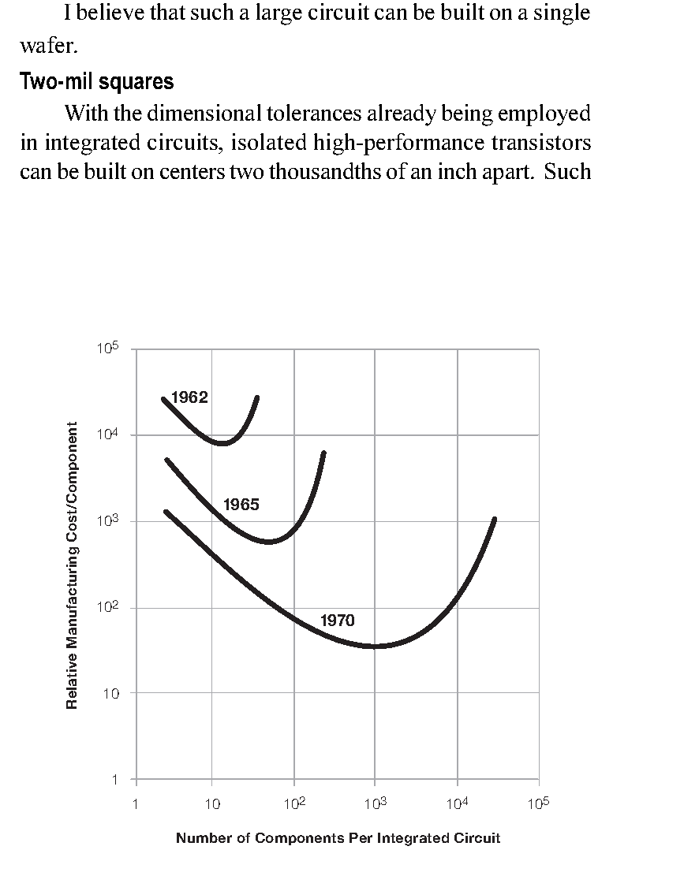
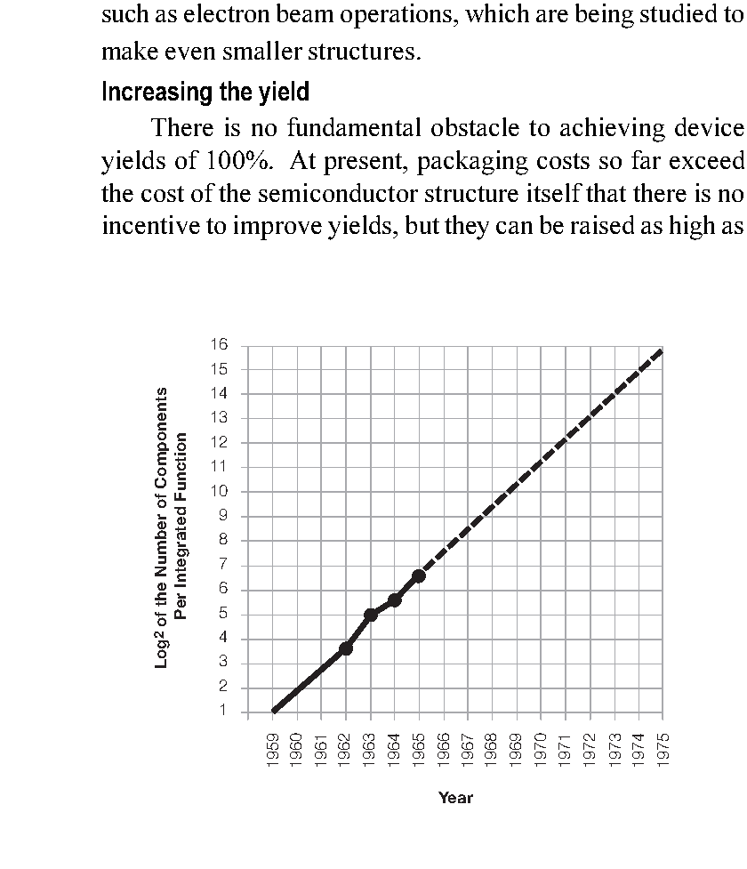

# 把更多元件塞进集成电路

**Gordon E. Moore**  
仙童半导体研究与发展实验室主任，Fairchild Camera and Instrument Corp. 分部

> 随着每个电路中元件数增加，单位成本下降。到 1975 年，经济性可能要求在单个硅片上塞进多达 65,000 个元件。

## 作者简介

Gordon E. Moore 博士是新型电子工程师之一，他受的是物理科学训练，而非电子学训练。他在加州大学获得化学学士学位，在加州理工学院获得物理化学博士学位。他是仙童半导体的创始人之一，自 1959 年起担任研究与发展实验室主任。

## 引言

集成电子学的未来就是电子学本身的未来。集成带来的优势将导致电子学扩散，把这门科学推进许多新领域。

集成电路将带来这样的奇迹：家庭计算机——或者至少连接到中央计算机的终端——汽车自动控制，以及个人便携通信设备。电子手表如今只需要一个显示器就可以实现。

但最大的潜力在于大型系统的生产。在电话通信中，集成电路中的数字滤波器将分离复用设备上的信道；集成电路还将交换电话线路并执行数据处理。

计算机将更强大，并以完全不同的方式组织。例如，由集成电子器件构成的存储器可以分布在整个机器中，而不是集中在中央单元。此外，集成电路带来的可靠性改进，将使构建更大的处理单元成为可能。与今天已有的机器类似的机器，将以更低成本、更快周转时间被制造出来。

## 现在与未来

我所说的集成电子学，指今天称为微电子学的各种技术，以及任何额外的技术——这些技术把电子功能作为不可再分的单元提供给用户。这些技术最早在 1950 年代末被研究，目标是使电子设备小型化，在最小重量下把越来越复杂的电子功能装入有限空间。出现了若干路线，包括单个元件的微组装技术、薄膜结构以及半导体集成电路。

每种路线都迅速发展并相互汇聚，彼此借鉴技术。许多研究者相信，未来之路是各种方法的组合。

半导体集成电路的支持者已经在使用薄膜电阻的改良特性，把这种薄膜直接淀积在有源半导体衬底上；而主张基于薄膜技术的人，则在开发把有源半导体器件连接到无源薄膜阵列上的复杂技术。两种方法都运行良好，并已用于今天的设备中。

## 集成电子学已经确立

集成电子学如今已经确立。对于新的军用系统，其技术几乎是必需的，因为某些系统所要求的可靠性、尺寸和重量只能通过集成实现。阿波罗载人登月计划等项目已经证明了集成电子学的可靠性：完整电路功能的失效概率与最好的单个晶体管一样低。

商业计算机领域的大多数公司，都有采用集成电子学的机器处于设计或早期生产阶段。这些机器比使用“传统”电子学的机器成本更低、性能更好。

各种仪器，特别是越来越多采用数字技术的仪器，正开始使用集成，因为它降低了制造和设计成本。

线性集成电路的使用仍主要限于军事领域。这类集成功能价格昂贵，且种类不足，无法满足大部分线性电子学需求。但首批应用已开始出现在商业电子设备中，特别是需要小型低频放大器的设备。

## 可靠性至关重要

几乎在所有情形下，集成电子学都表现出高可靠性。即便在当前生产水平下——与分立元件相比仍然较低——它已降低了系统成本，并在许多系统中实现了性能改进。

集成电子学将使电子技术更普遍地应用于整个社会，执行许多目前由其它技术完成得不充分或根本无法完成的功能。主要优势将是更低成本和极大简化的设计——这是随时可获得低成本功能封装带来的回报。

对大多数应用而言，半导体集成电路将占主导。半导体器件是目前唯一合理的集成电路有源元件候选者。无源半导体元件也很有吸引力，因为它们有低成本和高可靠性的潜力；但只有在精度不是首要要求时才能使用。

硅很可能仍是基本材料，尽管其它材料会在特定应用中发挥作用。例如砷化镓在集成微波功能中将很重要。但在较低频率下，硅将占主导，因为围绕硅及其氧化物已经形成了成熟技术，而且硅是丰富且相对便宜的起始材料。

## 成本与曲线

降低成本是集成电子学的主要吸引力之一，而且随着技术演进，在单个半导体衬底上生产越来越大的电路功能，成本优势持续增加。

对简单电路而言，每元件成本几乎与元件数成反比。这是把若干相同电路封装进等效封装的等效半导体片中所得到的结果，该封装含有更多元件。但随着元件增加，良率下降带来的影响超过了复杂度增加的影响，倾向于抬高每元件成本。因此，在技术演进的任一给定时刻，都存在一个最小成本。目前，当每个电路使用 50 个元件时达到最小成本。但最小值正在迅速上升，同时整条成本曲线正在下降（见下图）。若向前看五年，成本曲线表明，每元件最小成本可能出现在每电路约 1,000 个元件处（前提是这种电路功能能中等批量生产）。到 1970 年，每元件制造成本预计只有当前成本的十分之一。

达到最小元件成本的复杂度，一直以大约每年翻一番的速率增长（见下页图）。当然，短期内这一速率可望持续，甚至提高。长期看，增长率稍不确定，但没有理由认为它不会在至少 10 年内保持近乎恒定。这意味着到 1975 年，为达到最小成本，单个集成电路中的元件数将达到 65,000。

我相信这样的电路可以构建在单个晶圆上。

## 两密耳见方

利用集成电路中已经采用的尺寸公差，隔离的高性能晶体管可以以千分之二英寸的间距构建。这样一个两密耳见方的区域也能包含几千欧姆电阻或几个二极管。这允许每线性英寸至少 500 个元件，即每平方英寸约 25 万个元件。因此，65,000 个元件只需占据约四分之一平方英寸。

在目前使用的硅晶圆上，通常直径一英寸或更大，如果元件能紧密排列而不为互连图形浪费空间，则这种结构有足够空间。这是现实的，因为为了把复杂度提升到现有集成电路之上，人们已经在采用由介质薄膜隔开的多层金属化图形。这种元件密度可由现有光学技术实现，并不需要正在研究用于制造更小结构的电子束操作等更奇异技术。

## 提高良率

实现 100% 器件良率没有根本障碍。目前，封装成本远远超过半导体结构本身成本，因此没有提高良率的动力；但良率可以提高到经济上合理的程度。不存在与化学反应中常限制良率的热力学平衡考虑相当的障碍；甚至不需要做任何基础研究或替换现有工艺，只需要工程努力。

在集成电路早期，当良率极低时，确实存在这种动力。如今，普通集成电路的良率已可与单个半导体器件相比。如果其它考虑使这种阵列值得采用，同样的模式将使更大阵列变得经济。

## 散热问题

能否去除单个硅片上数万个元件产生的热量？

如果把一台标准高速数字计算机的体积缩小到仅容纳元件本身，我们预计它会因当前功耗而发出明亮的光。但集成电路不会如此。由于集成电子结构是二维的，每个发热中心附近都有可用于冷却的表面。此外，功率主要用于驱动系统中的各种线路和电容。只要一个功能限于晶圆上的小区域，必须驱动的电容就相当有限。事实上，在集成结构上缩小尺寸，使该结构在单位面积功率相同的情况下能以更高速度运行。

## 清算之日

显然，我们将能够制造这种元件密集的设备。接下来要问的是，在什么情况下应该这样做。必须最小化实现某一系统功能的总成本。为此，可把工程成本分摊到若干相同项目上，或开发灵活技术来设计大功能，使某个特定阵列不必承担不成比例的费用。也许新设计自动化过程能无需特殊工程，就把逻辑图转换为技术实现。

把大型系统由较小功能构建，或许更经济：这些较小功能分别封装并互连。大功能的可用性，结合功能化设计与构造，将使大型系统制造商能快速且经济地设计和构建多种设备。

## 线性电路

集成不会像改变数字系统那样彻底改变线性系统。尽管如此，线性电路也会达到相当程度的集成。在线性领域，集成电子学最大的基本限制，是缺少大容量电容和电感。

这些元件按其本质要求在一个体积中存储能量。为获得高 Q，体积必须很大。大体积与集成电子学之间的不相容性，从术语本身即可看出。某些谐振现象，例如压电晶体中的谐振，可望在调谐功能中得到一些应用，但电感和电容仍会与我们共存一段时间。

未来的集成射频放大器，很可能由集成增益级构成，以最低成本提供高性能，其间穿插相对较大的调谐元件。

其它线性功能也会发生很大变化。集成结构中相似元件的匹配和跟踪，将允许设计性能大幅提高的差分放大器。利用热反馈效应把集成结构稳定到小数点后某一度的一小部分，将能构建具有晶体稳定性的振荡器。

即使在微波领域，包含在集成电子学定义中的结构也将变得越来越重要。制造和装配与所涉波长相比很小的元件，将允许使用集总参数设计，至少在较低频率如此。目前还难以预测集成电子学对微波领域的侵入会有多广泛。例如，利用大量集成微波功率源成功实现相控阵天线，可能彻底革新雷达。
