# 大型共享数据库的关系模型

**E. F. Codd**

IBM Research Laboratory, San Jose, California

## 摘要

大型数据库的未来用户不应被迫知道数据在机器中如何组织（即内部表示）。提供一种提示服务来告知这些信息，并不是令人满意的解决方案。当数据的内部表示发生变化，甚至外部表示的某些方面发生变化时，终端用户活动和多数应用程序都应保持不变。由于查询、更新和报表流量的变化，以及所存储信息类型的自然增长，数据表示的改变往往是必要的。

现有的非推理式、格式化数据系统向用户提供树状文件或稍微更一般的数据网络模型。第 1 节讨论这些模型的不足；文中引入一种基于 $n$ 元关系的模型、一种用于数据库关系的范式，以及通用数据子语言的概念。第 2 节讨论关系的若干运算（逻辑推理之外），并把它们应用于用户模型中的冗余与一致性问题。

## 1. 关系模型与范式

### 1.1 引言

本文关注初等关系理论在如下系统中的应用：这些系统提供对大量格式化数据集合的共享访问。除 Childs 的一篇论文 [1] 外，关系在数据系统中的主要应用一直是演绎式问答系统。Levein 与 Maron [2] 给出了该领域的大量参考文献。相比之下，这里处理的问题是**数据独立性**——应用程序和终端活动独立于数据类型增长与数据表示变化——以及某些类型的数据不一致性；即使在不具演绎能力的系统中，这些问题预计也会变得棘手。

第 1 节描述的关系观点（或模型）在若干方面似乎优于当前非推理系统中流行的图模型或网络模型 [3, 4]。它提供了一种仅按照数据的自然结构描述数据的方式，也就是说，不为机器表示目的叠加任何额外结构。因此，它为一种高级数据语言提供了基础，这种语言将在程序与机器表示及数据组织之间产生最大程度的独立性。

关系观点的另一个优点是，它为处理关系的可推导性、冗余性和一致性提供了坚实基础；这些问题将在第 2 节讨论。另一方面，网络模型产生了许多混淆，其中尤其重要的是把**连接的推导**误认为**关系的推导**（见第 2 节关于“连接陷阱”的评述）。

最后，关系观点使得我们可以更清楚地评估当前格式化数据系统的范围与逻辑限制，也能更清楚地比较单一系统内相互竞争的数据表示的相对优点（从逻辑角度看）。本文不同部分引用了若干例子来说明这种更清晰的视角。本文不讨论支持关系模型的系统实现。

### 1.2 当前系统中的数据依赖性

在最近开发的信息系统中提供数据描述表，是朝向数据独立性目标的一项重大进展 [5, 6, 7]。这种表有助于改变数据库中存储的数据表示的某些特征。然而，在不逻辑损害某些应用程序的前提下可以改变的数据表示特征种类仍然相当有限。此外，用户与之交互的数据模型仍然充斥着表示属性，特别是在数据集合（相对于单个项）的表示方面。仍需消除的三类主要数据依赖是：排序依赖、索引依赖和访问路径依赖。在某些系统中，这些依赖彼此并不能清楚地区分。

#### 1.2.1 排序依赖

数据库中的数据元素可以以多种方式存储：有些不考虑顺序，有些允许每个元素只参与一种排序，另一些允许每个元素参与多种排序。考虑现有那些要求或允许数据元素至少以一种与硬件决定的地址顺序密切相关的全序存储的系统。例如，关于零件的文件记录可以按零件序列号升序存储。这类系统通常允许应用程序假定：从这种文件中呈现给程序的记录顺序与存储顺序相同（或是其子序列）。利用文件存储顺序的应用程序，如果由于某种原因必须用另一种顺序替代该顺序，很可能无法正确运行。通过指针实现的存储排序也有类似情况。

没有必要单独挑出某个系统作为例子，因为当今市场上所有知名的信息系统都没有清楚地区分“呈现顺序”与“存储顺序”。要提供这种独立性，必须解决重要的实现问题。

#### 1.2.2 索引依赖

在格式化数据的语境中，索引通常被认为是数据表示中纯粹面向性能的组件。它倾向于改善查询和更新的响应，同时减慢插入和删除的响应。从信息角度看，索引是数据表示中的冗余组件。如果系统使用索引，并且要在数据库活动模式不断变化的环境中表现良好，那么可能需要具备不时创建和销毁索引的能力。于是问题出现了：随着索引的出现与消失，应用程序和终端活动能否保持不变？

当前的格式化数据系统采用非常不同的索引方式。TDMS [7] 无条件地对所有属性提供索引。当前发布的 IMS 版本 [5] 为每个文件提供选择：要么完全不索引（层次顺序组织），要么仅对主键索引（层次索引顺序组织）。在这两种情况下，用户的应用程序逻辑都不依赖于无条件提供的索引存在。然而，IDS [8] 允许文件设计者选择要索引的属性，并通过附加链把索引纳入文件结构。利用这些索引链性能优势的应用程序必须按名字引用这些链；如果这些链后来被移除，这些程序就无法正确运行。

#### 1.2.3 访问路径依赖

许多现有格式化数据系统向用户提供树状文件或稍一般的数据网络模型。为这些系统开发的应用程序，如果树或网络结构发生变化，往往会在逻辑上受损。下面是一个简单例子。

假设数据库包含关于零件和项目的信息。对每个零件记录零件号、零件名、零件描述、现有数量和订购数量。对每个项目记录项目编号、项目名称、项目描述。每当某项目使用某零件时，还记录该零件承诺给该项目的数量。假设系统要求用户或文件设计者以树结构声明或定义数据。那么，对于上述信息可以采用以下任一层次结构（结构 1–5）。

```text
结构 1. 零件下辖项目
文件  段        字段
F     PART     零件号、零件名、零件描述、现有数量、订购数量
        PROJECT  项目编号、项目名称、项目描述、承诺数量

结构 2. 项目下辖零件
文件  段        字段
F     PROJECT  项目编号、项目名称、项目描述
        PART     零件号、零件名、零件描述、现有数量、订购数量、承诺数量

结构 3. 零件与项目同级；承诺联系从属于项目
文件  段        字段
F     PART     零件号、零件名、零件描述、现有数量、订购数量
G     PROJECT  项目编号、项目名称、项目描述
        PART     零件号、承诺数量

结构 4. 零件与项目同级；承诺联系从属于零件
文件  段        字段
F     PART     零件号、零件描述、现有数量、订购数量
        PROJECT  项目编号、承诺数量
G     PROJECT  项目编号、项目名称、项目描述

结构 5. 零件、项目与承诺联系同级
文件  段        字段
F     PART     零件号、零件名、零件描述、现有数量、订购数量
G     PROJECT  项目编号、项目名称、项目描述
H     COMMIT   零件号、项目编号、承诺数量
```

现在考虑如下问题：打印出名为 “alpha” 的项目所使用的每个零件的零件号、零件名和承诺数量。无论选择哪种可用的面向树的信息系统，都可以作如下观察。如果为这个问题开发的程序 $P$ 假定上述五种结构之一（即 $P$ 不测试当前生效的是哪种结构），那么 $P$ 至少会在其余三种结构上失败。更具体地说，如果 $P$ 在结构 5 上成功，它在其他所有结构上都会失败；如果 $P$ 在结构 3 或 4 上成功，它至少会在 1、2、5 上失败；如果 $P$ 在结构 1 或 2 上成功，它至少会在 3、4、5 上失败。原因很简单：在没有测试当前结构的情况下，$P$ 要么试图引用不存在的文件（可用系统将其视为错误），要么没有尝试引用包含所需信息的文件。不相信的读者可以为这个简单问题编写示例程序。

由于通常不现实去开发能测试系统允许的所有树结构的应用程序，所以当结构需要改变时，这些程序就会失败。

向用户提供数据网络模型的系统也会遇到类似困难。在树和网络两种情况下，用户（或其程序）都被要求利用一组用户访问路径来访问数据。这些路径是否与存储表示中由指针定义的路径密切对应并不重要——在 IDS 中对应关系极其简单，在 TDMS 中则正好相反。其结果是，无论存储表示如何，终端活动和程序都变得依赖于这些用户访问路径的持续存在。

一种解决办法是采用这样的策略：一旦定义了用户访问路径，在使用该路径的所有应用程序废弃之前，不得使其失效。这种策略并不实际，因为对于数据库用户群体而言，整个模型中的访问路径数量最终会变得过多。

### 1.3 数据的关系观点

这里使用的“关系”一词采用其公认的数学意义。给定集合 $S_1,S_2,\ldots,S_n$（不必互不相同），如果 $R$ 是一个 $n$ 元组集合，且每个元组的第一个元素来自 $S_1$、第二个元素来自 $S_2$，依此类推，那么 $R$ 是这 $n$ 个集合上的一个关系[^1]。更简洁地说，$R$ 是笛卡尔积 $S_1\times S_2\times\cdots\times S_n$ 的子集。我们把 $S_j$ 称为 $R$ 的第 $j$ 个域。按上述定义，$R$ 的**度**为 $n$。度为 1 的关系常称为一元关系，度为 2 称为二元关系，度为 3 称为三元关系，度为 $n$ 称为 $n$ 元关系。

为便于说明，我们经常使用关系的数组表示，但必须记住，这种特定表示并不是所阐述关系观点的本质部分。表示 $n$ 元关系 $R$ 的数组具有以下性质：

1. 每一行表示 $R$ 的一个 $n$ 元组；
2. 行的顺序无关紧要；
3. 所有行互不相同；
4. 列的顺序是有意义的——它对应于定义 $R$ 的域的顺序 $S_1,S_2,\ldots,S_n$（不过，也见下面关于域有序关系和域无序关系的评述）；
5. 每一列的意义部分地通过标注相应域的名称来传达。

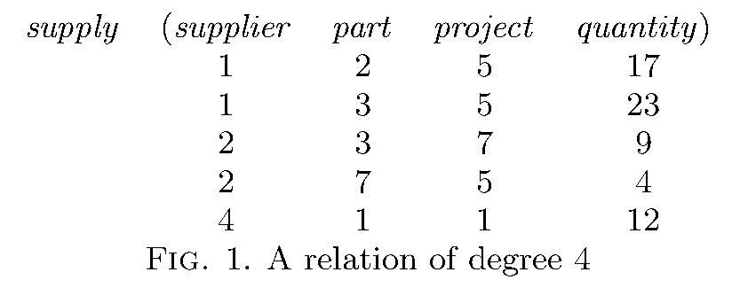

图 1 的例子展示了一个名为 `supply` 的度为 4 的关系，它反映了指定供应商向指定项目按指定数量运送零件的在途情况。

有人可能会问：如果列是用相应域的名称标注的，为什么列的顺序还重要？图 2 的例子表明，两列可能具有相同的标题（表示相同的域），但相对于该关系却具有不同意义。图中所示关系称为 `component`。它是一个三元关系，前两个域称为 `part`，第三个域称为 `quantity`。`component(x,y,z)` 的含义是：零件 $x$ 是零件 $y$ 的直接组成部分（或子装配），装配一个单位的 $y$ 需要 $z$ 个单位的 $x$。它在零件展开问题中起关键作用。

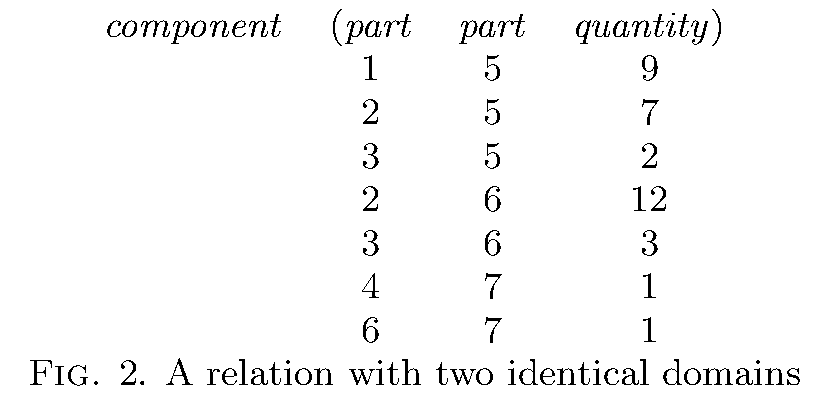

值得注意的是，若干现有信息系统（主要是基于树状文件的系统）未能为具有两个或更多相同域的关系提供数据表示。当前版本的 IMS/360 [5] 就是这样的系统之一。

==数据库中的数据整体可以看作一组随时间变化的关系集合==。这些关系具有不同度。随着时间推移，每个 $n$ 元关系都可能经历插入新的 $n$ 元组、删除已有元组，以及改变已有元组分量等操作。

然而，在许多商业、政府和科学数据库中，有些关系的度相当高（度为 30 并不少见）。通常不应让用户负担记住任何关系的域顺序（例如 `supply` 关系中的 supplier、part、project、quantity 顺序）。因此，我们建议用户处理的不是**域有序关系**，而是与之对应的**域无序联系**[^2]。为实现这一点，域必须至少在给定关系内无需位置即可唯一标识。于是，在存在两个或更多相同域的地方，我们要求每次都用不同的**角色名**限定域名，该角色名用于标识该域在给定关系中所扮演的角色。例如，在图 2 的 `component` 关系中，第一个 `part` 域可以用角色名 `sub` 限定，第二个用 `super` 限定，这样用户就可以处理联系 `component` 及其域——`sub.part`、`super.part`、`quantity`——而不必考虑这些域之间的顺序。

总之，我们建议多数用户交互的是一个由随时间变化的**联系**（而非关系）组成的关系模型。每个用户只需知道每个联系的名称及其域名（必要时用角色限定）即可[^3]。甚至这些信息也可以由系统按菜单方式（受安全与隐私约束）在用户请求时提供。

为一个数据库建立关系模型通常有许多可选方式。为了讨论一种优选方式（或范式），我们先引入几个附加概念：活动域、主键、外键、非简单域，并建立与当前信息系统编程术语的一些联系。本文余下部分，除明确说明有必要区分时外，不再区分关系与联系。

考虑一个包含零件、项目和供应商关系的数据库示例。一个名为 `part` 的关系定义在以下域上：

1. 零件号；
2. 零件名；
3. 零件颜色；
4. 零件重量；
5. 现有数量；
6. 订购数量；

也可能还有其他域。每个域实际上是一个值的池，其中部分或全部值可能在某些时刻在数据库中表示出来。虽然可以设想在某一时刻所有零件颜色都出现了，但所有可能的零件重量、零件名和零件号都出现则不太可能。我们把某一时刻表示出来的值集合称为该时刻的**活动域**。

通常，给定关系的一个域（或域组合）的值能唯一标识该关系的每个元素（$n$ 元组）。这样的域（或域组合）称为**主键**。在上面的例子中，零件号会是主键，而零件颜色则不是。如果主键要么是简单域（不是组合），要么是一个组合且其中没有任何简单域在唯一标识每个元素时是多余的，则称该主键是**非冗余的**。一个关系可能拥有多个非冗余主键；如果不同零件总是被赋予不同名字，那么上面的例子就会出现这种情况。每当一个关系有两个或更多非冗余主键时，任意选择其中一个称为该关系的主键。

一个常见要求是，关系的元素需要交叉引用同一关系或其他关系的元素。键提供了一种面向用户的表达这种交叉引用的手段（但不是唯一手段）。如果关系 $R$ 的某个域（或域组合）不是 $R$ 的主键，但其元素是某关系 $S$ 的主键值（不排除 $S$ 与 $R$ 相同），则称它为 $R$ 的**外键**。在图 1 的 `supply` 关系中，`supplier`、`part`、`project` 的组合是主键，而这三个域单独看都是外键。

以往工作中存在一种强烈倾向：把数据库中的数据看作两部分，一部分由实体描述组成（例如供应商描述），另一部分由各实体或实体类型之间的关系组成（例如 `supply` 关系）。当任何关系中都可能有外键时，这种区分难以维持。在用户的关系模型中，作这种区分似乎没有好处；不过，当把关系概念应用于用户联系集合的机器表示时，可能有一些好处。

到目前为止，我们讨论的关系例子都定义在**简单域**上——即其元素为原子（不可分解）值的域。非原子值也可以在关系框架中讨论。因此，某些域可能以关系作为元素；这些关系又可以定义在非简单域上，依此类推。例如，定义 `employee` 关系的某个域可能是 `salary history`。`salary history` 域的一个元素是在 `date` 域和 `salary` 域上定义的二元关系。`salary history` 域就是所有这类二元关系的集合。在任一时刻，数据库中 `salary history` 关系的实例数与员工数一样多；相比之下，`employee` 关系只有一个实例。

当前数据库术语中的 `attribute` 和 `repeating group` 大致分别类似于简单域和非简单域。当前术语中的许多混淆源于未能区分类型与实例（如“记录”一词所示），也未能区分用户数据模型的成分与其机器表示对应物（同样以“记录”为例）。

[^1]: 更简洁地说，$R$ 是笛卡尔积 $S_1\times S_2\times\cdots\times S_n$ 的子集。
[^2]: 数学上，联系是在域置换下等价的那些关系的等价类（见第 2.1.1 节）。
[^3]: 自然，与任何存入和从计算机系统检索的数据一样，如果用户了解其含义，通常会更有效地利用这些数据。

### 1.4 范式

一个所有域都是简单域的关系，可以用存储中上述那种二维的列同质数组来表示。对于具有一个或多个非简单域的关系，则需要某种更复杂的数据结构。由于这个原因（以及下文将提到的其他原因），消除非简单域的可能性值得研究[^4]。事实上，存在一种非常简单的消除过程，我们称之为**规范化**。

例如，考虑图 3(a) 所示的关系集合。`jobhistory` 和 `children` 是 `employee` 关系的非简单域。`salaryhistory` 是 `jobhistory` 关系的非简单域。图 3(a) 中的树只展示了这些非简单域之间的相互关系。

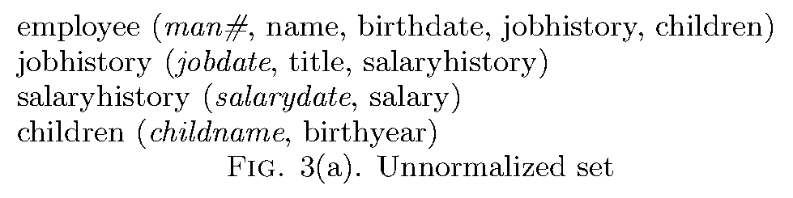

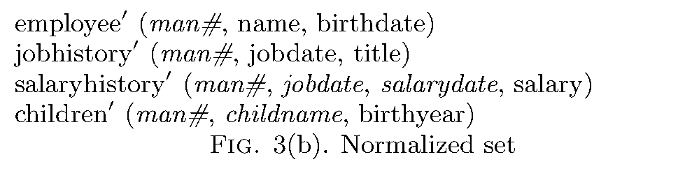

规范化过程如下。从树顶端的关系开始，取其主键，并通过插入该主键域或域组合来扩展每个直接下级关系。每个被扩展关系的主键，由扩展前的主键加上从父关系复制下来的主键构成。然后，从父关系中划去所有非简单域，移除树的顶端节点，并在每个剩余子树上重复同样的操作序列。

对图 3(a) 中的关系集合进行规范化的结果，就是图 3(b) 中的集合。每个关系的主键用斜体表示，以展示这些键是如何通过规范化被扩展的。

如果要使上述规范化适用，未规范化的关系集合必须满足以下条件：

1. 非简单域相互关系的图是一组树；
2. 任何主键都不含有非简单域作为其组成域。

作者不知道有什么应用需要放宽这些条件。还可以进行其他规范化类型的操作；本文不讨论这些操作。

当所有关系都转换为范式后，数组表示的简洁性不仅有利于存储，也有利于在使用截然不同数据表示的系统之间传输批量数据。通信形式将是数组表示的适当压缩版本，并具有以下优点：

1. 它不含指针（地址值或位移值）；
2. 它避免了对散列寻址方案的任何依赖；
3. 它不含索引或排序表。

如果用户的关系模型以范式建立，数据库中数据项的名称可以采用比在其他情况下更简单的形式。一般名称的形式如下：

$$R(g).r.d$$

其中 $R$ 是关系名；$g$ 是代标识符（可选）；$r$ 是角色名（可选）；$d$ 是域名。由于 $g$ 仅在给定关系的若干代存在或预期存在时才需要，而 $r$ 仅在关系 $R$ 有两个或更多名为 $d$ 的域时才需要，因此简单形式 $R.d$ 通常就足够了。

[^4]: IBM San Jose 的 M. E. Sanko 独立认识到消除非简单域的可取性。

### 1.5 若干语言方面的问题

采用上述关系模型，使得开发一种基于应用谓词演算的通用数据子语言成为可能。如果关系集合处于范式，一阶谓词演算就足够了。这样的语言将为所有其他被提出的数据语言提供语言能力的标尺，并且其自身也是嵌入多种宿主语言（程序设计语言、命令式或面向问题的语言）的强有力候选者（需作适当语法修改）。

本文的目的不是详细描述这样的语言，但其显著特征如下。我们用 $R$ 表示数据子语言，用 $H$ 表示宿主语言。$R$ 允许声明关系及其域。每个关系的声明都要标识该关系的主键。被声明的关系被加入系统目录，供用户群体中具有适当权限的成员使用。$H$ 允许支持性声明，这些声明可能不那么持久，用于说明这些关系在存储中如何表示。$R$ 允许指定从数据库中检索数据的任何子集。对此类检索请求的处理受安全约束限制。

数据子语言的通用性在于其描述能力（而非计算能力）。在大型数据库中，数据的每个子集都有大量可能（且合理）的描述，即使我们（确实）假设系统可访问的函数子程序集合是有限的，这些子程序用于限定待检索的数据。因此，集合说明中可用的限定表达式类别，必须具有应用谓词演算中良构公式类别的描述能力。众所周知，为了保持这种描述能力，并不一定需要在所选语法中表达所选谓词演算的每个公式。例如，仅使用前束范式就足够了 [9]。

限定表达式或检索语句的其他部分可能需要算术函数。此类函数可以在 $H$ 中定义，并在 $R$ 中调用。

这样指定的集合，可以仅为查询目的而取出，也可以保留下来以便可能的更改。插入采取向已声明关系添加新元素的形式，而不考虑这些关系在机器表示中可能存在的任何顺序。对用户群体整体有效（而非对单个用户或子群体有效）的删除，采取从已声明关系中移除元素的形式。如果在 $R$ 中声明了指定关系之间的删除依赖和更新依赖，则某些删除和更新可以由其他删除和更新触发。

看待数据的观点对用于检索数据的语言的一个重要影响，体现在数据元素和集合的命名上。其中某些方面已在上节讨论。采用通常的网络观点时，用户常常会不得不创造并使用比绝对必要更多的关系名，因为名称是与路径（或路径类型）相关联的，而不是与关系相关联的。

一旦用户知道某个关系被存储，他就会期望能够利用[^5]它，使用其参数的任意组合作为“已知项”，其余参数作为“未知项”，因为信息（如同 Everest 一样）就在那里。这是当前许多信息系统所缺少的一项系统特性，我们称之为（逻辑上的）**关系的对称利用**。当然，性能上的对称并不应被期待。

为了支持单个二元关系的对称利用，需要两条有向路径。对于度为 $n$ 的关系，需要命名和控制的路径数是 $n$ 的阶乘。

再者，如果采用这样一种关系观点：用户必须把每个 $n$ 元关系（$n>2$）表示为只涉及二元关系的嵌套表达式（例如见 Feldman 的 LEAP 系统 [10]），那么必须创造 $2n-1$ 个名称，而采用第 1.2 节所述的直接 $n$ 元表示法只需要 $n+1$ 个名称。例如，图 1 中的四元关系 `supply` 在 $n$ 元表示法中需要 5 个名称，而在嵌套二元表示法中可表示为：

$$P(\text{supplier}, Q(\text{part}, R(\text{project}, \text{quantity})))$$

因此会使用 7 个名称。这种表达式的另一个缺点是它的不对称性。尽管这种不对称性并不禁止对称利用，但它肯定会让用户难以表达某些查询基础（例如，考虑这样一个查询：查询通过 $Q$ 和 $R$ 与某些给定项目相关联的零件和数量）。

[^5]: 利用关系包括查询、更新和删除。

### 1.6 可表达的、命名的和存储的关系

与数据库相关联的是两个关系集合：命名集合与可表达集合。**命名集合**是用户群体可以用简单名称（或标识符）识别的所有关系的集合。当具有适当权限的用户声明关系 $R$ 时，$R$ 就获得命名集合中的成员资格；当具有适当权限的用户取消对 $R$ 的声明时，$R$ 就失去成员资格。

**可表达集合**是可以用数据语言中的表达式指定的所有关系的总集合。这样的表达式由以下成分构造：命名集合中关系的简单名称；代、角色和域的名称；逻辑连接词；谓词演算的量词[^6]；以及某些常量关系符号，例如 $=$、$>$。命名集合是可表达集合的子集——通常是一个非常小的子集。

由于命名集合中的某些关系可能是该集合中其他关系的与时间无关的组合，因此，考虑为命名集合关联一组定义这些时间无关约束的语句是有用的。在引入若干关系运算之后，我们再推迟进一步讨论这一点（见第 2 节）。

对于要为用户支持关系模型的数据系统设计者而言，主要问题之一是确定要支持的存储表示类别。理想情况下，所允许的数据表示种类应恰好足以覆盖所有安装环境的性能需求范围。种类过多会导致不必要的存储开销，以及对当前生效结构的描述进行持续重新解释。

对于任何选定的存储表示类别，数据系统必须提供一种手段，把用关系模型的数据语言表达的用户请求，翻译成对当前存储表示的相应且高效的动作。对于高级数据语言来说，这是一个具有挑战性的设计问题。尽管如此，这是一个必须解决的问题——随着越来越多的用户获得对大型数据库的并发访问，提供高效响应和吞吐量的责任正从单个用户转移到数据系统本身。

[^6]: 由于实际数据库中的每一个关系在每一时刻都是有限集，存在量词和全称量词可以用一个计算任意有限集合中元素个数的函数来表示。

## 2. 冗余与一致性

### 2.1 关系上的运算

由于**关系是集合**，所有通常的集合运算都适用于关系。然而，结果可能不是一个关系；例如，二元关系与三元关系的并集就不是一个关系。

下面讨论的运算是专门针对关系的。引入这些运算，是因为它们在从其他关系推导关系方面发挥着关键作用。它们的主要应用是在非推理式信息系统中——即不提供逻辑推理服务的系统——不过，当加入此类服务时，它们的适用性并不一定被破坏。

多数用户不会直接关心这些运算。然而，信息系统设计者以及关注数据库控制的人员，应当彻底熟悉它们。

#### 2.1.1 置换

二元关系具有两列的数组表示。交换这两列就得到逆关系。更一般地说，如果对 $n$ 元关系的列施加一个置换，所得关系称为给定关系的一个置换。例如，若包括保持列顺序不变的恒等置换，图 1 中的 `supply` 关系有 $4! = 24$ 个置换。

由于用户的关系模型由联系（域无序关系）集合组成，单独考虑这一模型时，置换并不相关。然而，对于该模型的存储表示而言，置换是相关的。在提供关系对称利用的系统中，一个存储关系所能回答的查询集合，与它的任何置换所能回答的查询集合相同。虽然在逻辑上没有必要同时存储一个关系及其某个置换，但性能方面的考虑可能使这样做成为可取的选择。

#### 2.1.2 投影

现在假设我们选择关系的某些列（划去其他列），然后从所得数组中移除行中的任何重复项。最终数组所表示的关系，称为给定关系的一个**投影**。我们使用选择算子 $\pi$ 来获得任何所需的置换、投影，或两者的组合。因此，如果 $L$ 是一个由 $k$ 个索引组成的列表[^7] $L = i_1,i_2,\ldots,i_k$，而 $R$ 是一个 $n$ 元关系（$n\ge k$），那么 $\pi_L(R)$ 是这样一个 $k$ 元关系：其第 $j$ 列是 $R$ 的第 $i_j$ 列（$j=1,2,\ldots,k$），但要移除结果行中的重复项。考虑图 1 中的 `supply` 关系，其一个置换投影如图 4 所示。注意，在这个特定情形下，投影的 $n$ 元组数少于它所由之导出的关系。

[^7]: 处理联系时，我们使用域名（必要时用角色限定）而不是域位置。

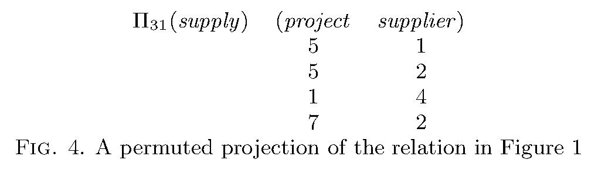

#### 2.1.3 连接

假设给定两个具有某个共同域的二元关系。在什么条件下可以把这些关系组合起来，形成一个保留给定关系中全部信息的三元关系？

图 5 中的例子展示了两个可以无信息损失地连接的关系 $R$、$S$；图 6 展示了 $R$ 与 $S$ 的一个连接。如果存在一个三元关系 $U$，使得 $\pi_{12}(U)=R$ 且 $\pi_{23}(U)=S$，则称二元关系 $R$ 与二元关系 $S$ **可连接**。任何这样的三元关系都称为 $R$ 与 $S$ 的一个连接。如果 $R$、$S$ 是二元关系且满足 $\pi_2(R)=\pi_1(S)$，那么 $R$ 可与 $S$ 连接。在这种情况下始终存在的一个连接，是 $R$ 与 $S$ 的**自然连接**，定义为：

$$R * S = \{(a,b,c) : R(a,b) \land S(b,c)\}$$

其中，如果 $(a,b)$ 是 $R$ 的成员，则 $R(a,b)$ 取值为真，$S(b,c)$ 同理。立即可以得出：

$$\pi_{12}(R * S) = R$$

以及

$$\pi_{23}(R * S) = S.$$

注意，图 6 所示的连接是图 5 中 $R$ 与 $S$ 的自然连接。另一个连接如图 7 所示。考察这些关系可以发现，在连接所依据的域 `part` 中有一个元素（元素 1），它在 $R$ 下和 $S$ 下都拥有不止一个相对项。正是这个元素导致了多个连接的存在。连接域中的这种元素，称为关于 $R$ 与 $S$ 连接的一个**歧义点**。

如果 $\pi_{21}(R)$ 或 $S$ 是函数[^8]，则在连接 $R$ 与 $S$ 时不会出现歧义点。在这种情况下，$R$ 与 $S$ 的自然连接就是它们唯一的连接。注意，反复限定“$R$ 与 $S$ 的连接”是必要的，因为 $S$ 也可能与 $R$ 可连接（正如 $R$ 与 $S$ 可连接一样），而这种连接是完全不同的考虑事项。在图 5 中，关系 $R$、$\pi_{21}(R)$、$S$、$\pi_{21}(S)$ 都不是函数。

$R$ 与 $S$ 连接中的歧义有时可以借助其他关系来消解。假设给定（或可以从独立于 $R$ 和 $S$ 的来源推导出）一个定义在 `project` 和 `supplier` 域上的关系 $T$，具有以下性质：

1. $\pi_1(T)=\pi_2(S)$；
2. $\pi_2(T)=\pi_1(R)$；
3. $T(j,s)\to\exists p\,(R(s,p)\land S(p,j))$；
4. $R(s,p)\to\exists j\,(S(p,j)\land T(j,s))$；
5. $S(p,j)\to\exists s\,(T(j,s)\land R(s,p))$。

那么我们可以构成 $R$、$S$、$T$ 的三方连接，即一个三元关系 $U$，使得：

$$\pi_{12}(U)=R,\quad \pi_{23}(U)=S,\quad \pi_{31}(U)=T.$$

这样的连接称为**循环三元连接**，以区别于**线性三元连接**——后者是一个四元关系 $V$，满足：

$$\pi_{12}(V)=R,\quad \pi_{23}(V)=S,\quad \pi_{34}(V)=T.$$

[^8]: 函数是这样的二元关系：它是一对一或多对一，但不是一对多。

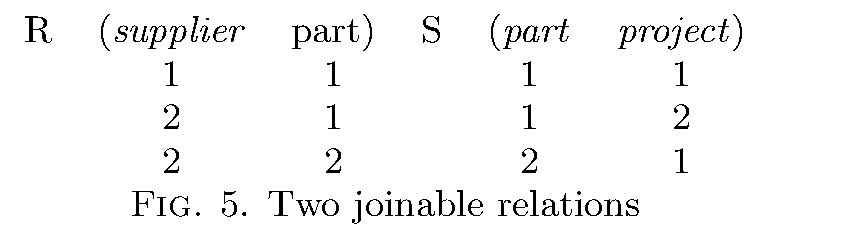

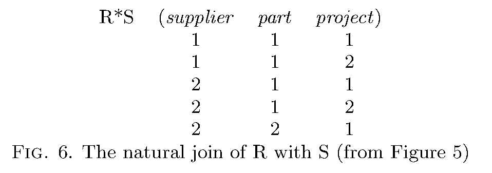

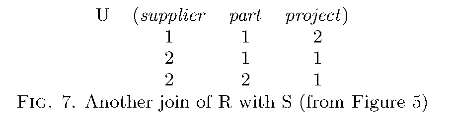

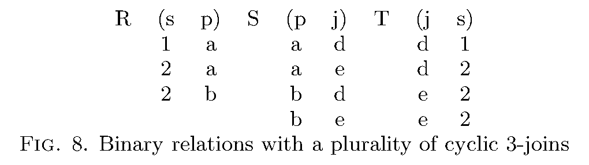

虽然可能存在不止一个循环三元连接（见图 8、图 9 中的例子），但发生这种情况的条件，远比为二元连接出现多个连接所需的条件严格。具体而言，关系 $R$、$S$、$T$ 必须在 $R$ 与 $S$ 的连接（设为点 $x$）、$S$ 与 $T$ 的连接（设为点 $y$）、$T$ 与 $R$ 的连接（设为点 $z$）上都具有歧义点，而且进一步要求：$y$ 是 $x$ 在 $S$ 下的相对项，$z$ 是 $y$ 在 $T$ 下的相对项，$x$ 是 $z$ 在 $R$ 下的相对项。注意，在图 8 中，点 $x=a$、$y=d$、$z=2$ 具有这一性质。

三个二元关系 $R$、$S$、$T$ 的自然线性三元连接为：

$$R * S * T = \{(a,b,c,d) : R(a,b)\land S(b,c)\land T(c,d)\}$$

左边不需要括号，因为自然二元连接（$*$）是可结合的。为了得到循环对应物，我们引入算子 $\gamma$，它通过将关系的两端绑在一起来从 $n$ 度关系生成 $n-1$ 度关系。因此，如果 $R$ 是一个 $n$ 元关系（$n\ge 2$），则 $R$ 的绑接定义为：

$$\gamma(R)=\{(a_1,a_2,\ldots,a_{n-1}) : R(a_1,a_2,\ldots,a_{n-1},a_n)\land a_1=a_n\}.$$

于是，我们可以把 $R$、$S$、$T$ 的自然循环三元连接表示为：

$$\gamma(R * S * T).$$

把线性和循环三元连接及其自然对应物的概念，扩展到 $n$ 个二元关系（其中 $n\ge 3$）的连接，是显而易见的。不过，对于不一定是二元的关系的连接，有几点值得说明。考虑两个关系 $R$（度为 $r$）和 $S$（度为 $s$）要在它们的 $p$ 个域上连接（$p<r$，$p<s$）。为简单起见，假设这 $p$ 个域是 $R$ 的 $r$ 个域中的最后 $p$ 个，以及 $S$ 的 $s$ 个域中的最前 $p$ 个。若不是这样，我们总能施加适当的置换使其如此。现在，取 $R$ 的前 $r-p$ 个域的笛卡尔积，称这个新域为 $A$。取 $R$ 的后 $p$ 个域的笛卡尔积，称其为 $B$。取 $S$ 的后 $s-p$ 个域的笛卡尔积，称其为 $C$。

我们可以把 $R$ 视为定义在域 $A$、$B$ 上的二元关系。类似地，可以把 $S$ 视为定义在域 $B$、$C$ 上的二元关系。这样，线性和循环三元连接的概念就可以直接适用。对于不同度的 $n$ 个关系的线性与循环 $n$ 元连接，也可以采取类似方法。

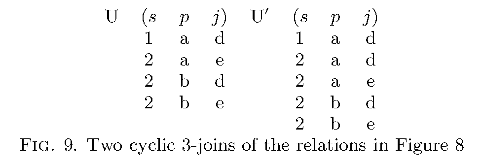

#### 2.1.4 复合

读者可能熟悉函数复合的概念。我们将讨论这一概念的推广，并首先把它应用于二元关系。我们对复合和可复合性的定义，直接建立在上面给出的连接和可连接性定义之上。

假设给定两个关系 $R$、$S$。如果存在 $R$ 与 $S$ 的一个连接 $U$，使得 $T=\pi_{13}(U)$，则 $T$ 是 $R$ 与 $S$ 的一个**复合**。因此，两个关系可复合当且仅当它们可连接。然而，$R$ 与 $S$ 存在多个连接，并不意味着 $R$ 与 $S$ 存在多个复合。

与 $R$ 和 $S$ 的自然连接相对应的是 $R$ 与 $S$ 的**自然复合**[^9]，定义为：

$$R\cdot S=\pi_{13}(R*S).$$

取图 5 中的关系 $R$、$S$，它们的自然复合如图 10 所示，另一个复合如图 11 所示（由图 7 所示的连接导出）。

当存在两个或更多连接时，不同复合的数量可以少至一个，也可以多至不同连接的数量。图 12 展示了一个例子：两个关系有多个连接，但只有一个复合。注意，在把 $R$ 与 $S$ 复合时，点 $c$ 的歧义性会丢失，因为通过点 $a$、$b$、$d$、$e$ 建立了无歧义的关联。

把复合扩展到不一定为二元（且可能不同度）的关系对，其方式与把成对连接扩展到此类关系的方式相同。

对关系复合缺乏理解，使若干系统设计者陷入了可称为**连接陷阱**的境地。这个陷阱可以用下面的例子描述。假设每个供应商描述都通过指针链接到该供应商所供应的每个零件的描述，而每个零件描述又以类似方式链接到使用这个零件的每个项目的描述。于是得出一个结论——一般来说这是错误的：如果从给定供应商出发，沿着他所供应的零件，再沿着使用这些零件的项目，走遍所有可能路径，就会得到该供应商所供应项目的有效集合。只有当项目与供应商之间的目标关系实际上恰好是另外两个关系的自然复合时，这个结论才成立——而且我们通常还必须加上“在所有时刻”这一限定语，因为在关于沿路径技术的断言中，这一点通常是隐含的。

[^9]: 其他作者往往忽略自然复合以外的复合，因而把这一特定复合称为“the composition”——例如见 Kelley 的 *General Topology*。

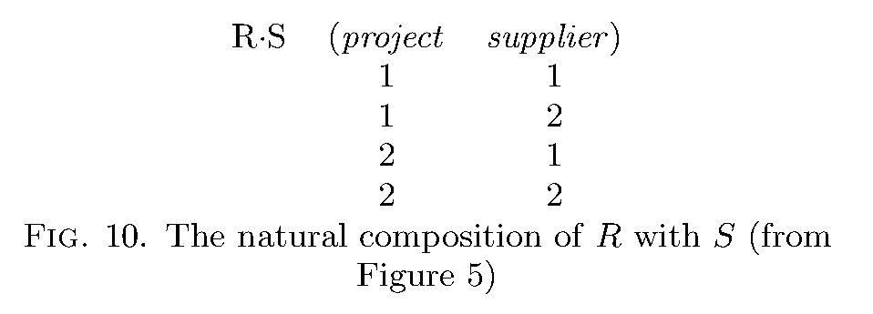

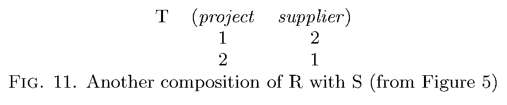

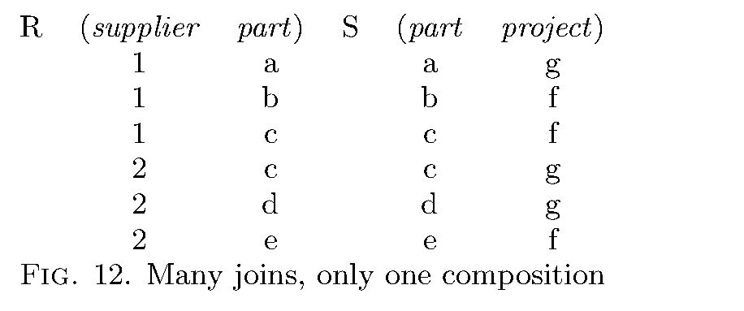

#### 2.1.5 限制

关系的子集仍然是关系。关系 $S$ 作用于关系 $R$ 并生成 $R$ 的一个子集的一种方式是：对 $R$ 施行由 $S$ 进行的**限制**运算。这一运算是把函数限制到其定义域某个子集这一概念的推广，定义如下。

设 $L$、$M$ 是等长的索引列表，且 $L=i_1,i_2,\ldots,i_k$，$M=j_1,j_2,\ldots,j_k$，其中 $k\le R$ 的度且 $k\le S$ 的度。那么，由 $S$ 对 $R$ 施加的 $L,M$ 限制，记作 $R_{L}\,|\,_{M}S$，是 $R$ 的最大子集 $R'$，使得：

$$\pi_L(R')=\pi_M(S).$$

该运算仅当对所有 $h=1,2,\ldots,k$，$\pi_{i_h}(R)$ 的元素与 $\pi_{j_h}(S)$ 的元素之间可以应用相等性时才有定义。图 13 中的三个关系 $R$、$S$、$R'$ 满足等式 $R'=R_{(2,3)}\,|\,_{(1,2)}S$。

现在我们可以考虑这些关系运算的各种应用。

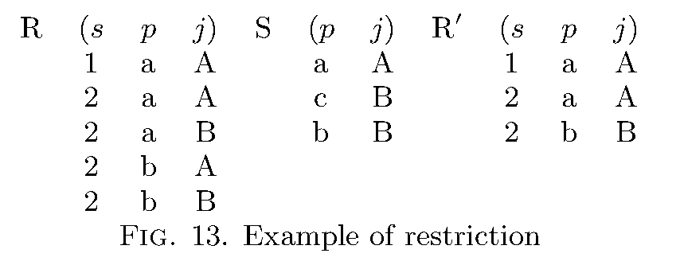

### 2.2 冗余

命名关系集合中的冗余，必须与存储表示集合中的冗余区分开来。这里我们主要关注前者。

首先，我们需要一个精确的关系可推导性概念。假设 $\theta$ 是关系上一组运算，且其中每个运算都具有如下性质：由其操作数产生唯一的关系（因此自然连接符合条件，而连接不符合）。如果存在 $\theta$ 中一系列运算，在所有时刻都能从关系集合 $S$ 的成员产生关系 $R$，则称 $R$ 可从关系集合 $S$ $\theta$ 推导。“在所有时刻”这一短语的出现，是因为我们处理的是随时间变化的关系，而我们关心的是在相当长时期内成立的可推导性。对于非推理系统中命名的联系集合，一个充分的 $\theta_1$ 集合似乎包含以下运算：投影、自然连接、绑接和限制。置换是无关的，而自然复合不必包含在内，因为它可以通过先取自然连接再取投影得到。对于存储表示集合，一个充分的运算集合 $\theta_2$ 将包括置换，以及涉及关系子集化与合并、关系元素排序与连接的其他运算。

#### 2.2.1 强冗余

一个关系集合如果包含至少一个关系，该关系具有一个可从该集合中其他关系的投影推导出来的投影，则称该集合是**强冗余**的。下面两个例子旨在解释为什么以这种方式定义强冗余，并展示其实际用途。在第一个例子中，关系集合仅由以下关系组成：

$$\text{employee}(\text{serial\#},\ \text{name},\ \text{manager\#},\ \text{managername})$$

其中 `serial#` 是主键，`manager#` 是外键。我们用 $\Delta_t$ 表示活动域，并假设在所有时刻 $t$：

$$\Delta_t(\text{manager\#})\subset\Delta_t(\text{serial\#})$$

且

$$\Delta_t(\text{managername})\subset\Delta_t(\text{name}).$$

在这种情况下，冗余是明显的：`managername` 域是不必要的。要看出它是上面定义的强冗余，我们注意到：

$$\pi_{34}(\text{employee})=\pi_{12}(\text{employee})\,|_{1,1}\,\pi_3(\text{employee}).$$

在第二个例子中，关系集合包括：描述供应商的关系 $S$（主键为 `s#`）、描述部门的关系 $D$（主键为 `d#`）、描述项目的关系 $J$（主键为 `j#`），以及以下关系：

$$P(\text{s\#},\text{d\#},\ldots),\quad Q(\text{s\#},\text{j\#},\ldots),\quad R(\text{d\#},\text{j\#},\ldots),$$

其中每种情况下的 $\ldots$ 表示除 `s#`、`d#`、`j#` 之外的其他域。假设已知以下条件 $C$ 独立于时间成立：供应商 $s$ 供应部门 $d$（关系 $P$），当且仅当供应商 $s$ 供应某个分配给 $d$ 的项目 $j$（关系 $Q$，关系 $R$）。于是我们可以写出等式：

$$\pi_{12}(P)=\pi_{12}(Q)\cdot\pi_{21}(R)$$

从而展现出一种强冗余。

命名联系集合中存在强冗余的一个重要原因是用户便利。其中一种特殊情况是，在命名集合中保留半过时的联系，以便按名称引用它们的旧程序能够继续正确运行。了解命名集合中强冗余的存在，使系统或数据库管理员在选择存储表示时拥有更大的自由度，从而更高效地应对当前流量。如果命名集合中的强冗余直接反映为存储集合中的强冗余（或者向存储集合中引入了其他强冗余），那么一般而言，会消耗额外的存储空间和更新时间，而某些查询的查询时间和中央处理单元负载则可能下降。

#### 2.2.2 弱冗余

还可能存在第二类冗余。与强冗余不同，它不能用等式来刻画。如果一个关系集合包含这样一个关系：它具有一个不能由集合中其他成员推导，但在所有时刻都是集合中其他关系的某些投影的某个连接之投影的投影，则称该集合是**弱冗余**的。

我们可以借助上面强冗余的第二个例子来展示弱冗余，现在假设条件 $C$ 并非在所有时刻都成立。关系 $\pi_{12}(P)$、$\pi_{12}(Q)$、$\pi_{12}(R)$ 是复杂关系[^10]，在任意两个关系潜在连接时，可能不时出现歧义点。在这些情况下，它们中任何一个都不能由另外两个推导出来。然而，它们之间确实存在约束，因为每一个都是这三者循环连接中某个连接的投影。其中一个弱冗余可以用如下陈述来刻画：在所有时刻，$\pi_{12}(P)$ 都是 $\pi_{12}(Q)$ 与 $\pi_{21}(R)$ 的某个复合。该复合在某一时刻可能是自然复合，在另一时刻则可能是非自然复合。

一般而言，弱冗余是用户群体逻辑需求中固有的。它们不能被系统或数据库管理员移除。如果它们出现，就会同时出现在命名集合和存储表示集合中。

[^10]: 如果一个二元关系及其逆关系都不是函数，则该二元关系是复杂的。

### 2.3 一致性

只要命名关系集合在任一意义上是冗余的，我们就应为该集合关联一组语句，这些语句定义在成员关系之间独立于时间成立的所有冗余。如果信息系统缺乏（而且很可能缺乏）关于每个命名关系的详细语义信息，它就无法推导出适用于命名集合的冗余。在一段时间内，它可能会尝试归纳这些冗余，但这样的尝试容易出错。

给定一组随时间变化的关系 $C$、一组相关的约束语句 $Z$ 以及 $C$ 的一个瞬时值 $V$，根据 $V$ 是否满足 $Z$，我们称状态 $(C,Z,V)$ 是一致的或不一致的。例如，给定存储关系 $R$、$S$、$T$ 以及约束语句“$\pi_{12}(T)$ 是 $\pi_{12}(R)$ 与 $\pi_{12}(S)$ 的一个复合”，我们可以不时检查为 $R$、$S$、$T$ 存储的值是否满足这一约束。执行这种检查的算法将检查 $R$、$S$、$T$ 各自的前两列（无论它们在系统中如何表示），并确定：

1. $\pi_1(T)=\pi_1(R)$；
2. $\pi_2(T)=\pi_2(S)$；
3. 对于关系 $\pi_{12}(T)$ 中的每个元素对 $(a,c)$，都存在一个元素 $b$，使得 $(a,b)$ 在 $\pi_{12}(R)$ 中，且 $(b,c)$ 在 $\pi_{12}(S)$ 中。

对一组关系拍摄瞬时快照存在实际问题（这里不讨论），其中某些关系可能非常大且高度可变。

重要的是要注意，上面定义的一致性是数据库瞬时状态的一种属性，并且与该状态如何产生无关。因此，特别是不会根据用户是由于遗漏行为还是作为行为而产生不一致性来作区分。考察一个简单的例子，就能看出这种（可能非常规的）一致性处理方式的合理性。

假设命名集合 $C$ 包括第 2.2 节例子中的关系 $S$、$J$、$D$、$P$、$Q$、$R$，并且 $P$、$Q$、$R$ 具有那里描述的强冗余或弱冗余（在当前讨论的特定情形下，发生哪一种冗余并不重要）。进一步假设在某个时刻 $t$，数据库状态是一致的，且不存在这样的项目 $j$：供应商 2 供应项目 $j$，并且 $j$ 被分配给部门 5。因此，$\pi_{12}(P)$ 中不存在元素 $(2,5)$。现在，用户通过向 $P$ 插入某个适当元素，把元素 $(2,5)$ 引入 $\pi_{12}(P)$。此时数据库状态变得不一致。

如果输入 $(2,5)$ 是正确的，并且确实存在这样一个项目 $j$：供应商 2 供应 $j$ 且 $j$ 被分配给部门 5，那么这种不一致性可能源于遗漏行为。在这种情况下，用户很可能打算在不久后向 $Q$ 和 $R$ 插入元素，其作用是把 $(2,j)$ 引入 $\pi_{12}(Q)$，把 $(5,j)$ 引入 $\pi_{12}(R)$。另一方面，输入 $(2,5)$ 可能是错误的。也可能用户本来打算向 $P$ 插入某个其他元素——插入该元素会把一个一致状态转换为另一个一致状态。

关键在于，系统通常无法在不询问其环境（也许是造成不一致性的用户）的情况下解决这一问题。

当然，系统检测不一致性并作出响应有若干可能方式。一种方法是，每当发生插入、删除或主键更新时，系统都检查可能的不一致性。自然，这种检查会减慢这些操作。如果已经产生不一致性，细节会在内部记录下来；如果在某个合理的时间间隔内没有补救，就会通知用户或某个负责数据安全与完整性的人。另一种方法是把一致性检查作为批处理操作，每天执行一次或频率更低。如果系统维护所有改变状态的事务日志，那么在检查时仍能追踪导致数据库中不一致状态留下的输入。如果不发生非瞬态不一致性很少，后一种方法无疑更优。

### 2.4 总结

第 1 节提出了一种关系数据模型，作为保护格式化数据系统用户免受数据库增长和流量变化所引起的、可能具有破坏性的数据表示变化影响的基础。文中引入了一种用于随时间变化的联系集合的范式。

第 2 节定义了关系上的运算和两类冗余，并把它们应用于维护数据处于一致状态的问题。随着越来越多不同类型的数据被集成到公共数据库中，这必将成为一个严重的实际问题。

本文提出了许多问题，但并未回答。例如，第 1.4 节中数据子语言只提到了少数较重要的性质。既没有讨论这种语言纯粹的语言学细节，也没有讨论实现问题。尽管如此，所呈现的材料应足以让有经验的系统程序员设想若干实现途径。本文也希望能够为格式化数据系统工作贡献更高的精确性。

**致谢**：正是 IBM Poughkeepsie 的 C. T. Davies 使作者认识到未来信息系统对数据独立性的需求。作者希望感谢他，也感谢 IBM San Jose Research Laboratory 的 F. P. Palermo、C. P. Wang、E. B. Altman 和 M. E. Senko 进行的有益讨论。

## 3. 参考文献

[1] Childs, D. L. 集合论数据结构的可行性——一种基于重构关系定义的一般结构。*Proc. IFIP Cong.*, 1968, North Holland Pub. Co., Amsterdam, pp. 162–172.

[2] Levein, R. E., and Maron, M. E. 用于推理执行和数据检索的计算机系统。*Comm. ACM* 10, 11 (Nov. 1967), 715–721.

[3] Bachman, C. W. 随机访问处理的软件。*Datamation* (Apr. 1965), 36–41.

[4] McGee, W. C. 通用文件处理。载于 *Annual Review in Automatic Programming* 5, 13, Pergamon Press, New York, 1969, pp. 77–149.

[5] *Information Management System/360, Application Description Manual H20-0524-1*. IBM Corp., White Plains, N. Y., July 1968.

[6] *GIS (Generalized Information System), Application Description Manual H20-0574*. IBM Corp., White Plains, N. Y., 1965.

[7] Bleier, R. E. 在 SDC 分时数据管理系统（TDMS）中处理层次数据结构。*Proc. ACM 22nd Nat. Conf.*, 1967, MDI Publications, Wayne, Pa., pp. 41–49.

[8] *IDS Reference Manual GE 625/635*, GE Inform. Sys. Div., Phoenix, Ariz., CPB 1093B, Feb. 1968.

[9] Church, A. *An Introduction to Mathematical Logic I*. Princeton U. Press, Princeton, N.J., 1956.

[10] Feldman, J. A., and Rovner, P. D. 一种基于 Algol 的关联语言。Stanford Artificial Intelligence Rep. AI-66, Aug. 1, 1968.
