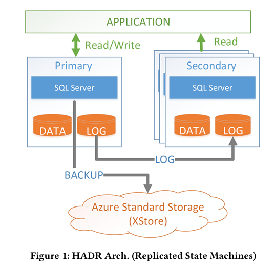
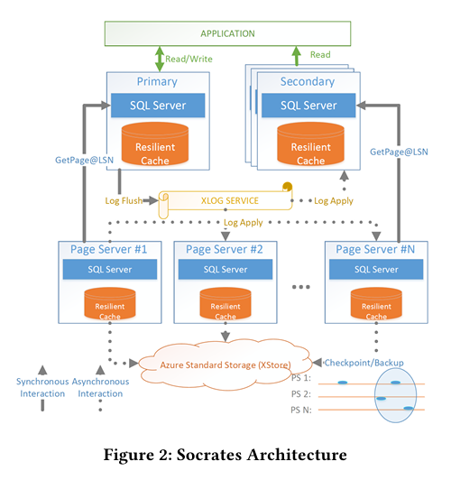
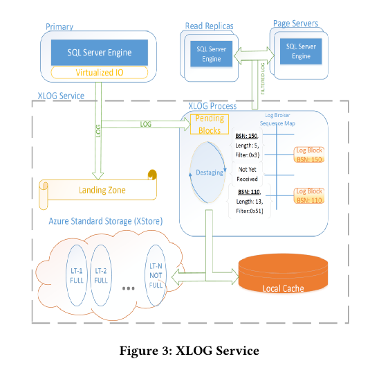
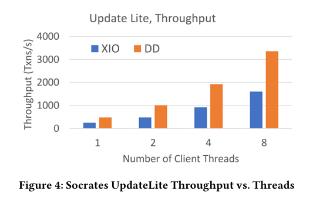

**DOI:** [https://doi.org/10.1145/3299869.3314047](https://doi.org/10.1145/3299869.3314047)

---

## 摘要

云端"数据库即服务"(DBaaS) 范式正变得越来越流行。组织采用这一范式是因为他们期望获得更高的安全性、更高的可用性，以及更低且更灵活的成本，同时保持高性能。然而，越来越清晰的是，在云端使用传统的单体数据库架构无法满足这些期望。本文提出了一种创新的 DBaaS 架构，称为 Socrates。Socrates 已在 Microsoft SQL Server 中实现，并以 SQL DB Hyperscale 的品牌在 Azure 中提供服务。本文描述了 Socrates 的核心思想和特性，并将其性能与 Azure 中此前的 SQL DB 方案进行了对比。

**CCS 概念:**
- 信息系统 → DBMS 引擎架构;

**关键词:** Database as a Service, 云数据库架构, 高可用

---

## 1. 引言

云已成为常态。大多数初创公司都是云原生的。此外，许多大型企业正在将其数据和工作负载迁移到云端。迁移到云端的主要原因是安全性、上市时间，以及更灵活的"按需付费"成本模型，该模型避免了对利用率不足的机器过度付费。尽管这些理由都很有说服力，但客户期望数据库在云端的运行至少与本地部署一样好（甚至更好）。具体而言，客户期望"数据库即服务"具备高可用性（例如 99.999% 可用性）、支持大型数据库（例如 100 TB OLTP 数据库），并且具有高性能。此外，该服务必须具有弹性，能够随工作负载增长和收缩，以便客户能够利用按需付费模式。

事实证明，在云端使用传统的单体数据库架构无法满足所有这些需求。一个问题是成本弹性——这似乎从来不是本地部署数据库所考虑的因素：将大型数据库从一台机器迁移到另一台机器以支持更高或更低的吞吐量并充分利用集群中的计算资源，其成本可能高得令人望而却步。另一个更微妙的问题是，支持大型事务数据库与高可用性之间存在冲突：高可用性要求较小的平均恢复时间，而传统上只有小型数据库才能实现这一点。这个问题在本地部署数据库中不会出现，因为这类部署通常使用特殊且昂贵的硬件来实现高可用性（如存储区域网络 SANs）；而这类硬件在云中不可用。此外，本地部署可以控制软件更新周期并精心计划停机时间；这种计划在云中通常是不可能的。

为应对这些挑战，过去十年中对面向云端的新型 OLTP 数据库系统架构进行了大量研究；例如 [5, 8, 16, 17]。一个思路是将数据库管理系统的功能分解，并独立部署计算服务（如事务处理）和存储服务（如 checkpoint 和恢复）。第一个采用这一理念的商业系统是 Amazon Aurora [20]。

**表 1: Socrates 目标：可扩展性、可用性、成本**

| | 当前 (Today) | Socrates |
|---|---|---|
| 最大数据库大小 | 4 TB | 100 TB |
| 可用性 | 99.99 | 99.999 |
| 扩容/缩容 | O(数据量) | O(1) |
| 存储影响 | 4x 副本 (+备份) | 2x 副本 (+备份) |
| CPU 影响 | 4x 单镜像 | 减少 25% |
| 恢复 | O(1) | O(1) |
| 提交延迟 | 3 ms | <0.5 ms |
| 日志吞吐量 | 50 MB/s | 100+ MB/s |

本文介绍了 Socrates，这是一种面向 OLTP 数据库系统的新型架构，源于 Microsoft 在 Azure 中管理数百万数据库的经验。Socrates 目前在 Azure 中以 SQL DB Hyperscale [2] 的品牌提供服务。Socrates 的设计采用了计算与存储分离的方式。此外，Socrates 将数据库日志与存储分离，并将日志视为一等公民。正如我们将看到的，**将日志层与存储层分离也意味着将持久性（由日志实现）与可用性（由存储层实现）分离。** 持久性是任何数据库系统避免数据丢失的基本属性。可用性则是在故障存在时提供良好服务质量所必需的。传统上，数据库系统通过将计算资源专门用于维护多个数据副本这一任务，将持久性和可用性的实现耦合在一起。然而，通过将这两个概念分离，存在巨大的未被利用的潜力：(a) 与可用性不同，持久性不需要在快速存储中保留副本；(b) 与持久性不同，可用性不需要固定数量的 Replica。分离这两个概念使 Socrates 能够为手头的任务使用最合适的机制。具体而言，与当前市场上其他数据库架构相比，Socrates 在快速本地存储中需要更少昂贵的数据副本、总体更少的数据副本、更少的网络带宽以及更少的计算资源来保持副本最新。

表 1 展示了 Socrates 在数据库可扩展性、可用性、弹性、成本（CPU 和存储）以及性能（恢复时间、提交延迟和日志吞吐量）方面对 Azure DBaaS 产品的影响。Socrates 具体如何实现这些改进是本文的主题。

本文的其余部分组织如下：第 2 节讨论当前技术水平。第 3 节总结了我们构建 Socrates 所利用的现有 SQL Server 特性。第 4 节解释 Socrates 架构。第 5 节概述 Socrates 中重要的分布式工作流。第 6 节展示 Socrates 在处理成本/可用性/性能权衡方面的灵活性。第 7 节呈现性能实验结果。第 8 节总结本文并提出未来可能的研究方向。

---

## 2. 当前技术水平

本节回顾当前市场上使用的四个知名 DBaaS 系统。

**SQL DB** 是 Microsoft 在 Azure 中的 DBaaS 产品。在 Socrates 之前，SQL DB 基于一种称为 HADR 的架构，如图 1 所示。HADR 是基于日志复制的状态机的经典例子。有一个 Primary 节点处理所有更新事务，并将更新日志传送到所有 Secondary 节点。日志传输 (log shipping) 是保持分布式数据库系统中 Replica 一致的事实标准 [13]。此外，Primary 定期将数据备份到 Azure 标准存储服务（称为 XStore）：日志每五分钟备份一次，整个数据库的增量每天备份一次，整库备份每周一次。Secondary 节点可以处理只读事务。如果 Primary 故障，其中一个 Secondary 成为新的 Primary。在 HADR 中，SQL DB 需要四个节点（一个 Primary 和三个 Secondary）来保证高可用性和持久性：如果所有四个节点都故障，则会丢失数据，因为日志每五分钟才备份一次。

迄今为止，HADR 架构已成功用于 Azure 中部署的数百万数据库。该服务稳定且成熟。此外，HADR 具有高性能，因为每个 Compute 节点都有数据库的完整本地副本。不利的一面是，数据库的大小不能超过单台机器的存储容量。一个特殊情况是长时间运行的事务，当日志增长超过机器的存储容量时，在长时间运行的事务提交之前无法截断日志。O(数据量) 操作也会带来问题。例如，为新节点播种 (seeding) 的成本与数据库大小成线性关系。备份/恢复、扩容和缩容是其他成本随数据库大小线性增长的操作。这就是为什么 SQL DB 目前将数据库大小限制为 4 TB（表 1）。

另一个基于日志复制状态机的著名云数据库系统是 **Google Spanner** [11]。为了解决 O(数据量) 问题，Spanner 自动将数据逻辑分片为称为 split 的分区。多个 split 副本使用 Paxos 协议 [9] 保持一致。只有一个分区（称为 leader）可以修改数据；其他分区是只读的。Spanner 支持异地复制，并借助 TrueTime 设施保持所有副本一致，该设施是一个基于数据中心的时间源，限制了不同 Replica 之间的时间漂移。Split 会动态进行分割和合并，以实现负载均衡和容量管理。

在过去十年中，一种称为 **shared disk** 的替代架构已被用于研究云中的数据库 [5, 8, 16, 17]。



该架构将 Compute 和 Storage 分离。AWS Aurora 是第一个采用此架构的商业 DBaaS 产品。Aurora Primary Compute 节点处理更新事务（与 HADR 相同），每条日志记录被传送到六个 Storage Server，由其持久化数据。这六个 Storage Server 分布到三个可用区 (AZ) 中，如果日志在六个 Storage 节点中的四个成功持久化，事务即可安全提交。在 Storage 层内部，数据（和日志）被分区以实现可扩展性。Aurora 支持可变数量的 Secondary Compute 节点，这些节点连接到 Storage 节点以获取数据页。

**Oracle** 开创了另一种不同的 DBaaS 架构，基于 Exadata 和 Oracle RAC。在此架构中，集群的所有节点在快速互连上紧密耦合，共享缓存融合层 (Shared Cache Fusion) 位于分布式存储层之上，存储层包含使用本地闪存的 Storage Cell [3, 7]。

---

## 3. SQL Server 的重要特性

Socrates 建立在 SQL Server 中已有的基础之上。本节介绍几个对 Socrates 至关重要的重要（且不明显的）SQL Server 特性，这些特性的开发独立于 Socrates。

### 3.1 页面版本存储 (Page Version Store)

SQL Server 维护数据库记录的多个版本，目的是在存在并发 Writer 的情况下提供读快照（例如实现 Snapshot Isolation [4]）。在 HADR 架构中，所有这些版本控制都在本地临时存储中完成。正如第 4 节中将明确的，Socrates 采用了扩展的 shared-disk 架构，要求行版本不能再保持在本地临时存储中：Compute 节点还必须在共享存储层中共享行版本。

### 3.2 加速数据库恢复 (Accelerated Database Recovery)

SQL Server 利用持久版本存储实现了一项称为加速数据库恢复 (ADR) 的新特性。在 ADR 之前，SQL Server 使用类似 ARIES 的恢复方案 [18]，首先分析日志，然后 redo 所有在最近 checkpoint 之前未提交的事务，最后 undo 所有未提交（失败）的事务。在此方案中，存在长时间运行事务时 undo 阶段可能无限期延长。在托管数百万数据库的生产环境中，这种无限制的 undo 阶段确实可能成为问题。事实证明，版本存储可以显著改善这种情况：通过共享的持久版本存储，系统即使在故障后也能访问行的已提交版本，这使得在许多情况下可以消除 undo 阶段，数据库在分析和 redo 阶段后立即可用——这是一个受 checkpoint 间隔限制的常数时间操作。

### 3.3 弹性缓冲区池扩展 (Resilient Buffer Pool Extension)

2012 年，SQL Server 发布了一个称为缓冲区池扩展 (BPE) 的特性，它将内存数据库缓冲区池的内容溢出到本地 SSD 文件中（在内存和 SSD 之间使用相同的生命周期和驱逐策略）。在 Socrates 中，我们扩展了这一概念，使缓冲区池具有弹性——即在故障后可恢复。我们将此组件称为 RBPEX，它作为 Compute 层和 Storage 层中页面的缓存机制（第 4 节）。拥有像 RBPEX 这样的可恢复缓存，显著缩短了节点达到峰值性能（使用热缓冲区）的平均恢复时间：如果故障是短暂的（例如软件升级后机器重启），读取并应用（少数）已更新页面的日志记录比从远程服务器重新获取所有（已缓存的）页面（这在传统的不可恢复缓存中是必需的）要廉价得多。更短的平均恢复时间提高了可用性 [14]。

在架构上，RBPEX 是一个简单直接的概念。然而，RBPEX 的精心实现、集成和管理对性能至关重要。如果做得不对，性能甚至可能下降。我们将 RBPEX 构建为内存存储引擎 Hekaton [15] 中的一张表，这确保了 RBPEX 的读 I/O 与本地 SSD 的直接 I/O 一样快。此外，Hekaton 在故障后恢复 RBPEX——就像恢复任何其他 Hekaton 表一样。RBPEX 的写 I/O 需要精心编排，因为不允许 RBPEX 的元数据 I/O 阻塞数据 I/O，也不允许 RBPEX 故障破坏 RBPEX 状态。为了实现这一点，我们拦截了缓冲区池页面生命周期跟踪机制，这是一个高度性能敏感的组件。

### 3.4 RBIO 协议

正如我们将看到的，Socrates 将数据库引擎的组件分布在多个层中。为了支持更丰富的计算分布，我们扩展了传统的 SQL Server 网络层（称为统一通信栈，Unified Communication Stack），增加了一种称为远程块 I/O (Remote Block I/O, RBIO) 的新协议。RBIO 是一种无状态协议，强类型，支持自动版本控制，对瞬时故障具有弹性，并具有最佳 Replica 选择的 QoS 支持。

### 3.5 快照备份/恢复

SQL Server 2016 引入了在数据库文件存储在 Azure 中时能够进行几乎即时备份的能力。此特性依赖于 Azure Storage (XStore) [10] 实现的 blob 快照特性，XStore 被组织为日志结构存储系统 [19]。在日志结构文件系统中，备份是常数时间操作，因为它只需要保持一个指向日志当前头部的指针（时间戳）即可。Socrates 扩展了此特性，使备份/恢复完全基于 XStore 快照工作。因此，Socrates 可以在常数时间内进行备份（和恢复），而在 Compute 层不产生任何 CPU 或 I/O 开销。借助 XStore 的快照机制，即使数百 TB 的大型数据库的数据库文件也可以在几分钟内恢复。当然，应用日志以恢复到正确的时间点（使用 ADR）并启动服务器并刷新恢复后数据库的缓存需要更长的时间，但这些操作都不依赖于数据库的大小。备份/恢复是 Socrates 从关键运维工作流中消除"数据量级操作"的一个典型例子。

### 3.6 I/O 栈虚拟化

在 I/O 栈的最底层，SQL Server 使用一种称为 FCB（File Control Block）的抽象。FCB 层提供 I/O 能力，同时抽象底层设备的细节。使用此抽象层，SQL Server 可以支持多种文件系统以及多样化的存储平台和 I/O 模式。Socrates 通过实现新的 FCB 实例大量利用此 I/O 虚拟化层，这些实例对 Compute 进程隐藏了 Socrates 的存储层次结构。这种方法帮助我们在不更改 SQL Server 大多数核心组件的情况下实现了 Socrates：大多数组件"认为"它们是单体的独立数据库系统的组件，并且 FCB 层之上的任何组件都不需要处理 Socrates 实际所在的分布式异构系统的复杂性。

---

## 4. Socrates 架构

### 4.1 设计目标与原则

如今，Azure 使用第 2 节描述的 HADR 架构成功托管了许多数据库。在生产中运营所有这些数据库教给了我们指导 Socrates 设计的重要经验教训。在解释 Socrates 架构之前，我们先描述这些经验教训以及相应的 Socrates 设计目标和原则。

#### 4.1.1 本地快速存储 vs. 廉价、可扩展、持久存储

第一个经验教训涉及存储层次结构：高性能需要直连存储 (SSD)，而大型数据库的持久性和可扩展性需要廉价存储（硬盘）。在本地部署中，这些需求通过像 SAN 这样的存储系统来满足，这些系统在单一存储栈中透明地优化不同种类的存储设备。在云中，这样的存储系统不存在；取而代之的是，每台机器挂载的本地存储 (SSD) 快速但有限且非持久（机器永久故障时数据丢失）。此外，像 Azure 这样的云具有独立的远程存储服务，用于廉价、无限、持久的存储。为了在云中实现良好的性能、可扩展性和持久性，Socrates 具有分层的 scale-out 存储架构，显式管理 Azure 中可用的不同存储设备和服务。此架构的一个具体特性是，它避免了快速增长数据库的动态存储分配中的碎片化和昂贵的数据移动。

#### 4.1.2 时间有界操作

如表 1 所示，Socrates 的一个重要设计目标是支持大约 100 TB 的大型数据库。不幸的是，当前的 HADR 架构涉及许多操作，其性能取决于数据库的大小，如第 2 节所述。快速创建新的 Replica 对于以低成本实现高可用性尤为重要，因为此操作决定了平均恢复时间，这直接影响给定 Replica 数量的可用性 [14]。避免任何"数据量级操作"的需求导致我们开发了用于备份/恢复（基于快照）、数据库日志管理（暂存）、带异步 Replica 播种的分层缓存，以及充分利用 scale-out 存储服务的新机制。

#### 4.1.3 从 Shared-nothing 到 Shared-disk

HADR 架构（以及任何其他复制状态机 DBMS 架构）的一个基本原则是每个 Replica 维护数据库的本地副本。这一原则与支持数百 TB 大型数据库的设计目标冲突，因为没有机器拥有如此多的存储。即使可能，在 HADR 中放置数据库时，存储成为限制因素和主要标准；结果就是，如果一个大型的（例如 100 TB）数据库部署在工作负载相当轻的情况下，CPU 周期会被浪费。

这些观察促使我们从 HADR（以及复制状态机）的 shared-nothing 模型转向 shared-disk 设计。在此设计中，所有执行事务和查询的数据库 Compute 节点都可以访问同一个（远程）存储服务。跨数据库节点共享数据需要不同级别的数据版本控制支持。为此，Socrates 依赖第 3.1 节描述的共享版本存储。共享版本存储和加速恢复（ADR，第 3.2 节）的结合使得新 Compute 节点能够快速启动，并将 Socrates 中读 scale-out 的边界推向远超 HADR 可能的水平。

#### 4.1.4 低日志延迟，日志分离
**日志是任何 OLTP 数据库系统的潜在瓶颈。每次更新必须在事务提交前写入日志， 日志必须被传送到数据库的所有 Replica 以保持它们一致。** 问题是如何在云规模下提供高性能的日志解决方案？

**Socrates 对此问题的答案是提供一个独立的日志服务。** 这样，我们可以专门针对日志的特定访问模式进行调优。**首先，Socrates通过复制日志使日志持久且容错：一旦事务的日志记录已持久化，该事务即可提交。事实证明，我们硬化日志记录所实现的仲裁比在复制状态机（如 HADR）中达成仲裁更快。因此，Socrates 可以实现更好的提交性能**， 如表 1 所示。

**其次，如果日志与其他数据库组件解耦，读取和传送日志记录将更灵活且可扩展。** Socrates 利用日志访问的非对称性：最近创建的日志记录需求很高，而旧的日志记录仅在不常见的情况下才需要（例如，中止和撤销长时间运行的事务）。因此，Socrates 将最近的日志记录保持在内存中并以可扩展的方式分发它们（可能到数百台机器），而旧的日志记录被降级存储 (destage) 并按需提供。

第三，分离日志使我们可以站在巨人的肩膀上，插入任何外部存储设备来实现日志。如附录 A 所示，这一特性已经在产生回报，因为 Socrates 可以利用 Azure 存储的最新创新，而无需改变其任何架构原则。特别是，此特性允许 Socrates 实现低提交延迟，而无需实现自己的日志传输、gossip 仲裁协议或日志存储系统。

#### 4.1.5 存储功能下推

Shared-disk 架构的一个优势是，它使得将功能从 Compute 层卸载到 Storage 层成为可能，从而将功能迁移到数据所在位置。通过这种方式，Socrates 可以实现显著的性能提升。最重要的是，每个可以卸载到存储的数据库功能（无论是备份、checkpoint、IO 过滤等）都减轻了 Primary Compute 节点和日志这两个系统瓶颈的压力。

#### 4.1.6 复用组件、调优、优化

SQL Server 拥有丰富的生态系统，包含许多工具、库和现有应用。Azure 中现有的数百万 SQL DB 数据库上的应用必须能够无缝迁移到 Socrates。此外，与数百万可能在将来某天迁移到 Azure 的 SQL Server 本地部署数据库完全向后兼容也是最高优先级。因此，Socrates 需要支持相同的 T-SQL 编程语言和用于管理数据库的基本 API。此外，SQL Server 是一个企业级数据库系统，在稳健性（测试）和高性能方面有数十年的投入。我们不想也不能承受在任何情况下重新造轮子和降低客户体验。因此，SQL Server 的关键组件（如查询优化器、查询运行时、安全、事务管理和恢复等）保持不变。此外，Socrates 数据库的调优方式与 HADR 数据库相同，Socrates 在特定工作负载（例如对热行的重复更新）下的行为与 HADR 类似。Socrates（像 HADR 一样）也拥抱 scale-up 架构以实现高吞吐量，因为这是当前技术水平，并且对大多数 OLTP 工作负载是足够的。

### 4.2 Socrates 架构概览

图 2 展示了 Socrates 架构。正如将变得清晰的，它遵循了前一节概述的所有<u>设计原则和目标：(a) Compute 与 Storage 分离，(b) 分层和 scale-out 存储，(c) 有界操作，(d) 日志与 Compute 和 Storage 分离，(e) 将功能迁移到存储层的机会，以及 (f) 现有组件的复用。</u>

Socrates 架构有四个层。应用连接到 Compute 节点。与 HADR 一样，有一个 Primary Compute 节点处理所有读写事务。可以有任意数量的 Secondary 节点处理只读事务或作为故障切换目标。Compute 节点以与当前相同的方式实现查询优化、并发控制和安全，并支持 T-SQL 和相同的 API（第 4.1.6 节）。如果 Primary 故障，其中一个 Secondary 成为新的 Primary。所有 Compute 节点在内存和 SSD 中通过弹性缓冲区池扩展（第 3.3 节）缓存数据页。



Socrates 架构的第二层是 XLOG 服务。此层实现了第 4.1.4 节提出的"日志分离"原则。虽然这种分离之前已在文献中提出 [6, 8]，但这种日志分离使 Socrates 区别于其他云数据库系统，如 Amazon Aurora [20]。XLOG 服务在存储层实现了低提交延迟和良好的可扩展性 (scale-out)。<span style="color:blue">由于 Primary 处理所有更新（包括 DML 操作），只有 Primary 写入日志。这种单 Writer 方法保证了写入日志时的低延迟和高吞吐量。所有其他节点（例如 Secondary）以异步方式消费日志，以保持其数据副本最新。</span>

第三层是存储层。它由 Page Server 实现。每个 Page Server 拥有数据库一个分区的副本，从而部署了 scale-out 存储架构，正如我们将看到的，这有助于使所有操作保持有界（如第 4.1.2 节所述）。<span style="color:blue">Page Server 扮演两个重要角色：首先，它们向 Compute 节点提供页面。每个 Compute 节点可以按照 shared-disk 架构（第 4.1.3 节）从 Page Server 请求页面。</span>我们目前正在实现在 Page Server 中执行批量操作，如批量加载、索引创建、数据库重组、深层页面修复和表扫描，以进一步卸载 Compute 节点（如第 4.1.5 节所述）。<span style="color:blue">在其次要角色中，Page Server 对数据页进行 checkpoint 并在 XStore（第四层）中创建备份。像 Compute 节点一样，Page Server 将所有数据保持在内存或本地 SSD 中以实现快速访问。</span>



第四层是 Azure 存储服务（称为 XStore），这是 Azure 独立于 Socrates 和 SQL DB 提供的现有存储服务。XStore 是基于硬盘的高可扩展、持久且廉价的存储服务。数据访问是远程的，在该规模和价位下存储服务有其吞吐量和延迟限制。将带有本地快速存储的 Page Server 与持久、可扩展、廉价的存储分离，实现了第 4.1.1 节概述的设计原则。

**Compute 节点和 Page Server 是无状态的。它们可以随时故障而不丢失数据。数据库的"真相"存储在 XStore 和 XLOG 中。** <u>XStore 高度可靠</u>，几乎所有 Azure 客户多年来一直在使用它而没有数据丢失。Socrates 利用了这种稳健性。<u>XLOG 是我们专门为 Socrates 构建的新服务。它有高性能要求，必须可扩展、可负担，并且绝不能丢失任何数据。</u>我们接下来更详细地描述 XLOG、Compute 节点和 Page Server 的实现。

### 4.3 XLOG 服务

图 3 展示了 XLOG 服务的内部结构。从图 3 的左上角开始，Primary Compute 节点将日志块直接写入日志落地区 (Landing Zone, LZ)，这是一个快速且持久的存储服务，对数据完整性、韧性和一致性提供强保证；换句话说，一个具有类似 SAN 能力的存储服务。

当前版本的 SQL DB Hyperscale 使用 Azure Premium Storage 服务 (XIO) 来实现 LZ。为了持久性，XIO 为所有数据保留三个 Replica。与任何存储服务一样，都存在性能、成本、可用性和持久性的权衡。此外，此领域有许多创新。Socrates 自然地受益于这些创新。附录 A 通过展示使用替代存储服务替代 XIO 的性能影响来研究这一效果。

**Primary 同步地直接将日志块写入 LZ，以实现最低的提交延迟。LZ 旨在快速（可能昂贵）但小。** LZ 被组织为环形缓冲区，日志格式是传统 SQL Server 日志格式的向后兼容扩展，在 Microsoft 的所有 SQL 服务和产品中使用。这种方法遵循了不重新造轮子的设计原则（第 4.1.6 节），并保持 Socrates 与所有其他 SQL Server 产品和服务的兼容性。此日志扩展的一个关键特性是，它允许并发日志读者在日志写入者存在的情况下读取一致性信息，而无需任何同步（超出 wraparound 保护）。最小化层间同步带来了更可扩展和更具韧性的系统。

<span style="color:blue">Primary 还将所有日志块写入一个特殊的 XLOG 进程，该进程将日志块分发到 Page Server 和 Secondary。这些写入是异步的，可能不可靠（以 fire-and-forget 方式），使用有损协议。一种理解此方案的方式是：Socrates 为持久性而同步可靠地写入 LZ，为可用性而异步写入 XLOG 进程。</span>

Primary 并行地将日志块写入 LZ 和 XLOG 进程。没有同步，一个日志块可能在 LZ 中持久化之前就到达了 Secondary。我们将这种未同步的方法称为**投机日志 (speculative logging)**，它可能在故障存在时导致不一致和数据丢失。<u>为避免这些情况，XLOG 只分发**已硬化 (hardened)** 的日志块。硬化的块是那些已在 LZ 中持久化（具有写仲裁）的块。</u>为此，Primary 首先将所有日志块写入 XLOG 进程的"pending area"。此外，Primary 通知 XLOG 所有已硬化的日志块。一旦一个块被硬化，XLOG 将其从"pending area"移动到 Log Broker 以进行分发，同时也填补缺口并重新排序来自有损协议的乱序块。

为了分发和归档日志块，XLOG 进程实现了一个存储层次结构。一旦一个块被移动到 Log Broker，一个名为 destaging 的内部 XLOG 进程将日志移动到固定大小的本地 SSD 缓存以快速访问，并移动到 XStore 以长期保留。同样，XStore 便宜、充裕、持久但速度较慢。我们将日志块的这种长期归档称为 LT。除非另有规定，SQL DB 将日志记录保留 30 天用于时间点恢复和模糊备份的灾难恢复。在 LZ（低延迟、昂贵的服务）中保留 30 天的日志记录将过于昂贵。此 destaging 流水线必须精心调优：一旦 LZ 充满了尚未 destage 的日志记录，Socrates 就无法处理任何更新事务。虽然这种分层架构很复杂，但不需要其他日志备份过程；在 LZ 和 LT (XStore) 之间，所有日志信息都已持久存储。此外，此层次结构满足了我们所有的延迟（LZ 中的快速提交）和成本（XStore 中的大容量存储）要求。

<u>**消费者**（Secondary、Page Server）从 XLOG 服务中**拉取**日志块。</u>通过这种方式，架构更具可扩展性，因为 Log Broker 不需要跟踪日志消费者——可能多达数百个 Page Server。在顶层，Log Broker 有一个内存中的日志块哈希映射（在图 3 中称为 Sequence Map）。在理想系统中，所有日志块都从此 Sequence Map 提供服务。如果在 Sequence Map 中找不到数据，XLOG 进程的本地 SSD 缓存是下一个层次。此本地 SSD 缓存是日志尾部的另一个环形缓冲区。如果消费者请求一个已从本地 SSD 缓存中老化的块，日志块从 LZ 中获取，如果失败，最后从 LT 中获取，日志块保证能在 LT 中找到。

XLOG 进程实现了分布式 DBaaS 系统所需的一些其他通用功能：日志生命周期的租约、LT blob 清理、备份/恢复簿记、日志消费者的进度报告、块过滤等。所有这些功能都经过精心选择，以保持 XLOG 进程的无状态特性、允许轻松水平扩展，并避免影响 XLOG 的主要功能——服务日志和 destage 日志。

### 4.4 Primary Compute 节点与 GetPage@LSN

Socrates Primary Compute 节点的行为几乎与本地部署 SQL Server 安装中的独立进程相同。数据库实例本身不知道其他 Replica 的存在。它不知道其存储是远程的，也不知道日志不是在本地文件中管理的。相比之下，HADR Primary 节点清楚地知道它参与了一个复制状态机，并达成仲裁以硬化日志和提交事务。特别是，HADR Primary 以紧耦合的方式知道所有 Secondary。因此，Socrates Primary 更简单。

然而，Primary 的核心功能是相同的：处理读写事务并产生日志。与本地部署 SQL Server 相比，有几个显著区别：

- **存储级操作**（如 checkpoint、备份/恢复、页面修复等）委托给 Page Server 和更低存储层。
- **Socrates Primary 将日志写入 LZ**，使用第 3.6 节的虚拟化文件系统机制。此机制产生的 I/O 模式与第 4.3 节描述的 LZ 概念兼容。
- **Socrates Primary 使用 RBPEX 缓存**（第 3.3 节）。RBPEX 作为 I/O 虚拟化层之上的一层透明集成。
- **可以说最大的区别是 Socrates Primary 不保留完整的数据库副本。** 它只缓存适合放入其内存缓冲区和 SSD (RBPEX) 的数据库热数据部分。

最后一个区别<span style="color:blue">需要一种机制，使 Primary 能检索本地节点中未缓存的页面。我们将此机制称为 **GetPage@LSN**。GetPage@LSN 机制是一种远程过程调用</span>，由 Primary 从 FCB I/O 虚拟化层使用 RBIO 协议（第 3.4 节）发起。此调用的原型具有以下签名：

```
getPage(pageId, LSN)
```

**这里，`pageId` 唯一标识 Primary 需要读取的页面，`LSN` 标识一个页面日志序列号，其值至少与页面的最后 Page LSN 一样高。Page Server（第 4.6 节）返回已应用了所有更新（直到此 LSN 或更高）的页面版本。**

为了理解此机制的必要性，考虑以下事件序列：

1. Primary 在其本地缓冲区中更新 Page X。
2. Primary 由于内存压力或累积活动从本地缓冲区（缓冲区池和 RBPEX）中驱逐 Page X。在页面驱逐之前，Primary 遵循预写日志协议 [18] 并将描述对 Page X 更改的所有日志记录刷入 XLOG。
3. Primary 再次读取 Page X。

在这种情况下，重要的是 Primary 在步骤 3 中看到 Page X 的最新版本，因此发出 `getPage(X, X-LSN)` 请求，带有一个特定的 X-LSN 以确保 Page Server 返回页面的最新版本。

为了保证新鲜度，Page Server 按以下方式处理 `getPage(X, X-LSN)` 请求：

1. 等待直到它已从 XLOG 应用了所有直到 X-LSN 的日志记录。
2. 返回 Page X。

这个简单的协议就是确保 Page Server 不会将过时版本的 Page X 返回给 Primary 所需的全部。（第 4.6 节包含有关 Page Server 的更多细节。）

我们尚未描述 Primary 如何知道在发出 `getPage(X, X-LSN)` 调用时使用哪个 X-LSN。理想情况下，X-LSN 将是 Page X 的最新页面 LSN。然而，Primary 无法记住它已驱逐的所有页面的 LSN（基本上是整个数据库）。相反，Primary 构建一个哈希映射（以 pageId 为键），在每个桶中存储从 Primary 驱逐的每个页面的最高 LSN。鉴于 Page X 在某个时刻从 Primary 驱逐，此机制将保证给出至少与 Page X 最大 LSN 一样大的 X-LSN 值，因此是安全的。

### 4.5 Secondary Compute 节点

遵循复用设计原则（第 4.1.6 节），Socrates Secondary 共享与 HADR 相同的 apply log 功能。一个（简化的）区别是 Socrates Secondary 不需要保存和持久化日志块，因为这是 XLOG 服务的责任。此外，Socrates 是松耦合架构，因此 Socrates Secondary 不需要知道谁产生日志（即哪个节点是 Primary）。与 HADR 一样，**Socrates Secondary 处理只读事务**（使用 Snapshot Isolation [4]）。最重要的组件（如查询处理器、安全管理器、事务管理器）与独立 SQL Server 和 HADR 几乎保持不变。

与 Primary 一样，Socrates 和 HADR 之间最显著的变化来自 Socrates Secondary 没有完整的数据库副本这一事实。这一事实对于实现支持大型数据库并使 Compute 节点无状态（带缓存）的目标至关重要。因此，可能会出现 Secondary 处理一条涉及不在其缓冲区（既不在内存中也不在 SSD 中）中的页面的日志记录的情况。对此情况有不同的可行策略。一种可能的策略是获取页面并应用日志记录。这样，Secondary 的缓存大致具有与 Primary 缓存相同的状态（至少对已更新页面而言），并且在故障切换到 Secondary 后性能更稳定。

SQL DB Hyperscale 当前实现的策略是，涉及未缓存页面的日志记录被简单忽略。此策略导致了一个有趣的竞态条件，因为缓存中存在性检查可能与 Secondary 处理的只读事务的并发、未完成的 GetPage@LSN 请求发生冲突。为了解决此冲突，Secondary 必须在进行实际的 `apply-log` 调用**之前**注册 GetPage@LSN 请求，并且 Secondary 的线程将待处理 GetPage@LSN 请求的日志记录排队，直到页面加载完成。

另一个有趣的竞态条件发生在 Secondary 进行 B 树遍历以处理只读事务时。Secondary 采用与 Primary 相同的 GetPage@LSN 协议从 Page Server 获取页面。同样，Secondary 有一个 PageLSN 缓存来保守地确定正确的 LSN。此 LSN 通常低于 Primary 在同一时间点写入的最后 LSN。这可能导致不一致。考虑以下作为 B 树遍历一部分的情况：

- Secondary 读取 B 树节点 P，LSN 为 23。（Secondary 已应用日志直到 LSN 23。）
- 下一个节点 C（P 的子节点）未被缓存。Secondary 发出 `getPage(C, 23)` 请求。
- Page Server 遵循第 4.4 节描述的协议返回 Page C，LSN 为 25。

根据 GetPage@LSN 协议，Page Server 可能返回来自"未来"的页面。这可能导致不一致。例如，如果 Page C 在时刻 24 被分裂了怎么办？在这种情况下，Secondary 以"现在"的视角（分裂前）查看了 Page P，却以"未来"的视角（分裂后）查看 Page C，这可能产生错误结果。幸运的是，检测此类不一致是容易的。如果 Secondary 在索引遍历期间检测到此类不一致，它将暂停片刻，给日志应用线程一些时间消费更多日志以刷新过时的索引页面（即 Page P）。暂停后，它将重新开始 B 树遍历，希望索引结构现已一致。

这里的关键洞察是，SQL Server 中的持久数据结构已被设计为，即使在存在物理上从不同时间点（从 LSN 角度来看）获取的页面的情况下，仍能实现逻辑上一致的遍历。逻辑遍历依赖第 3.1 节描述的版本存储，在给定事务时间戳（使用 Snapshot Isolation）的情况下从页面中提取记录的正确版本。

### 4.6 Page Server
<span style="color:blue">Page Server 负责 (i) 通过对分区应用日志来维护数据库的一个分区，(ii) 响应来自 Compute 节点的 GetPage@LSN 请求，以及 (iii) 执行分布式 checkpoint 和进行备份。</span>

遵循第 4.1.6 节的复用原则，Page Server 以类似于第 4.5 节描述的 Secondary 过程的方式执行日志应用任务。与 Secondary（需要感知对数据库的所有更改，因此需要消费所有日志块）不同，Page Server 只关心包含涉及特定 Page Server 处理的数据库分区中页面的日志记录的日志块。为此，Primary 为每个日志块包含足够的带外注释，指示哪些分区受日志块中日志记录的影响。XLOG 使用此过滤信息仅向每个 Page Server 分发相关的日志块。

服务 GetPage@LSN 请求也很直接。Page Server 简单地遵循第 4.4 节的协议。为此，Page Server 也使用 RBPEX，即 SSD 扩展的可恢复缓存。使用 RBPEX 的机制与 Compute 节点相同，但策略不同。Compute 节点缓存最热的页面以获得最佳性能；它们的缓存是稀疏的。相比之下，Page Server 缓存不太热的页面——那些热度不足以进入 Compute 节点缓存的页面。这就是为什么 SQL DB Hyperscale 目前使用覆盖缓存 (covering cache) 实现 Page Server；即分区的所有页面都存储在 Page Server 的 RBPEX 中。此外，Socrates 以保持步幅的布局组织 Page Server 的 RBPEX，使得来自 Compute 节点覆盖多页范围的单个 I/O 请求转化为 Page Server 的单个 I/O 请求。由于 Page Server 的缓存是密集的，Page Server 不会遭受读放大，而 Compute 节点的稀疏 RBPEX 缓存会。这一特性对于通常读取多达 128 页的扫描操作的性能很重要。Page Server 缓存的另一个重要特性是，它提供了对瞬时 XStore 故障的隔离。在 XStore 中断时，Page Server 继续以一种模式运行，在该模式下记录了已写入 RBPEX 但尚未写入 XStore 的页面，当 XStore 重新上线后，checkpoint 恢复（XStore 被赶上）。同样的机制允许 Socrates 将多个发送到 XStore 的 I/O 聚合到单个大型写操作中，以获得来自底层存储服务的最佳可能吞吐量。最后，当启动新的 Page Server 时，其 RBPEX 是异步播种的，而 Page Server 已经可用并能够服务请求和应用日志。将长时间运行操作（如播种新 Page Server）与其他运维任务分离（第 4.1.3 节）是我们试图在 Socrates 栈的所有层中强制执行的关键原则之一。

最后，**Page Server 通过与 XStore 交互来进行 checkpoint 和备份。** Page Server 和 XStore 如何为这些操作协同工作是下一小节的主题。

### 4.7 XStore：持久性与备份/恢复

如前几节所示，数据库的真相存储在 XStore 中。XStore 的细节在 [10] 中描述。简而言之，XStore 廉价（基于硬盘）、持久（由于跨可用区的高度复制而几乎没有数据丢失），并通过使用日志结构设计提供高效的备份和恢复（进行备份仅需要保留指向日志的指针）[19]。但是 XStore 可能很慢。Socrates 架构中所有其他组件的目标是增加性能和可用性。换句话说，XStore 在 Socrates 中扮演的角色与传统数据库系统中硬盘和磁带相同。Compute 节点和 Page Server 的内存和 SSD 缓存 (RBPEX) 在 Socrates 中扮演的角色与传统系统中内存相同。

一旦理解了这些类比，就很容易理解 Socrates 如何进行 checkpoint、恢复、备份和恢复。对于 checkpoint，Page Server 定期将修改后的页面发送到 XStore。备份使用 XStore 的快照功能实现，该功能仅通过记录时间戳即可在常数时间内创建备份 [10]。当用户请求时间点恢复操作 (PITR) 时，恢复工作流识别 (i) 在 PITR 时刻之前已采取的完整快照集，以及 (ii) 将此快照集从其时刻恢复到请求时刻所需的日志范围。然后将这些快照复制到新的 blob 中，并启动恢复操作：每个 blob 附加到一个新的 Page Server 实例，一个新的 XLOG 进程在复制的日志 blob 上引导启动，并应用日志使数据库一直到达 PITR 请求时刻。

此 Socrates PITR 过程比当前的 HADR 高效得多。与进行快照一样，在 XStore 中恢复快照是一个简短的元数据操作，在常数时间内执行（与数据大小无关）。此外，数据库几乎立即可用，因为新的 Page Server 可以立即开始为恢复的数据库提供页面。然而，在 Page Server 的缓存恢复之前，性能会下降，因为页面需要首先从 XStore 获取和恢复。此示例再次证明了利用现有云服务的重要性（第 4.1.4 节）。

---

## 5. Socrates 的工作原理

第 4.4 节到 4.6 节描述的 GetPage@LSN 协议是 Socrates 如何实现分布式协议的一个很好的例子。设计原则始终相同：Socrates 的微服务（如 Primary、Secondary、XLOG 和 Page Server）是自治和解耦的，通信尽可能异步。为可扩展性考虑，微服务不需要知道其他微服务；例如，Primary 不需要知道有多少 Page Server 存在——可能是数百个（第 6 节）。同步尽可能通过时间穿越 (time travel) 完成，如果某个微服务落后了，则通过等待完成。

Socrates 遵循这些原则实现所有分布式算法。其他示例（为简洁起见省略）包括：分布式 checkpoint（跨所有 Page Server）、Primary 故障切换、弹性扩缩容（即 serverless）、创建新的 Secondary、日志消费租约管理以及创建新的 Page Server。

---

## 6. 讨论与 Socrates 部署

Socrates 架构有许多优点。Compute 和 Storage（Socrates 中的 Page Server）的分离在文献中已被广泛研究 [5, 8, 16, 17, 20]：它有助于构建超越单台机器存储能力的可扩展数据库系统。此外，这一原则有助于在云中建立更细粒度的按需付费模型，客户只需为他们需要的存储付费，并独立为他们消费的计算付费。Socrates 继承了这种 Compute-Storage 分离原则的所有优点。它也继承了其缺点——读取可能变得更加昂贵，因为可能需要访问远程服务器；Socrates 通过在 Compute 节点中积极地在内存和磁盘中缓存数据来弥补这一缺点，第 4 节描述了我们为使缓存正确工作所做的许多创新。

Socrates 架构的一个新颖特性是它将可用性与持久性分离。**在 Socrates 中，XLOG 和 XStore 是负责持久性的层，而 Compute 和 Page Server 层仅用于可用性：如果它们故障，不会丢失数据，但服务在它们恢复之前不可用。** 此分离的巨大优势在于，它提供了灵活性和细粒度控制来导航可用性/性能/成本权衡。这样，Socrates 部署可以根据应用的具体需求进行定制。

XLOG 和 XStore 在所有 Socrates 部署中用于持久性。因此，最简单的 Socrates 部署由单个 Compute 节点（Primary Compute 节点，没有 Secondary）和一个为整个数据库处理页面请求的 Page Server 组成。此部署是最具成本效益的部署；其性能取决于运行 Primary 和 Page Server 的硬件。此最小部署的缺点是可用性：如果 Primary Compute 节点故障，需要启动一个新的 Compute 节点成为新的 Primary，从而导致停机。一旦新的 Primary 节点启动，系统可用，但只有在新 Primary 的缓存变热后才能达到峰值性能。

为在故障后实现更高的可用性并避免性能抖动，可以添加任意数量的 Secondary，成本更高但性能更好，因为 Secondary 可用于只读事务。增加 Page Server 的数量也会增加成本、性能和可用性。有趣的是，Socrates 中有两种添加 Page Server 的方式，对可用性有微妙不同的影响。一种添加 Page Server 的方式是使数据库的分片更细粒度。这样，可用性得到提高，因为分区更小，因此平均恢复时间更小，因为为分区启动新的 Page Server 更快。根据 [14]，更低的平均恢复时间意味着更高的可用性。此外，此方法通过在将批量操作（例如大表扫描或批量加载）下推到 Page Server 时增加并行度来提高性能 [12]。根据当前的网络和硬件参数，我们计算出 Page Server 的良好分区大小是 128 GB。因此，具有数百 TB 的 Socrates 数据库将产生具有数千个 Page Server 的部署。

添加 Page Server 的第二种方式是创建现有 Page Server 的 Replica。这种方法提高了可用性，因为 Replica 在 Page Server 故障时已经准备好（且是热的）。

异地复制是提高可用性和性能的重要方式。Socrates 允许将 Secondary 和 Page Server 部署在不同的数据中心和可用区中。这种方法提高了性能，例如数据库可以由全球各地的本地 Secondary 查询。但当然，异地复制也带来了跨数据中心传输日志的成本。

最后，Socrates 架构的一个重要优势是它充分利用了其他现有云服务。Azure XStore 服务用于执行高效的备份（用于时间点恢复）并以可扩展和廉价的方式实现持久性。XLOG 层依赖于 Azure Premium Storage。正如我们将在第 7 节中看到的，Socrates 自然地受益于这些现有服务的创新。Compute 和 Page Server 层只实现原生数据库功能，不复制其他更通用的云服务提供的任何功能。

---

## 7. 性能实验与结果

本节呈现评估 Socrates 设计有效性的实验结果。我们使用 HADR 架构（第 2 节）作为基准。

### 7.1 使用的软件和服务

我们将 Socrates 实现为 Azure 中 SQL DB Hyperscale 服务的一部分。在撰写本文时，此服务处于预览阶段，我们使用此预览版本进行本文报告的所有实验。我们使用两种不同的部署进行实验：

- **生产 (Production):** 这是 Azure 客户获得的 SQL DB Hyperscale 的相同版本。它使我们能够将 Socrates 与基于 HADR 的 SQL DB 服务进行公平对比。它使用 Azure Premium Storage (XIO) 实现 Socrates LZ。
- **测试 (Test):** 我们还在测试集群中部署了 Socrates，以研究新的、改进的高级存储服务对实现 LZ 的影响。

测试系统的实验在附录 A 中呈现。

我们使用不同 T-shirt 规格的 Azure VM。对于测试集群中的实验，我们使用具有 64 核、432 GB 内存和 32 个磁盘的 VM。在生产部署中，我们对 Socrates 和 HADR 使用 8 核和 16 核的 VM。

我们使用 CDB 基准 [1]，这是 Microsoft 的云数据库基准（也称为 DTU 基准），已被用于测试 Azure 中所有 Microsoft DBaaS 产品的性能。CDB 基于一个包含六张表的合成数据库，并使用缩放因子生成不同大小的数据库。除非另有说明，我们使用 1 TB CDB 数据库，这是 HADR 舒适支持的大小。我们还进行了实验来展示 Socrates 对更大规模（HADR 不支持的大小）的可扩展性。

CDB 定义了一组事务类型，涵盖从简单点查找到复杂批量更新的广泛操作。此外，CDB 指定了测试特定工作负载下系统特性的工作负载组合；例如只读。

### 7.2 实验 1: CDB 默认混合负载，吞吐量，生产集群

表 2 展示了在生产环境中 8 核 VM 上使用 64 个并发客户端线程生成工作负载时 Socrates 和 HADR 的吞吐量。对于这些实验，我们使用 CDB 的**默认工作负载混合**，执行基准测试的所有事务类型。数据库大小为 1 TB。

**表 2: CDB 吞吐量：HADR vs. Socrates (1 TB)**

| | CPU% | Write TPS | Read TPS | Total TPS |
|---|---|---|---|---|
| HADR | 99.1 | 347 | 1055 | 1402 |
| Socrates | 96.4 | 330 | 1005 | 1335 |

表 2 显示 Socrates 的吞吐量比 HADR 低约 5%。对于预览阶段的服务，这个结果并不意外，特别是考虑到 HADR 多年来已针对此基准进行了调优。理解 Socrates 如何损失这 5% 是很有趣的。HADR 达到 99.1% 的 CPU 利用率，几乎是完美的。Socrates 的 CPU 利用率较低，因为它需要更长时间等待远程 I/O。这种较低的 CPU 利用率解释了一半的差距。回顾一下，远程 I/O 是任何将数据库规模扩展到超过单台机器容量的 DBaaS 架构的基础。从性能剖析来看，似乎另外 2.5% 的性能差距来自将日志写入远程服务 (XLOG) 的更高 CPU 成本。我们相信 Socrates 可以通过更大的缓存以及对 I/O 和网络协议的进一步优化赶上并变得比 HADR 更好。

### 7.3 实验 2: 缓存行为

表 3 展示了 Socrates 对于 1 TB CDB 数据库和 56 GB 内存缓冲区、168 GB SSD 存储空间的 RBPEX 的缓存命中率。（显然，HADR 中的命中率是 100%，因为 HADR 在每个 Compute 节点中存储了数据库的完整副本。）

**表 3: Socrates 缓存命中率 (CDB)**

| 数据大小 | 缩放因子 | 内存大小 | RBPEX 大小 | 本地缓存命中率% |
|---|---|---|---|---|
| 1 TB | 20000 | 56 GB | 168 GB | 52 |

对于此实验，我们再次使用 CDB 的默认工作负载混合。此工作负载随机访问散布在整个数据库中的页面。因此，此工作负载是缓存的恶劣情况。尽管如此，对于仅占数据库大小 15% 的缓存，我们实现了 50% 的命中率。为了研究更现实的场景，我们在 30 TB TPC-E 数据库上使用 TPC-E 基准运行了 Socrates。对于此实验，我们增加了 Socrates Primary 的缓冲区池（88 GB 内存和 320 GB SSD）。表 4 显示尽管缓存大小仅约为数据库大小的 1%，Socrates 仍具有 32% 的命中率。

**表 4: Socrates 缓存命中率 (TPC-E)**

| 数据大小 | 客户数 | 内存大小 | RBPEX 大小 | 本地缓存命中率% |
|---|---|---|---|---|
| 30 TB | 310万 | 88 GB | 320 GB | 32 |

这些结果表明智能的本地 SSD 缓存极其有效。我们相信在其他运维领域也可以实现类似的改进，从而利用 Socrates 灵活的、解耦的架构；例如降低恢复成本、减少数据库引擎升级的影响，以及机器重启后的峰间性能。

### 7.4 实验 3: 更新密集型 CDB，日志吞吐量

此实验的目标是评估维持高更新吞吐量的能力。具体而言，此实验使用产生最大日志数据量的 CDB 特殊工作负载混合来研究 Socrates 和 HADR 的日志吞吐量。在此实验中，日志是 HADR 和 Socrates 的瓶颈，系统性能由日志带宽决定。对于这些实验，我们使用具有 16 核和 256 个客户端线程的 VM 来生成事务工作负载，以确保日志组件确实达到饱和。

**表 5: CDB 日志吞吐量：HADR vs. Socrates**

| | SF | Log MB/s | CPU% |
|---|---|---|---|
| HADR | 30000 | 56.9 | 46.2 |
| Socrates | 30000 | 89.8 | 73.2 |

表 5 显示 Socrates 在此实验中击败了 HADR。低 CPU 利用率表明在两个系统中日志组件确实都是瓶颈。

为什么 Socrates 在此实验中更好？什么决定了日志带宽？要回答这些问题，我们需要查看整个日志流水线。HADR 需要从 Compute 节点并行驱动日志和数据库备份以及用户工作负载。日志产生被限制在 Azure Storage 层 (XStore) 能够安全处理日志备份出口的水平。相比之下，Socrates 可以利用 XStore 的快照功能进行备份，从而在 Socrates Primary 上游产生更高的日志产出速率。

这一结果是说明将存储功能（如本例中的备份）下推到专用存储层是一个极其强大的概念的一个好例证。系统中较低层级的此类优化可以显著影响面向客户的 Compute 节点的性能，因为即使在像 Socrates 这样的松耦合系统中也存在复杂的性能依赖关系。

---

## 8. 结论

本文介绍了 Socrates，一种面向云中 DBaaS 产品的新型架构。Socrates 驱动着 Microsoft 在 Azure 中的新 SQL 数据库服务——SQL DB Hyperscale。Socrates 依赖经过充分验证的 Compute 与 Storage 分离原则来实现更好的可用性和弹性。此外，Socrates 将持久性与可用性分离。这种方法具有创新性，此前在文献中未见研究。此分离的巨大优势在于，它允许灵活地满足客户在成本/性能/可用性权衡方面的需求。

Socrates 是一种新颖的架构，我们仍处于理解和发掘其全部潜力的早期阶段。我们目前正在 Socrates Page Server 中并行实现批量操作。未来工作的进一步方向包括探索 Socrates 的多 Master 变体、在 Socrates 中更好的 HTAP 支持，以及为审计和安全等其他服务利用日志。

---

## 致谢

Socrates 和 SQL DB Hyperscale 是 Microsoft SQL 组织和 Microsoft Research 之间大规模协作努力的结果。我们要感谢 Elias Yousefi Amin Abadi、Ruokun An、Wayne Chen、Christian Damianidis、Paul Larson、Justin Lewandoski、Alexandru Nedelcu、Shweta Raje、Brendan Rowan、Swati Roy、Sridharan Sakthivelu (Intel) 和 Weidan Yan 对 Socrates 的设计和实现所做的宝贵贡献。

---

## 参考文献

[1] 2018. CDB/DTU benchmark. https://docs.microsoft.com/en-us/azure/sql-database/sql-database-service-tiers-dtu.

[2] 2018. Microsoft SQL Hyperscale. https://docs.microsoft.com/en-us/azure/sql-database/sql-database-service-tier-hyperscale.

[3] 2018. Oracle Cloud Database. https://cloud.oracle.com/database/.

[4] Hal Berenson, Phil Bernstein, Jim Gray, Jim Melton, Elizabeth O'Neil, and Patrick O'Neil. 1995. A Critique of ANSI SQL Isolation Levels. In *SIGMOD 1995*.

[5] Philip A. Bernstein, Colin W. Reid, and Sudipto Das. 2011. Hyder — A Transactional Record Manager for Shared Flash. In *CIDR 2011*.

[6] Dhruba Borthakur. 2017. The Birth of RocksDB-Cloud. http://rocksdb.blogspot.com/2017/05/the-birth-of-rocksdb-cloud.html.

[7] Peter Braam, Sean Roberts, Matthew O'Keefe, and David Bonnie. 2016. The Limits of Open Source in Extreme-scale Storage Systems Design. https://docplayer.net/62056362-The-limits-of-open-source-in-extreme-scale-storage-systems-design.html.

[8] Matthias Brantner, Daniela Florescu, David Graf, Donald Kossmann, and Tim Kraska. 2008. Building a Database on S3. In *SIGMOD 2008*.

[9] Alain Bui and Hacène Fouchal (Eds.). 2002. *OPODIS 2002*. Studia Informatica Universalis, Vol. 3.

[10] Brad Calder, Ju Wang, Aaron Ogus, Niranjan Nilakantan, Arild Skjolsvold, Sam McKelvie, Yikang Xu, Shashwat Srivastav, Jiesheng Wu, Huseyin Simitci, Jaidev Haridas, Chakravarthy Uddaraju, Hemal Khatri, Andrew Edwards, Vaman Bedekar, Shane Mainali, Rafay Abbasi, Arpit Agarwal, Mian Fahimul Haq, Muhammad Ikramul Haq, Deepali Bhardwaj, Sowmya Dayanand, Anitha Adusumilli, Marvin McNett, Sriram Sankaran, Kavitha Manivannan, and Leonidas Rigas. 2011. Windows Azure Storage: a highly available cloud storage service with strong consistency. In *SOSP 2011*.

[11] James C. Corbett, Jeffrey Dean, Michael Epstein, Andrew Fikes, Christopher Frost, JJ Furman, Sanjay Ghemawat, Andrey Gubarev, Christopher Heiser, Peter Hochschild, Wilson Hsieh, Sebastian Kanthak, Eugene Kogan, Hongyi Li, Alexander Lloyd, Sergey Melnik, David Mwaura, David Nagle, Sean Quinlan, Rajesh Rao, Lindsay Rolig, Dale Woodford, Yasushi Saito, Christopher Taylor, Michal Szymaniak, and Ruth Wang. 2012. Spanner: Google's Globally-Distributed Database. In *OSDI 2012*.

[12] Michael J. Franklin, Björn Þór Jónsson, and Donald Kossmann. 1996. Performance Tradeoffs for Client-Server Query Processing. In *SIGMOD 1996*.

[13] Jim Gray, Pat Helland, Patrick E. O'Neil, and Dennis E. Shasha. 1996. The Dangers of Replication and a Solution. In *SIGMOD 1996*.

[14] Jim Gray and Andreas Reuter. 1990. *Transaction Processing: Concepts and Techniques*.

[15] Per-Åke Larson, Spyros Blanas, Cristian Diaconu, Craig Freedman, Jignesh M. Patel, and Mike Zwilling. 2011. High-Performance Concurrency Control Mechanisms for Main-Memory Databases. *PVLDB* 5, 4 (2011).

[16] Simon Loesing, Markus Pilman, Thomas Etter, and Donald Kossmann. 2015. On the Design and Scalability of Distributed Shared-Data Databases. In *SIGMOD 2015*.

[17] David B. Lomet, Alan Fekete, Gerhard Weikum, and Michael J. Zwilling. 2009. Unbundling Transaction Services in the Cloud. In *CIDR 2009*.

[18] C. Mohan, Don Haderle, Bruce Lindsay, Hamid Pirahesh, and Peter Schwarz. 1992. ARIES: A Transaction Recovery Method Supporting Fine-granularity Locking and Partial Rollbacks Using Write-ahead Logging. *TODS* 17, 1 (1992).

[19] Mendel Rosenblum and John K. Ousterhout. 1992. The Design and Implementation of a Log-Structured File System. *TOCS* 10, 1 (1992).

[20] Alexandre Verbitski, Anurag Gupta, Debanjan Saha, Murali Brahmadesam, Kamal Gupta, Raman Mittal, Sailesh Krishnamurthy, Sandor Maurice, Tengiz Kharatishvili, and Xiaofeng Bao. 2017. Amazon Aurora: Design Considerations for High Throughput Cloud-Native Relational Databases. In *SIGMOD 2017*.

---

## 附录 A: 实验 4 — 测试集群，XIO vs. Direct Drive

最后一组实验研究了用于实现 LZ 的存储服务的影响。Azure 不断改进其存储服务，Socrates 使 SQL DB Hyperscale 能够利用这些创新。

对于此实验，我们在测试集群中以两种不同配置运行 Socrates，使用相同的硬件并在相同数据库上运行相同的工作负载。唯一的区别是 LZ 的实现：我们比较了基于 XIO（与所有先前实验相同）和基于称为 Direct Drive（简称 DD）的新 Azure 服务的两种实现。进行这些实验时，DD 也处于预览阶段。DD 积极利用新技术趋势，如 RDMA。DD 使用 Win32 和 Windows I/O 栈。对于此实验，我们使用一个 CDB 工作负载混合，主要是小型更新，没有读事务。我们减少了客户端数量并测量了提交事务的延迟。在此工作负载中，CPU 利用率较低，因为客户端未生成足够工作来饱和 CPU。

**表 6: CDB Update Lite 延迟：XIO vs. DD**

| | STDEV | Min (us) | Median (us) | Max (us) |
|---|---|---|---|---|
| XIO | 431 | 2518 | 3300 | 36864 |
| DD | 167 | 484 | 800 | 39857 |

表 6 显示 DD 在最小和中位延迟方面显著更好。仅在最大延迟上 XIO 和 DD 相同。



表 6 的结果是使用单个客户端线程获得的。图 4 描绘了随并发客户端线程数增长时的吞吐量。显然，只要 Primary 的 CPU 利用不足，更低的延迟就转化为更高的吞吐量。此规则依赖于工作负载，特别取决于读/写比率。尽管如此，DD 是明确的赢家，表明 Socrates 很好地受益于 DD 等创新。

**表 7: CDB Update Lite 日志吞吐量：XIO vs. DD**

| | Threads | Log MB/s | CPU% |
|---|---|---|---|
| XIO | 128 | 69 | 30 |
| DD | 16 | 70 | 9 |

最后，表 7 显示了 CPU 利用率。在此实验中，我们变化客户端线程数，使得使用 XIO 和 DD 的 Socrates 具有大致相同的 70 MB/s 日志吞吐量。表 7 显示 XIO 需要 8 倍的负载才能达到与 DD 相同的日志吞吐量，从而在 Primary 中消耗三倍多的 CPU（并在客户端中消耗八倍多的 CPU）。这样，DD 可以显著降低 Socrates 数据库的成本，因为 CPU 主导了运行 DBaaS 产品的成本。这里，一个因素是 XIO 需要昂贵的 REST 调用，而 DD 请求通过更便宜的 Win32 调用。我们希望利用 DD 也将帮助 Socrates 缩小实验 1 中讨论的与 SQL DB 的性能差距。

总之，所有这些实验说明了一个简单的观点：Socrates 可以以传统、更单体的 DBaaS 架构无法做到的方式利用存储创新。这些改进的实现没有改变一行代码。从长远来看，我们相信这些改进超过了因从远程服务器读取数据而导致的性能损失。
