> arXiv:2608.25512 [cs.PL] · 该论文英文全文 Markdown 版的完整中文译本；公式、图片、表格、算法与参考文献条目均按原文保留。

## 摘要

现代软件——从插件系统到自演进的智能体运行时框架——越来越需要*动态组合*，但其形式化基础仍不成熟。我们指出该问题的两个正交维度：<font color=blue>*时间可组合性*，即在组件移除时完整撤销其副作用的能力；以及*空间可组合性*，即声明并响应式地管理组件间依赖的能力。</font> 我们通过将经典的效应与协效应概念提升为运行时机制来应对这两个维度。具体而言，我们形式化*可逆效应*：每个上下文变换都携带一个由运行时持有的逆，从而在单个组件的局部确立时间可组合性；我们形式化*响应式协效应*：每次上下文变化都依据组件的协效应规格加以分类，以驱动其激活与停用，从而在单个组件的局部确立空间可组合性。随后，我们把效应上下文与协效应上下文统一为单一的上下文类型，并通过它中介所有效应与协效应，得到一种我们称之为*上下文范式*的规程；这种中介诱导出一种观察等价，在此等价意义下，不同组件的效应彼此交错而不互相干扰。把这些机制结合为*组件*这一概念后，我们给出动态组合的演算，其元理论把时空可组合性从单个组件推广到由交错组件构成的整个系统。我们在 *Cordis* 中实现了这些思想：这是一个面向时空可组合性的元框架，提供具备效应追踪与协效应解析的核心库，以及具备配置调和与热模块替换的声明式组件加载器。

## 目录

- [1. 引言](#1-引言) — 4
  - [1.1. 可组合性的维度](#11-可组合性的维度) — 4
  - [1.2. 动机示例](#12-动机示例) — 4
    - [1.2.1. 插件系统](#121-插件系统) — 4
    - [1.2.2. 自演进智能体运行时框架](#122-自演进智能体运行时框架) — 5
    - [1.2.3. 粗粒度的权宜之计](#123-粗粒度的权宜之计) — 5
  - [1.3. 贡献](#13-贡献) — 6
- [2. 预备知识](#2-预备知识) — 7
  - [2.1. 效应](#21-效应) — 7
  - [2.2. 协效应](#22-协效应) — 7
  - [2.3. 与动态可组合性的关系](#23-与动态可组合性的关系) — 8
- [3. 可逆效应与响应式协效应](#3-可逆效应与响应式协效应) — 9
  - [3.1. 可逆效应](#31-可逆效应) — 9
    - [3.1.1. 效应上下文](#311-效应上下文) — 9
    - [3.1.2. 效应函数](#312-效应函数) — 12
    - [3.1.3. 效应迭代器](#313-效应迭代器) — 15
  - [3.2. 响应式协效应](#32-响应式协效应) — 16
    - [3.2.1. 协效应上下文](#321-协效应上下文) — 17
    - [3.2.2. 规格与通知](#322-规格与通知) — 18
    - [3.2.3. 隔离与拦截](#323-隔离与拦截) — 19
  - [3.3. 上下文范式](#33-上下文范式) — 21
    - [3.3.1. 统一上下文](#331-统一上下文) — 21
    - [3.3.2. 观察等价](#332-观察等价) — 23
  - [3.4. 达成独立性](#34-达成独立性) — 26
    - [3.4.1. 效应独立性](#341-效应独立性) — 26
    - [3.4.2. 协效应交换性](#342-协效应交换性) — 28
- [4. 动态组合演算](#4-动态组合演算) — 31
  - [4.1. 组件与纤维](#41-组件与纤维) — 31
  - [4.2. 演算](#42-演算) — 34
    - [4.2.1. 编排](#421-编排) — 34
    - [4.2.2. 生命周期](#422-生命周期) — 35
    - [4.2.3. 封闭性](#423-封闭性) — 38
  - [4.3. 元理论](#43-元理论) — 39
    - [4.3.1. 保持性](#431-保持性) — 43
    - [4.3.2. 时间可组合性](#432-时间可组合性) — 44
    - [4.3.3. 空间可组合性](#433-空间可组合性) — 47
    - [4.3.4. 进展性](#434-进展性) — 49
    - [4.3.5. 合流性](#435-合流性) — 51
  - [4.4. 扩展](#44-扩展) — 55
- [5. 实现与案例研究](#5-实现与案例研究) — 57
  - [5.1. 核心库](#51-核心库) — 57
    - [5.1.1. 效应追踪](#511-效应跟踪) — 59
    - [5.1.2. 协效应操作](#512-协效应操作) — 60
    - [5.1.3. 组件生命周期](#513-组件生命周期) — 61
    - [5.1.4. 上下文访问](#514-上下文访问) — 64
  - [5.2. 组件加载器](#52-组件装载器) — 64
    - [5.2.1. 声明式配置](#521-声明式配置) — 65
    - [5.2.2. 热模块替换](#522-热模块替换) — 67
  - [5.3. 案例研究：Koishi](#53-案例研究koishi) — 69
- [6. 讨论](#6-讨论) — 70
  - [6.1. 系统边界](#61-系统边界) — 70
  - [6.2. 服务多路复用](#62-服务多路复用) — 71
  - [6.3. 访问控制与沙箱](#63-访问控制与沙箱) — 72
  - [6.4. 语言无关性与语言选择](#64-语言独立性与选择) — 73
  - [6.5. 相互依赖与组件粒度](#65-相互依赖与组件粒度) — 74
  - [6.6. 依赖类型与版本管理](#66-依赖定型与版本管理) — 75
  - [6.7. 与语言及操作系统的协同设计](#67-与语言及操作系统的协同设计) — 76
- [7. 相关工作](#7-相关工作) — 77
  - [7.1. 效应系统与协效应系统](#71-效应与协效应系统) — 77
  - [7.2. 编程范式](#72-编程范式) — 78
  - [7.3. 时间可组合性](#73-时间可组合性) — 79
  - [7.4. 空间可组合性](#74-空间可组合性) — 81
- [8. 结论](#8-结论) — 82
- [参考文献](#参考文献) — 83

## 1. 引言

组合——由较简单的部件装配出复杂系统——是软件工程的基础性原则 [1]。传统上，组合是*静态的*：函数调用、模块导入与类继承在编译期解析，并在整个执行过程中保持不变。然而，<font color=blue>现代软件越来越需要*动态的*组合：组件在运行时被加载、卸载与重新配置。插件架构 [2] 与自演进的智能体运行时框架都要求系统能够在运行中安全地增删功能，</font> 但当前实践仍诉诸粗粒度机制 [3]，只能通过重启来重新配置，并丢弃运行时状态。尽管动态组合的实践重要性不断上升，其理论基础相较静态组合丰富的形式化框架仍显薄弱。

### 1.1. 可组合性的维度

为刻画动态组合的需求，我们在组合已被充分研究的代数层面之外，指出两个正交的维度：

- <font color=blue>**时间可组合性**关注*时间*维度：移除组件时，该组件对共享环境所做的修改必须被完整且安全地撤销。这要求追踪组件执行的每一次资源分配、事件注册与状态变更，并保证在移除时按序回收这些资源。</font> 
- <font color=blue>**空间可组合性**关注*空间*维度：组件必须能够以结构化且可验证的方式声明、发现并解析彼此之间的依赖，这要求管理依赖拓扑，并随依赖变化协调各组件的生命周期。</font> 在静态场景中，时间可组合性退化为词法作用域（如 RAII [4]、bracket 模式 [5]），空间可组合性退化为模块导入解析 [6]。在动态场景中，组件于运行时到来与离开，两个维度都显著变难：时间可组合性必须处理作用域不受词法界定的、长寿命且有状态的效应；空间可组合性必须处理在执行过程中出现、消失或改变身份的依赖。

### 1.2. 动机示例

#### 1.2.1. 插件系统

插件系统是动态组合的典型实例。我们以使用最广泛的可扩展 IDE 之一 Visual Studio Code（VSCode）为代表展开说明。

**时间维度的局限。** VSCode 把所有扩展运行在名为扩展宿主（extension host）的共享进程中。虽然扩展可以动态安装，但该宿主没有在运行时卸载单个扩展代码的机制。一旦扩展的 `activate` 函数执行过，禁用或卸载它就需要重启整个宿主，并影响所有已加载的扩展。纯声明式扩展（如主题、键位绑定与代码片段）不含代码，可以自由移除。然而，在安装量前 100 的扩展中，有 87 个包含可执行代码1，移除时因此必须重启。尽管 VSCode 提供了 `deactivate` 钩子，它只是在宿主进程终止时用于优雅关闭的回调，无法支持实时移除。此外，该钩子把效应的处置与效应的创建（在 `activate` 中）分离，破坏了关注点局部性，使完整清理难以验证。

**空间维度的局限。** VSCode 确实提供了 `extensionDependencies` 用于声明扩展之间的依赖，却很少被使用：在安装量前 100 的扩展中，只有 7 个声明了对非内置扩展的 `extensionDependencies`。1 这种稀缺源于扩展 API 的形态：它暴露的是固定而表层的扩展点，如命令、视图与语言特性。扩展通过这些扩展点向宿主贡献功能，而不是彼此依赖，因此扩展间依赖很少出现。再者，VSCode 的扩展间交互机制没有结构性契约：它通过 `vscode.extensions.getExtension(...).exports` 把某个扩展的功能暴露给其他扩展，但返回值是无类型的（默认为 `any`），依赖方无法依靠受检查的接口。简言之，VSCode 把扩展引向一组由宿主提供的固定扩展点，却没有为它们提供安全、结构化的相互依赖方式。

这两项局限并非 VSCode 独有；它们在各类插件系统中普遍复现 [2, 7]，只是程度不同。

#### 1.2.2. 自演进智能体运行时框架

<font color=blue>现代 AI 智能体依赖运行时的智能体框架（agent harness）[8–10]。这类系统可以组合多样的工具集 [11] 与执行环境，管理权限与沙箱，维护会话状态与持久化，提供上下文管理与记忆系统 [12]，编排子智能体与多智能体工作流 [13]，并向用户与自动化程序暴露接口。未来的框架或许能在持续服务请求的同时，生成并部署对自身组件的修改。由模型合成的可复用工具，是组件级自我修改的一个范围更窄的前身 [14]。每一次此类修改本身都是动态组合的一个实例。</font>

由于这些修改持续发生且很少或没有人工监督，动态可组合性变得不可或缺。若没有时间可组合性，每次自我修改都会强制完全重启，丢弃进程内累积的全部状态；在这种频率下，累计的不可用时间相当可观，进行中的任务被反复打断；更糟的是，一次错误的自我修改可能使恢复所依赖的进程本身失效。若没有空间可组合性，每个模块都必须自行检测并适应其所依赖模块的出现、消失或身份变化，而且只能以临时手段完成；更糟的是，朴素的代码替换策略可能静默地破坏依赖方，或引入只有在重新加载时才暴露的循环依赖。

#### 1.2.3. 粗粒度的权宜之计

动态可组合性之所以很少受到形式化关注，原因之一是操作系统与容器编排器已经提供了一种粗粒度的替代品。操作系统在进程粒度上给出时间可组合性；容器编排器 [3] 在服务粒度上给出空间可组合性。实践中，多数软件通过诉诸这些粗粒度机制来容忍细粒度可组合性的缺失：行为异常的模块靠重启进程处理，服务依赖交由容器编排器管理。[^1]

然而，这种权宜之计代价不菲。在时间维度上，每次重启都会丢弃进程内累积的全部状态（如缓存、连接、部分计算），重建它往往需要数秒到数分钟 [15]；为在过渡期维持可用性，必须部署冗余副本，用资源开销来弥补无法恢复单个组件的缺陷。在空间维度上，容器级编排无法表达共享同一地址空间的组件之间的依赖，还会为本可以是本地函数调用的交互引入网络开销。这两种机制都作用于进程与容器的边界，而现代系统越来越多地在更细的层级上组合。这种粒度错配，要求有一种在组件自身的层级上管理效应与依赖的组合式抽象。

### 1.3. 贡献

动态可组合性的两个维度分别关涉计算*如何修改*环境，以及计算*如何依赖*环境。形式化这两个方向的正是*效应系统* [16, 17] 与*协效应系统* [18, 19]：效应为推理环境修改提供形式化语汇，协效应为推理环境需求提供形式化语汇。然而，既有表述把推理限制在词法固定作用域上的编译期分析，无法延伸到组件于运行时到来与离开的动态场景。通过把效应提升为可逆的运行时模型、把协效应提升为响应式的依赖解析机制，我们得到动态可组合性的统一形式基础：它与语言无关，适用于任何需要动态组合的软件架构。本文的贡献如下：

1. 我们形式化了<u>**可逆效应**（第 3.1 节）：每个上下文变换都带有运行时持有的显式逆，且追踪与恢复都保持组合性，因此在组件移除时上下文得以恢复。这确立了局部的时间可组合性。</u>
2. 我们形式化了**响应式协效应**（第 3.2 节）：组件把所需的协效应声明为规格，上下文的每次变化都对照该规格分类为激活、停用或中性，从而驱动组件的激活与停用。这确立了局部的空间可组合性。
3. 我们提出**上下文范式**（第 3.3 节）：效应上下文与协效应上下文被统一为单一的上下文类型，所有效应与协效应都经它中介，这种中介诱导出一种观察等价，在此等价意义下不同组件的效应达成独立性。
4. 我们建立动态组合的演算（第 4 节），把两种机制结合为**组件**这一概念，并给出它们的操作语义。其元理论进而把时空可组合性从单个组件推广到由交错组件构成的整个系统。
5. 我们在 **Cordis**（第 5 节）中实现了这些思想：这是一个面向时空可组合性的元框架，提供以效应追踪与协效应解析实现形式模型的核心库，以及具备配置调和与热模块替换的声明式组件加载器。

## 2. 预备知识

本节简要回顾效应系统与协效应系统——支撑本工作的两根理论支柱。我们假定读者熟悉基本的类型论与范畴论；此处的目标是固定记号，并引入第 3 节将具体化为运行时机制的关键抽象。

### 2.1. 效应

在简单类型 λ 演算（STLC）[20, 21] 中，类型判断 $\Gamma \vdash t: T$ 表示项 $t$ 在上下文 $\Gamma$ 下具有类型 $T$。*效应系统*对类型加以细化，以描述计算可能产生的副作用，从而得到如下形式的判断

$$
\Gamma \vdash t: T_{\mathrm{effect}} \tag{1}
$$

这里，结果类型附带效应代数中的一个元素，用以描述计算可能产生哪些副作用，从而支持对有状态计算的组合式推理。这一路径始于 Lucassen 与 Gifford [22]，他们引入了一种区分类型、效应与区域的分类型系统，用于发现并行程序中的调度约束。

**单子效应。** Moggi [16] 首次用单子从范畴论角度建模计算效应；Wadler [23] 使该方法在 Haskell 中广为流传。范畴 $\mathcal{C}$ 上的单子 $(T, \eta, \mu)$ 把有效应的计算封装为类型 $T(A)$ 的值，其中 $\eta: A\to T(A)$ 提升纯值，$\mu: T(T(A)) \to T(A)$ 串行化嵌套计算。经典实例包括 Maybe 单子（部分性）、State 单子（可变状态）与 IO 单子（外部交互）。

**代数效应。** Plotkin 与 Power [17, 24] 证明代数运算决定单子，建立了效应接口与其实现解耦的框架。效应签名 $\Sigma$ 声明一组运算（例如针对状态的 $\mathrm{get}: () \to S$、$\mathrm{put}: S\to()$）；程序可自由调用运算，而不必绑定某种特定解释。Plotkin 与 Pretnar [25] 随后引入*效应处理器*，通过给出续体语义来解释运算：

$$
\mathrm{handle} e\mathrm{with} \{ \mathrm{op}(v, \kappa) \mapsto\ldots \} \tag{2}
$$

处理器接收运算参数 $v$ 与受限续体 $\kappa$，可调用它零次、一次或多次，从而在统一框架内表达异常、协程与非确定性 [26]。Koka [27, 28]、Eff [29] 与 OCaml 5 [30] 等语言以不同的设计取舍采纳了代数效应。

### 2.2. 协效应

与效应相对偶，*协效应系统* [18, 31] 细化的是上下文而非类型，得到如下形式的判断

$$
\Gamma_{\mathrm{coeffect}} \vdash t: T \tag{3}
$$

这里，上下文附带协效应代数中的一个元素，描述计算需要从环境获得什么，例如可访问的资源、须持有的权限或要依赖的服务。效应刻画程序对世界的影响，协效应则刻画世界对程序的约束。

**余单子协效应。** 用余单子组织上下文相关计算的想法由 Uustalu 与 Vene [32] 首先发展：他们提出对称（半）幺半余单子，作为 Moggi 效应单子框架的对偶，用以捕捉数据流与属性求值等概念。Petricek 等人 [18] 在此之上提出把协效应作为上下文依赖的统一静态分析。余单子 $(D, \epsilon, \delta)$ 捕捉上下文相关计算：$\epsilon: D(A) \to A$ 从上下文中抽取当前值，$\delta: D(A) \to D(D(A))$ 复制上下文以支持嵌套访问。环境余单子 $D(X) = E\times X$ 建模对固定环境 $E$ 的依赖；流余单子 $D(X) =$ $\mathbb{N}\to X$ 建模对时序数据的依赖。

**分级协效应。** 为更细粒度地追踪，*分级*协效应系统用预序半环 $\mathcal{S}= (S, \le, +, \times, 0, 1)$ 作为协效应代数 [33]，这一规程后来由 Gaboardi 等人 [19] 与分级效应统一。$S$ 的元素标注每个变量绑定以量化其使用方式：$0$ 表示未使用，$1$ 表示线性使用，$n$ 表示有界使用，$\infty$ 表示无限制使用。半环运算按序（$\times$）与并行（$+$）组合协效应，从而在统一的代数框架内支持精确的资源追踪、敏感性分析 [34] 与信息流控制 [35, 36] [37]。

### 2.3. 与动态可组合性的关系

效应系统与协效应系统沿两个互补方向组织对计算的推理：效应描述计算*如何修改*环境，协效应描述计算*如何依赖*环境。这两个方向正对应第 1 节指出的动态可组合性的两个维度：

- **时间可组合性**==要求组件对共享环境的修改在卸载时可被撤销。相关的效应是有状态的那类，它们持久地改变该环境；撤销这种变换要求它存在逆。==
- **空间可组合性**==要求组件间依赖被声明并以响应式方式管理。== 这类依赖正是协效应所刻画的对象，管理它们就是逐一按环境所供给的内容加以解析。然而，经典的效应与协效应系统都是静态工具：效应在词法固定的作用域内追踪，并由编译期处理器消解；协效应标注则依据执行前已确定的上下文来验证。相比之下，动态组合要求这些保证对运行时到来与离开的组件、对持续演化的上下文依然成立。任何固定的词法作用域都无法界定部署之后才加载的插件；任何编译期上下文都无法预见由运行时配置产生的依赖。

这促成了视角的转变：与其为静态类型系统添加更多标注，不如把效应与协效应的概念结构具体化，使运行时能够直接操作它们，从而动态地确立这些系统静态地给出的保证。

## 3. 可逆效应与响应式协效应

本节把第 2 节引入的效应与协效应概念提升为运行时机制，构造动态组合的理论。核心思想是：把承载效应与协效应的*类型上下文*转变为*上下文类型*，即把上下文具体化为一等实体的、可由运行时操作的类型。第 3.1 节把效应建模为上下文变换，配上由运行时持有的逆，从而在单个组件的局部确立时间可组合性；第 3.2 节把协效应建模为声明的依赖，每次上下文变化都据此分类，确立其空间对应物。每种局部保证都在其他组件介入之处终止。为得到二者的全局形式，第 3.3 节把两个上下文统一为一个，并引入*上下文范式*：所有效应与协效应都经统一上下文中介，这种中介诱导出观察等价，此后所有相等关系都在该等价下解读。第 3.4 节进而确立效应独立性与协效应交换性，在此条件下不同组件的效应彼此交错而不互相干扰。

### 3.1. 可逆效应

==时间可组合性指在运行时加载与卸载组件，并使得卸载时共享环境恢复到组合之前状态的能力。这要求组件对环境所做的每次修改既可追踪又可恢复。== 因此我们把效应建模为类型 $\Gamma \to\Gamma \times (\Gamma \to\Gamma)$ 的函数：作用于当前上下文时，它产生修改后的上下文以及一个显式的逆。提供该逆使效应可被撤销，把它交还运行时使效应可被追踪。我们称这类效应为*可逆的*：通过在执行过程中复合这些逆，局部时间可组合性成为结构性保证。

#### 3.1.1. 效应上下文

给定任意非纯函数 $f: X\rightsquigarrow Y$，我们把它变换为纯形式 $f: \Gamma \times X\to\Gamma \times Y$，其中 $\Gamma$ 是上下文类型。在这个纯形式下，所有可能的副作用都可表示为 $\Gamma$ 上的变换：对任意固定输入 $x: X$，诱导的映射 $\gamma\mapsto\mathrm{pr}_{1}(f(\gamma, x)): \Gamma \to\Gamma$ 独立于返回值捕捉 $f$ 的副作用。因此，$\Gamma$ 上的效应存在于复合运算 $\circ$ 下的变换幺半群 $\Gamma \to\Gamma$ 中，其中每条幺半群公理都可直读为效应的一条性质：

- *封闭性*：两个效应的顺序复合仍是效应；
- *结合律*：复合效应与其加括号方式无关；
- *单位元*：$\Gamma$ 上的恒等函数 $\mathrm{id}_{\Gamma}$ 充当复合的单位。
  为建模可撤销的效应，我们把每个变换 $f$ 与另一个撤销 $f$ 的变换 $g$ 配对，并称 $g$ 为 $f$ 的*左逆*，全文简称*逆*。撤销是单侧的：对逆的要求是 $g\circ f$，而绝不是 $f\circ g$。变换对自身带有一种乘法：

**定义 1.** 用下式定义上下文变换对的*扭曲复合*：

$$
(f_{1}, g_{1}) \circ(f_{2}, g_{2}) \coloneqq(f_{1} \circ f_{2}, g_{2} \circ g_{1}) \tag{4}
$$

至于 $\circ$ 本身，左操作数在右操作数之后作用，逆按相反顺序累积。这使 $(\Gamma \to\Gamma) \times (\Gamma \to\Gamma)$ 成为以 $(\mathrm{id}_{\Gamma}, \mathrm{id}_{\Gamma})$ 为单位的幺半群，即变换幺半群与其反幺半群的积，我们称之为 $\Gamma$ 上的扭曲复合幺半群 $\mathfrak{T}_{\Gamma}$。

为在上下文自身内部追踪效应，我们引入如下定义：

**定义 2.** 给定上下文 $\Gamma$，定义其*效应上下文*为：

$$
\partial\Gamma \coloneqq\Gamma \times (\Gamma \to\Gamma) \tag{5}
$$

它可以理解为一对 $(\gamma, \varphi)$，其中：

- $\gamma: \Gamma$ 是当前的上下文状态；
- $\varphi: \Gamma \to\Gamma$ 是*累加器*，即迄今所执行效应的逆的复合，
  也是把上下文恢复到初始状态的函数。
  特别地，初始效应上下文可表示为 $(\gamma_{0}, \mathrm{id}_{\Gamma})$。

我们也把 $\partial(\partial\Gamma) = \partial\Gamma \times (\partial\Gamma \to\partial\Gamma)$ 记作 $\partial^{2}\Gamma$；以这种方式迭代 $\partial$ 得到塔 $\Gamma, \partial\Gamma, \partial^{2}\Gamma, \cdots$。

由于存在累加器 $\varphi$，在 $\partial\Gamma$ 上执行的所有效应都可被追踪，上下文也可被恢复。下面给出追踪与恢复的具体构造。

**定义 3.** 在上下文函数对上定义变换 $\mathrm{track}_{\Gamma}$：

$$
\mathrm{track}_{\Gamma}:(\Gamma \to\Gamma) \times (\Gamma \to\Gamma) \to\partial\Gamma\to\partial\Gamma \\
\mathrm{track}_{\Gamma}=(f, g)\mapsto(\gamma, \varphi) \mapsto(f(\gamma), \varphi\circ g) \tag{6}
$$

该变换把前向函数 $f$ 与候选逆 $g$ 一起转换为效应上下文 $\partial\Gamma$ 上的变换。把 $\mathrm{track}_{\Gamma}(f, g)$ 作用于状态 $(\gamma, \varphi)$，会用 $f$ 变换 $\gamma$，并把逆 $g$ 复合到 $\varphi$ 上，从而在上下文中追踪 $f$ 的效应。

**定理 4.** 对每个 $(f, g) \in(\Gamma \to\Gamma) \times (\Gamma \to\Gamma)$，记 $f' \coloneqq\mathrm{track}_{\Gamma}(f, g)$；则下图交换，即

$$
\mathrm{pr}_{1} \circ f' = f\circ\mathrm{pr}_{1} \tag{7}
$$

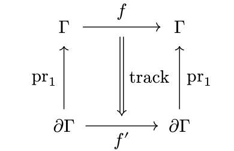

*证明.* 对所有 $(\gamma, \varphi) \in\partial\Gamma$：

$$
(\mathrm{pr}_{1} \circ\mathrm{track}_{\Gamma}(f, g))(\gamma, \varphi) = \mathrm{pr}_{1}(f(\gamma), \varphi\circ g) \\
= f(\gamma) \\
= (f\circ\mathrm{pr}_{1})(\gamma, \varphi)\square
$$

定理 4 保证追踪不改变前向行为：在上下文状态上，无论携带何种候选逆，$\mathrm{track}_{\Gamma}(f, g)$ 的作用都与 $f$ 相同。

**定理 5.** $\mathrm{track}_{\Gamma}$ 是从 $\mathfrak{T}_{\Gamma}$ 到 $\partial\Gamma \to\partial\Gamma$ 的幺半群同态。即，

1.$\mathrm{track}_{\Gamma}(\mathrm{id}_{\Gamma}, \mathrm{id}_{\Gamma}) = \mathrm{id}_{\partial\Gamma}$；

2. 对所有 $(f_{1}, g_{1}), (f_{2}, g_{2}) \in\mathfrak{T}_{\Gamma}$，

$$
\mathrm{track}_{\Gamma}((f_{1}, g_{1}) \circ(f_{2}, g_{2})) = \mathrm{track}_{\Gamma}(f_{1}, g_{1}) \circ\mathrm{track}_{\Gamma}(f_{2}, g_{2}) \tag{8}
$$

*证明.*

1. 单位被映为单位，因为 $\mathrm{track}_{\Gamma}(\mathrm{id}_{\Gamma}, \mathrm{id}_{\Gamma})(\gamma, \varphi) = (\gamma, \varphi\circ\mathrm{id}_{\Gamma}) = (\gamma, \varphi)$。
2. 对于乘法，任取 $(\gamma, \varphi) \in\partial\Gamma$：

$$
(\mathrm{track}_{\Gamma}(f_{1}, g_{1}) \circ\mathrm{track}_{\Gamma}(f_{2}, g_{2}))(\gamma, \varphi) = \mathrm{track}_{\Gamma}(f_{1}, g_{1})(f_{2}(\gamma), \varphi\circ g_{2}) \\
= (f_{1}(f_{2}(\gamma)), \varphi\circ g_{2} \circ g_{1}) \\
= \mathrm{track}_{\Gamma}(f_{1} \circ f_{2}, g_{2} \circ g_{1})(\gamma, \varphi)\square
$$

定理 5 保证逐个追踪变换对与一次追踪其扭曲复合是一致的，因此一串被追踪的效应可以作为单个被追踪的效应来推理。

**定义 6.** 在 $\partial\Gamma$ 上定义变换 $\mathrm{recover}_{\Gamma}$：

$$
\mathrm{recover}_{\Gamma}:\partial\Gamma\to\partial\Gamma \\
\mathrm{recover}_{\Gamma}= (\gamma, \varphi) \mapsto(\varphi(\gamma), \mathrm{id}_{\Gamma}) \tag{9}
$$

该变换把恢复函数 $\varphi$ 作用于当前状态 $\gamma$，并把 $\varphi$ 重置为恒等。下图说明在一串效应 $f_{i}'\coloneqq\mathrm{track}_{\Gamma}(f_{i}, g_{i})$、$i= 1, \cdots, n$ 作用于 $\partial\Gamma$ 之后，$\mathrm{recover}$ 如何把上下文恢复到其初始状态：

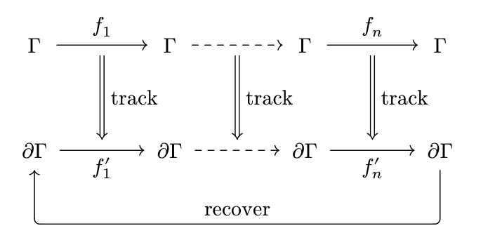

图中表明，被追踪的效应之后再接 $\mathrm{recover}$，会把初始效应上下文带回自身。事实上，无论从哪个状态出发，每个追踪步骤都保持恢复结果本身：

**定理 7.** 对每个 $(\gamma, \varphi) \in\partial\Gamma$ 以及每个满足 $g(f(\gamma)) = \gamma$ 的对 $(f, g)$，

$$
\mathrm{recover}_{\Gamma}(\mathrm{track}_{\Gamma}(f, g)(\gamma, \varphi)) = \mathrm{recover}_{\Gamma}(\gamma, \varphi) \tag{10}
$$

*证明.*

$$
\mathrm{recover}_{\Gamma}(\mathrm{track}_{\Gamma}(f, g)(\gamma, \varphi)) = \mathrm{recover}_{\Gamma}(f(\gamma), \varphi\circ g) \\
= (\varphi(g(f(\gamma))), \mathrm{id}_{\Gamma}) \\
= (\varphi(\gamma), \mathrm{id}_{\Gamma}) = \mathrm{recover}_{\Gamma}(\gamma, \varphi)\square
$$

定理 7 保证：若被追踪效应的逆确实撤销它，则该效应不会改变恢复的结果——在步骤之后恢复所得到的，与在步骤之前恢复本会得到的相同。恢复只通过量 $\varphi(\gamma)$ 读取状态，因此该保证等价于保持 $\varphi(\gamma)$；我们称 $\varphi(\gamma) = \gamma_{0}$ 为 $\partial\Gamma$ 中状态的*可靠性不变式*。特别地，从初始效应上下文 $(\gamma_{0}, \mathrm{id}_{\Gamma})$ 出发，由逆确实撤销自身的被追踪效应可达的每个状态都满足该不变式，而恢复把每个这样的状态带回 $(\gamma_{0}, \mathrm{id}_{\Gamma})$。

沿一串效应的保持性可由定理 5 一次应用得到。设 $(f_{1}, g_{1}), \cdots, (f_{n}, g_{n})$ 从 $(\gamma, \varphi)$ 起依次作用，并把中间上下文状态记为 $\delta_{0} = \gamma$ 与 $\delta_{i}= f_{i}(\delta_{i-1})$。由定理 5，复合 $\mathrm{track}_{\Gamma}(f_{n}, g_{n}) \circ\cdots\circ\mathrm{track}_{\Gamma}(f_{1}, g_{1})$ 是单个追踪步骤，即扭曲复合 $(f_{n}\circ\cdots\circ f_{1}, g_{1} \circ\cdots\circ g_{n})$ 的 $\mathrm{track}_{\Gamma}$。若每个逆都撤销各自的步骤，即 $g_{i}(\delta_{i}) = \delta_{i-1}$，则复合逆把 $\delta_{n}$ 带回起点：$(g_{1} \circ$ $\cdots\circ g_{n})(\delta_{n}) = \delta_{0} = \gamma$。因此该扭曲复合在 $\gamma$ 处满足定理 7 的前提，应用一次定理即得

$$
\mathrm{recover}_{\Gamma}((\mathrm{track}_{\Gamma}(f_{n}, g_{n}) \circ\cdots\circ\mathrm{track}_{\Gamma}(f_{1}, g_{1}))(\gamma, \varphi)) = \mathrm{recover}_{\Gamma}(\gamma, \varphi) \tag{11}
$$

带有 $g\circ f= \mathrm{id}_{\Gamma}$ 的对在每个状态都满足该前提。

#### 3.1.2. 效应函数

上一节的 $\mathrm{track}$/$\mathrm{recover}$ 模型有两处局限：

1.$\mathrm{track}_{\Gamma}(f, g)$ 在看到任何上下文状态之前就固定了 $g$，因此同一个 $g$ 必须在

效应被应用的每个状态都满足定理 7 的前提。而撤销所需更少：只需

针对 $f$ 被应用的那个状态给出一个逆，它可以随状态而变。逐状态的

逆无法在看到状态之前固定在参数位置；它必须在

应用之点返回。

2.$\mathrm{recover}_{\Gamma}$ 是全有或全无的：它不能在保留其他效应的同时选择性地撤销某一个。

为处理这两个问题，我们分别在输入侧与输出侧增强模型：

1. 在输入侧，我们不仅变换 $\Gamma$，还同时返回一个逆函数，
   使逆在效应被应用之处给出：$\Gamma \to\Gamma \times (\Gamma \to\Gamma)$，即 $\Gamma \to$
   $\partial\Gamma$；
2. 在输出侧，我们不仅变换 $\partial\Gamma$，也同时返回一个逆函数，使一个效应可被撤销而其余得以保留：$\partial\Gamma \to\partial\Gamma \times (\partial\Gamma \to$
   $\partial\Gamma)$，即 $\partial\Gamma \to\partial^{2}\Gamma$。
   这两处改动使输入与输出具有相同的形状，即从上下文到「变换后的上下文加上一个逆」的映射：输入侧为 $\Gamma \to\partial\Gamma$，输出侧为 $\partial\Gamma \to\partial^{2}\Gamma$。于是一个类型族即可覆盖两个层次，我们在每个上下文上把它定义为效应函数类型 $\mathfrak{E}_{\Gamma}$，并用见证细化为 $\mathfrak{E}_{\Gamma}^{\ast}$：

**定义 8.** 定义效应函数 $\mathfrak{E}_{\Gamma}$ 与*带见证的*效应函数 $\mathfrak{E}_{\Gamma}^{\ast}$ 为：

$$
\mathfrak{E}_{\Gamma} \coloneqq\Gamma \to\Gamma \times (\Gamma \to\Gamma) \\
\mathfrak{E}_{\Gamma}^{\ast} \coloneqq(e: \Gamma \to\Gamma \times (\Gamma \to\Gamma)) \\
\times ((\gamma: \Gamma) \to(\delta: \Gamma) \to(g: \Gamma \to\Gamma) \to((\delta, g) = e(\gamma) \to g(\delta) = \gamma)) \tag{12}
$$

其中 $e(\gamma)$ 产生一对 $(\delta, g)$，表示：

- $\delta: \Gamma$ 是新的上下文；
- $g: \Gamma \to\Gamma$ 是当前效应的逆函数。
  见证把每个返回的逆约束于一个等式 $g(\delta) = \gamma$：只要求逆在它被应用的那个状态撤销效应。因此 $\mathfrak{E}_{\Gamma}^{\ast}$ 的元素可以在每个状态选择不同的逆。单个带有 $g\circ f= \mathrm{id}_{\Gamma}$ 的 $g$ 在所有状态同时满足该等式，于是赋值 $(f, g) \mapsto\gamma\mapsto(f(\gamma), g)$ 把这样的对带入 $\mathfrak{E}_{\Gamma}^{\ast}$，定理 11 表明该赋值是同态。下面的交换图陈述同一条件：返回的逆 $e$ 在 $e$ 被应用的状态处撤销该变换：

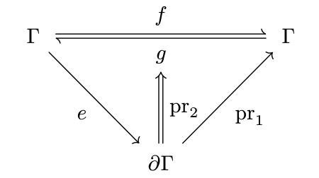

由于效应函数 $\mathfrak{E}_{\Gamma}$ 不再是上下文上的自同态，它们无法直接复合。因此我们为效应复合定义新的运算：

**定义 9.** 给定函数 $f, g\in\mathfrak{E}_{\Gamma}$，定义它们的*效应复合* $f\diamond g$ 为：

$$
f\diamond g:\Gamma \to\partial\Gamma \\
\mathbf{let}(\delta, s) = g(\gamma) \mathbf{in} \\
f\diamond g= \gamma\mapsto\mathbf{let}(\epsilon, t) = f(\delta) \mathbf{in} \\
(\epsilon, s\circ t) \tag{13}
$$

**定理 10.** 效应复合把 $\mathfrak{T}_{\Gamma}$ 的幺半群结构带到 $\mathfrak{E}_{\Gamma}$ 上。即，

1.$(\mathfrak{E}_{\Gamma}, \diamond)$ 是以 $\eta_{\Gamma} \coloneqq\gamma\mapsto(\gamma, \mathrm{id}_{\Gamma})$ 为单位的幺半群；

2. 赋值 $(f, g) \mapsto\gamma\mapsto(f(\gamma), g)$ 是从 $\mathfrak{T}_{\Gamma}$ 到 $\mathfrak{E}_{\Gamma}$ 的幺半群同态。
   *证明.*
3. 结合律与单位律按分量由 $\circ$ 的相应定律得出。
4. 记 $e_{i}= \gamma\mapsto(f_{i}(\gamma), g_{i})$；则 $(e_{1} \diamond e_{2})(\gamma) = (f_{1}(f_{2}(\gamma)), g_{2} \circ g_{1})$，它是
   $(f_{1}, g_{1}) \circ(f_{2}, g_{2})$ 的像，且 $(\mathrm{id}_{\Gamma}, \mathrm{id}_{\Gamma})$ 映到 $\eta_{\Gamma}$。$\square$
   **定理 11.** 见证在效应复合下得以保持，且统一的逆在每个状态都构成见证。即，

1.$\mathfrak{E}_{\Gamma}^{\ast}$ 是 $\mathfrak{E}_{\Gamma}$ 的子幺半群；

2. 定理 10 的同态把每个带有 $g\circ f= \mathrm{id}_{\Gamma}$ 的对带入 $\mathfrak{E}_{\Gamma}^{\ast}$。
   *证明.*
3. 单位属于 $\mathfrak{E}_{\Gamma}^{\ast}$，因为 $\mathrm{id}_{\Gamma}(\gamma) = \gamma$。对于封闭性，取 $f, g\in\mathfrak{E}_{\Gamma}^{\ast}$ 与任意 $\gamma\in\Gamma$，并
   令 $(\delta, s) = g(\gamma), (\epsilon, t) = f(\delta)$，于是 $(f\diamond g)(\gamma) = (\epsilon, s\circ t)$。则 $s(\delta) = \gamma$ 且 $t(\epsilon) = \delta$，
   因此 $(s\circ t)(\epsilon) = s(\delta) = \gamma$。
   2.$g\circ f= \mathrm{id}_{\Gamma}$ 在每个 $\gamma$ 处给出 $g(f(\gamma)) = \gamma$，所以这样的对的像在每个

状态都有见证。$\square$

正如 $\mathrm{track}$ 把 $\Gamma$ 上的一对变换提升到 $\partial\Gamma$，我们定义 $\mathrm{effect}$ 把 $\mathfrak{E}_{\Gamma}$ 提升到 $\mathfrak{E}_{\partial\Gamma}$：

**定义 12.** 定义效应函数变换 $\mathrm{effect}_{\Gamma}$ 为：

$$
\mathrm{effect}_{\Gamma}:\mathfrak{E}_{\Gamma}\to\partial\Gamma\to\partial^{2}\Gamma \\
\mathrm{effect}_{\Gamma}=e\mapsto(\gamma, \varphi) \mapsto\mathbf{let}(\delta, g) = e(\gamma) \mathbf{in} \\
((\delta, \varphi\circ g), \mathrm{track}_{\Gamma}(g, \mathrm{pr}_{1} \circ e)) \tag{14}
$$

由于 $\mathrm{effect}_{\Gamma}(e)$ 本身就是 $\mathfrak{E}_{\partial\Gamma}$，它所返回的是按定义 8 在上一层解读的逆。该逆本身又是把效应的两个方向互换后所得之对的 $\mathrm{track}$。普通追踪规则再次适用：撤销效应本身就是一个效应，它用 $g$ 变换状态，而撤销*那个*效应的办法就是再执行该效应一次，这正是 $\mathrm{pr}_{1} \circ e$ 所做的。因此该逆复合到交给它的累加器上，完全依照 $\mathrm{track}$ 的规定。

现在我们可以证明 $\mathrm{effect}$ 与 $\mathrm{track}$ 的那些性质相对应的性质。

**定理 13.** $\mathrm{effect}$ 保持 $\diamond$ 运算。即，$\forall f, g\in\mathfrak{E}_{\Gamma}$：

$$
\mathrm{effect}_{\Gamma}(f) \diamond\mathrm{effect}_{\Gamma}(g) = \mathrm{effect}_{\Gamma}(f\diamond g) \tag{15}
$$

*证明.* 任取 $(\gamma, \varphi) \in\partial\Gamma$，令 $(\delta, s) = g(\gamma)$ 与 $(\epsilon, t) = f(\delta)$，于是 $(f\diamond g)(\gamma) = (\epsilon, s\circ t)$ 与 $\mathrm{pr}_{1} \circ(f\diamond g) = (\mathrm{pr}_{1} \circ f) \circ(\mathrm{pr}_{1} \circ g)$。则

$$
(\mathrm{effect}_{\Gamma}(f) \diamond\mathrm{effect}_{\Gamma}(g))(\gamma, \varphi) = ((\epsilon, \varphi\circ s\circ t), \mathrm{track}_{\Gamma}(s, \mathrm{pr}_{1} \circ g) \circ\mathrm{track}_{\Gamma}(t, \mathrm{pr}_{1} \circ f)) \\
= ((\epsilon, \varphi\circ s\circ t), \mathrm{track}_{\Gamma}(s\circ t, (\mathrm{pr}_{1} \circ f) \circ(\mathrm{pr}_{1} \circ g))) \\
= \mathrm{effect}_{\Gamma}(f\diamond g)(\gamma, \varphi)
$$

其中第一步在 $(\gamma, \varphi)$ 与 $(\delta, \varphi\circ s)$ 处展开定义 12，第二步是定理 5，第三步折回定义 12。$\square$

两个层次之间的关系由下图给出。其上三角是 $e$ 按定义 8 的见证条件，下三角则是 $e'$ 是否像 $e$ 那样带见证的问题。

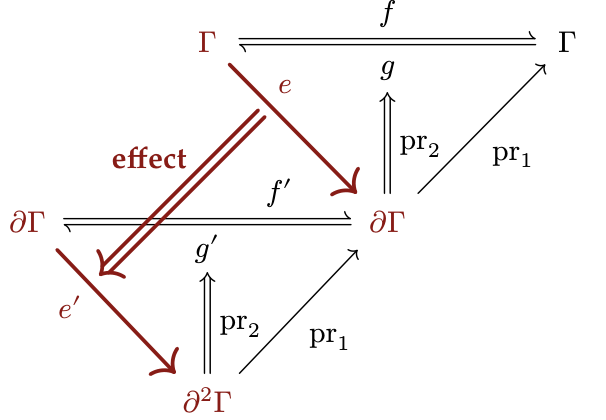

在层次之间，投影 $\mathrm{pr}_{1}$ 把每个提升后的映射与被它提升的映射联系起来，正如定理 4 中对 $\mathrm{track}_{\Gamma}$ 所做的那样。

**定理 14.** 设 $e\in\mathfrak{E}_{\Gamma}$，记 $f\coloneqq\mathrm{pr}_{1} \circ e$，并设 $e' \coloneqq\mathrm{effect}_{\Gamma}(e)$ 的前向映射为 $f' \coloneqq\mathrm{pr}_{1} \circ$ $e'$。则

1.$\mathrm{pr}_{1} \circ f' = f\circ\mathrm{pr}_{1}$；

2. 对每个 $(\gamma, \varphi) \in\partial\Gamma$，提升后的逆 $g' \coloneqq\mathrm{pr}_{2}(e'(\gamma, \varphi))$ 与逆 $g\coloneqq\mathrm{pr}_{2}(e(\gamma))$
   在那里得到见证，二者满足 $\mathrm{pr}_{1} \circ g' = g\circ\mathrm{pr}_{1}$。
   *证明.*
3. 由定义 12，$f'(\gamma, \varphi) = (f(\gamma), \varphi\circ g)$，其状态为 $f(\gamma) = (f\circ\mathrm{pr}_{1})(\gamma, \varphi)$。
4. 这是把定理 4 应用于 $g' = \mathrm{track}_{\Gamma}(g, f)$。$\square$
   下三角是否闭合，由计算提升后的逆返回什么来判定：

**定理 15.** 设 $e\in\mathfrak{E}_{\Gamma}^{\ast}$ 并记 $f\coloneqq\mathrm{pr}_{1} \circ e$。固定 $(\gamma, \varphi) \in\partial\Gamma$，令 $(\delta, g) = e(\gamma)$，并把 $\mathrm{effect}_{\Gamma}(e)$ 在 $(\gamma, \varphi)$ 处的值记为 $(\Delta, g')$。则

$$
g'(\Delta) = (\gamma, \varphi\circ g\circ f) \tag{16}
$$

状态被精确恢复。累加器也被还原（等价于 $\mathrm{effect}_{\Gamma}(e) \in$ $\mathfrak{E}_{\partial\Gamma}^{\ast}$），当且仅当 $g\circ f= \mathrm{id}_{\Gamma}$；而无论何种情形都有 $(\varphi\circ g\circ f)(\gamma) = \varphi(\gamma)$，因此可靠性不变式得以保持。

*证明.* 由定义 12，$\Delta = (\delta, \varphi\circ g)$ 且 $g' = \mathrm{track}_{\Gamma}(g, f)$，于是

$$
g'(\Delta) = (g(\delta), \varphi\circ g\circ f) = (\gamma, \varphi\circ g\circ f)
$$

这里用了 $g(\delta) = \gamma$。属于 $\mathfrak{E}_{\partial\Gamma}^{\ast}$ 要求它在每个输入处等于 $(\gamma, \varphi)$；取 $\varphi= \mathrm{id}_{\Gamma}$ 把累加器的相等化为 $g\circ f= \mathrm{id}_{\Gamma}$，而该条件反过来又给出每个 $\varphi$ 处累加器的相等。最后 $(\varphi\circ g\circ f)(\gamma) = \varphi(g(\delta)) = \varphi(\gamma)$。$\square$

因此，下三角只有在 $\gamma$ 处得到见证的逆在每个状态都撤销 $f$ 时才闭合，所以 $\mathrm{effect}_{\Gamma}$ 并不把 $\mathfrak{E}_{\Gamma}^{\ast}$ 带入 $\mathfrak{E}_{\partial\Gamma}^{\ast}$。在每种情形成立的，是在 $\gamma$ 处的一致：$\mathrm{recover}_{\Gamma}(g'(\Delta)) = \mathrm{recover}_{\Gamma}(\gamma, \varphi)$，这正是定理 7 对累加器所要求的全部，所以撤销不会改变恢复目标。

#### 3.1.3. 效应迭代器

组件加载时所执行的不是一个效应，而是一串效应；卸载时要撤销的是整串。按应用顺序的逆序撤销效应不需要额外条件，因为此时每个逆都遇到自身应用所产生的状态：

**定理 16.** 设 $e_{1}, \cdots, e_{n}\in\mathfrak{E}_{\Gamma}^{\ast}$ 从 $(\gamma_{0}, \mathrm{id}_{\Gamma})$ 起依次应用，并按逆序撤销。则

1. 每次撤销都恢复到其应用所针对的上下文状态；
2. 每个中间状态都满足可靠性不变式。
   *证明.* 每一步要么是应用，要么是撤销。应用把 $(\gamma, \varphi)$ 带至 $(\delta, \varphi\circ g)$ 并带有 $g(\delta) = \gamma$，故由定理 7 保持 $\varphi(\gamma)$，而该定理的前提正是 $\mathfrak{E}_{\Gamma}^{\ast}$ 的见证。按逆序撤销把每个逆交给自身应用所产生的状态，因此由定理 15，该撤销精确恢复前一状态，同时也保持 $\varphi(\gamma)$；两个结论都不依赖逆所收到的累加器。$\square$

这串效应本身值得被具体化。*效应迭代器*一次执行一个效应，每次迭代产生修改后的上下文、一个逆以及一个续体：

**定义 17.** 把效应迭代器 $\Im_{\Gamma}$ 与*带见证的*效应迭代器 $\Im_{\Gamma}^{\ast}$ 定义为如下递归类型：

$\Im_{\Gamma} \coloneqq\mu\Im. \Gamma \to\Gamma \times (\Gamma \to\Gamma) \times \mathsf{Maybe}(\Im)$

$$
\Im_{\Gamma}^{\ast} \coloneqq\mu\Im. (e: \Gamma \to\Gamma \times (\Gamma \to\Gamma) \times \mathsf{Maybe}(\Im)) \\
\times ((\gamma: \Gamma) \to(\delta: \Gamma) \to(g: \Gamma \to\Gamma) \to(o: \mathsf{Maybe}(\Im)) \to((\delta, g, o) = e(\gamma) \to g(\delta) = \gamma)) \tag{17}
$$

其中 $e(\gamma)$ 产生三元组 $(\delta, g, o)$，表示：

- $\delta$ 是新的上下文；
- $g$ 是当前效应的逆函数；
- $o$ 表示续体：
  $\triangleright \mathsf{Nothing}$ 表示迭代终止；
  $\triangleright \mathsf{Just}(i)$ 给出下一次迭代。
  见证把每次迭代约束于定义 8 对单个效应施加的条件，且带见证的迭代器所产生的续体仍是带见证的。

效应迭代器变换 $\mathrm{effect}^{\mathrm{iter}}_{\Gamma}$ 通过递归调用把 $\mathrm{effect}_{\Gamma}$ 扩展到迭代器结构上：

**定义 18.** 定义效应迭代器变换 $\mathrm{effect}^{\mathrm{iter}}_{\Gamma}$ 为：

$\mathrm{effect}^{\mathrm{iter}}_{\Gamma}:\Im_{\Gamma}\to\partial\Gamma\to\partial^{2}\Gamma$

$$
\mathbf{let}(\delta, g, o) = i(\gamma) \mathbf{in} \\
\mathbf{let}t= \mathrm{track}_{\Gamma}(g, \mathrm{pr}_{1} \circ i) \mathbf{in} \\
\mathbf{match}o \tag{18}
$$

$\mathrm{effect}^{\mathrm{iter}}_{\Gamma}=i\mapsto(\gamma, \varphi) \mapsto$

$$
| \mathsf{Nothing}\Rightarrow((\delta, \varphi\circ g), t) \\
| \mathsf{Just}(i') \Rightarrow\mathbf{let}(s, r) = \mathrm{effect}^{\mathrm{iter}}_{\Gamma} (i')(\delta, \varphi\circ g) \mathbf{in} \\
(s, t\circ r)
$$

在每次迭代中，逆 $g$ 按应用顺序复合到 $\varphi$ 上，因此累加器 $\varphi\circ g_{1} \circ\cdots\circ g_{k}$ 在应用时以后进先出顺序撤销这些效应（定理 16）。由于 $\mathrm{effect}^{\mathrm{iter}}_{\Gamma}$ 落在与 $\mathrm{effect}_{\Gamma}$ 相同的 $\partial\Gamma \to\partial^{2}\Gamma$ 中，迭代器本身就是一个效应，可用于任何允许效应之处；第 4 节把组件的一次完整加载读作一个迭代器。$\mathsf{Maybe}(\Im)$ 续体在任意两次相邻迭代之间提供了一个边界：此时上下文正是此前各次迭代所造成的状态，累加器只恢复这些迭代、不多也不少。在这个意义上，效应迭代器是具体化的受限续体，主流语言通过 `yield` 运算符 [38] 暴露的正是这一结构，因此本模型可直接映射到它们已提供的生成器上。

普通效应函数是退化情形：$e\in\mathfrak{E}_{\Gamma}$ 嵌入为这样的迭代器——其第一次迭代就产生 $\mathsf{Nothing}$，

$$
\gamma\mapsto\mathbf{let}(\delta, g) = e(\gamma) \mathbf{in}(\delta, g, \mathsf{Nothing}) \tag{19}
$$

且该嵌入把 $\mathfrak{E}_{\Gamma}^{\ast}$ 带入 $\Im_{\Gamma}^{\ast}$，两个见证要求同一个等式。下文在迭代器上定义的每个概念，都通过这一嵌入在效应函数上解读。

这些构造共同构成*可逆效应*：$\mathfrak{E}_{\Gamma}^{\ast}$ 中的每个效应函数显式提供自己的逆，$\mathrm{effect}$ 在 $\partial\Gamma$ 上追踪该效应，而 $\diamond$ 运算在保持可逆性的同时复合效应函数。它们交付的是*局部时间可组合性*，这里的「局部」指该保证只就单个组件自身的效应来解读。我们把它取为如下判据：对组件所应用的任意效应函数序列，累加器恢复其起始上下文（定理 7），而撤销该序列时每个逆都遇到自身应用所针对的状态（定理 16）。加载组件就是运行一个迭代器并把其逆累积到 $\varphi$ 中；卸载组件就是应用 $\varphi$。该判据遗漏了两件事，而二者都在多个组件同时存在时出现：不按累加器规定的顺序撤销，以及与他者效应交错的序列。二者都由独立性给出，它是施加于效应之上的条件，而非构造本身的性质（第 3.4 节）。

### 3.2. 响应式协效应

*空间可组合性*指组件能够声明彼此之间的依赖，且系统能在运行时解析、提供与撤回这些依赖的能力。这要求每当共享上下文变化时都重新评估依赖的满足情况，使组件在其依赖可用时激活、在被撤回时停用。因此我们把组件的依赖建模为规格，并把上下文的每次变化对照该规格分类为激活型、停用型或中性。对照规格进行分类，是检测满足性变化的手段；对分类作出响应，是驱动激活与停用的手段。我们称这类协效应为*响应式的*：通过对上下文变化分类并据此驱动激活与停用，局部空间可组合性成为结构性保证。

#### 3.2.1. 协效应上下文

传统的控制反转（IoC）容器 [39] 通常把依赖建模为简单的键值映射。本节把 IoC 形式化为与可逆效应协同的协效应上下文，为动态组合提供数学基础。

**定义 19.** 给定类型族 $\mathcal{V}: K\to\mathrm{Type}$，把*协效应上下文*定义为依赖部分函数类型：

$$
\Sigma \coloneqq(k: K) \rightharpoonup\mathcal{V}_{k} \tag{20}
$$

其中 $\sigma: \Sigma$ 是有限部分函数，为每个 $k\in\mathrm{dom}(\sigma) \subseteq K$ 指派一个类型为 $\mathcal{V}_{k}$ 的值。我们记作：

- $\sigma(k)$ 表示应用（当 $k\in\mathrm{dom}(\sigma)$ 时有定义）；
- $\sigma[k\mapsto v]$ 表示在 $k$ 处绑定 $v$、其余处与 $\sigma$ 一致的表；
- $\sigma\setminus k$ 表示限制（当 $k\in\mathrm{dom}(\sigma)$ 时有定义）；
- $k\in\mathrm{dom}(\sigma)$ 表示成员关系。
  使用类型族 $\mathcal{V}$ 保证每个依赖键 $k$ 与特定的值类型 $\mathcal{V}_{k}$ 关联，为依赖访问提供静态类型安全。扩展与限制带有前提，由下述运算施加：依赖不能被重复提供（扩展要求 $k\notin\mathrm{dom}(\sigma)$），也不能在缺失时撤回（限制要求 $k\in\mathrm{dom}(\sigma)$）。违反前提会作为错误发出信号且不产生转移，因此描述「确实发生的转移」的效应代数可原样适用于这些运算。希望把失败内部化的读者，可把下文每个 $\Sigma \rightharpoonup\Sigma$ 读作 $\Sigma \to\mathsf{Maybe}(\Sigma)$，并在 $\mathsf{Maybe}$ 单子中复合（第 2.1 节），代价是把每个恒等替换为该运算定义域上的部分恒等。基于这一上下文结构，我们定义两个核心运算：

**定义 20.** $\Sigma$ 上的 $\mathrm{get}$ 与 $\mathrm{set}$ 运算定义为：

$$
\mathrm{get}:(k: K)\to\Sigma \rightharpoonup\mathcal{V}_{k} \\
\mathrm{get} =k\mapsto\sigma\mapsto\sigma(k) \\
\mathrm{set}:(k: K) \times \mathcal{V}_{k}\to\Sigma \rightharpoonup\Sigma \times (\Sigma \rightharpoonup\Sigma) \\
\mathrm{set}=(k, v)\mapsto\sigma\mapsto(\sigma[k\mapsto v], \lambda\sigma'.\sigma' \setminus k) \tag{21}
$$

其中 $\mathrm{get}(k)$ 以 $k\in\mathrm{dom}(\sigma)$ 为前提，$\mathrm{set}(k, v)$ 以 $k\notin\mathrm{dom}(\sigma)$ 为前提。

值得注意的是，$\mathrm{set}(k, v)$ 具有类型 $\mathfrak{E}_{\Sigma}^{\ast}$，即协效应上下文上的效应函数。因此我们可以直接套用第 3.1 节的效应机制：$\mathrm{effect}_{\Sigma}$ 提供依赖注册的自动追踪与恢复。这正是响应式协效应与可逆效应之间的协同：协效应操作就是效应，而效应是可逆的。

#### 3.2.2. 规格与通知

前述定义描述的是单个依赖如何注册与访问。然而，访问缺失的依赖是运行时失败。因此组件应当只在它所声明的依赖全部就位时激活，而不是乐观地访问、在缺失时失败。这引出两个问题：组件声明的依赖是否被共同满足，以及当该状态变化时系统应如何响应。协效应上下文 $\Sigma$ 带有自然的观察结构，使两个问题都可处理：对任意协效应规格 $d\subseteq K$，定义*满足谓词*：

$$
\sigma\models d\coloneqq\forall k\in d. k\in\mathrm{dom}(\sigma) \tag{22}
$$

该谓词是可判定的（因为 $\mathrm{dom}(\sigma)$ 有限）。由于对 $\sigma$ 的所有修改都经由效应函数（其逆会恢复先前的定义域），满足性的变化可在每个效应边界被检测到。这就是响应性的代数基础：效应系统保证每次协效应变化都被观察到。

**定义 21.** *协效应规格*为：

$$
\mathfrak{D}_{\Sigma} \coloneqq\mathsf{Set}(K) \tag{23}
$$

表示组件向环境声明的依赖集合。

使这一规格具有响应性的，是它对状态转移的分类方式。任何把 $\sigma$ 变换为 $\sigma'$ 的效应，都可按规格 $d\in\mathfrak{D}_{\Sigma}$ 依据 $d$ 的满足状态是否被改变来分类：

**定义 22.** 给定协效应规格 $d\subseteq K$ 与状态 $\sigma, \sigma' \in\Sigma$，定义：

$$
\mathrm{activating}\mathrm{if} \sigma\not\models d\land\sigma' \models d \\
\mathrm{notify}_{d}(\sigma, \sigma') \coloneqq\mathrm{deactivating} \mathrm{if} \sigma\models d\land\sigma' \not\models d \\
\mathrm{neutral}\mathrm{otherwise} \\
\{ \tag{24}
$$

激活型转移触发组件效应的执行，并按第 3.1 节的规定加以追踪；停用型转移则通过应用累加器触发恢复。由此触发的激活与停用，其操作语义在第 4 节给出。

$\mathrm{set}$ 与 $\mathrm{notify}$ 共同交付的是*局部空间可组合性*，「局部」的含义与前文相同：该保证只就单个组件自身的协效应来解读。我们把它取为如下判据：组件只在满足其规格的状态激活，因而从不读取缺失的绑定；上下文的每次变化都对照该规格分类，因而满足性的丧失在发生之处即被检测到并驱动停用。两半都可直接由上述定义得出：满足性是组件将要激活处所检查的前提，而 $\mathrm{notify}_{d}$ 在每次转移处都有定义；协效应定序的一个方向随前半而来——组件只在其所声明键的提供者之后激活。该判据遗漏了两件事，二者都在多个组件同时存在时出现：绑定只有在它所引起的停用完成后才能撤回，以及激活期间保持该激活所读取的绑定不变。二者都是施加于其他组件而非正在行动的组件之上的条件，因此属于保证的全局形式，由第 4.3.3 节确立。

#### 3.2.3. 隔离与拦截

基本的协效应上下文 $\Sigma$ 建模的是扁平的依赖表。然而实践中，系统可能需要为不同组件把同一个逻辑依赖绑定到不同的值。本节为协效应上下文增加两种机制：*协效应隔离*（同一个键在不同上下文中解析到不同结果）与*协效应拦截*（依赖访问上的横切行为）。

**实现。** 两种机制与 $\mathrm{get}$、$\mathrm{set}$ 的差别在于作用对象。供给写入所有组件都读取的共享表，因此是该表上的效应，并带有撤回它的逆。隔离与拦截则调整某个键在某个上下文下*如何解析*，而保持表本身不变。把一个运算定型为效应，固定的是它的*指称*——后继状态加上一个逆——而不是它的*实现*，后者决定该逆如何执行。

**定义 23.** 上下文上的效应函数有两种*实现*：

- *就地*实现修改上下文并返回非平凡的逆；后继与输入互为别名，恢复时运行该逆以撤销修改。
- *派生*实现保持输入不变，返回由它派生的新上下文，并以恒等为逆；恢复时丢弃派生上下文。由另一个上下文派生出的上下文，正是定义 28 的递归结构所承载的。在纯函数式场景中两者重合，而命令式宿主可为每个运算任选其一；第 5.1.2 节同时实现了两者。隔离与拦截直接采用派生实现：各自产生一个新上下文，其自身的表不同于所继承的表，因此下文把它们定为从上下文到上下文的映射，而不是效应函数。共享表中没有任何变化，因而没有效应需要追踪，也没有定义 12 需要提升的对象；恢复时把派生上下文连同它携带的调整一并丢弃。派生表上的赋值会覆盖继承表在该键处原有的内容，这正是两个运算都不带前提的原因。

**协效应隔离。** 通过引入*隔离域*，协效应隔离允许同一依赖在不同上下文中绑定到不同值。这在多租户系统、测试环境与组件沙箱中有广泛用途。

**定义 24.** 定义带隔离的协效应上下文为：

$$
\Sigma^{\mathrm{iso}} \coloneqq(K\rightharpoonup R) \times ((r: R) \rightharpoonup\mathcal{V}_{r}) \tag{25}
$$

它可表示为一对 $(\rho, \sigma)$，其中：

- $\rho: K\rightharpoonup R$ 是隔离域表，为每个被隔离的键指派一个域标识符；
  不在 $\mathrm{dom}(\rho)$ 中的键解析到自身的域，故在那里记作 $\rho(k) = k$（$R\supseteq K$）；
- $\sigma: (r: R) \rightharpoonup\mathcal{V}_{r}$ 是依赖表，即从域标识符到带类型值的部分依赖函数。
  两层映射结构把逻辑层与存储层解耦，使依赖访问具备上下文感知能力。访问键 $k$ 时，系统先解析 $\rho(k)$ 得到域标识符 $r$，再访问 $\sigma(r)$ 取得实际值。

**定义 25.** $\Sigma^{\mathrm{iso}}$ 上的 $\mathrm{get}$、$\mathrm{set}$ 与 $\mathrm{isolate}$ 运算为：

$\mathrm{get}:(k: K)\to\Sigma^{\mathrm{iso}}\rightharpoonup\mathcal{V}_{\rho(k)}$

$\mathrm{get}=k\mapsto(\rho, \sigma) \mapsto\sigma(\rho(k))$

$\mathrm{set}:(k: K) \times \mathcal{V}_{\rho(k)}\to\Sigma^{\mathrm{iso}}\rightharpoonup\Sigma^{\mathrm{iso}} \times (\Sigma^{\mathrm{iso}} \rightharpoonup\Sigma^{\mathrm{iso}})$

$$
\mathrm{set}=(k, v)\mapsto(\rho, \sigma) \mapsto((\rho, \sigma[\rho(k) \mapsto v]), \lambda(\rho', \sigma').(\rho', \sigma' \setminus\rho'(k))) \tag{26}
$$

$\mathrm{isolate}:K\times R\to\Sigma^{\mathrm{iso}}\to\Sigma^{\mathrm{iso}}$

$\mathrm{isolate} =(k, r)\mapsto(\rho, \sigma) \mapsto(\rho[k\mapsto r], \sigma)$ 其中 $\mathrm{get}$ 与 $\mathrm{set}$ 带有沿 $\rho$ 搬运而来的定义 20 的前提，即 $\rho(k) \in$ $\mathrm{dom}(\sigma)$ 与 $\rho(k) \notin\mathrm{dom}(\sigma)$。$\mathrm{isolate}(k, r)$ 所派生的上下文把域 $r$ 指派给 $k$，并原样继承依赖表，因此已被隔离的键会被重新指派而非被拒绝。

协效应隔离机制实质上实现了一个运行时特设多态（ad-hoc polymorphism）系统。借助隔离域标识符，同一依赖键在不同上下文中可解析到完全不同的值，且这种多态可在运行时动态调整。与传统依赖注入相比，协效应隔离提供更细粒度的控制，可为特定组件定制隔离；$\mathrm{set}$ 仍是效应函数（$\mathfrak{E}_{\Sigma^{\ast}}^{\mathrm{iso}}$），因而继承可逆性，而 $\mathrm{isolate}$ 无需可逆性，它派生一个上下文而非写入共享表。

**协效应拦截。** 第二种机制*协效应拦截*为依赖访问附加横切元数据，在不改变依赖值的前提下增加行为。这类元数据既可由上下文携带，也可由组件声明，因此我们同时扩展协效应上下文与协效应规格：

**定义 26.** 定义带拦截的协效应上下文与规格为：

$$
\Sigma^{\mathrm{inter}} \coloneqq((k: K) \to\mathcal{M}_{k}) \times ((k: K) \rightharpoonup(\mathcal{M}_{k}\to\mathcal{V}_{k})) \\
\mathfrak{D}^{\mathrm{inter}} \coloneqq(k: K) \rightharpoonup\mathcal{M}_{k} \tag{27}
$$

上下文 $\Sigma^{\mathrm{inter}}$ 是一对 $(\iota, \sigma)$：$\iota$ 是安装在上下文自身的*上下文携带*元数据，默认为空（$\varepsilon_{k}$）；$\sigma$ 把每个键 $k$ 映射到一个从元数据 $\mathcal{M}_{k}$ 到值 $\mathcal{V}_{k}$ 的*提供者函数*。规格 $d\in\mathfrak{D}^{\mathrm{inter}}$ 携带*组件声明*的元数据，为每个键指派其元数据 $d(k)$，而 $\mathrm{dom}(d)$ 充当依赖集合。每个键为其元数据配备幺半群 $(\mathcal{M}_{k}, \oplus_{k}, \varepsilon_{k})$：合并 $\oplus_{k}$ 满足结合律，单位元为 $\varepsilon_{k}$（空元数据）。

**定义 27.** $\Sigma^{\mathrm{inter}}$ 上的 $\mathrm{get}$、$\mathrm{set}$ 与 $\mathrm{intercept}$ 运算为：

$$
\mathrm{get}:(k: K) \times \mathcal{M}_{k}\to\Sigma^{\mathrm{inter}}\rightharpoonup\mathcal{V}_{k} \\
\mathrm{get}=(k, \mu)\mapsto(\iota, \sigma) \mapsto\sigma(k)(\mu\oplus_{k}\iota(k)) \\
\mathrm{set}:(k: K) \times (\mathcal{M}_{k}\to\mathcal{V}_{k}) \to\Sigma^{\mathrm{inter}}\rightharpoonup\Sigma^{\mathrm{inter}} \times (\Sigma^{\mathrm{inter}} \rightharpoonup\Sigma^{\mathrm{inter}}) \\
\mathrm{set}=(k, \psi)\mapsto(\iota, \sigma) \mapsto((\iota, \sigma[k\mapsto\psi]), \lambda(\iota', \sigma').(\iota', \sigma' \setminus k)) \\
\mathrm{intercept}:(k: K) \times \mathcal{M}_{k}\to\Sigma^{\mathrm{inter}}\to\Sigma^{\mathrm{inter}} \\
\mathrm{intercept} =(k, \nu)\mapsto(\iota, \sigma) \mapsto(\iota[k\mapsto\iota(k) \oplus_{k}\nu], \sigma) \tag{28}
$$

其中 $\mathrm{get}$ 与 $\mathrm{set}$ 带有定义 20 对提供者表的前提，即 $k\in$ $\mathrm{dom}(\sigma)$ 与 $k\notin\mathrm{dom}(\sigma)$。$\mathrm{intercept}(k, \nu)$ 所派生的上下文把 $\nu$ 合并到在 $k$ 处继承的元数据上，并原样继承提供者表。

当具有规格 $d$ 的组件访问键 $k$ 时，系统求值 $\sigma(k)(d(k) \oplus_{k}$ $\iota(k))$：组件声明的元数据与上下文携带的元数据 $\iota$ 合并，再把提供者函数作用于结果。该合并遵循每个键自身的语义（例如标量字段覆盖、集合值字段取并）且是右偏的，因此 $\iota(k)$ 优先，可以覆盖组件的声明，使外层上下文能够约束组件如何使用某个协效应，而无需修改该组件（例如第 6.3 节）。

### 3.3. 上下文范式

第 3.1 节与第 3.2 节各自作用于一个上下文：前者作为效应的载体，后者作为协效应的载体。第 3.3.1 节构造同时承载二者的统一上下文，为其每个键给出一组运算，并通过约束效应迭代器的阶段（定义 30）确立上下文范式。第 3.3.2 节进而把这些运算作为比较标准：若没有运算序列能区分两个上下文状态，则它们观察等价；第 3.1 节中的每个相等关系都在该等价下重新解读。

#### 3.3.1. 统一上下文

对上下文 $\Gamma$，效应上下文 $\partial\Gamma$（第 3.1 节）提供了更高层的抽象，承载上一层的上下文及该层的累加器（定义 2）。把这一结构递归化并与协效应上下文 $\Sigma$ 结合，得到如下类型：

**定义 28.** 上下文类型 $\Gamma_{\infty}$ 定义为：

$$
\Gamma_{\infty}\coloneqq\mu\Gamma. \Gamma \times (\Gamma \to\Gamma) \times \Sigma \tag{29}
$$

其中三个投影为：

- $\Gamma$：当前上下文状态（递归）；
- $\Gamma \to\Gamma$：累加器，撤销本层的效应；
- $\Sigma$：承载依赖信息的协效应上下文。
  在此定义下，$\mathrm{effect}$ 把 $\mathfrak{E}_{\Gamma_{\infty}}$ 映射到自身，把 $\partial$ 塔统一为单一的自相似类型。协效应上下文 $\Sigma$ 在结构上被整合进来：依赖运算（$\mathrm{set}$、$\mathrm{get}$）作用于 $\Sigma$，累加器持有它们的逆。由于 $\Sigma$ 底层的类型族 $\mathcal{V}$ 不受约束，系统需要在组件之间共享的任何状态都可编码为具有适当值类型的依赖——$\Sigma$ 囊括所有共享可变状态，而不只是组件间依赖。组件与其环境之间的每次交互都经由这一实体。

经由单一实体才算一种规程，前提是别无他物可经由；因此组件能对绑定值做什么也必须被固定下来。于是键所承载的不只是值类型：

**定义 29.** 键 $k$ 处的*协效应*是一对 $(\mathcal{V}_{k}, \mathcal{A}_{k})$，其中 $\mathcal{V}_{k}$ 是定义 19 的值类型，$\mathcal{A}_{k}$ 是一组*协效应运算*，即绑定在 $k$ 处的值向持有它的组件提供的运算。运算 $a\in\mathcal{A}_{k}$ 带有参数类型 $X_{a}$ 与结果类型 $B_{a}$，且只作用于该值：

$$
a: X_{a}\to\mathcal{V}_{k}\rightharpoonup\mathcal{V}_{k}\times (\mathcal{V}_{k}\rightharpoonup\mathcal{V}_{k}) \times B_{a} \tag{30}
$$

其前两个成分构成 $\mathcal{V}_{k}$ 上按定义 8 要求带见证的效应函数，第三个成分则是*结果*。这些运算诱导出 $\mathcal{V}_{k}$ 上的等价 $\simeq_{k}$，$k$ 处的值即在该等价下比较（第 3.3.2 节）。运算通过它的*提升*作用于协效应上下文

$$
a^{\Sigma}(x)(\sigma) \coloneqq\mathbf{let}(v, g, b) = a(x)(\sigma(k)) \mathbf{in}(\sigma[k\mapsto v], \lambda\sigma'.\sigma'[k\mapsto g(\sigma'(k))], b) \tag{31}
$$

（当 $k\in\mathrm{dom}(\sigma)$ 时有定义），其前两个成分是 $\Sigma$ 上的效应函数。

把 $k$ 的运算定型在 $\mathcal{V}_{k}$ 上，正是把它限制在 $k$ 处的绑定：提升只读写该绑定，其余每个键保持原样，因此无需附加条件来说明这一点。在隔离生效时，它所抵达的绑定是域所解析到的那个（定义 24），共享同一域的两个键共享一个绑定。若某运算的行为依赖另一个键，它会把该键的值读入其参数 $X_{a}$；而第 3.2.2 节的响应式规程保证：只要读取它的组件在运行，该绑定就保持不变（定理 70），其值只能由该键的运算改变。这一对还不是协效应的全部：一旦定义了两个运算的独立性，第 3.4.2 节会为这一对补上第三个成分——一个见证，证明 $\mathcal{A}_{k}$ 的运算两两独立。

组件所执行的是一串阶段，其中每个阶段都可能依赖此前阶段产生的结果：对某个键所绑定的值执行一次运算，或者提供一个属于自己的绑定。这种每次迭代一个阶段的迭代器，就是该规程在效应函数层面所取的形式。

**定义 30.** 对键集 $P\subseteq S\subseteq K$，*上下文中介的*迭代器 $\Im_{\Sigma}^{\mathcal{A}}(S, P)$ 是 $\Sigma$ 上包含单位 $\sigma\mapsto(\sigma, \mathrm{id}_{\Sigma}, \mathsf{Nothing})$ 的最小迭代器集合，且当每个命名的续体都是某成员的 $\mathsf{Nothing}$ 或 $\mathsf{Just}$ 时，包含

$$
\sigma\mapsto\mathbf{let}(\delta, s, b) = a^{\Sigma}(x)(\sigma) \mathbf{in}(\delta, s, c_{b})\mathrm{for} k\in S, a\in\mathcal{A}_{k}, x: X_{a}, (c_{b})_{b\in B_{a}} \\
\sigma\mapsto\mathbf{let}(\delta, s) = \mathrm{set}(k, v)(\sigma) \mathbf{in}(\delta, s, c)\mathrm{for} k\in P, v: \mathcal{V}_{k}, c \tag{32}
$$

*运算阶段*执行一次协效应运算，并按结果选择后续，因此参数可依赖已获得的结果。*供给阶段*在一个没有运算能创建的键上安装一个绑定（运算以它所作用的绑定为前提），并产生与扩展配对的限制 $\mathrm{set}$（定义 20）。成员中*出现的*阶段是它自身的阶段，以及其续体可达的每个迭代器的阶段。

属于这一类是「每次交互都经上下文中介」的形式化内容。落在类外的是读取任何其他东西的映射，无论读取的是它未执行任何阶段的键，还是没有键绑定的位置；从上下文不携带的计数器中取句柄的分配器属于后一种，一旦把计数器绑定到它自己的键上，就变成上下文中介的。

**层次化组合。** $\Gamma_{\infty}$ 的递归结构支持层次化控制：父上下文聚合多个子层效应，形成树状控制结构，在保持模块化的同时实现统一的跨层管理。$\mathrm{effect}$ 变换实现了字面意义上的「即插」隐喻：

- 加载组件对应执行其效应（插入）；
- 卸载组件对应撤销其效应（拔出，且不影响其他运行中的组件）；
- 层次结构中不同层级的组件可独立加载与卸载；父上下文聚合并管理其所有子级的效应，从而支持
  任意深度的嵌套组合。

#### 3.3.2. 观察等价

第 3.1 节的恢复保证断言的是状态相等（定理 7），这是一种理想化，因为物理状态无法按原样恢复。例如，`free` 向分配器释放一块内存，却不恢复 `malloc` 之前堆的布局；生成式名字也不会被丢弃它的逆还原，因为下一次创建会取一个新的名字 [40]。因此第 3 节的相等关系要在某个等价 $\simeq$ 下解读，我们取 $\simeq$ 为*观察等价*：若没有观察者能区分两个状态，则二者相关。比较行为而非表示，是程序等价的既定路径 [41]，而这种比较所得的关系取决于观察者被给予什么 [42]。上下文的观察者被给予它所携带的协效应，值的观察者被给予其键的运算（定义 29），因此每个键处的关系由这些运算生成，上下文上的关系则由各键处的关系组装而成。这两种构造都是本节的任务，而对所得结果取商，正是第 3.4.1 节的独立性得以达成的前提。

值的观察者运行其键的运算并读取结果。

**定义 31.** 设 $V$ 在定义 29 的意义下带有一组运算 $\mathcal{A}$。$\mathcal{A}$ 上的*测试*是一个有限字，其字母取自效应函数 $a(x)$ 的前向映射与所产生的逆，涵盖每个 $a\in\mathcal{A}$ 与每个参数 $x: X_{a}$，每个字母作用于此前字母留下的值；其*结果*是其中作为前向映射的字母沿途产生的结果，当前提失败时测试无定义。值 $v, v': V$ *不可区分*（记作 $v\approx_{\mathcal{A}}v'$），当且仅当 $\mathcal{A}$ 上的每个测试在二者上同时有定义或同时无定义，并产生相同的结果。键处的等价即在其自身运算下的不可区分性：

$$
\simeq_{k}\coloneqq\approx_{\mathcal{A}_{k}} \tag{33}
$$

若在某等价下，运算在相关联的值上要么都有定义、要么都无定义，且在有定义处产生相关联的后继、把相关联的值映为相关联的值的逆，以及相等的结果，则称该运算*尊重*该等价。

**引理 32.** 每个 $\simeq_{k}$ 都是 $\mathcal{A}_{k}$ 的所有运算都尊重的等价，且是最粗的这类关系。即，

1.$\approx_{\mathcal{A}}$ 是等价，且 $\mathcal{A}$ 的每个运算都尊重它；

2. 每个被 $\mathcal{A}$ 的所有运算尊重的等价都包含于 $\approx_{\mathcal{A}}$。
   *证明.*
3. 测试在可定义性与结果上的一致具有自反性、对称性与传递性。设 $v\approx_{\mathcal{A}}v'$，并把 $a\in\mathcal{A}$ 作用于某个参数。在测试前添加一个字母
   仍是测试，因此前向映射到达的值不可区分，
   由任一所产生的逆从不可区分的参数到达的值也不可区分；
   单字母测试给出二者上同时有定义或同时无定义，以及结果的相等。
4. 设 $R$ 是这样的等价且 $vRv'$。测试的每个字母都是运算的前向映射或
   所产生的逆，而尊重沿任一方向承载 $R$，使到达的值
   保持相关、每个字母处的结果相等。因此每个测试在 $v$ 与 $v'$ 处一致。$\square$
   第 (2) 条同时是 $\simeq_{k}$ 的证明原则：要关联两个值，只需给出一个包含该对、且为运算所尊重的等价。

**定义 33.** 两个协效应上下文在键集 $S\subseteq K$ 上相关，当且仅当它们把 $S$ 的相同键绑定到相关的值；两个上下文状态相关，当且仅当它们的协效应投影相关：

$$
\sigma\simeq_{S}\sigma'\coloneqq\mathrm{dom}(\sigma) \cap S= \mathrm{dom}(\sigma') \cap S\land\forall k\in\mathrm{dom}(\sigma) \cap S. \sigma(k) \simeq_{k}\sigma'(k) \\
\gamma\simeq_{S}\gamma'\coloneqq\sigma_{\gamma}\simeq_{S}\sigma_{\gamma_{'}} \tag{34}
$$

其中 $\sigma_{\gamma}$ 记 $\gamma$ 的协效应投影（定义 28）。由引理 32，每个 $\simeq_{k}$ 都是 $\mathcal{V}_{k}$ 上的等价，因此 $\simeq_{S}$ 是协效应上下文与状态上的等价，三条性质都逐键成立。当 $S= K$ 时省略下标，于是 $\simeq$ 是这些关系中最细的一个，而 $\simeq_{S}$ 还忘掉 $S$ 之外的键。

状态中没有任何键绑定的部分由此被忘掉；正是这种遗忘使定理 7 能够在 $\simeq$ 下解读：除非有某个键绑定它们，堆布局与上述生成式名字都在关系之外。限制会忘得更多，只比较 $S$ 的键所绑定的内容；第 4 节在由组件自身声明所命名的限制处解读关于单个组件的每条断言（定义 48）。第 3.2.2 节对 $\simeq$ 所需之处是推导出来的，而非假定：相关状态具有相同的定义域，因而它们在满足谓词 $\sigma\models d$ 与定义 22 的分类 $\mathrm{notify}_{d}$ 上一致，响应性正是 $\Sigma/ \simeq$ 的性质。

把 $\simeq$ 处处替换为 $=$ 本身还不够，因为效应函数除状态外还返回一个逆，而被 $\simeq$ 等同的两个状态必须产生同样被 $\simeq$ 等同的逆。

**定义 34.** 定义 33 在状态上的关系与各键值上的每个 $\simeq_{k}$ 是基本情形，任何其他基本类型 $\simeq_{S}$ 上都是相等。该关系沿类型构造子扩展：

$$
\mathrm{for} f, g: X\to Y,f\simeq_{S}g\coloneqq(\gamma: X) \to(\gamma': X) \to(\gamma\simeq_{S}\gamma' \to f(\gamma) \simeq_{S}g(\gamma'))
$$

$\mathrm{for} a, b: X_{1} \times \cdots\times X_{n},a\simeq_{S}b\coloneqq(a_{1} \simeq_{S}b_{1}) \land\cdots\land(a_{n}\simeq_{S}b_{n})$

$$
z\simeq_{S}z'\mathrm{if} x= \mathsf{Just}(z) \mathrm{and} y= \mathsf{Just}(z') \tag{35}
$$

$\mathrm{for} x, y: \mathsf{Maybe}(X),x\simeq_{S}y\coloneqq\top\mathrm{if} x= y= \mathsf{Nothing}$

$$
\bot\mathrm{otherwise} \\
\{
$$

在递归类型上，各条款共归纳地解读，$\simeq_{S}$ 是满足其展开式的最大关系，与 $\Im_{\Gamma}$ 上相同。若映射或迭代器与自身相关（记作 $f\simeq_{S}f$），则称它*尊重* $\simeq_{S}$。

**引理 35.** 在映射与迭代器上，$\simeq_{S}$ 是部分等价：它对称且传递，因此两个相关的成员各自都尊重它。

*证明.* 在基本类型上，由定义 33 与引理 32，$\simeq_{S}$ 是等价。对函数而言，对称性即基本关系在输入与输出处的对称性，传递性在 $\gamma' \simeq_{S}\gamma'$ 处读取中间映射：由 $f\simeq_{S}g$、$g\simeq_{S}h$ 与 $\gamma\simeq_{S}\gamma'$ 得出 $f(\gamma) \simeq_{S}g(\gamma')$ 与 $g(\gamma') \simeq_{S}h(\gamma')$，进而 $f(\gamma) \simeq_{S}h(\gamma')$；积按分量继承两者，而 $\mathsf{Maybe}$ 按情形继承。对迭代器而言，最大关系 $R$ 的逆 $R^{-1}$ 与复合 $R\circ R$ 由上述两个论证共归纳地读出，仍满足其展开式，故二者都包含于 $R$。于是由对称性与传递性，$f\simeq_{S}g$ 给出 $f\simeq_{S}f$，此即尊重。$\square$

尊重 $\simeq_{S}$ 的映射，就是能下降到 $\Gamma/ \simeq_{S}$ 的映射；由 $\simeq_{S}$ 相关的两个映射，就是在该商上下降为同一映射的两个映射，由引理 35 它们各自尊重它。自反性是函数构造子唯一不保持的性质：$f\simeq_{S}f$ 要求在每对相关输入处给出相关输出，而不仅在相等输入处，因此它只对能下降的映射成立——这正是「尊重」是条件而非既定事实的原因。在两个键集上尊重是两个互不蕴涵的条件，因为 $\simeq\subseteq\simeq_{S}$ 同时弱化前提与结论。在 $S$ 之外的键上分支的映射就是区分二者的例子：它尊重 $\simeq$，却不尊重 $\simeq_{S}$。

**定义 36.** 把*上见证至* $\simeq_{S}$ 的效应函数定义为：

$$
\mathfrak{E}_{\Gamma}^{S} \coloneqq(e: \Gamma \to\Gamma \times (\Gamma \to\Gamma)) \times (e\simeq_{S}e) \\
\times ((\gamma: \Gamma) \to(\delta: \Gamma) \to(g: \Gamma \to\Gamma) \to((\delta, g) = e(\gamma) \to g(\delta) \simeq_{S}\gamma)) \tag{36}
$$

子句 $e\simeq_{S}e$ 承载每个成分的尊重，其在 $\gamma\simeq_{S}\gamma$ 处的实例把每个所产生的逆与自身关联。我们把 $\mathfrak{E}_{\Gamma}^{\ast}$ 记作 $\mathfrak{E}_{\Gamma}^{K}$；取 $\simeq$ 为 $\Gamma$ 上的相等即恢复定义 8，因为每个映射都与自身相等。键集是组件声明进入之处：第 4 节对效应函数的要求，是在该组件所命名的键上的 $\mathfrak{E}_{\Gamma}^{S}$（定义 48）。

第 3.1.3 节的迭代器以同样方式带见证，其续体按定义 34 比较，并由递归再次见证：

**定义 37.** 把*上见证至* $\simeq_{S}$ 的效应迭代器定义为：

$\Im_{\Gamma}^{S} \coloneqq\mu\Im. (e: \Gamma \to\Gamma \times (\Gamma \to\Gamma) \times \mathsf{Maybe}(\Im)) \times (e\simeq_{S}e)$

$$
\times ((\gamma: \Gamma) \to(\delta: \Gamma) \to(g: \Gamma \to\Gamma) \to(o: \mathsf{Maybe}(\Im)) \to((\delta, g, o) = e(\gamma) \to g(\delta) \simeq_{S}\gamma)) \tag{37}
$$

第 3.1.3 节的嵌入把 $\mathfrak{E}_{\Gamma}^{S}$ 带入 $\Im_{\Gamma}^{S}$；取 $\simeq$ 为 $\Gamma$ 上的相等、$S= K$ 为相等，即恢复定义 17 中带见证的 $\Im_{\Gamma}^{\ast}$。

**引理 38.** 按定义 36 解读 $\mathfrak{E}_{\Gamma}^{\ast}$ 时，第 3.1 节断言的每个状态相等在把 $=$ 换成 $\simeq$ 后仍成立，且从 $(\gamma_{0}, \mathrm{id}_{\Gamma})$ 可达的每个状态的累加器都尊重 $\simeq$。对替换 $\simeq$ 的任意等价同样成立，证明除传递性与尊重外不使用该关系的任何性质。

*证明.* 累加器是若干逆的复合，每个逆都尊重 $\simeq$，即定义 36 的子句 $e\simeq e$ 在 $\gamma\simeq\gamma$ 处的解读；而尊重 $\simeq$ 的映射的复合仍尊重 $\simeq$，基本情形为 $\mathrm{id}_{\Gamma}$。于是第 3.1 节的证明可原样通过：正是「尊重」把关系沿逆传递——由 $g_{2}(\delta_{2}) \simeq\delta_{1}$ 与 $g_{1}(\delta_{1}) \simeq\gamma$，尊重给出 $(g_{1} \circ g_{2})(\delta_{2}) \simeq\gamma$，这是逆的每次复合所走的一步；定理 7 的可靠性不变式由该步读作 $\varphi(\gamma) \simeq\gamma_{0}$。$\square$

定义 30 的阶段形态决定了某个成员容许 $\simeq$ 的哪些解读，也决定了它是否属于带见证的迭代器；这正是使关于单个组件的断言能在该组件所命名的键上解读的原因。

**引理 39.** 设 $i\in\Im_{\Sigma}^{\mathcal{A}}(S', P)$，并设 $S\subseteq K$ 包含 $i$ 的每个阶段出现所在的键。则 $i$ 属于 $\Im_{\Sigma}^{S}$（定义 37）；特别地，$i$ 及其所产生的每个逆都尊重 $\simeq_{S}$，且见证在相等处成立。

*证明.* 对定义 30 的构造作归纳。单位返回其参数 $\mathrm{id}_{\Sigma}$，且处处有 $\mathsf{Nothing}$。在执行 $a\in\mathcal{A}_{k}$ 的运算阶段，令 $\sigma\simeq_{S}\sigma'$；则 $k\in S$，故 $\sigma(k) \simeq_{k}\sigma'(k)$。$a$ 尊重 $\simeq_{k}$（引理 32），因此它在二者上同时有定义或同时无定义，产生 $\simeq_{k}$ 相关的值、相等的结果，以及把 $\simeq_{k}$ 相关值映为 $\simeq_{k}$ 相关值的逆；其提升只读写 $k$。于是所达状态是 $\simeq_{S}$ 相关的，逆是 $\simeq_{S}$ 相关的且尊重 $\simeq_{S}$，相等的结果选定一个续体，归纳假设适用于它。在 $k\in P\subseteq S$ 处的供给阶段，前提 $k\notin\mathrm{dom}(\sigma)$ 在二者上同时成立或同时不成立，所达状态把 $k$ 绑定到该阶段携带的唯一值，而它产生的限制尊重 $\simeq_{S}$——两个相关状态对 $k$ 的绑定相同。每个阶段的见证在相等处成立：运算的逆的提升恢复定义 29 见证它所针对的值，限制撤销扩展（定义 20），而相等给出 $\simeq_{S}$。$\square$

一个阶段只读取它执行所在的键，不读取其他键，因此取 $S$ 为成员所命名的键即满足该前提。

### 3.4. 达成独立性

在第 3.3 节的基础上，本节给出把局部保证推广到交错组件系统的条件。第 3.4.1 节定义该条件，即两个效应函数的*独立性*：一方的每个变换与另一方的每个变换交换，前向映射与所产生的逆皆然。第 3.4.2 节把上下文中介效应函数的独立性归约为单个协效应处的交换性，并用该交换性的见证细化协效应，与效应函数的见证相平行。

#### 3.4.1. 效应独立性

在自身应用所产生的状态撤销效应，是定理 16 所覆盖的情形；在其他状态撤销，则是本小节所覆盖的情形。有两种情况需要后者：某个逆可能在后续效应仍然在位时运行，这正是从运行中系统移除一个组件的实质；以及一个序列可能交错多个组件的效应，每个组件各自持有自己的逆，于是某组件的逆被另一组件的应用隔开。两种情况下，逆都遇到被外来效应移动过的状态，它是否仍能撤销本该撤销的东西，是交换性问题：需要交换的是一方可能执行的每个变换与另一方可执行的每个变换，前向映射与所产生的逆皆然。单个累加器无法解决这两种情况，因为 $\varphi$ 是以一种顺序、一次性运行其所持有全部逆的复合。

一个迭代器产生若干映射：它可达的每次迭代的前向映射，以及每次迭代在每个上下文状态所产生的逆。两个迭代器的交换关联的是两个集合而非两个单独映射，而下面的定义量化的正是这些集合。

**定义 40.** 对迭代器 $i\in\Im_{\Gamma}$，令 $\mathrm{reach}(i)$ 为包含 $i$ 且对续体封闭的最小迭代器集合。*变换幺半群* $\mathfrak{M}(i)$ 是 $\Gamma \to\Gamma$ 中由 $\mathrm{reach}(i)$ 里每个迭代器的前向映射与所产生的逆生成的子幺半群，而 $\mathfrak{M}(i)$ 的*生成元*即该生成集的元素：

$$
\mathrm{reach}(i) \coloneqq\bigcap\{S| i\in S\land\forall i' \in S, \gamma\in\Gamma. i'(\gamma) = (-, -, \mathsf{Just}(i'')) \Rightarrow i'' \in S\} \\
\mathfrak{M}(i) \coloneqq\langle\{\mathrm{pr}_{1} \circ i' | i' \in\mathrm{reach}(i)\} \cup\{\mathrm{pr}_{2}(i'(\gamma)) | i' \in\mathrm{reach}(i), \gamma\in\Gamma\}\rangle \tag{38}
$$

把 $\mathrm{len}(i)$ 记作 $|C|$ 在续体所定序的链 $C\subseteq\mathrm{reach}(i)$ 上的上确界。通过第 3.1.3 节的嵌入，效应函数 $e$ 处的 $\mathfrak{M}(e)$ 由 $e$ 的前向映射连同 $e$ 所产生的每个逆生成；由对 $(f, g) \in\mathfrak{T}_{\Gamma}$ 诱导的效应以 $f$ 与 $g$ 为生成元，它在每个状态产生的逆为 $g$。

**引理 41.** 交换性在生成元上即可判定，且 $\diamond$ 不扩大任何变换幺半群。即，

1. 若 $\mathfrak{M}(e_{1})$ 的每个生成元与 $\mathfrak{M}(e_{2})$ 的每个生成元交换，则
   $\mathfrak{M}(e_{1})$ 的每个元素与 $\mathfrak{M}(e_{2})$ 的每个元素交换；
   2.$\mathfrak{M}(e_{1} \diamond e_{2}) \subseteq\langle\mathfrak{M}(e_{1}) \cup\mathfrak{M}(e_{2})\rangle$。

*证明.*

1. 与 $\mathfrak{M}(e_{2})$ 的每个生成元交换的映射构成 $\Gamma \to\Gamma$ 的子幺半群，因为
   $\mathrm{id}_{\Gamma}$ 属于它，且当 $f$ 与 $f'$ 属于它时 $f\circ f'$ 也属于。该子幺半群由假设包含
   $\mathfrak{M}(e_{1})$ 的生成元，因而包含 $\mathfrak{M}(e_{1})$。固定 $f\in\mathfrak{M}(e_{1})$，与
   $f$ 交换的映射同样构成子幺半群，包含 $\mathfrak{M}(e_{2})$ 的生成元，因而包含 $\mathfrak{M}(e_{2})$。
2. 由定义 9，$e_{1} \diamond e_{2}$ 的前向映射为 $(\mathrm{pr}_{1} \circ e_{1}) \circ(\mathrm{pr}_{1} \circ e_{2})$，它在
   任一状态产生的逆为 $s\circ t$，其中 $s$ 由 $e_{2}$ 产生、$t$ 由 $e_{1}$ 产生。因此 $\mathfrak{M}(e_{1} \diamond$ 的每个生成元
   $e_{2})$ 都是二者生成元的复合。$\square$
   **定义 42.** 迭代器 $i, j\in\Im_{\Gamma}$ *独立*，当
3. 一方的每个变换与另一方的每个变换交换，

$$
\forall f\in\mathfrak{M}(i), g\in\mathfrak{M}(j).f\circ g= g\circ f \tag{39}
$$

2. 一方的变换也不扰动另一方所产生的结果，逆与续体
   皆然，

$$
\forall i' \in\mathrm{reach}(i), g\in\mathfrak{M}(j), \gamma\in\Gamma.\mathrm{pr}_{2,3}(i'(g(\gamma))) = \mathrm{pr}_{2,3}(i'(\gamma)) \tag{40}
$$

并且交换 $i$ 与 $j$ 后同样成立。若对每个 $l\ne l'$，$i_{l}$ 与 $i_{l_{'}}$ 都独立，则称族 $(i_{l})_{l\in L}$ *两两独立*。族中可以重复某个迭代器，而要求它与自身独立，就是要求 $\mathfrak{M}(i)$ 交换。

通过第 3.1.3 节的嵌入在效应函数上解读时，第 (2) 条只比较逆，因为续体在每个状态都是 $\mathsf{Nothing}$；下述结果也在效应函数层面给出，而第 4 节在迭代器本身上应用该定义。对于由对 $(f_{1}, g_{1})$ 与 $(f_{2}, g_{2})$ 诱导的效应，由引理 41(1)，第 (1) 条是四对 $f_{1}, f_{2}$、$g_{1}, g_{2}$、$f_{1}, g_{2}$ 与 $g_{1}, f_{2}$ 的交换；而第 (2) 条直接成立，因为诱导效应在每个状态只产生一个逆。在 $\diamond$ 下的交换是另一回事：$e_{1} \diamond e_{2} = e_{2} \diamond e_{1}$ 所等同的是两种顺序的复合前向映射彼此相等、以及两种顺序的复合逆彼此相等，其中每个逆在自身应用所产生的状态进入复合；独立性则把一方的每个变换与另一方的每个变换关联起来，包括前向映射与外来逆的配对。

在独立性下，逆可以在后续效应已移动过的状态运行；无论逆按什么顺序应用，它在那里只撤回自己的贡献，不多也不少：

**定理 43.** 设 $e_{1}, \cdots, e_{n}\in\mathfrak{E}_{\Gamma}^{\ast}$ 两两独立并从 $\gamma_{0}$ 起依次应用，每个 $g_{i}$ 是 $e_{i}$ 在其应用处产生的逆。在序列所达状态按 $\{1, \cdots, n\}$ 的任意排列所定的顺序应用这 $n$ 个逆，将到达 $\gamma_{0}$。

*证明.* 记 $f_{i}\coloneqq\mathrm{pr}_{1} \circ e_{i}$，令 $\delta_{i}\coloneqq f_{i}(\delta_{i-1})$ 且 $\delta_{0} \coloneqq\gamma_{0}$，于是 $g_{i}= \mathrm{pr}_{2}(e_{i}(\delta_{i-1}))$。固定 $j$，把 $\delta_{i}'\coloneqq(f_{i}\circ\cdots\circ f_{j+1})(\delta_{j-1})$ 记为省略 $e_{j}$ 的序列的状态，于是 $\delta_{j}'= \delta_{j-1}$。对每个满足 $j\le u\le n$ 的 $u$ 有两条断言成立。(1) $\delta_{u}= f_{j}(\delta_{u}')$ 与 $g_{j}(\delta_{u}) = \delta_{u}'$。第一个等式对 $u$ 归纳：在 $u= j$ 处它读作 $\delta_{j}= f_{j}(\delta_{j-1})$，即 $\delta_{j}$ 的定义；归纳步为 $\delta_{u+1} = f_{u+1}(\delta_{u}) =$ $f_{u+1}(f_{j}(\delta_{u}')) = f_{j}(f_{u+1}(\delta_{u}')) = f_{j}(\delta_{u+1}')$，中间的等式是定义 42 的第 (1) 条用于 $e_{u+1}$ 与 $e_{j}$，由于 $u+ 1 > j$，它们是族中不同的效应。对第二个等式，第 (1) 条把 $g_{j}$ 沿 $e_{j}$ 之后应用的前向映射带出，留下 $e_{j}$ 的见证在它唯一成立的状态处使用：

$$
g_{j}(\delta_{u}) = (g_{j}\circ f_{u}\circ\cdots\circ f_{j+1})(\delta_{j}) = (f_{u}\circ\cdots\circ f_{j+1})(g_{j}(f_{j}(\delta_{j-1}))) = \delta_{u}'
$$

最后一个等式依赖 $g_{j}(f_{j}(\delta_{j-1})) = \delta_{j-1}$，即定义 8 在 $\delta_{j-1}$ 处要求 $e_{j}$ 具备的见证。(2) 每个满足 $i> j$ 的 $e_{i}$ 在 $\delta_{i-1}'$ 处产生与在 $\delta_{i-1}$ 处相同的逆 $g_{i}$：由 (1)，状态 $\delta_{i-1}$ 即 $f_{j}(\delta_{i-1}')$，且 $f_{j}\in\mathfrak{M}(e_{j})$，于是定义 42 的第 (2) 条用于 $e_{i}$ 与 $e_{j}$ 给出 $\mathrm{pr}_{2}(e_{i}(f_{j}(\delta_{i-1}'))) =$ $\mathrm{pr}_{2}(e_{i}(\delta_{i-1}'))$。定理由对 $n$ 的向下归纳得出。设该排列以 $j$ 开头。由 (1)，在 $\delta_{n}$ 处应用 $g_{j}$ 到达 $\delta_{n}'$，即省略 $e_{j}$ 的序列所达状态；由 (2)，其余效应在那里产生的逆正是手中现有的 $g_{i}$。该序列作为子族仍两两独立，故归纳假设适用于它及排列的余下部分；空序列到达 $\gamma_{0}$。$\square$

第 4.3.2 节把这一结论推广到整个系统的一条迹上，在那里某个效应与其撤销之间会插入其他纤维的步骤。

#### 3.4.2. 协效应交换性

由引理 38，定义 42 所要求的交换要在 $\simeq$ 下解读，所产生的续体按定义 34 比较两个迭代器的方式比较；正是这种解读使它有可能成立：两个运算可以留下被 $\simeq_{k}$ 等同的值，却仍算作交换。相对于它们提升所诱导的效应函数，两个运算还多要求一件事——运算还会产生结果。

**定义 44.** 运算 $a$ 与 $a'$ *独立*，当且仅当在每对参数处它们的提升作为效应函数独立（定义 42），且一方的变换不扰动另一方产生的结果：

$$
\forall x: X_{a}, g\in\mathfrak{M}(a^{'\Sigma}), \sigma\in\Sigma.\mathrm{pr}_{3}(a^{\Sigma}(x)(g(\sigma))) = \mathrm{pr}_{3}(a^{\Sigma}(x)(\sigma)) \tag{41}
$$

交换 $a$ 与 $a'$ 后同样成立，其中 $\mathfrak{M}(a^{\Sigma})$ 记由所有参数上提升 $a^{\Sigma}(x)$ 的前向映射与所产生的逆生成的子幺半群，生成方式如定义 40 生成 $\mathfrak{M}$。若 $\mathcal{A}_{k}$ 的任意两个运算都独立（包括运算与自身独立），则称键 $k$ *交换*。

在不同键之间，该条件直接成立。

**定理 45.** 不同键上的运算相互独立。

*证明.* 设 $a$ 属于 $\mathcal{A}_{k}$、$a'$ 属于 $\mathcal{A}_{k_{'}}$ 且 $k\ne k'$。由定义 29，$\mathfrak{M}(a^{\Sigma})$ 的每个生成元都形如 $\sigma\mapsto\sigma[k\mapsto u(\sigma(k))]$，其中 $u$ 是 $\mathcal{V}_{k}$ 上的映射——或是前向映射的提升，或是所产生逆的提升；$a'$ 在 $k'$ 处亦然。两个这样的映射交换，因为它们各自只读写一个键而两个键不同；引理 41(1) 把交换从生成元扩展到两个幺半群。对于第二个条件，$a^{\Sigma}$ 在 $\sigma$ 处产生的结果（逆与结果皆然）由 $\sigma(k)$ 决定，而 $\mathfrak{M}(a^{'\Sigma})$ 的每个生成元都保持它不变。$\square$

因此该条件取决于同一键上的运算对，而其独立性的证明被做成协效应本身的一个成分，正如「逆确实撤销」的证明是效应函数的一个成分（定义 8）：

**定义 46.** 当 $k$ 处的协效应（定义 29）除 $\mathcal{V}_{k}$ 与 $\mathcal{A}_{k}$ 外还带有第三个成分——$k$ 交换的证明（定义 44）时，称它是*带见证的*。

两个见证彼此平行：各自证明其使用者本不得不假定的条件，一个是所返回的逆在那里撤销效应，另一个是运算在此交换；二者都在定义写出之处提供，而非在使用之处检查。由定理 45，该证明只关涉 $k$ 的运算，因此责任落在提供该键的组件上，而不落在任何消费它的组件上；下面的例子展示了如何履行它。此后每个协效应都带见证，第 4 节也如此解读 $K$ 的每个键。

值为条目表的键，当每次注册都占用属于自己的条目时是交换的，注册路由或事件监听器就是典型情形。运算为它添加的条目取一个标识符，所产生的逆移除该条目，因此两次注册无论注册什么都命名两个不同条目：任一顺序留下的表对每个测试的回答都相同，且任一项注册都可在另一项仍在位时撤回。可复制数据类型正是按这一条件设计的，并为此给每次添加附上唯一标签；而增删只命名裸元素的集合不具备该性质 [43]。值为有序链的键则不交换，因为插在另一个之前的中间件会看到不同的请求，且任一顺序都无法在不扰动另一方的情况下撤回。

开篇例子中的分配器，按其接口公布的内容而分野。若它发出的句柄不被该键的任何运算比较，就没有测试能观察它们，于是 $\simeq_{k}$ 在句柄重命名的意义下把两个堆关联起来，分配是交换的；重命名是运算所尊重的等价，由引理 32(2) 包含于 $\simeq_{k}$，CompCert 正是这样关联程序与其翻译后的内存状态 [44]。若地址是按相等比较的结果，则再一次分配的结果会区分两种分配顺序，该键就不交换。POSIX 在其自身的分配器上划出同一条线：`mmap` 可返回任意未用地址，`creat` 可指派任意未用 inode，而 `open` 必须返回最小的可用描述符，正是这一要求使两次描述符分配无法交换 [45]。

定义 31 把这些分野都变成设计选择。$\simeq_{k}$ 是在 $k$ 的运算所生成的测试下的不可区分性，因此公布较少结果的接口容许较少的测试、使关系更粗；把调用者并不需要的结果隐去，就能把一个键从分野的一侧移到另一侧。可扩展交换性规则把同一手法用于整个 POSIX 接口，把交换性读作「通过接口不可区分」，而非内部状态相等 [45]。

两个上下文中介迭代器（定义 30）的独立性只取决于它们的键：

**定理 47.** 设 $i_{1} \in\Im_{\Sigma}^{\mathcal{A}}(S_{1}, P_{1})$ 与 $i_{2} \in\Im_{\Sigma}^{\mathcal{A}}(S_{2}, P_{2})$ 且 $P_{1} \cap S_{2} = P_{2} \cap S_{1} = \varnothing$，并设两者运算共同出现所在的每个键都是交换的（定义 44）。则 $i_{1}$ 与 $i_{2}$ 独立（定义 42）。

*证明.* $\mathrm{reach}(i_{l})$ 所含的每个迭代器或是单位或是阶段，其前向映射与所产生的逆是它头部执行的运算或 $\mathrm{set}$ 的成分，因此 $\mathfrak{M}(i_{l})$ 的生成元都在 $i_{l}$ 中出现的各阶段的生成元之中，另加 $\mathrm{id}_{\Sigma}$。对定义 42 的第 (1) 条，由引理 41(1)，只需这些生成元两两交换。每个生成元都是*键局部的*：由某一个键的绑定（包括其存在性）定义，且只写该绑定——或是运算前向映射的提升、或其所产生逆的提升（定义 29）、或是供给阶段所做的扩展、或其所产生的限制（定义 20）。不同键上的两个键局部映射交换，因为各自都不动对方所读写的内容。这解决了所有涉及供给阶段生成元的配对（其键属于某一 $P_{l}$，由假设不在另一成员的任何键中）以及不同键上运算生成元的配对（即定理 45）；同一键上运算生成元的配对由该键的交换性覆盖。对第 (2) 条，取 $i' \in\mathrm{reach}(i_{1})$、$g\in\mathfrak{M}(i_{2})$ 与 $\sigma\in\Sigma$。单位处处产生 $(\mathrm{id}_{\Sigma}, \mathsf{Nothing})$。在 $k\in P_{1}$ 处的供给阶段无论状态如何都产生 $k$ 处的限制与它的唯一续体，且在 $\sigma$ 与 $g(\sigma)$ 处同样有定义，因为其前提只读 $k$ 的存在性，而 $\mathfrak{M}(i_{2})$ 的每个生成元都保持它不变。在 $k\in S_{1}$ 处的运算阶段产生 $a^{\Sigma}(x)$ 在 $\sigma(k)$ 处产生的东西（逆与结果）；若 $i_{2}$ 的运算都不在 $k$ 处出现，则 $\mathfrak{M}(i_{2})$ 的生成元保持 $\sigma(k)$ 不变；若有出现，则该键按假设交换，而其运算的独立性逐次应用于 $g$ 的一个生成元，在 $g(\sigma)$ 处给出相同的逆与相同的结果。相等的结果选定同一个续体，故产生物一致。$\square$

由于每个协效应都带见证，定理 47 的交换性前提在每个键处都已给出（定义 46），于是对一对只需检查不相交性 $P_{1} \cap S_{2} = P_{2} \cap S_{1} = \varnothing$；第 4 节从两个组件的声明中读出这种不相交性。

组件的效应函数是上下文中介迭代器沿协效应投影的提升（定义 56），独立性传递到该提升，其变换只移动投影。第 3.4.1 节留下的假设由此得到满足：每个协效应的见证提供定理 47 所消耗的交换性，随之得到整个组件系统的时间可组合性。

这一分解划分的是计算的交换部分与顺序敏感部分。交换部分由效应承载：组件按任务所需的任意顺序执行它们，定理 43 按系统方便的任意顺序撤销它们，任何两个组件都不相互约束。顺序敏感部分由协效应承载，因为运算不交换的键，其顺序必须从效应之外施加；施加顺序有两处可用。在单个组件内，累加器按后进先出顺序施加它，无论效应如何（定理 16）。在组件之间，声明的协效应施加它：一个组件提供另一个所声明的内容，且供给先于声明的满足（第 3.2.2 节）。于是可组合性在组件的粒度上而非单个效应的粒度上取得，这正是第 4 节所工作的尺度。

定理有一处局限值得点明，它正是本节开篇的假设：把每个共享位置绑定到某个键上是范式的规程，而非构造的性质，因此系统无法具体化为协效应的位置落在第 6.1 节的边界之外，也随之落在该定理之外。

## 4. 动态组合演算

本节为第 3 节的理论给出操作语义。它把运行中的系统分解为*组件*，每个组件是由协效应规格、供给与带见证的效应函数构成的三元组。组件的实例化称为*纤维*，演算给出移动它们的规则：编排规则，由编排器插入与退役纤维；生命周期规则，由系统在前提成立时自发地激活与停用它们。元理论随后以全局形式确立时间可组合性与空间可组合性：第 3 节就单个组件读出的保证，对任意交错中的每个纤维都成立。

### 4.1. 组件与纤维

本节固定规则所作用的对象：*组件*；*纤维*，即带有自身生命周期状态的组件实例；以及*注册表*，它保存状态所携带的纤维，协效应上下文也由它读出。

**组件。** 组件以三元组给出，其协效应一侧拆分为「从环境读取什么」与「向环境提供什么」。

**定义 48.** 在同时承载效应与协效应的上下文 $\Gamma$（定义 28）上，*组件*定义为：

$$
\mathfrak{C}_{\Gamma} \coloneqq(d: \mathfrak{D}_{\Gamma}) \times (p: \mathfrak{P}_{\Gamma}) \times \Im_{\Gamma}^{d\cup p} \tag{42}
$$

表示三元组 $(d, p, e)$，其中：

- $d: \mathfrak{D}_{\Gamma}$ 是定义 21 的协效应规格，声明所需的
  环境依赖；
- $p: \mathfrak{P}_{\Gamma} \coloneqq\mathsf{Set}(K)$ 是*协效应供给*，声明组件可以
  提供的协效应键；$p$ 之外的键都不是其效应函数安装绑定的位置；
- $e: \Im_{\Gamma}^{d\cup p}$ 是带见证的效应函数，即上见证
  至 $\simeq_{d\cup p}$（定义 37）的效应迭代器（定义 17），定义组件活跃时
  所贡献的效应以及撤回它们的逆；普通效应函数通过
  第 3.1.3 节的嵌入进入。
  下标始终取在 $\Gamma$ 上，协效应上下文是它的投影之一（定义 28），因此定义 21 的 $\mathfrak{D}_{\Sigma}$ 在此写作 $\mathfrak{D}_{\Gamma}$。

**纤维。** 一个组件可被多次实例化，每个实例随时间被激活与停用，并带有自己的生命周期状态。我们把这样的实例称为*纤维*。纤维记录产生它的组件、它所实例化于其下的纤维、它提供的协效应，以及它在生命周期中所处的位置。

**定义 49.** 固定纤维名字集合 $\mathfrak{N}$。实例化组件 $(d, p, e) \in\mathfrak{C}_{\Gamma}$ 的*纤维*是元组 $\langle d, p, e, \pi, \sigma, \tau, \theta\rangle$，其中

- $d: \mathfrak{D}_{\Gamma}$、$p: \mathfrak{P}_{\Gamma}$ 与 $e: \Im_{\Gamma}^{d\cup p}$ 分别是
  定义 48 的协效应规格、供给与效应函数；
- $\pi: \mathfrak{N}\cup\{\mathsf{root}\}$ 是*父纤维*，即本纤维实例化于其下的纤维，或根标记
  $\mathsf{root}$；
- $\sigma: \Sigma$ 是纤维自己的协效应表（定义 19），激活前为空，并随
  其效应运行而被写入；
- $\tau: \{\bot, \top\}$ 是*退役*标志，新纤维中取 $\bot$，编排器退役后取 $\top$
  该纤维；
- $\theta: \Theta_{\Gamma}$ 是*生命周期状态*：

$$
\Theta_{\Gamma} \coloneqq\mathsf{Inactive}| \mathsf{Reloading}(i, g, \omega) | \mathsf{Active}(g, \omega) | \mathsf{Unloading}(g, \omega) \tag{43}
$$

其中 $i: \Im_{\Gamma}^{d\cup p}$ 是剩余的效应迭代器，$g: \Gamma \to\Gamma$ 是迄今构建的累加器，

$\omega: d\to\mathfrak{N}$ 是*已提交视图*。当纤维的生命周期状态带有累加器与已提交视图时，称它为*已安装*：

$$
\mathrm{installed}_{n}(\gamma) \coloneqq\theta_{n}\ne\mathsf{Inactive} \tag{44}
$$

已安装的纤维在 $\omega_{n}(k) = m$ 时把 $k$ *解析为* $m$。

*转移*是把纤维从一个生命周期状态移到另一个的动作；在两次转移之间，纤维停留在两个*稳定*状态之一：$\mathsf{Inactive}$ 或 $\mathsf{Active}$，前者不贡献任何东西，后者贡献其效应。转移沿两个方向之一运行：*激活*执行 $e$，在上下文上累积副作用；*停用*应用累加器以恢复上下文。真实运行时中的转移分布在一个区间上，而非一步完成，因此每个方向都有纤维在转移运行期间所处的状态：激活为 $\mathsf{Reloading}$，停用为 $\mathsf{Unloading}$。已提交视图 $\omega$ 把纤维声明的每个键映到转移提交时提供它的纤维名字。第 4.2 节把四个状态画成状态机（图 1），并给出其边上的规则。

**注册表。** 状态按名字持有其纤维，而纤维的身份与第 3.2 节的协效应上下文都从这一安排中读出。

**定义 50.** 记 $\mathfrak{F}_{\Gamma}$ 为 $\Gamma$ 上的纤维集合。状态 $\gamma\in\Gamma$ 携带*注册表*

$$
F_{\gamma}: \mathfrak{N}\rightharpoonup\mathfrak{F}_{\Gamma} \tag{45}
$$

一个有限部分函数，其父指针构成以 $\mathsf{root}$ 为根的树，另加 $\Gamma$ 中没有任何纤维的 $\sigma$ 命名的其他内容。我们把 $\gamma(n)$ 记作 $F_{\gamma}(n)$；在状态明确时，用 $n$ 作下标缩写 $\gamma(n)$ 的字段，于是 $d_{n}, p_{n}, e_{n}, \pi_{n}, \sigma_{n}, \tau_{n}, \theta_{n}$ 是定义 49 的字段，$g_{n}, \omega_{n}$ 是 $\theta_{n}$ 所带的累加器与已提交视图；$\gamma[\theta_{n}\mapsto\theta']$、$\gamma[n\mapsto$ $\langle\cdots\rangle]$ 与 $\gamma\setminus n$ 分别表示在 $\gamma$ 的一个字段、一个纤维、以及一个纤维的存在性上有所不同的状态。

纤维的名字给了它一种在自身变更中得以存续的身份：下面每条规则都重写某一个纤维的生命周期状态而不动其他纤维，因此规则必须指明是哪一个；有两个字段引用纤维而非描述纤维，即父 $\pi$ 与已提交视图 $\omega$。名字是原子：没有规则计算名字、检视其结构，或以相等之外的方式关联两个名字；引入纤维只是抽取一个尚未使用的名字。这正是动态创建局部名字的规程 [40]，此处用于纤维身份。

每个纤维各自持有表，意味着协效应上下文是派生出来的而非存储的：它是所有活跃纤维共同提供的内容。

$$
\sigma_{\gamma}\coloneqq\bigcup\{\sigma_{m}| m\in\mathrm{dom}(F_{\gamma}), \theta_{m}= \mathsf{Active}(-, -)\} \tag{46}
$$

该并集是良定义的，因为纤维自己的表只持有其供给的键 $\mathrm{dom}(\sigma_{n}) \subseteq p_{n}$（定义 48），而不同纤维的供给互不相交——O-Insert 不接受供给与既有供给相交的纤维（第 4.2.1 节）——因此每个 $k\in\mathrm{dom}(\sigma_{\gamma})$ 恰好位于一个 $\mathsf{Active}$ 纤维的表中，我们把这个纤维的名字记作 $\mathrm{provider}_{k}(\gamma) \in\mathfrak{N}$，称它为 $k$ 的*提供者*。于是每个键只有一个可能的提供者，由供给而非状态固定。没有规则直接写表：纤维提供的绑定是它自己的效应函数执行的供给阶段，它们落在 $\sigma_{n}$ 中，因而已是 $e_{n}$ 所返回状态的一部分；它们随累加器一同离去，而它在声明键上执行的运算作用于其提供者表所持有的值（定义 56）。效应函数只由这类阶段构成，因此没有键绑定的位置就没有纤维会触及。

本章与第 3.2.3 节分道扬镳之处，正在于并集所依赖的不相交性；它简化的是形式化，而非所建模的系统。定义 24 的隔离让一个键可经域表解析，于是两个纤维可在不同域提供同一个键；携带域的演算会把不相交性放宽为域内不相交，并把声明的键对照声明它的纤维的域来解析（第 4.4 节给出这一解读）。我们改为在单一共享域上解读每个键；想要同一键有多个提供者的系统仍有两条路：域，以及第 6.2 节的代理——由一个纤维提供该键，并在注册到它那里的实现之间分派。在演算内部，不相交性限制了组件可被实例化的次数：供给非空的组件同时只能有一个纤维，因此下文的多次实例化都针对不提供任何东西的组件，这是只消费或实例化其他组件的组件的常见情形。

有了 $\sigma_{\gamma}$，第 3.2.2 节的满足关系可原样应用，$\gamma\models d$ 缩写 $\sigma_{\gamma}\models d$。某个键属于 $\mathrm{dom}(\sigma_{\gamma})$，当且仅当某个 $\mathsf{Active}$ 纤维已安装它；供给是它可能安装的键而非已经安装的键，因此 $\gamma\models d$ 已经要求每个声明的键都有一个 $\mathsf{Active}$ 提供者。只对 $\mathsf{Active}$ 纤维取并集，使纤维能在尚未撤回任何东西之前停止提供，第 4.2.2 节把它变成顺序规程；这也确定了进行中的转移如何读取：处于 $\mathsf{Reloading}$ 或 $\mathsf{Unloading}$ 的纤维通过它所持有的 $\omega$ 读取协效应，而不提供自己的任何协效应，因此其转移已写入的键尚不是依赖方可据以激活的键。

定义 48 的两个声明是同一个*接口*的两个方向：$d$ 是组件从环境读取的，$p$ 是它写入环境的；效应函数类型上的上标持有对该接口的见证。纤维无论是否发布都持有自己的绑定，因此见证所读的投影是对同一批表的第二次解读。

**定义 51.** 记

$$
\sigma_{\gamma}^{S}\coloneqq\bigcup\{\sigma_{m}|_{S}| m\in\mathrm{dom}(F_{\gamma})\} \tag{47}
$$

为注册表在键集 $S\subseteq K$ 上记录的绑定，涵盖所有纤维而不只是 $\mathsf{Active}$ 纤维；供给不相交使它成为函数，而 $\sigma_{\gamma}$ 是 $\sigma_{\gamma}^{K}$ 限制到 $\mathsf{Active}$ 纤维的结果。这是本节始终解读定义 33 所用的协效应投影，于是 $\gamma\simeq_{S}\delta$ 即 $\sigma_{\gamma}^{S}\simeq\sigma_{\delta}^{S}$，而 $\Im_{\Gamma}^{S}$（定义 37）是在这些键上带见证的效应函数。

两个声明的键都从表中读出，而非从 $\sigma_{\gamma}$ 读出，见证条件正是原因：转移写入的绑定在纤维变为 $\mathsf{Active}$ 之前一直留在该纤维的表中，而逆被要求移除的正是这个绑定，因此见证所读的投影无论纤维处于生命周期何处都必须持有它。同一解读把关系留在控制字段无法移动它的地方：写生命周期状态可以让某张表进出 $\sigma_{\gamma}$ 而每个绑定保持原样，而 $\sigma_{\gamma}^{S}$ 只在某个绑定变动时才移动。见证由此被要求恢复的，是两个声明、别无其他。

### 4.2. 演算

本节给出演算：生成两种关系的九条规则。*编排*规则以 O- 为前缀、写作 $\gamma\Rightarrow\delta$，是编排器可以执行的动作；其前提说明动作何时合法，而不说明何时发生。*生命周期*规则以 L- 为前缀、写作 $\gamma\longrightarrow\delta$，是系统在前提成立时自发采取的步骤。一个步骤序列把两者交错起来。九条中有八条位于图 1 的边上；O-Retire 只写退役标志且在每个生命周期状态都适用，因此它在四个节点上都是自环，图中省略了它。

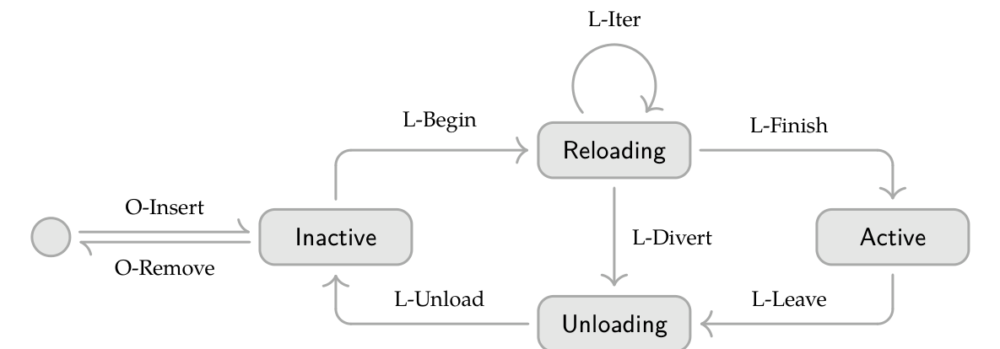

*图 1 | 组件生命周期，空节点表示注册表中不存在的纤维*

#### 4.2.1. 编排

插入与退役是仅有的外部输入：编排器请求某个纤维存在或不再存在，从不直接设置其生命周期状态。

$$
\dfrac{
  n \notin \mathrm{dom}(F_\gamma) \quad
  \pi \in \mathrm{dom}(F_\gamma) \cup \{\mathsf{root}\} \quad
  (d,p,e) \in \mathfrak{C}_\Gamma \quad
  \forall m \in \mathrm{dom}(F_\gamma).\; p \cap p_m = \varnothing
}{
  \gamma \Rightarrow \gamma\big[n \mapsto \langle d,p,e,\pi,\varnothing,\bot,\mathsf{Inactive}\rangle\big]
}\ \ \text{O-Insert}
$$

<!-- -->

$$
\dfrac{
  n \in \mathrm{dom}(F_\gamma)
}{
  \gamma \Rightarrow \gamma[\tau_n \mapsto \top]
}\ \ \text{O-Retire}
$$

<!-- -->

$$
\dfrac{
  \tau_n = \top \quad \theta_n = \mathsf{Inactive} \quad
  \sigma_n = \varnothing \quad \forall m.\; \pi_m \ne n
}{
  \gamma \Rightarrow \gamma \setminus n
}\ \ \text{O-Remove}
$$

<details markdown="1"><summary>原图（PDF 矢量图渲染）</summary>

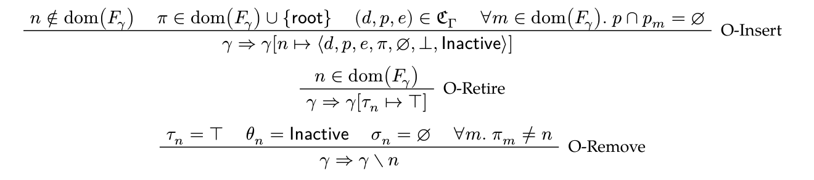

</details>

O-Retire 对纤维状态不加条件，因为退役只是一个请求，执行它的是生命周期规则。同理，退役与移除被分开：仍处于 $\mathsf{Active}$ 的已退役纤维必须先被停用，提前移除会丢弃累加器并造成泄漏。前提 $\forall m. \pi_{m}\ne n$ 通过先移除子级再移除父级保持树的良构；$\sigma_{n}= \varnothing$ 只允许移除不持有任何绑定的条目，从而移除不丢弃任何东西：停用会留下该条目（推论 69），这也使定理 68 能把一次移除视为对表无改变。O-Insert 的最后一个前提施加了单源规程：一个键只有一个可能的提供者，因为编排器不得接纳第二个声明它的组件。

**实例化。** 组件在安装其效应时可以实例化另一个组件，这正是插件宿主在插件加载自己的插件时所做的事。迄今的规则把注册表只留给编排规则，因此这样的实例化无处发生。一个原语为它提供了位置。

**定义 52.** $e_{n}$ 的一次迭代可以*实例化*组件 $(d, p, e) \in\mathfrak{C}_{\Gamma}$。它不取状态映射，而是取该组件以 $\pi= n$ 进行的 O-Insert，并把如此实例化的纤维的 O-Retire 作为逆产生。该规则在 O-Insert 的新鲜性前提下抽取名字，并把它交给效应函数。

逆执行退役而非移除，理由是逆必须在被到达的任何状态都能应用。O-Remove 带有前提，因此由它构造的逆可能失效：若子级仍为 $\mathsf{Active}$，父级就无法运行其累加器，而由于定义 53 不读取纤维树，也没有规则会移动该子级。O-Retire 的唯一前提是 $n\in\mathrm{dom}(F_{\gamma})$。它在实例化发生之处留下的条目已退役（$\mathsf{Inactive}$）且持有空表，这正是引理 62 的残留条目：它与纤维的缺席仅在控制字段上不同，没有规则区分二者。

退役子级会设置 $\tau$，从而把其目标视图变为 $\bot$，之后普通规则把它带回 $\mathsf{Inactive}$。父级不必等待，因为 O-Retire 无条件成立，所以无论子级是否已离开，L-Unload 都适用于父级。孙级逐层到达：子级自己的累加器退役它所实例化的对象。定理 73 同时覆盖这一级联与第 4.2.2 节沿协效应施加的级联。

#### 4.2.2. 生命周期

六条生命周期规则按它们移动纤维的方向划分：激活把纤维带向它尚未持有的目标视图，停用则把它带离已不再是目标的已提交视图。

**目标视图。** 各规则把每个纤维与一个*目标*比较，即它是否应当运行，以及应当针对其依赖的哪种解析运行。目标不是纤维单独的性质，因为纤维声明的键要对照整个状态解析，所以它是该状态上的谓词。

**定义 53.** $n$ 在 $\gamma$ 处的*目标视图*把每个声明的键映射到其提供者，因此是全映射 $d_{n}\to\mathfrak{N}$；当 $n$ 根本不应运行时为 $\bot$：

$$
\mathrm{if} \tau_{n}\lor\neg(\gamma\models d_{n}) \\
\mathrm{target}_{n}(\gamma) \coloneqq\{\bot \\
(k\in d_{n}) \mapsto\mathrm{provider}_{k}(\gamma)\mathrm{otherwise} \tag{48}
$$

当每个纤维都已在其目标视图处稳定、没有进行中的转移时，称状态为*静止的*：

$$
\mathrm{target}_{n}(\gamma) = \bot\mathrm{if} \theta_{n}= \mathsf{Inactive} \\
\mathrm{quiet}(\gamma) \coloneqq\forall n\in\mathrm{dom}(F_{\gamma}).\mathrm{target}_{n}(\gamma) = \omega_{n}\mathrm{if} \theta_{n}= \mathsf{Active}(-, \omega_{n}) \\
\bot\mathrm{otherwise} \\
\{ \tag{49}
$$

目标只回应两件事：退役（通过 $\tau_{n}$）与协效应解析（通过 $\gamma\models d_{n}$ 与 $\mathrm{provider}_{k}$），每个声明的键都在第 4.1 节唯一共享域处从 $\sigma_{\gamma}$ 读出。

定义 49 的已提交视图与目标视图类型相同，生命周期由比较二者驱动：$\omega_{n}$ 是 $n$ 激活时所针对的解析，$\mathrm{target}_{n}(\gamma)$ 是它应当运行所针对的解析，下面每条规则都在二者一致或不一致时触发。这正是第 3.2 节的响应式规程：只要目标视图变化就启动转移，不论是哪一方使它变化。记录提供者而非值使比较可用，否则提供相等值的不同纤维会被判为相等。组件读取的值经视图取得，因为值保存在提供者的表中；实现把该映射存放在 `fiber.committed`，并把它的一份散列存放在 `fiber.target`（第 5.1.3 节）。

**激活。** 一次激活可依次执行多个效应，停用必须撤销它们。效应迭代器 $e_{n}$ 建模这样的激活（第 3.1.3 节），每次迭代产生修改后的上下文、一个逆与一个续体，而组件的一次完整激活就是 $e_{n}$ 的一次运行：L-Begin 进入 $\mathsf{Reloading}$，L-Iter 走一次迭代，L-Finish 落下最后一次。

$$
\dfrac{
  \theta_n = \mathsf{Inactive} \quad \omega = \mathrm{target}_n(\gamma) \ne \bot
}{
  \gamma \longrightarrow \gamma\big[\theta_n \mapsto
    \mathsf{Reloading}(e_n, \mathrm{id}_\Gamma, \omega)\big]
}\ \ \text{L-Begin}
$$

<!-- -->

$$
\dfrac{
  \theta_n = \mathsf{Reloading}(i,g,\omega) \quad
  \mathrm{target}_n(\gamma) = \omega \quad
  i(\gamma) = (\delta,h,\mathsf{Just}(i'))
}{
  \gamma \longrightarrow \delta\big[\theta_n \mapsto
    \mathsf{Reloading}(i', g \circ h, \omega)\big]
}\ \ \text{L-Iter}
$$

<!-- -->

$$
\dfrac{
  \theta_n = \mathsf{Reloading}(i,g,\omega) \quad
  \mathrm{target}_n(\gamma) = \omega \quad
  i(\gamma) = (\delta,h,\mathsf{Nothing})
}{
  \gamma \longrightarrow \delta\big[\theta_n \mapsto
    \mathsf{Active}(g \circ h, \omega)\big]
}\ \ \text{L-Finish}
$$

<details markdown="1"><summary>原图（PDF 矢量图渲染）</summary>

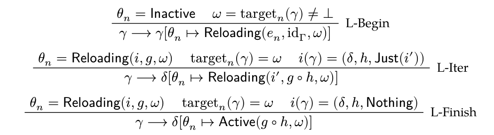

</details>

每次迭代把新产生的逆按 $g\circ h$ 复合到累加器上（依定义 18），使累加器以后进先出顺序应用这些逆。

**停用。** 停用可从生命周期的任一阶段进入：L-Divert 取出转移仍在进行的纤维，L-Leave 取出处于 $\mathsf{Active}$ 的纤维。它不能一步完成。因提供者即将离开而被拆除的组件，正在运行自己的拆卸代码，而这段代码可能恰恰需要那个被撤回的协效应；关闭连接池通常意味着把连接交还给提供它们的对象。因此消费者在整个自身的停用过程中都必须仍能读取该键，而提供者的撤回必须在此之后才生效，这赋予第 3.2 节对依赖方与被依赖方所要求的顺序以实际内容。一步完成的停用会同时移除供给并运行逆，中间没有区间供消费者的拆卸占用。因此下面的规则把「决定」与「行动」分开，而行动由以下条件守卫。

**定义 54.** 当某个其他已安装纤维把某个键解析到纤维 $n$ 时，称它在 $\gamma$ 处*被依赖*：

$$
\mathrm{relied}_{n}(\gamma) \coloneqq\exists m\in\mathrm{dom}(F_{\gamma}), k\in d_{m}. m\ne n\land\mathrm{installed}_{m}(\gamma) \land\omega_{m}(k) = n \tag{50}
$$

<!-- -->

$$
\dfrac{
  \theta_n = \mathsf{Reloading}(i,g,\omega) \quad
  \mathrm{target}_n(\gamma) \ne \omega \quad
  (\delta,h) = (\gamma,\mathrm{id}_\Gamma) \;\lor\; i(\gamma) = (\delta,h,-)
}{
  \gamma \longrightarrow \delta\big[\theta_n \mapsto
    \mathsf{Unloading}(g \circ h, \omega)\big]
}\ \ \text{L-Divert}
$$

<!-- -->

$$
\dfrac{
  \theta_n = \mathsf{Active}(g,\omega) \quad
  \mathrm{target}_n(\gamma) \ne \omega
}{
  \gamma \longrightarrow \gamma\big[\theta_n \mapsto
    \mathsf{Unloading}(g,\omega)\big]
}\ \ \text{L-Leave}
$$

<!-- -->

$$
\dfrac{
  \theta_n = \mathsf{Unloading}(g,\omega) \quad
  \neg\,\mathrm{relied}_n(\gamma) \quad g(\gamma) = \delta
}{
  \gamma \longrightarrow \delta\big[\theta_n \mapsto \mathsf{Inactive}\big]
}\ \ \text{L-Unload}
$$

<details markdown="1"><summary>原图（PDF 矢量图渲染）</summary>

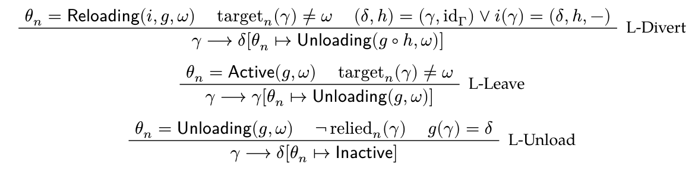

</details>

L-Divert 可落在转移的任意两次相邻迭代之间，把纤维连同迄今累积的逆送入 $\mathsf{Unloading}$，而不是当场应用它们。若改为经由 $\mathsf{Active}$，纤维就会在一步的时长内继续提供其协效应，并迫使依赖方针对一个正在离开的组件激活。L-Divert 的两个分支中，第一个*中止*纤维正持有的迭代，这只有迭代边界才可能做到，因此 divert 可落的粒度就是迭代器的粒度；第二个让该迭代落地，服务于第 4.4 节容许的宿主——在那里进行中的迭代无法被拒绝。

L-Leave 记录停用的决定而不立即执行，它使纤维停止提供协效应，同时保持自身的已提交视图与其他所有纤维的视图不变。L-Unload 应用累加器、丢弃已提交视图，并把纤维置为 $\mathsf{Inactive}$；它是演算中唯一应用累加器的规则，L-Divert 会路由到它，而不是应用自己的累加器。

于是两项要求由形式的不同部分承载：消费者通过已提交视图读取（L-Unload 把丢弃它作为最后一步），而撤回的推迟由前提 $\neg \mathrm{relied}_{n}(\gamma)$ 承载，我们称之为*守卫*，它把提供者的撤回阻住，直到每个把某个键解析到 $n$ 的消费者都已离开。对由 L-Divert 从首次转移中取出的纤维，守卫是空的：从未处于 $\mathsf{Active}$ 的纤维不提供任何东西，也不出现在任何已提交视图中。定理 70 确立这两项要求。

守卫按绑定而非按纤维施加：$\mathrm{relied}_{n}(\gamma)$ 检查是否有某个已提交视图命名 $n$，因此不声明 $n$ 任何键的纤维不是障碍，在另一个域解析了 $n$ 的某个键的纤维也不是（第 3.2.3 节）。在 O-Insert 的单源规程下，按绑定的解读与更粗的检验 $\exists m\ne n, k\in$ $d_{m}. \mathrm{installed}_{m}(\gamma) \land k\in p_{n}$ 一致，因为那里一个键只有一个可能的提供者。

这类守卫通常会导致死锁。使之不死锁的，是 $\mathsf{Unloading}$ 连同 $\sigma_{\gamma}$ 是只对 $\mathsf{Active}$ 纤维取的并集：一旦 L-Leave 或 L-Divert 标记了 $n$，它的表就离开 $\sigma_{\gamma}$，于是再没有目标视图能命名 $n$，而每个已提交到 $n$ 的消费者本身也正在退出。定理 73 把它变成「守卫总会释放」的断言。

守卫沿协效应而非沿纤维树为停用定序：父级可以在其子级仍为 $\mathsf{Unloading}$ 时运行自己的逆，因为 $\mathrm{relied}$ 只谈已提交视图。相应地，父与子的定序弱于定理 70 对提供者与消费者的定序；若父与子的效应在某个共享键处相遇，则由引理 66 的两两独立性管辖。

这些规则是非确定性的：多个纤维可能各自持有与其目标视图不同的已提交视图，而关系并不承诺它们之间的顺序。它们也是*纯响应式的*，因为没有规则提及调度器；步骤是规则应用的任意序列，因此对所有这类序列成立的定理，对运行时可能采取的任何调度策略都成立。

#### 4.2.3. 封闭性

有了实例化这唯一的例外，就可以给出效应函数所须遵守的规程。它限定一次迭代应用能写什么（使应用它的规则能交代其余所有变化），也限定它能读什么（使纤维只看到它声明的协效应，看不到注册表的其余部分）。限定写入，正是第 4.3 节能把表 1 读作写入的完整清单的原因。

**定义 55.** 称映射 $f: \Gamma \to\Gamma$ *封闭于* $n$，当对每个满足 $n\in\mathrm{dom}(F_{\gamma})$ 的 $\gamma\in\Gamma$，记 $\delta= f(\gamma)$ 时，

1. *（写入。）* 对每个 $m\in$，$\mathrm{dom}(F_{\delta}) = \mathrm{dom}(F_{\gamma})$、$\delta(m)$ 与 $\gamma(m)$ 至多在 $\sigma_{m}|_{d_{n}}$ 处不同，
   $\mathrm{dom}(F_{\gamma})$ 与 $m\ne n$，且 $\delta(n)$ 与 $\gamma(n)$ 仅在 $\sigma$ 处不同；
2. *（读取。）* 在 $\sigma_{n}$ 以及每个 $m\in\mathrm{dom}(F_{\gamma})$ 的限制 $\sigma_{m}|_{d_{n}}$ 上一致的两个状态，
   被 $f$ 带到在这两处仍一致的状态。
   称效应函数 $e$ *封闭于* $n$，当每个迭代器 $i\in\mathrm{reach}(e)$ 要么实例化一个组件（定义 52），要么其状态映射 $\mathrm{pr}_{1} \circ i$ 与所产生的每个逆都封闭于 $n$。实例化只写入 O-Insert 所写的条目、且只在它抽取的那一个名字处，别无其他；它作为逆产生的 O-Retire 只写该名字的 $\tau$，别无其他。因此两类应用都不写任何已存在纤维的控制字段（那一个 $\tau$ 除外），也完全不读控制字段。

第 (1) 条允许在纤维自己的表之外写入，而且恰好只有一种：声明键的值位于提供者的表中，因此组件对其声明的协效应执行运算时会移动为该键提供它的 $m$ 的 $\sigma_{m}|_{d_{n}}$。第 (2) 条则说明组件为何也能读取它声明的值：若效应函数除 $\sigma_{n}$ 外不读任何表，就无法使用自己的协效应。它既不能读也不能写的，是两个声明之外的表、任何控制字段，以及任何表都不持有的东西——这正防止组件依据某个它未声明的纤维的生命周期状态来分支。

上下文范式固定了效应函数的形式——一串阶段，每个阶段或是协效应运算、或是供给、或是实例化——封闭性是这一形式的推论。

**定义 56.** 称定义 30 的阶段*沿协效应投影提升*：它作用于持有其键绑定的那一张表，涵盖所有纤维而不像定义 51 那样只取 $\mathsf{Active}$ 纤维的表；扩展落在执行动作的纤维的表中，其余状态保持原样。针对 $n$ 的*上下文中介*迭代器是 $\Gamma$ 上包含单位的最小迭代器集合 $\Im_{\Gamma}^{\mathcal{A}} (n)$：当每个续体取自 $\mathsf{Nothing}$ 与各成员时，它包含三种迭代形式——在 $d_{n}\cup p_{n}$ 的键处提升运算阶段、在 $p_{n}$ 的键处提升供给阶段、以及实例化（定义 52）。每个纤维的效应函数都要求在该纤维处属于 $\Im_{\Gamma}^{\mathcal{A}} (n)$。

**引理 57.** $\Im_{\Gamma}^{\mathcal{A}} (n)$ 的成员封闭于 $n$，并且在定义 51 所固定的投影处属于 $\Im_{\Gamma}^{d^{n}\cup p^{n}}$（定义 37），这正是定义 48 要求它具备的见证。

*证明.* 封闭性对构造作归纳。实例化是定义 55 划出的例外。在 $k$ 处阶段的提升只写 $k$ 处的绑定，别无其他：在 $k\in$ $p_{n}$ 处该绑定由供给不相交而位于 $\sigma_{n}$，在 $k\in d_{n}$ 处位于某个 $\sigma_{m}|_{d_{n}}$，即第 (1) 条；它所产生的逆（运算逆的提升或 $k\in p_{n}$ 处的限制）写同一绑定或把它从 $\sigma_{n}$ 移除。对第 (2) 条，阶段读取其键处的绑定及其存在性，二者都由 $\sigma_{n}$ 连同 $\sigma_{m}|_{d_{n}}$ 决定，并把它读到的内容写回同两处。对成员资格，引理 39 的归纳逐阶段沿用：在运算阶段或供给阶段，那里的论证原样适用——提升像阶段移动投影那样移动共同承载 $\sigma_{\gamma}^{d_{n}\cup p_{n}}$ 的表、不动其余，于是 $\Sigma$ 上关于 $\simeq_{d_{n}\cup p_{n}}$ 的尊重与见证在定义 51 的投影处读作关于 $\Gamma$ 的同一条件；实例化迭代添加一个持有空表的条目，并产生写一个 $\tau$ 的 O-Retire，二者对 $\simeq_{d_{n}\cup p_{n}}$ 都不可见，故其条款直接成立。$\square$

### 4.3. 元理论

本节确立演算的元理论：每条规则保持注册表的良构性（第 4.3.1 节）；时间可组合性与空间可组合性以全局形式成立，即一个纤维的保证在其他纤维其间做任何事之后依然存活（第 4.3.2、4.3.3 节）；系统会归于静止（第 4.3.4 节）；且它静止在「从零开始加载同一配置本会到达」之处（第 4.3.5 节）。

下面每条性质都是步骤序列的性质，因此我们给步骤编号，并从该编号读出状态的字段。

**定义 58.** 用 $t$ 给步骤编号，使 $\gamma^{t}$ 是前 $t$ 个步骤所达的状态，并记

$$
\mathrm{step}^{t}\coloneqq r(n) \tag{51}
$$

为在 $\gamma^{t}$ 处所取的步骤：它所应用的规则 $r$（九条之一）与应用该规则的名字 $n\in\mathfrak{N}$。序列始于满足 $\mathrm{dom}(F^{0}) = \varnothing$ 的 $\gamma^{0}$，因此每个纤维都由 O-Insert 产生，无论出自编排器还是某次迭代（定义 52）。$\gamma^{t}$ 的字段以上标携带编号，于是 $\theta_{n}^{t}$、$\omega_{n}^{t}$、$\sigma_{n}^{t}$、$g_{n}^{t}$ 与 $i^{t}_{n}$ 分别是 $n$ 在 $\gamma^{t}$ 处的生命周期状态、已提交视图、表、累加器与剩余迭代器，而 $F^{t}$ 与 $\sigma^{t}$ 是 $\gamma^{t}$ 自身的注册表与协效应上下文，即定义 50 的 $F_{\gamma}$ 与 $\sigma_{\gamma}$ 在该处读出。谓词把状态作为参数、其余都作下标，因此 $\mathrm{installed}^{t}_{n}$、$\mathrm{target}^{t}_{n}$、$\mathrm{relied}^{t}_{n}$ 与 $\mathrm{quiet}^{t}$ 是定义 49、53、54 的谓词在 $\gamma^{t}$ 处的值。$n$ 的一个*片段*是使 $\mathrm{installed}^{t}_{n}$ 全程成立的最大编号区间 $[b, u]$。它在 $b$ 处*开启*，此处 $b>$ $0$ 且 $\neg \mathrm{installed}^{b-1}_{n}$，空的 $F^{0}$ 使开端没有已安装纤维；它在 $u$ 处*闭合*，此时 $\mathrm{installed}^{u}_{n}$ 而 $\mathrm{installed}^{u+1}_{n}$ 不成立，最后的片段未必闭合。第 4.2 节每条规则都以下形结束：$\gamma\longrightarrow\delta[\cdots]$，其中前提由 $\gamma$ 算出 $\delta$，在未算出任何东西处就令其为 $\gamma$，方括号则编辑注册表中指定的字段。两半分别命名，且都是整个 $\Gamma$ 上的映射。在 $\gamma^{t}$ 处由作用于 $n$ 的规则所取步骤的*状态映射*为

$$
\Psi^{t} \coloneqq
\begin{cases}
\mathrm{pr}_{1}\circ i & \text{at L-Iter, L-Finish, and a landing L-Divert}\\
g & \text{at L-Unload}\\
\mathrm{id}_{\Gamma} & \text{at every other rule}
\end{cases}
\tag{52}
$$

其中 $i$ 与 $g$ 是 $\theta_{n}^{t}$ 所带的迭代器与累加器，而*编辑* $\mathrm{edit}^{t}: \Gamma \to\Gamma$ 是把方括号读作函数，给它所命名的字段赋上前提在 $\gamma^{t}$ 处算出的值。因此二者都由 $\mathrm{step}^{t}$ 连同 $\gamma^{t}$ 固定，且在每个状态有定义，这正是定理 68 与引理 78 能在 $\gamma^{t}$ 之外求值它们的原因。每个步骤分解为

$$
\gamma^{t+1} = \mathrm{edit}^{t}(\Psi^{t}(\gamma^{t})) \tag{53}
$$

例如在 L-Unload 处 $\mathrm{edit}^{t}$ 是 $[\theta_{n}\mapsto\mathsf{Inactive}]$，在 O-Remove 处它是移除 $\setminus n$，这就是后半之所以是编辑而非赋值的原因。字段沿同一条缝划分：*表* $\sigma_{m}$，一旦创建 $m$ 的 O-Insert 把它置空后，任何 $\mathrm{edit}^{t}$ 都不再写它；以及*控制字段* $\theta_{m}$、$\tau_{m}$、$\pi_{m}$、$d_{m}$、$p_{m}$、$e_{m}$ 连同 $\mathrm{dom}(F_{\gamma})$，除经定义 52 的原语外任何 $\Psi^{t}$ 都不写它们。

规则读取控制字段以决定是否适用，因此比较两个完整状态所用的关系必须保留它们。它是定义 33 在注册表上的关系，合取注册表定义域以及每个纤维每个控制字段上的一致性：

$$
\gamma\simeq\delta\coloneqq\sigma_{\gamma}^{K}\simeq\sigma_{\delta}^{K}\land\mathrm{dom}(F_{\gamma}) = \mathrm{dom}(F_{\delta}) \land\forall n, c\in\{\theta, \tau, \pi, d, p, e\}. c(\gamma(n)) \simeq c(\delta(n)) \tag{54}
$$

函数类型的字段（如 $e_{n}$ 与 $\theta_{n}$ 内的 $g$）按定义 34 比较映射与迭代器的方式比较，其他类型的字段按相等比较。下面的结果在定义 51 给出的更粗解读下比较状态：$\simeq_{K}$ 处所有表都在考察范围内，$\simeq_{d_{n}\cup p_{n}}$ 处只考察一个纤维的表；三者是嵌套而非交叉的，在每个 $S$ 处 $\simeq$ 蕴涵 $\simeq_{K}$、$\simeq_{K}$ 蕴涵 $\simeq_{S}$。引理 60 对全部九条规则一次性确立第一个蕴涵。

表 1 就是把第 4.2 节的九条规则读作这样的写入。累加器、已提交视图与剩余迭代器都是 $\theta_{n}$ 的成分，因此第三列也记录对它们的写入；那里的 $h$ 指第四列的迭代所产生的逆，在 L-Divert 中止该迭代处为 $\mathrm{id}_{\Gamma}$。由迭代器构建的 $\Psi^{t}$ 若实例化一个纤维（定义 52），该实例化在它抽取的名字处带有 O-Insert 行的写入；累加器退役某个纤维的 L-Unload 带有 O-Retire 行的写入。下文每个情形分析都是查表，其中五次查表反复出现，值得命名。

| 规则     | $\theta_n^{t}$                   | $\theta_n^{t+1}$                                    | $\Psi^{t}$                                       | 被编辑的控制字段           |
| -------- | ---------------------------------- | ----------------------------------------------------- | -------------------------------------------------- | -------------------------- |
| O-Insert | 未定义                             | $\mathsf{Inactive}$                                 | $\mathrm{id}_\Gamma$                             | $\mathrm{dom}(F_\gamma)$ |
| O-Retire | 不受约束                           | 不变                                                  | $\mathrm{id}_\Gamma$                             | $\tau_n$                 |
| O-Remove | $\mathsf{Inactive}$              | 未定义                                                | $\mathrm{id}_\Gamma$                             | $\mathrm{dom}(F_\gamma)$ |
| L-Begin  | $\mathsf{Inactive}$              | $\mathsf{Reloading}(e_n,\mathrm{id}_\Gamma,\omega)$ | $\mathrm{id}_\Gamma$                             | $\theta_n$               |
| L-Iter   | $\mathsf{Reloading}(i,g,\omega)$ | $\mathsf{Reloading}(i',g\circ h,\omega)$            | $\mathrm{pr}_1\circ i$                           | $\theta_n$               |
| L-Finish | $\mathsf{Reloading}(i,g,\omega)$ | $\mathsf{Active}(g\circ h,\omega)$                  | $\mathrm{pr}_1\circ i$                           | $\theta_n$               |
| L-Divert | $\mathsf{Reloading}(i,g,\omega)$ | $\mathsf{Unloading}(g\circ h,\omega)$               | $\mathrm{id}_\Gamma$ 或 $\mathrm{pr}_1\circ i$ | $\theta_n$               |
| L-Leave  | $\mathsf{Active}(g,\omega)$      | $\mathsf{Unloading}(g,\omega)$                      | $\mathrm{id}_\Gamma$                             | $\theta_n$               |
| L-Unload | $\mathsf{Unloading}(g,\omega)$   | $\mathsf{Inactive}$                                 | $g$                                              | $\theta_n$               |

*表 1 | 规则作为对它所作用的纤维 $n$ 的写入，其中 $\mathrm{step}^t$ 是在 $n$ 处应用的该规则。*

<details markdown="1"><summary>原表（PDF 矢量图渲染）</summary>

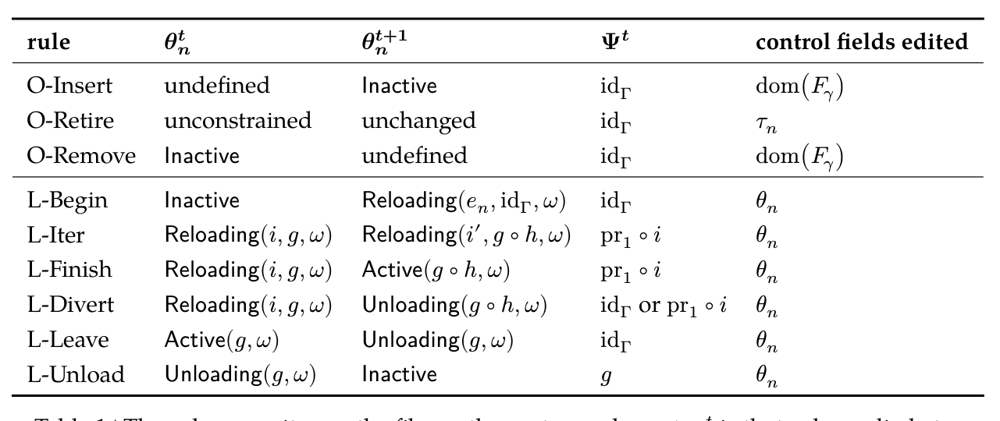

</details>

**引理 59.** 结合表 1 与定义 55，对每个步骤 $t$ 以及在 $\gamma^{t}$ 处存在的所有纤维 $m, n$：

1. 表只在 $\Psi^{t}$ 内部移动：$\sigma_{m}^{t+1}\ne\sigma_{m}^{t}$ 仅在步骤 $t$ 作用于 $m$，或作用于某个 $n\ne$
   $m$ 且满足 $\mathrm{dom}(\sigma_{m}^{t}) \cap d_{n}\ne\varnothing$ 时才变化；后一种情形中两表只在 $d_{n}$ 的键处取值不同
   且 $\mathrm{dom}(\sigma_{m})$ 不变；
   2.$\omega_{n}$ 只在 $\mathrm{step}^{t}= L-\mathrm{Begin}(n)$ 处产生，只在 $\mathrm{step}^{t}=$ 处消失

$L-\mathrm{Unload}(n)$，故在 $n$ 的一个片段内 $\omega_{n}^{t}$ 对 $t$ 为常量；

3.$\Psi^{t}= g_{n}^{t}$ 仅在 $\mathrm{step}^{t}= L-\mathrm{Unload}(n)$ 处，且没有其他步骤把 $g_{n}$ 作用于状态；

$$
4.\neg \mathrm{installed}^{t}_{n}\land\mathrm{installed}^{t+1}_{n}\Rightarrow\mathrm{step}^{t}= L-\mathrm{Begin}(n), and \mathrm{installed}^{t}_{n}\land\neg \mathrm{installed}^{t+1}_{n}\Rightarrow
$$

$\mathrm{step}^{t}= L-\mathrm{Unload}(n)$；

5.$\pi_{n}$、$d_{n}$、$p_{n}$ 与 $e_{n}$ 随 $n$ 的条目一同产生且此后不再被写，

而 $\tau_{n}$ 是单调的，只在 $\top$ 处、且只由 O-Retire 写入。

*证明.* 设步骤 $t$ 在 $n$ 处应用 $r$。由定义 58 它分解为 $\mathrm{edit}^{t}\circ\Psi^{t}$，其中 $\mathrm{edit}^{t}$ 只写表 1 第五列所命名字段，别无其他；而 $\Psi^{t}$ 是 $\mathrm{id}_{\Gamma}$、$n$ 的某次迭代的应用、或累加器 $g_{n}^{t}$（即那些迭代所产生的逆的复合）。三者都由引理 57 封闭于 $n$，故在 $\gamma^{t}$ 处 $\Psi^{t}$ 不写任何已存在纤维的字段，只写 $\sigma_{n}$ 以及其他表在 $d_{n}$ 的键处所持有的值（定义域不变），另加实例化添加的条目与其逆所写的 $\tau$。两半由是对写入作出划分，每条子句都是该划分在某一字段上的读法。第二、三列有一种读法会被用到两次：$\mathsf{Inactive}$ 是唯一不带已提交视图的生命周期状态，L-Begin 是唯一引出它的规则，L-Unload 是唯一引入它的规则，而其他每行都把前提的 $\omega$ 原样带入结论。(1) $\mathrm{edit}^{t}$ 不写表（第五列未命名任何表），而 $\Psi^{t}$ 在 $\sigma_{n}$ 之外写的是持有它们的表中 $d_{n}$ 键处的值，定义域不变。因此 $\sigma_{m}$ 只能在 $\Psi^{t}$ 内移动，位于执行动作的纤维处或 $d_{n}$ 的表所持有的键处。(2) $\omega_{n}$ 是 $\theta_{n}$ 的成分，只有 $\mathrm{edit}^{t}$ 写它且只写在步骤所作用的纤维上，故由上述读法，$\omega_{n}$ 在 $n$ 的 L-Begin 处产生、在 $n$ 的 L-Unload 处消失。$n$ 的片段是使 $\mathrm{installed}_{n}$ 成立的区间，因而全程 $\omega_{n}$ 有定义，两条规则都不落在其内部。(3) 第四列中累加器只出现在 L-Unload：其他规则取前向映射 $\mathrm{pr}_{1} \circ i$ 或 $\mathrm{id}_{\Gamma}$，而没有 $\mathrm{edit}^{t}$ 对状态应用映射。(4) $\mathrm{installed}_{n}$ 即 $\theta_{n}\ne\mathsf{Inactive}$；由上述读法，L-Begin 与 L-Unload 是仅有的前提与结论在 $\theta_{n}$ 是否为 $\mathsf{Inactive}$ 上不同的规则。作用于某 $m\ne$ $n$ 的步骤不写 $\theta_{n}$，而实例化添加的条目位于 $\gamma^{t}$ 处尚不存在的名字。(5) 第五列没有任何一行命名 $\pi$、$d$、$p$ 或 $e$；它们随 O-Insert 添加的条目一同产生（其结论写入该条目，实例化所取的 O-Insert 亦然）。只有 O-Retire 在 $\top$ 处写 $\tau$，无论由编排器执行还是作为实例化的逆（定义 52）；O-Insert 在尚未存在的名字处设置 $\tau= \bot$，故没有步骤把 $\tau$ 恢复为 $\bot$。$\square$

另有三次查表说明规则*看不到*什么。其一是：规则只通过上述观察读取状态，因此整个演算可下降到 $\Gamma/ \simeq$。

**引理 60.** **（$\simeq$-不变性。）** 按上述方式解读 $\gamma\simeq\gamma'$。则第 4.2 节的某条规则在 $\gamma$ 处作用于 $n$ 适用，当且仅当它在 $\gamma'$ 处作用于 $n$ 适用，且两次应用所达状态仍由 $\simeq$ 关联。

*证明.* 第 4.2 节的每个前提属于四类之一，每类都读取该关系保留的成分。把 $\theta_{n}$ 或 $\tau_{n}$ 与模式匹配的前提、以及 O-Remove 的前提 $\forall m. \pi_{m}\ne n$，读控制字段。O-Insert 的前提 $(d, p, e) \in\mathfrak{C}_{\Gamma}$ 与 $\forall m. p\cap p_{m}= \varnothing$ 读 $d$、$p$ 与 $e$。提到 $\mathrm{target}_{n}$ 或 $\mathrm{relied}_{n}$ 的前提读 $\tau_{n}$、$\theta_{m}$ 内的已提交视图与 $\mathrm{dom}(\sigma_{\gamma})$，后者由定义 50 从 $\theta_{m}$ 与 $\mathrm{dom}(\sigma_{m})$ 算出，而定义 33 只在两个协效应上下文定义域一致处关联它们。其余前提读 $\mathrm{dom}(F_{\gamma})$。两个由 $\simeq$ 关联的状态有由 $\simeq$ 关联的 $\sigma_{\gamma}$，该关系比较每张表、而控制字段决定 $\sigma_{\gamma}$ 对哪些表取并；没有前提以 $\simeq_{k}$ 之外的方式读取值 $\sigma_{\gamma}(k)$，故没有前提能区分两个由 $\simeq$ 关联的状态。

对结论，由定义 58 有 $\gamma^{t+1} = \mathrm{edit}^{t}(\Psi^{t}(\gamma^{t}))$。$\mathrm{edit}^{t}$ 所赋的值是其匹配前提的成分，由上段与定义 37 的子句 $e\simeq e$ 在两状态处相关联，后者关联迭代器在相关状态产生的三元组。而 $\Psi^{t}$ 把 $\simeq$ 相关状态带到 $\simeq$ 相关状态：它是 $\mathrm{id}_{\Gamma}$、$e_{n}$ 的一次迭代或 $\theta_{n}$ 内的累加器；后两者由引理 57 尊重 $\simeq_{d_{n}\cup p_{n}}$（而 $\simeq$ 蕴涵它），封闭性则使两个声明之外的每个绑定与每个控制字段保持原样。$\square$

状态所携带的名字只被其中两种观察读取：$\mathrm{dom}(F_{\gamma})$ 与控制字段的索引；而抽取名字的规则可抽取任何尚未使用的名字（定义 52）。因此，把下文的结果理解为在 $\simeq$ 下成立，也要求把它们理解为在重命名下成立，这正是 4.1 节所兑现的纪律。

**引理 61.** **（等变性。）** 设 $\chi: \mathfrak{N}\to\mathfrak{N}$ 为双射，$\chi\cdot\gamma$ 是携带注册表 $F_{\gamma}\circ\chi^{-1}$ 的状态，其中出现在 $\pi_{m}$ 或 $\omega_{m}$ 中的每个名字都换成其像。则 $\chi\cdot$ $\gamma$ 是状态，且在 $\gamma$ 良构处良构；并且 $\mathrm{step}^{t}= r(n)$ 把 $\gamma^{t}$ 带到 $\gamma^{t+1}$，当且仅当 $r(\chi(n))$ 把 $\chi\cdot\gamma^{t}$ 带到 $\chi\cdot\gamma^{t+1}$。

*证明.* 前提读取名字只通过把名字与另一个名字比较：或直接比较，如 O-Insert 的鲜活性 $n\notin\mathrm{dom}(F_{\gamma})$ 与 O-Remove 的 $\forall m. \pi_{m}\ne n$；或通过名字表，如 $\mathrm{target}_{n}$ 与 $\mathrm{relied}_{n}$ 读取 $\pi_{m}$ 与 $\omega_{m}$。双射保持每一种这样的比较。规则写入的名字只有 O-Insert 设定的 $\pi$ 与 L-Begin 设定的 $\omega$，二者都取自其前提所读，因此写入与 $\chi$ 可交换；效应函数完全不写名字，只通过定义 52 的原语抽取一个名字，而定义 55 把它限制在该原语所添加的条目内。良构性（定义 63）是四个把名字与名字相比较的条件。$\square$

因此，一个序列与其重命名以相同次序采取相同的规则，并到达仅相差 $\chi$ 的状态。据此把除实例化所抽取的名字之外都相同的两个序列视为同一，下文的结果都在使它们同一的重命名下解读。

第二点要查的是：一个剥去除名字之外一切内容的条目对规则不可见；正因如此，定义 52 才能在它所恢复的状态不含该条目时让纤维退役，引理 79 也才能移除被删除片段所实例化的纤维。

**引理 62.** **（残留条目。）** 当 $\tau_{n}= \top$、$\theta_{n}= \mathsf{Inactive}$、$\sigma_{n}= \varnothing$ 且没有 $m$ 具有 $\pi_{m}= n$ 时，称 $n$ 在 $\gamma$ 处是*残留的*；残留条目满足 $\gamma\simeq_{K}\gamma\setminus n$。若 $n$ 在 $\gamma$ 处残留，则对每条规则与每个 $m\ne n$：

1. 在 $\gamma$ 处可施用、作用于 $m$ 的规则，在 $\gamma\setminus n$ 处也可施用并作用于 $m$，且二者到达的状态
   仅在 $n$ 处的条目上不同，而该条目保持残留；
2. 反之，在 $\gamma\setminus n$ 处可施用、作用于 $m$ 的规则在 $\gamma$ 处也可施用，除非它是 O-Insert
   抽取了名字 $n$，或声明了 $p_{n}$ 的某个键。
   *证明.* 残留的 $n$ 对作用于 $m\ne n$ 的规则的前提所读取的任何观察都无贡献。它不是 $\mathsf{Active}$，故 $\sigma_{n}$ 不进入任何 $\sigma_{\gamma}$，且 $n$ 不是任何键的提供者，使 $\gamma\models d_{m}$ 与 $\mathrm{target}_{m}$ 不变；$\mathrm{installed}_{n}$ 不成立，故 $n$ 不给 $\mathrm{relied}_{m}$ 贡献任何析取项；没有 $\pi_{m_{'}}$ 命名 $n$，故对 $m$ 的 O-Remove 的前提 $\forall m'. \pi_{m_{'}} \ne m$ 不变；而 $\theta_{n}$、$\tau_{n}$ 与 $\pi_{n}$ 只被作用于 $n$ 的规则读取。第 (2) 条所排除的两个前提，正是移除操作所放宽的那两个：不存在的名字总是新鲜的，不存在的提供也满足其余一切。由引理 59，作用于 $m\ne n$ 的规则除在 $\sigma_{n}$ 持有的 $d_{m}$ 的键处写值外，不写 $n$ 的任何字段，而空的 $\sigma_{n}$ 一个这样的键也不持有，故该条目得以保持残留。$\square$

#### 4.3.1. 保持性

定义 50 规定了注册表的形状，在下文结果能够对其加以补充之前，必须先按该形状检查各条规则。本小节给出规则所保持的不变量，其第一条即该形状，其余各条则是那些结果所假定的内容。

**定义 63.** 称注册表 $F_{\gamma}$ 是*良构的*，若对所有 $m, n\in\mathrm{dom}(F_{\gamma})$ 与所有 $k\in K$，

1.$\pi_{n}\in\mathrm{dom}(F_{\gamma}) \cup\{\mathsf{root}\}$；

2.$m\ne n\Rightarrow p_{m}\cap p_{n}= \varnothing$；

3.$\mathrm{installed}_{n}(\gamma) \Rightarrow\omega_{n}$ 在 $d_{n}$ 上全定义且取值于 $\mathrm{dom}(F_{\gamma})$；

4.$\mathrm{installed}_{n}(\gamma) \land k\in d_{n}\land\omega_{n}(k) = m\Rightarrow\mathrm{installed}_{m}(\gamma)$。第 (1) 条是把定义 50 的树逐条边读出的结果，它保证父指针落在注册表内。该定义还要求的无环性无需单列条款，因为指针所指的纤维总在命名它的纤维之前引入。

**定理 64.** **（保持性。）** 若 $F^{t}$ 良构，则无论步骤 $t$ 施用哪条规则，$F^{t+1}$ 也良构。每一条都在 $\gamma^{t+1}$ 处由 $\gamma^{t}$ 处的四条共同确立。

*证明.* 设步骤 $t$ 作用于 $n$。(1) 由表 1，只有 O-Insert 与 O-Remove 写 $\pi$ 或 $\mathrm{dom}(F_{\gamma})$。O-Insert 以 $\pi_{n}\in\mathrm{dom}(F^{t}) \cup$ $\{\mathsf{root}\}$ 为前提，这正是它所添加纤维对应的条款，且它在扩大 $\mathrm{dom}(F_{\gamma})$ 的同时不动其余每个 $\pi$。O-Remove 带有 $\forall m. \pi_{m}\ne n$，故没有任何存留的 $\pi_{m}$ 命名被它移除的纤维。(2) O-Insert 的最后一个前提是 $\forall m. p_{n}\cap p_{m}= \varnothing$，即它所添加纤维对应的条款；由表 1，没有其他规则写 $p$ 或扩大 $\mathrm{dom}(F_{\gamma})$。下文用到两点推论：由定义 48 有 $\mathrm{dom}(\sigma_{m}) \subseteq p_{m}$，故不同表互不相交且 $\sigma_{\gamma}$ 是函数；而 $k\in p_{m}\cap$ $p_{m_{'}}$ 蕴涵 $m= m'$，故 $k$ 至多有一个可能的提供者。(3) 由引理 59(2)，唯一写 $\omega_{n}$ 的规则是 L-Begin，其前提 $\omega= \mathrm{target}^{t}_{n}\ne\bot$ 使它在 $d_{n}$ 上全定义且取值于 $\mathrm{dom}(F^{t})$，其中 $\mathrm{target}$ 命名各提供者。由表 1，唯一缩小 $\mathrm{dom}(F_{\gamma})$ 的规则是 O-Remove，其前提 $\theta_{n}^{t}= \mathsf{Inactive}$ 给出 $\neg \mathrm{installed}^{t}_{n}$，于是由 $\gamma^{t}$ 处的第 (4) 条，在 $\mathrm{installed}^{t}_{m}$ 期间没有 $m$ 把 $\omega_{m}^{t}(k) = n$ 作为 $k\in d_{m}$；而 $n$ 自身不携带 $\omega$。(4) 由引理 59(2) 与 (4)，该条款只可能在以下情形于 $\gamma^{t+1}$ 处失效：某个 $\mathrm{installed}$ 已落下、某个 $\omega$ 已被写入，或某个 $\omega$ 所命名的纤维已离开 $\mathrm{dom}(F_{\gamma})$。最后一种是 O-Remove，其移除的纤维并未安装，因而由 $\gamma^{t}$ 处的第 (4) 条，它不被任何已安装 $m$ 的 $\omega_{m}^{t}$ 命名。第一种是对 $n$ 的 L-Unload，其前提 $\neg \mathrm{relied}^{t}_{n}$ 读作

$$
\forall m\ne n, k\in d_{m}. \mathrm{installed}^{t}_{m}\Rightarrow\omega_{m}^{t}(k) \ne n
$$

且它不为 $m\ne n$ 写任何 $\omega_{m}$ 并保持 $\neg \mathrm{installed}^{t+1}_{n}$ 不变，故该条款对 $n$ 也成立。第二种是对 $n$ 的 L-Begin，写入 $\mathrm{target}^{t}_{n}$，其值是 $d_{n}$ 各键的提供者，因而在 $\gamma^{t}$ 处有 $\mathsf{Active}$；该步骤不改变其他纤维的 $\theta$，故它们在 $\gamma^{t+1}$ 处也是已安装的。$\square$

承载第 (3)、(4) 条的是 L-Unload 上的守卫。O-Remove 的前提 $\forall m. \pi_{m}\ne n$ 只涉及父指针；使已提交视图不命名被移除纤维的，是那个早若干步、且出于另一理由加上的守卫。由此得到两点。O-Remove 释放的名字可由 O-Insert 重新发放，因为没有过期的已提交视图会命名它；而纤维一旦 $\mathsf{Inactive}$ 即可移除，无须另行检查是否还有谁依赖它。

#### 4.3.2. 时间可组合性

局部时间可组合性用一个累加器回退一个效应序列（3.1.2 节）。注册表为每条纤维各持一个累加器，而各纤维交错执行：从 $n$ 把一个逆合成到 $g_{n}$ 上的时刻，到 $g_{n}$ 运行的时刻之间，其他纤维已经改动了状态。$g_{n}$ 在那里是否仍能撤销它本要撤销的东西，正是该保证的全局形式所断言的；而它所依赖的条件，是中间各步骤与 $g_{n}$ 可交换。

**定义 65.** 称 $\Gamma$ 上的两个迭代器 $i, j$ 是*独立的*，若它们在定义 42 的意义下独立：按定义 34 的方式把 $\simeq$ 解读到映射、三元组与续延上，并把实例化迭代（定义 52）解读为它所命名组件的一致。当一方的提供与另一方的声明相遇，即 $p_{m}\cap(d_{n}\cup p_{n}) \ne\varnothing$ 或 $p_{n}\cap$ $(d_{m}\cup p_{m}) \ne\varnothing$ 时，称纤维 $m$ 与 $n$ *纠缠*。称一个步骤序列是*两两独立的*，若对它在任何时刻持有的每两个名字 $m\ne n$——分别对应编排器插入的每条纤维与某次迭代实例化的每条纤维——或者 $e_{m}$ 与 $e_{n}$ 独立，或者 $m$ 与 $n$ 纠缠且双方操作共同出现的每个键都是可交换的（定义 44）。

这种意义上的独立正是迹论当作原语的东西：可交换的动作生成序列上的一个等价关系，在此关系下重排两个相邻独立动作保持终点不变 [46]，而引理 78 就是这些规则下的那种重排。对名字而非迭代器量化，是为了把同一组件的两条纤维也纳入范围：这样一对要求该组件的效应函数与自身独立，也就是要求 $\mathfrak{M}(i)$ 可交换。定义 42 的第 (1) 条是定理 68 所用的，第 (2) 条则是定理 80 额外需要的：重排两条纤维的步骤会在另一条纤维改动过的状态上求值某个迭代器，而映射可交换本身并不能说明迭代器在那里产生相同的逆与相同的续延。检查第 (1) 条只需迭代本身，因为引理 41(1) 把可交换性从生成元带到它们生成的幺半群。

本范式同时给出两个析取支：

**引理 66.** **（两两独立。）** 每个步骤序列都是两两独立的。

*证明.* 每个键都是可交换的，其协效应把这一证明作为见证携带（定义 46），这在纠缠的一对上解决了第二个析取支。不纠缠的一对，其每一方的提供都在另一方所有键之外，这正是把定理 47 的假设 $P_{1} \cap S_{2} = P_{2} \cap S_{1} =$ $\varnothing$ 读在定义 30 的底层成员上的情形，故这些成员独立，每个共用操作键的可交换性同样由见证提供；独立性沿定义 56 的提升传递，该提升的变换按阶段移动投影的方式移动各表，而实例化迭代添加的条目不被任何表映射读取。同一组件的两条纤维落在这同样的两种情形中，定理 47 在 $i_{1} = i_{2}$ 处同样成立。$\square$

纠缠的纤维正是独立性无法覆盖、也不能指望它覆盖的那些对：消费者的操作作用的恰是提供者的扩展所安装的值，因此无论用哪种等价来解读差异，两种次序在每个缺少该绑定的状态上都不同。在那里替代独立性的是规则本身，它们绝不把两个映射以使二者分离的次序交错。整个论证中，按 3.2.1 节的约定，在前提出错处施用的提升不产生转移，因而遇到其键已离开的状态的映射被读作恒等映射。

**引理 67.** **（纠缠步骤。）** 设 $n$ 的一个片段在 $b$ 处开启，且该片段中的步骤 $t\ge b$ 作用于与 $n$ 纠缠的 $m\ne n$。则

1. 在 $p_{m}\cap(d_{n}\cup p_{n}) \ne\varnothing$ 处，$\Psi^{t}= \mathrm{id}_{\Gamma}$；
2. 否则 $g_{n}^{t}(\Psi^{t}(\gamma^{t})) \simeq_{K}\Psi^{t}(g_{n}^{t}(\gamma^{t}))$；
3. 进而在 $\theta_{n}^{t}= \mathsf{Reloading}(-, -, -)$ 处，两种情形下都有 $\Psi^{t}= \mathrm{id}_{\Gamma}$。
   *证明.* (1) $p_{m}\cap p_{n}$ 的某个键会使两个已注册的提供与 O-Insert 的前提冲突，故有某个 $k\in p_{m}\cap d_{n}$，且 $m$ 是唯一其提供携带 $k$ 的已注册纤维。$n$ 在 $b-1$ 处的 L-Begin 的前提把 $k$ 解析为一个 $\mathsf{Active}$ 提供者，故 $\omega_{n}^{b}(k) = m$ 且 $\theta_{m}^{b-1}=$ $\mathsf{Active}(-, -)$；只要片段开启，$\omega_{n}$ 就保持 $m$（引理 59(2)），同时 $\mathrm{installed}_{n}$ 成立，即在每个这样的 $t$ 处有 $\mathrm{relied}_{m}(\gamma^{t})$。因此守卫在那里阻止对 $m$ 的每一次 L-Unload，使 $m$ 永不达到 $\mathsf{Inactive}$；而处于 $\mathsf{Active}$ 或 $\mathsf{Unloading}$ 的纤维只能被 L-Leave、O-Retire 以及被阻止的 L-Unload 作用，其中前两者带有 $\Psi^{t}= \mathrm{id}_{\Gamma}$（表 1）。(2) 此处 $p_{m}\cap(d_{n}\cup p_{n}) = \varnothing$ 且有某个 $k\in p_{n}\cap d_{m}$。$\Psi^{t}$ 是 $m$ 的某次迭代或累加器 $g_{m}^{t}$，两种情形下都是定义 56 为 $m$ 允许的映射的复合：在 $d_{m}\cup p_{m}$ 的键处对操作映射（正向或逆向）的提升、在 $p_{m}$ 的键处的扩展与限制、实例化，以及由它们产生的 O-Retire。$g_{n}^{t}$ 的成分是定义 56 为 $n$ 允许的逆：在 $d_{n}\cup p_{n}$ 的键处对操作逆的提升、在 $p_{n}$ 的键处的限制，以及 O-Retire。把 $\Psi^{t}$ 的成分逐一与 $g_{n}^{t}$ 的成分交换。处在不同键的一对是键局部映射对，可交换；实例化或 O-Retire 写一个新条目或一个控制字段，任何表映射都不读它，因而与眼前每个成分可交换；同一共享键上的一对操作映射由该键的可交换性覆盖，其协效应的见证提供这一点（定义 46），并通过定义 56 的提升读在各表上。剩下的只有 $m$ 在键 $k\in p_{n}\cap d_{m}$ 处的操作映射，与 $n$ 在 $k$ 处的扩展或限制相对。这样的映射只在 $m$ 的某个把 $k$ 解析掉的已提交视图下才存在于 $\Psi^{t}$ 中（引理 59(2)），而该视图的 L-Begin 要求一个 $k$ 的 $\mathsf{Active}$ 提供者；只要 $m$ 已安装，该承诺就固定住这个提供者（把 (1) 的论证读在 $m$ 处），而两个已注册的提供不能共用 $k$，故该提供者即 $n$，且 $n$ 在开启的片段内曾是 $\mathsf{Active}$。因此它的转移在 $t$ 之前已经结束，而 $g_{n}^{t}$ 携带着扩展 $m$ 所解析出的结果在 $k$ 处给出的限制，按定义 18 的后进先出次序复合在 $n$ 于 $k$ 处的操作逆之左。在一侧，$m$ 的操作映射向左交换，越过其他键处的成分，并借 $k$ 的可交换性越过 $n$ 在 $k$ 处的操作逆，直到该限制把它吸收——对 $k$ 处的值写入后再移除 $k$ 就等于只做移除；在另一侧，它遇到一个已被 $g_{n}^{t}$ 从中移除 $k$ 的状态，因而不产生转移。故两个复合在 $\gamma^{t}$ 处一致。(3) 提供者的情形即 (1)。在消费者的情形中，当 $n$ 为 $\mathsf{Reloading}$ 时，$n$ 的消费者并未安装：它把某个键解析为 $n$ 的承诺本会保持 $\mathrm{relied}_{n}$ 并阻止关闭 $n$ 上一片段的 L-Unload，而新的承诺要求一个 $\mathsf{Active}$ 提供者。未安装的纤维只能被 L-Begin 与编排规则作用；编排规则带有 $\Psi^{t}= \mathrm{id}_{\Gamma}$，而 L-Begin 不可施用，因为 $n$ 提供的键落在 $\mathrm{dom}(\sigma_{\gamma_{t}})$ 之外，故声明该键的纤维的目标是 $\bot$。$\square$

既然每一对都已覆盖，定理 7 的单累加器不变量便在交错中存续，其形式正赋予时间可组合性以内容：运行一个逆只撤回该纤维的贡献，此外别无其他。

**定理 68.** **（恢复精确性。）** 设 $n$ 的一个片段在 $b$ 处开启，$u\ge b$ 位于其中，且 $t_{1} <$ $\cdots< t_{l}$ 是 $[b, u)$ 中作用纤维不是 $n$ 的那些下标。则

$$
g_{n}^{u}(\gamma^{u}) \simeq_{K}(\Psi^{t}_{l}\circ\cdots\circ\Psi^{t}_{1})(\gamma^{b}) \tag{55}
$$

也就是说，在 $\gamma^{u}$ 处施用 $n$ 的累加器，使每条纤维的表都停在同样那些步骤从 $\gamma^{b}$ 出发本会让它停下的位置，控制字段不在比较之列。把右式读作 $n$ 从未开始时所到达的状态，需要假定没有 $n$ 实例化的纤维在 $[b, u)$ 中采取步骤，因为 $n$ 实例化的纤维本就不会在那里采取步骤。

*证明.* 对 $u$ 归纳，归纳范围是片段内满足 $u+ 1$ 的下标 $u$。在 $u= b$ 处，$b-$ $1$ 处的步骤是 L-Begin（由定义 58，片段在此开启），故由表 1 有 $g_{n}^{b}= \mathrm{id}_{\Gamma}$，下标集为空，命题即 $\gamma^{b}\simeq_{K}\gamma^{b}$。每一步用到两个事实。$\mathrm{edit}^{t}$ 只写控制字段，而写 $\mathrm{dom}(F_{\gamma})$ 的两条规则让各表保持原样：O-Insert 添加一个带空表的条目，O-Remove 按其前提取走一个，故

$$
\gamma^{t+1} \simeq_{K}\Psi^{t}(\gamma^{t})
$$

并且，对每条纤维 $m$，$\mathfrak{M}(e_{m})$ 中的每个映射把 $\simeq_{K}$-相关的状态带到 $\simeq_{K}$-相关的状态：因为 $\simeq_{K}$ 蕴涵 $\simeq_{d_{m}\cup p_{m}}$，在该处引理 57 使这样的映射尊重该关系；又因为封闭性使它不移动两个声明之外的绑定，故接口之外的键保持它所发现的那份相关性；而按定义 52，实例化添加一个空条目。设步骤 $u$ 作用于 $n$。由于片段在 $u$ 与 $u+ 1$ 处开启，引理 59(4) 排除了 L-Begin 与对 $n$ 的 L-Unload，而 O-Insert 与 O-Remove 读取的是被 $\mathrm{installed}^{u}_{n}$ 否定的 $\theta_{n}$，于是只剩两种情形。当规则是 L-Iter、L-Finish 或落地的 L-Divert 时，表 1 对该次迭代产生的逆 $h$ 给出 $\Psi^{u}= \mathrm{pr}_{1} \circ i^{u}_{n}$ 与 $g_{n}^{u+1}= g_{n}^{u}\circ h$。定义 37 的见证条件读作 $h(\Psi^{u}(\gamma^{u})) \simeq_{d_{n}\cup p_{n}}\gamma^{u}$；一旦引理 57 补充说两个映射都不移动两个声明之外的绑定，它就是 $\simeq_{K}$；而实例化迭代是两状态在一个带空表的条目上不同的情形，$\simeq_{K}$ 不比较该条目。由上段，$g_{n}^{u}$ 携带 $\simeq_{K}$，

$$
g_{n}^{u+1}(\gamma^{u+1}) \simeq_{K}(g_{n}^{u}\circ h)(\Psi^{u}(\gamma^{u})) \simeq_{K}g_{n}^{u}(\gamma^{u})
$$

当规则是 L-Leave、中止的 L-Divert 或对 $n$ 的 O-Retire 时，表 1 给出 $\Psi^{u}= \mathrm{id}_{\Gamma}$ 与 $g_{n}^{u+1}= g_{n}^{u}$，故同一等式对 $h= \mathrm{id}_{\Gamma}$ 成立。两种情形下归纳假设都在下标集不变的情况下延续，这正是定理 7 的计算逐步展开。设步骤 $u$ 作用于 $m\ne n$。则由表 1 有 $g_{n}^{u+1}= g_{n}^{u}$ 与 $\Psi^{u}\in\mathfrak{M}(e_{m})$，若规则是编排规则则为 $\Psi^{u}= \mathrm{id}_{\Gamma}$。当 $m$ 与 $n$ 不纠缠时，引理 66 使 $e_{m}$ 与 $e_{n}$ 独立，且定义 42 的第 (1) 条（读在定义 58 更细的 $\simeq$ 上，从而也读在 $\simeq_{K}$ 上）使 $g_{n}^{u}$ 与 $\Psi^{u}$ 可交换；当二者纠缠时，引理 67 在 $\gamma^{u}$ 处使两者可交换，其第一种情形直接给出。两种情形下都有

$$
g_{n}^{u}(\gamma^{u+1}) \simeq_{K}g_{n}^{u}(\Psi^{u}(\gamma^{u})) \simeq_{K}\Psi^{u}(g_{n}^{u}(\gamma^{u}))
$$

即附上 $\Psi^{u}$ 后的归纳假设，而由上段，$\Psi^{u}$ 把 $\simeq_{K}$-相关的状态带到 $\simeq_{K}$-相关的状态。$\square$

**推论 69.** **（终态恢复。）** 设 $n$ 的一个片段在 $b$ 处开启、在 $u$ 处关闭。则取定理 68 中的 $t_{1} < \cdots< t_{l}$，

$$
\gamma^{u+1} \simeq_{K}(\Psi^{t}_{l}\circ\cdots\circ\Psi^{t}_{1})(\gamma^{b}) \tag{56}
$$

特别地 $\sigma_{n}^{u+1}= \varnothing$，这正是 O-Remove 对 $n$ 所带的前提。

*证明.* 由引理 59(4)，步骤 $u$ 是对 $n$ 的 L-Unload，其 $\Psi^{u}$ 由引理 59(3) 为 $g_{n}^{u}$，故 $\gamma^{u+1} \simeq_{K}$ $g_{n}^{u}(\gamma^{u})$，定理 68 适用。就表而言，该纤维带着空的 $\sigma_{n}$ 进入片段，且 $p_{n}$ 的键只能由 $n$ 自身的扩展进入 $\mathrm{dom}(\sigma_{n})$（定义 56），而右式一个这样的扩展也不施用，故右式使 $\sigma_{n}$ 保持为空；定义 33 只在两个协效应上下文的定义域一致时才把它们关联起来，因此与空表关联的表也是空的。$\square$

这两个结果比较的是表，故它们所断言的受限于状态的各键所绑定的东西，而在每个绑定内部又受限于该键的操作所导出的 $\simeq_{k}$：每个绑定只恢复到其键的等价所遗忘的限度，因此单调分配器不会被倒回，堆的布局 `free` 不予恢复，已发出的消息仍旧发出。这正是 3.3.2 节加在定理 7 上的界限，理由也相同：物理状态无法按原样恢复；系统未在任何键处具体化的位置完全落在演算之外（定义 56），而 6.1 节正是系统决定具体化什么的地方。

因此上述结果对序列不作任何假定。$\Im_{\Gamma}^{d\cup p}$ 的见证条件与尊重条件是引理 57，两两独立是引理 66，二者都只依赖组件：定义 56 规定了每个效应函数的形式，效应函数的见证要求每个返回的逆都能回退，协效应的见证则要求每个键可交换（定义 46），而定义 31 把这一接口性质变成一套设计规程。

#### 4.3.3. 空间可组合性

局部空间可组合性要求组件恪守自身规格：只在其依赖已被提供时才激活它，并据这些依赖分类每一次上下文变化（3.2.2 节）。全局形式加上了对其他纤维的量化：提供者只有在所有解析过该绑定的依赖方都已停用之后才撤回绑定，且一次转移据以安装其效应的解析不会在其过程中漂移。协效应侧的两条性质分别给出这两点，它们被一并证明，因为它们是同一不变量的两半，即引理 59(2) 所确立的 $\omega_{n}$ 在一个片段内的固定性。定序定理给出这种固定性在片段中 $n$ 为 $\mathsf{Active}$ 继而为 $\mathsf{Unloading}$ 的那一部分上的结论，一致性定理则给出它在 $n$ 正安装其效应的那一部分上的结论。

**定理 70.** **（定序。）** 纤维只在其依赖已被提供处开始一次转移：

$$
\mathrm{step}^{t}= L-\mathrm{Begin}(m) \Rightarrow\gamma^{t}\models d_{m} \tag{57}
$$

再设 $[b', u']$ 是 $m$ 的一个片段，对某个 $m\ne n$ 与 $k\in d_{m}$ 满足 $\omega_{m}^{b'}(k) = n$；设 $[b, u]$ 是包含 $b'$ 的 $n$ 的片段，并令 $t$ 取值于 $[b', u']$。则

1.$\omega_{m}^{t}(k) = n$；

2.$b< b'$，且若 $[b, u]$ 关闭则 $u' < u$；

3.$k\in\mathrm{dom}(\sigma_{n}^{t})$，且 $\sigma_{n}^{t}(k)$ 只由声明 $k$ 的纤维在 $k$ 处的操作所改动。

*证明.* 第一个断言即 L-Begin 的前提 $\mathrm{target}^{t}_{m}\ne\bot$，由定义 53 它给出 $\gamma^{t}\models$ $d_{m}$。(1) 即引理 59(2)。

对 (2)，$b' -1$ 处的 L-Begin 写入 $\omega_{m}^{b'}= \mathrm{target}_{m}^{b'-1}$，其值是各提供者，故 $\theta_{n}^{b'}=$ $\mathsf{Active}(-, -)$；$b-1$ 处的 L-Begin 保持 $\theta_{n}^{b}= \mathsf{Reloading}(-, -, -)$ 不变，故 $b\ne b'$ 从而 $b< b'$，两个片段都由定义 58 开启。设 $[b, u]$ 关闭并假定 $u\le u'$。则 $u\in[b', u']$，于是 $\mathrm{installed}^{u}_{m}$，且由 (1) 有 $\omega_{m}^{u}(k) = n$；即 $\mathrm{relied}^{u}_{n}$，而 $u$ 处的 L-Unload 否认这一点。故 $u' < u$。对 (3)，$n$ 是 $k$ 在 $\gamma^{b'}$ 处的提供者，故 $k\in\mathrm{dom}(\sigma_{n}^{b'})$。对 $n$ 的 L-Unload 不落在 $[b', u']$ 内：若 $[b, u]$ 关闭，由 (2) 它落在 $u> u'$；若不关闭，引理 59(4) 使 $n$ 完全没有 L-Unload。由于 $\theta_{n}^{b'}= \mathsf{Active}(-, -)$，表 1 因而使 L-Leave 成为 $n$ 在 $[b', u']$ 内唯一能被作用的规则，而其 $\Psi^{t}$ 是 $\mathrm{id}_{\Gamma}$，故 $n$ 不撤回任何东西，且由引理 59(1)，$\mathrm{dom}(\sigma_{n})$ 在那里为常量。另一条纤维的步骤所能改动的，只有其自身声明所命名的键处的值（定义 56），故对 $\sigma_{n}(k)$ 的一次写入，是一个规格中含 $k$ 的纤维在 $k$ 处的操作。$\square$

否则，跨若干步骤展开的一次转移可能在安装其效应时，所用的解析已在其过程中改变，而有两个前提阻止此事。L-Iter 与 L-Finish 带有 $\mathrm{target}_{n}(\gamma) = \omega$，故转移只在其已提交视图仍为目标视图时继续；L-Divert 带有其否定，故目标视图的任何变化都使纤维退出该转移。变化的方向不加区分：依赖已消失的组件与依赖已被替换的组件沿着同一条路径退出，因为已变成 $\bot$ 的目标视图与已变成另一条纤维的目标视图，同样都不等于 $\omega$。

L-Divert 的落地这一支，使上述结论不能成为关于每一步的保证：它落地的那次迭代安装的效应，是按一个已不再成立的解析计算出来的。因此规则给出的是一个析取，而正是第二个分支使第一个分支安全。

**定理 71.** **（解析一致性。）** 设 $n$ 的片段 $[b, u]$ 在 $b$ 处以 $\omega_{n}^{b}= \omega$ 开启。则在片段的一个初始区间 $[b, r]$ 上，$\theta_{n}$ 为 $\mathsf{Reloading}(-, -, -)$，且该转移的每一次迭代都针对同一个解析 $\omega$ 运行：

$$
\forall t\in[b, r]. \mathrm{step}^{t}\in\{L-\mathrm{Iter}(n), L-\mathrm{Finish}(n)\} \Rightarrow\mathrm{target}^{t}_{n}= \omega \tag{58}
$$

在纤维离开该区间、即 $r< u$ 处，以下恰有一项成立：

1.$\mathrm{step}^{r}= L-\mathrm{Finish}(n)$ 且 $\theta_{n}^{r+1}= \mathsf{Active}(-, \omega)$；

2.$\mathrm{step}^{r}= L-\mathrm{Divert}(n)$，且片段在某个 $u> r$ 处以 $\gamma^{u+1} \simeq_{K}(\Psi^{t}_{l}\circ\cdots\circ$ 关闭

$\Psi^{t}_{1})(\gamma^{b})$，如推论 69。

*证明.* $b-1$ 处的 L-Begin 写入 $\mathsf{Reloading}$，而由表 1，它是唯一进入该生命周期状态的规则；其前提 $\theta_{n}= \mathsf{Inactive}$ 与引理 59(4) 把对它的任何第二次施用排除在片段之外。故 $\mathsf{Reloading}$ 占据 $[b, u]$ 的一个初始区间 $[b, r]$ 且不再被重新进入。于是第一个断言即表 1 给 L-Iter 与 L-Finish 的前提 $\mathrm{target}_{n}(\gamma) = \omega'$，外加由引理 59(2) 得到的 $\omega' = \omega$。就二分而言，$\mathrm{step}^{r}$ 是这样一条规则：其前提含 $\theta_{n}= \mathsf{Reloading}(-, -, -)$ 而其结论不含；表 1 提供的是 L-Finish 与 L-Divert；前者落到 $\mathsf{Active}(-, \omega)$，后者落到 $\mathsf{Unloading}(-, \omega)$，由引理 59(4)，从后者出发的唯一出口是 L-Unload，推论 69 则给出该等式。落地的 L-Divert 所贡献的迭代是 $n$ 自身的一次迭代，因而属于该累加器所撤回的映射之列。反之若 $r= u$，序列在转移仍在进行时结束，此时所断言的只有第一个结论。$\square$

#### 4.3.4. 进展性

把提供者的撤回推迟到其依赖方都消失之后的守卫，只有在它最终放开时才能给出定理 70。承载这一论证的是注册表各纤维上的一个关系。

**定义 72.** 注册表各名字上的*优先关系*为

$$
n\prec m\coloneqq p_{n}\cap d_{m}\ne\varnothing \tag{59}
$$

从而 $n$ 可以提供 $m$ 所声明的某个键。它只读取 $d$ 与 $p$，而由引理 59(5)，二者随纤维的条目一道产生且此后不再被写入。

定理 73 与定理 80 是在 $\prec$ 无环这一假设下确立的；这是一项假定，并非定义所能给出，因为对某个声明了自己所提供的键的组件会有 $n\prec n$ 成立。$\prec$ 所定序的是两条纤维的激活而非其生存期：$n\prec m$ 说的是 $n$ 必须先变为 $\mathsf{Active}$，$m$ 才可能；至于提供者比其消费者活得更久，那是定理 70(2)，一条关于带守卫演算的定理。

纤维的目标视图既取决于其各提供者，也取决于创建它的那条纤维。创建者通过定义 52 的原语写入的是 $\tau_{n}$，而由引理 59(5)，$\tau$ 是单调的。因此，在其子纤维的整个存在期内，创建者至多能使该子纤维的目标视图转变一次。

进展性断言的是有某条规则可施用，因此它表述在宿主必须提供的那些规则之上：L-Begin、L-Leave、L-Unload、落地规则 L-Iter 与 L-Finish，以及 L-Divert。它完全不援引 L-Divert 的中止那一支，而 4.4 节正要用到这一支。

**定理 73.** **（进展性。）** 设 $\prec$ 无环，对每个 $n$ 有 $\mathrm{len}(e_{n}) \le K$，且序列在任何时刻持有的名字集合 $N$ 有限（定义 65）；并设每一步都施用一条生命周期规则。记 $S(n)$ 为作用于 $n$ 的步骤数，

$$
V(n) \coloneqq|\{t: \mathrm{target}^{t}_{n}\ne\mathrm{target}^{t+1}_{n}\}| \tag{60}
$$

为其目标视图转变的次数。则

1. *（无死锁。）* $\neg \mathrm{quiet}^{t}$ 蕴涵在 $\gamma^{t}$ 处有某条生命周期规则可施用；
2. *（终止性。）* $S(n) \le(K+ 3)(V(n) + 1)$，且 $V(n)$ 与 $\sum_{n}S(n)$ 都有限。
   因此，每个极大的生命周期步骤序列都终止于静止状态。

*证明.* *无死锁。* 设 $\neg \mathrm{quiet}^{t}$，于是某条纤维 $n$ 不满足定义 53 中 $\mathrm{quiet}$ 的任一支。按表 1 对照它可能属于的四种情形：

- $\theta_{n}^{t}= \mathsf{Inactive}$ 且 $\mathrm{target}^{t}_{n}\ne\bot$：L-Begin 可施用；
- $\theta_{n}^{t}= \mathsf{Reloading}(-, -, \omega_{n})$ 且 $\mathrm{target}^{t}_{n}= \omega_{n}$：由
  $i^{t}_{n}(\gamma^{t})$ 的值选定的 L-Iter 或 L-Finish 中相应那条可施用；
- $\theta_{n}^{t}= \mathsf{Reloading}(-, -, \omega_{n})$ 且 $\mathrm{target}^{t}_{n}\ne\omega_{n}$：L-Divert 可施用，使该次迭代落地
  而非中止它；
- $\theta_{n}^{t}= \mathsf{Active}(-, \omega_{n})$ 且 $\mathrm{target}^{t}_{n}\ne\omega_{n}$：L-Leave 可施用。
  设没有纤维属于上述任何一种，于是留下某个满足 $\theta_{m_{0}}^{t} = \mathsf{Unloading}(-, -)$ 的 $m_{0}$。如下构造 $m_{0}, m_{1}, \ldots$：给定 $\mathsf{Unloading}$ 中的 $m_{j}$，或者 $\neg \mathrm{relied}^{t}_{m_{j}}$，此时 L-Unload 可施用于 $m_{j}$ 且构造停止；或者存在满足 $\mathrm{installed}^{t}_{m_{j+1}}$ 与 $\omega_{m_{j+1}}^{t}(k_{j}) = m_{j}$ 的 $m_{j+1} \ne m_{j}$ 与 $k_{j}$。在后一种情形中

$$
k_{j}\in d_{m_{j+1}} \cap\mathrm{dom}(\sigma_{m_{j}}^{t}) \subseteq d_{m_{j+1}} \cap p_{m_{j}}
$$

其中第二个成员关系来自对 $t$ 所在片段中 $m_{j+1}$ 施用定理 70(3)，故 $m_{j}\prec$ $m_{j+1}$。此外 $\mathrm{target}^{t}_{m_{j+1}} \ne\omega_{m_{j+1}}^{t}$：处于 $\mathsf{Unloading}$ 的纤维在定义 $\sigma_{\gamma}$ 的并集之外，故 $k_{j}$ 在 $\gamma^{t}$ 处未被提供，或由 $m_{j}$ 以外的某条纤维提供。若 $m_{j+1}$ 属于 $\mathsf{Active}$ 或 $\mathsf{Reloading}$，它就会属于被排除的四种情形之一，故它属于 $\mathsf{Unloading}$，构造继续。各 $m_{j}$ 按 $\prec$ 递增，由无环性互不相同，而 $\mathrm{dom}(F^{t})$ 有限，故构造停止。*终止性。* 有两条断言界定 $S(n)$。(A) 在 $\mathrm{target}^{t}_{n}$ 恒为 $\omega^{\ast}$ 的极大区间上，至多有 $K+ 3$ 个步骤作用于 $n$。读表 1 的 $\theta_{n}$ 各列：从带 $\omega\ne\omega^{\ast}$ 的 $\mathsf{Active}(-, \omega)$ 出发，纤维先取一次 L-Leave 与一次 L-Unload，随后若 $\omega^{\ast}\ne\bot$ 则取一次 L-Begin 与至多 $\mathrm{len}(e_{n}) \le K$ 次落地；从 $\mathsf{Reloading}$ 面对某个 $\omega\ne\omega^{\ast}$ 出发，它以 L-Divert 取代 L-Leave；从任何其他状态出发，则取该序列的一个后缀。区间内不再有 L-Divert 或 L-Leave，因为 L-Begin 写入的 $\omega$ 正是 $\mathrm{target}^{t}_{n}= \omega^{\ast}$ 自身，而在 $\mathsf{Active}(-, \omega^{\ast})$ 处以及在带 $\omega^{\ast}= \bot$ 的 $\mathsf{Inactive}$ 处根本无规则可施用。(B) 若 $\mathrm{target}^{t}_{n}\ne\mathrm{target}^{t+1}_{n}$ 且步骤 $t$ 作用于 $m$，则或者 $m\prec n$，或者步骤 $t$ 写 $\tau_{n}$。由定义 53，$\mathrm{target}_{n}$ 的值是 $\tau_{n}$、各生命周期状态以及各提供者表的定义域的函数，从不依赖某个绑定的值；提供者满足 $k\in\mathrm{dom}(\sigma_{m}) \cap d_{n}$ 从而满足 $m\prec n$，而由引理 59(1)，表的定义域只在作用于其自身纤维的步骤处改变。无环性在第一种情形给出 $m\ne n$，而引理 59(5) 的单调性使第二种情形每条纤维至多出现一次 $t$。由 (A)，区间计数把 $S(n)$ 界定为 $S(n) \le(K+ 3)(V(n) + 1)$；由 (B)，$\mathrm{target}_{n}$ 的每次转变或者消耗掉严格按 $\prec$ 低于 $n$ 的某条纤维的一个步骤，或者就是 $\tau_{n}$ 所允许的那一次转变，故 $V(n) \le1 + \sum_{m\prec n}S(m)$。由于 $\prec$ 无环且 $N$ 有限，递归

$$
B(n) \coloneqq (K+3)\left(2+\sum_{m\prec n} B(m)\right)
$$

是良基的，并定义出满足 $S(n) \le B(n)$ 的 $B$；故 $V(n)$ 有限且有 $\sum_{n}S(n) \le\sum_{n}B(n)$。由 (1)，无法再延长的序列即静止。$\square$

$N$ 的有限性是假定的而非推得的，而组件上的一个条件即可给出它。宿主持有的组件是运行之前给定的有限多个程序，因此若没有组件能（无论多么间接地）实例化某个会实例化自身组件的组件的纤维，则各实例化构成一棵深度有界的树，且 $\mathrm{len}(e_{n}) \le K$ 界定其分支数。该假定所排除的，正是无界实例化自身的组件。

目标记录的是提供者纤维而非一个布尔值；在 O-Insert 的单源纪律下二者驱动相同的转移，因为那里一个键只有一个可能的提供者。该视图为上述结果提供了词汇——定理 70 与定理 71 都谈及纤维据以激活的解析——也正是它使这些结果在 3.2.3 节的有界解析下依然成立：在那里同一个键在不同领域中解析到不同提供者，各提供不再强制决定该视图。实现承载着这种定界，并把视图保存在 `fiber.committed` 中（5.1.3 节）。

#### 4.3.5. 合流性

到目前为止的结果都是关于单条纤维的。刻画整个系统的性质是：其动态历史不留痕迹——无论运行中的系统经历过怎样的激活与停用序列，它所静止于的状态，都与同样那些插入和退役在每个最终活跃的组件只按依赖序加载一次、且从不卸载的情况下所会产生的状态相同。生命周期关系是合流的，它所收敛到的范式即静态组装所得的范式。对动态组合而言，这相当于变更传播为增量计算所确立的与从头求值的一致性 [47]。

该断言只涉及 $\longrightarrow$。编排步骤是输入，给定不同输入的两条序列落在不同状态，并无深意；成问题的是生命周期规则——它们在下一步由哪条纤维走、以及处于 $\mathsf{Reloading}$ 的纤维选择哪个出口上是非确定的——是否可能给出分歧。哪个纤维提供某个键并不在选择之列，因为一个键只有一个可能的提供者（定义 50），故调度只挑顺序与出口，别无其他。

首先需要三条引理。第一条不援引任何步骤序列就确定了最终处于 $\mathsf{Active}$ 的纤维集合，这正使它成为输入的函数而非调度的函数。

**定义 74.** 称一条纤维在 $\gamma$ 处是*被支撑的*，若它未退役、实例化它的纤维被支撑、且它声明的每个键都由一条被支撑的纤维提供。$\mathrm{dom}(F_{\gamma})$ 上的*支撑关系*是这些子句所读到的两个关系的并，

$$
m\vartriangleleft n\coloneqq m\prec n\lor\pi_{n}= m \tag{61}
$$

在它良基处（引理 75），记 $A$ 为*支撑集*，即在 $\gamma$ 处被支撑的纤维：

$$
n\in A\coloneqq\neg\tau_{n}\land(\pi_{n}= \mathsf{root}\lor\pi_{n}\in A) \land\forall k\in d_{n}. \exists m\in A. k\in p_{m} \tag{62}
$$

其中 $\pi_{n}= \mathsf{root}$ 标记编排器插入的纤维，$\pi_{n}$ 否则标记其激活实例化了 $n$ 的那条纤维。这些子句除 $\tau, \pi, d, p$ 外不读任何字段。两半都把一条纤维与紧邻其下的一条联系起来——是父而非祖先、是直接提供者而非传递提供者，因为子句读到的正是如此；下文结果需要序时取传递闭包，其极小元、极大元与线性化即 $\vartriangleleft$ 的那些。

这些子句引用 $A$ 自身，故该定义是沿 $\vartriangleleft$ 的递归，而正是下面这条使它成为有解的递归。

**引理 75.** **（支撑良基。）** 设 $\prec$ 无环，$\gamma$ 由某个步骤序列到达。则 $\vartriangleleft$ 良基，且 $A$ 是定义 74 的唯一解，它只是 $\tau$、$\pi$、$d$ 与 $p$ 的函数。

*证明.* 按引入各名字的 O-Insert 的下标为 $\mathrm{dom}(F_{\gamma})$ 的名字排序，定义 58 通过让序列始于空注册表提供了该下标。$\vartriangleleft$ 的父那一半沿该下标下降：O-Insert 以 $\pi\in\mathrm{dom}(F_{\gamma})$ 为前提，故父指针命名的是更早引入的纤维，反复迭代可在有限步内到达某个名字的全部祖先。因此一个环必须用到 $\prec$；又因 $\prec$ 无环，环必须混合两半，这需要某个 $m$ 声明一个可由 $m$ 自身子树中的某条纤维提供的键。这样的纤维由 $m$ 或 $m$ 的某个后代的一次激活实例化，因而出现在 $m$ 的 L-Begin 之后的某步；该 L-Begin 以 $\gamma\models d_{m}$ 为前提，故提供该键的纤维在它之前已 $\mathsf{Active}$，而定义 63 的第 (2) 条不给该键第二个可能的提供者。于是本会闭合该环的纤维从未被引入，该边不出现在 $\mathrm{dom}(F_{\gamma})$ 中。良基递归有唯一解，且这些子句只读那四个字段。$\square$

最后一个子句读的是 $p$，即组件可能提供的键；而目标读的是 $\mathrm{dom}(\sigma_{\gamma})$，即其各纤维已安装的键，定义 48 仅通过 $\mathrm{dom}(\sigma_{n}) \subseteq$ $p_{n}$ 把二者联系起来。因此支撑集一般是对 $\mathsf{Active}$ 纤维的过近似，而弥合这一差距的条件如下。

**定义 76.** 称组件 $(d, p, e)$ *在其提供上完全*，若它的一次完成的激活已安装 $p$ 的每个键，从而在实例化它的每条 $\mathsf{Active}$ 纤维处有 $\mathrm{dom}(\sigma_{n}) = p_{n}$。

这只是对组件的一个条件，不涉及任何生命周期状态与任何步骤；而独立性（引理 66）已经界定了它能在多大程度上失效：若某组件只在另一组件的效应所到达的上下文状态下才安装某个键，其正向映射就不会与后者的映射可交换，故一条纤维所安装的键由其组件而非由调度决定。完全性所补充的是：这个固定的集合是 $p$ 的全部，而非其真子集。

**引理 77.** **（静止处的支撑。）** 设 $\prec$ 无环，$\mathrm{quiet}(\gamma)$，且 $\gamma$ 的每个组件都在其提供上完全（定义 76）。则支撑集即处于 $\mathsf{Active}$ 的纤维集合：

$$
A= \{n: \theta_{n}= \mathsf{Active}(-, -)\} \tag{63}
$$

*证明.* 记 $A'$ 为右式。定义 53 的 $\mathrm{quiet}$ 只留下 $\mathsf{Inactive}$ 与 $\mathsf{Active}$ 两个状态，并读作

$$
n\in A' \Longleftrightarrow\mathrm{target}_{n}(\gamma) \ne\bot
$$

由定义 53，右式恰在 $\neg\tau_{n}$ 且每个 $k\in d_{n}$ 都属于 $\mathrm{dom}(\sigma_{\gamma})$ 时成立，而由定义 76 有 $\mathrm{dom}(\sigma_{\gamma}) = \bigcup_{m\in A_{'}} p_{m}$。中间那个子句是目标不再携带的，实例化补上了它：带 $\pi_{n}\ne\mathsf{root}$ 的纤维只能由 $\pi_{n}$ 的一次激活实例化，且若 $\pi_{n}\notin A'$ 则 $\pi_{n}$ 不是 $\mathsf{Active}$，故由定义 52，其累加器已经运行并退役了 $n$，给出 $\tau_{n}$。因此 $A'$ 满足定义 74 的各子句，而引理 75 给出它们有唯一解，故 $A= A'$。$\square$

**引理 78.** **（换位。）** 设 $F^{t}$ 良构，步骤 $t$ 与 $t+ 1$ 分别作用于不同的纤维 $m$ 与 $n$。

1. 若二者都施用激活规则，即 L-Begin、L-Iter 或 L-Finish，且 $e_{m}$ 与 $e_{n}$
   独立（定义 65），且步骤 $t+ 1$ 在 $\gamma^{t}$ 处可施用，则步骤 $t$ 可施用
   于步骤 $t+ 1$ 从 $\gamma^{t}$ 产生的状态，且两种次序到达同一个 $\gamma^{t+2}$。
2. 若步骤 $t$ 在 $m$ 处施用激活规则，步骤 $t+ 1$ 在 $n$ 处施用编排规则，且步骤 $t$
   不实例化 $n$，则二者也有同样的结论。
   *证明.* 对 (1)，由表 1，$m$ 的步骤写 $\theta_{m}$，并在 $\Psi^{t}\in\mathfrak{M}(e_{m})$ 内写 $d_{m}\cup p_{m}$ 各键处的表。因此它不动 $\theta_{n}$ 与 $i_{n}$，且由定义 42 第 (2) 条也不动 $i_{n}$ 产生的逆与续延，故只剩步骤 $t+ 1$ 中提及 $\mathrm{target}_{n}$ 的那些前提需要检查。其退役那一半不会失效，因为没有激活规则写 $\tau$。其解析那一半也不会移动：$\mathrm{target}_{n}$ 读的是生命周期状态与表的定义域，其中 $\Psi^{t}$ 只改动 $\mathrm{dom}(\sigma_{m})$（引理 59(1)）；步骤 $t+ 1$ 在 $\gamma^{t}$ 处可施用使每个 $k\in d_{n}$ 都落在 $\mathrm{dom}(\sigma^{t})$ 内，而定义 63 第 (2) 条使提供这样一个 $k$ 的纤维成为唯一可能的提供者，故 $k\notin p_{m}$，且 $d_{n}$ 各键处的定义域都不变。反方向作同样论证，得步骤 $t$ 仍可施用。最后由定义 42 第 (1) 条，$\Psi^{t}\in\mathfrak{M}(e_{m})$ 与 $\Psi^{t+1} \in\mathfrak{M}(e_{n})$ 可交换，而两个 $\mathrm{edit}$ 写的是不同纤维的控制字段，故两种次序下的复合相同。对 (2)，由表 1，编排步骤带有 $\Psi^{t+1} = \mathrm{id}_{\Gamma}$，故两个状态映射直接可交换；其 $\mathrm{edit}^{t+1}$ 只在 $n$ 处写 $\tau_{n}$ 或 $\mathrm{dom}(F_{\gamma})$，激活步骤既不读也不写它：后者的前提读的是 $\theta_{m}$、$i_{m}$、$\tau_{m}$ 与 $\mathrm{target}_{m}$，而对一个新 $n$ 的 O-Insert 不改动任何目标（新纤维不提供任何东西），对 $n$ 的 O-Retire 或 O-Remove 则使 $\sigma_{\gamma}$ 保持原处——一种情形下 $n$ 为 $\mathsf{Inactive}$，另一种情形下其表不受影响。故步骤 $t$ 仍可施用。反过来，编排步骤的每个前提或者在 $n$ 处读取（步骤 $t$ 不写它），或者是 O-Insert 的两个前提之一，而更小的注册表只会放宽它们，于是它在 $\gamma^{t+1}$ 处的可施用性给出在 $\gamma^{t}$ 处的可施用性；这里，步骤 $t$ 不实例化 $n$，才使 $n$ 在 O-Retire 与 O-Remove 所要求的 $\gamma^{t}$ 处保持存在。$\square$

**引理 79.** **（删除。）** 设每个组件都在其提供上完全（定义 76），步骤序列到达静止状态 $\gamma^{T}$，$[b, u]$ 是 $n$ 的一个关闭的片段，序列中没有任何满足 $n\prec m$ 的 $m$ 的片段关闭，且 $[b, u]$ 期间 $n$ 实例化的纤维都没有片段。记 $R$ 为这些实例化所抽取的名字。则从 $[b, u]$ 中删除作用于 $n$ 的步骤，连同作用于 $R$ 中某个名字的每个步骤，得到的步骤序列仍到达一个与 $\gamma^{T}$ 按 $\simeq_{K}$ 相等、且在 $R$ 之外与它按 $\simeq$ 相等的状态。

*证明.* *被删除的步骤让状态保持原样。* 记 $t_{1} < \cdots< t_{l}$ 为 $[b, u]$ 中作用于 $n$ 以外纤维的步骤。推论 69 读作

$$
\gamma^{u+1} \simeq_{K}(\Psi^{t}_{l}\circ\cdots\circ\Psi^{t}_{1})(\gamma^{b})
$$

其右式正是 $[b, u]$ 中存留的步骤各自产生的结果，因为 $\gamma^{b-1} \simeq_{K}\gamma^{b}$ 及其各 $\mathrm{edit}$ 写的是 $n$ 以外纤维的控制字段，删除并不触及它们。由表 1，$n$ 中被删除的步骤除 $\theta_{n}$ 外不改任何字段，而引理 59(4) 在 $u$ 处把该字段恢复为它在 $\gamma^{b-1}$ 处所持有的 $\mathsf{Inactive}$。*一条不变量贯通后缀。* 记 $\gamma^{'t}$ 为存留步骤在与 $t$ 对应的位置所到达的状态。我们断言：对每个 $t> u$ 有 $\gamma^{t}\simeq_{K}\gamma^{'t}$，$R$ 的每个名字在 $\gamma^{t}$ 处是残留的且不出现在 $\gamma^{'t}$ 中，且两个状态在 $R$ 之外的每个名字的每个字段上一致。在 $t= u+ 1$ 处，这由上段与定义 52 给出：后者使 $R$ 的每个名字被在 $u$ 处运行的累加器退役，处于 $\mathsf{Inactive}$ 且持有空表，而按假设，$R$ 的纤维没有片段。归纳步是对 $R$ 的每个名字依次施用引理 62(1)：作用于 $R$ 之外的步骤在两个状态处有相同前提，到达的状态仍按 $\simeq_{K}$ 相等，并使 $R$ 的各条目保持残留。作用于 $R$ 中某个名字的步骤属于被删除的步骤，而引理 62(2) 说明了它为何必须删除而非保留——对不存在名字的 O-Retire 或 O-Remove 没有纤维可作用；再由 (1)，这样的步骤不改动 $R$ 之外的字段，故舍弃它保持不变量。于是最终状态按 $\simeq_{K}$ 相等，且在 $R$ 之外相等。*没有存留步骤丢失前提。* 作用于 $m\notin R\cup\{n\}$ 的步骤只通过 $\mathrm{target}_{m}(\gamma)$ 或 $\mathrm{relied}_{m}(\gamma)$ 读取 $n$。前者在 $m$ 声明 $n$ 提供的某个键时依赖 $n$，故有 $n\prec m$；在 $n$ 实例化 $m$ 时也依赖它，这给出 $m\in R$。第一种情形中，按假设 $m$ 的片段不关闭，故它在 $\gamma^{T}$ 处开启，此时 $\mathrm{quiet}$ 给出 $\omega_{m}= \mathrm{target}^{T}_{m}$，引理 77 把其值归入各 $\mathsf{Active}$ 纤维，而 $n$ 不在其中；又因一个键至多有一个可能的提供者，$n$ 在 $m$ 的 L-Begin 处也没有提供 $d_{m}$ 的任何键。第二种情形只通过 $\omega_{n}$ 的值读取 $n$，而删除该片段只会使 $\mathrm{relied}$ 为假，这是放宽而非阻断 L-Unload 上的守卫。这样的步骤对 $R$ 中某个名字所读到的内容，都由该不变量覆盖。$\square$

**定理 80.** **（合流性。）** 设某步骤序列到达静止状态 $\gamma^{T}$，每个组件都在其提供上完全（定义 76），且 $A$ 如定义 74。则

1. *（规范形式。）* 除归约所撤回其条目的那些名字之外，$\gamma^{T}$ 可由
   $\gamma^{0}$ 经一个序列到达，该序列以原次序采取同样的编排步骤，
   其中作用于编排器插入的纤维的那些步骤先于每个生命周期步骤，其余各步骤
   则紧跟在实例化其所作用纤维的那个步骤之后；并且对某个枚举
   $A$ 的、线性化 $\vartriangleleft$ 的 $n_{1}, \ldots, n_{k}$，按该次序各取每个 $n_{i}$ 的一个片段。
2. *（合流性。）* 从 $\gamma^{0}$ 出发、采取相同编排步骤的任意两个这样的序列，到达
   这样的状态：按引理 61 重命名后，它们由定义 58 的 $\simeq$ 相关联，从而
   由 $\simeq_{K}$ 相关联。
   *证明.* 对 (1)，序列中的片段分两类：关闭的，以及在 $\gamma^{T}$ 处仍开启的；由 $\mathrm{quiet}^{T}$ 与引理 77，后一类是 $A$ 的每条纤维各一个片段。*按关闭片段的个数归纳，把它们排到最前。* 每一阶段取一条纤维 $n$ 的关闭片段，要求它在片段仍关闭的纤维中按 $\vartriangleleft$ 极大；由引理 75 与 $N$ 的有限性，这样的纤维存在。此时引理 79 的三条假设都满足。按极大性，没有满足 $n\prec m$ 的 $m$ 具有关闭片段。而 $[b, u]$ 期间 $n$ 实例化的纤维都没有片段：这样的纤维被在 $u$ 处运行的累加器退役（定义 52），并由引理 59(5) 保持退役，故其目标视图为 $\bot$，引理 77 把它置于 $A$ 之外，于是它在 $\gamma^{T}$ 处没有开启的片段；而 $\vartriangleleft$ 通过父指针把它与 $n$ 联系起来，故按极大性它也没有关闭的片段。该引理移除这个片段以及它所实例化的各名字的步骤，使 $\gamma^{T}$ 在这些名字之外保持原处。度量减一，故不再有关闭片段。*$A$ 之外的纤维不采取生命周期步骤。* 由引理 77 与 $\mathrm{quiet}^{T}$，它在 $\gamma^{T}$ 处没有开启的片段，且现在已无关闭片段，故它根本没有片段，始终处于 $\mathsf{Inactive}$；L-Begin 是那里唯一可施用的规则，而施用它会开启一个片段。*接着排编排步骤。* 由引理 78(2)，作用于编排器所插入纤维的编排步骤可与另一条纤维的生命周期步骤换位而前移一位；该引理适用，是因为 $A$ 中某条纤维的步骤不实例化这样的名字：实例化抽取的是新名字，而这里的名字是原序列某次 O-Insert 引入的。与同一纤维的生命周期步骤无需交换，因为对 $n$ 的 O-Insert 已先于 $n$ 的每个步骤，而对 $n$ 的 O-Retire 或 O-Remove 只在 $A$ 之外施用，后者不采取生命周期步骤。逐个把它们移到最前，保持其相对次序不变。作用于某次激活所实例化纤维的编排步骤不能移到最前，其前提要求该纤维存在，故它留在实例化所放的位置；由上段，它作用于 $A$ 之外，因而按引理 78 的同一款与它和该实例化之间的一切步骤可交换。*按* $|A|$ *归纳，把各片段排序并连成连续块。* 设 $n_{1}$ 在 $A$ 中按 $\vartriangleleft$ 极小。则 $d_{n_{1}} =$ $\varnothing$ 且 $\pi_{n_{1}} = \mathsf{root}$：定义 74 把 $d_{n_{1}}$ 某个键的提供者与实例化 $n_{1}$ 的纤维都放入 $A$，而 $\vartriangleleft$ 把二者都置于 $n_{1}$ 之下。故 $\mathrm{target}_{n_{1}}$ 不读其他纤维的任何字段，又因没有编排步骤来写 $\tau_{n_{1}}$、也没有 $n_{1}$ 之下的纤维会把它退役，它是常量。作用于 $n_{1}$ 的每个步骤都是激活步骤，没有片段关闭，其余前提读的是 $\theta_{n_{1}}$ 与 $i_{n_{1}}$，而由表 1 只有 $n_{1}$ 写它们；因此每个步骤在任何更早的状态处都可施用，引理 78 把它前移一位而不改变终点。其独立性假设成立，因为在所穿越的区域中没有与 $n_{1}$ 纠缠的纤维采取步骤——$d_{n_{1}} =$ $\varnothing$ 使 $n_{1}$ 没有提供者，而声明 $p_{n_{1}}$ 某个键的纤维在 $n_{1}$ 成为 $\mathsf{Active}$ 之前目标为 $\bot$，故其步骤全都跟在 $n_{1}$ 的最后一步之后——而引理 66 使其余每一对都独立。每施用一次，先于 $n_{1}$ 某步骤的其他纤维步骤数就减一，故 $n_{1}$ 的片段成为开头的一个连续块。对该块之后的后缀按 $A\setminus\{n_{1}\}$ 重复这一论证；在那里 $n_{1}$ 始终为 $\mathsf{Active}$ 且不再采取步骤，故它同样贡献一个常量 $\mathrm{target}$；较晚的 $n_{j}$ 所声明的各提供者位于较早的块中且不在后缀里采取步骤，故上述纠缠论证在每个阶段都成立。如此产生的枚举按构造线性化 $\vartriangleleft$。对 (2)，两条序列都由 (1) 归约到一个规范序列，且两次归约在重命名意义下遍历同一个 $A$。定义 74 读的是 $\tau$、$\pi$、$d$ 与 $p$，其中后三者随纤维的条目一次性写入（引理 59(5)），故需要证明的是：相同的名字产生时携带相同的 $d$、$p$ 与 $\pi$，且相同的名字被退役。按假设，两条序列共享插入；它们也共享实例化：$A$ 中某条纤维的一次激活在其每次迭代处实例化迭代器在那里所命名的组件，而交错的步骤使之保持固定——对不与激活纤维纠缠的纤维用定义 42 第 (2) 条（引理 66），对纠缠的纤维则由引理 67(3) 使激活运行期间它没有 $\Psi \ne\mathrm{id}_{\Gamma}$——故 $A$ 纤维之下的实例化树是该纤维组件的函数；这些实例化所抽取的名字并不共享，正是在这里应用引理 61，用一个双射把两棵树对应起来。而一次退役或者是编排步骤（共享），或者是累加器所取的 O-Retire，它恰好退役同一次激活所实例化的那些名字。线性化 $\vartriangleleft$ 的两个枚举相差的是不可比片段的换位；引理 78 使每个端点在定义 58 的 $\simeq$ 意义下不变，引理 60 把其后的步骤带过该关系，故两个规范序列一致。结合定理 73 的终止性，生命周期关系因而具有唯一范式。$\square$

正是这条定理使得我们可以像静态组装那样来推演一个 Cordis 应用。编排器若添加某组件、移除它、替换某提供者、再撤销该替换，则保证到达这样的状态：它与一开始就写下最终组合所会得到的状态相同；而组件作者在推演哪些协效应处于作用域内时，只需考虑静止状态即可。它也划定了该保证的边界：它谈的是状态，而非系统沿途产生的排放，这正是 6.1 节在边界内被跟踪的获取与穿越边界的排放之间所作的区分。

### 4.4. 扩展

我们给出演算的四项扩展，每一项都由第 5 章的实现所实现，且都不改动 4.3 节的结果。

**异步性。** 规则是同步的：一个步骤的状态映射 $\Psi^{t}$（定义 58）在该步骤整体施用，环境只在一个映射与下一个映射之间变动。在异步宿主中，各次迭代与各逆产生的是 future，因此一个在途的映射无论是否仍被需要都会跑完，而 L-Divert 的中止那一支并非这样的宿主所能提供。这样的宿主是*惯性的*：对 L-Divert 它只取落地那一支；目标视图在某次迭代期间转变的纤维，会在该迭代落地之后，从 $\mathsf{Unloading}$ 出发、携带着它所产生的逆而停用。因此惯性是对宿主可取 L-Divert 哪一分支的限制；4.3 节的每条结果都对所有步骤序列量化，因而覆盖惯性的序列，且定理 73 完全不援引中止那一支，故受惯性约束的宿主仍会静止。在途的逆不需要惯性的对应物：规则从不会拒绝一次停用，因为只有 L-Unload 才离开 $\mathsf{Unloading}$，且它对目标视图没有前提；而落在累加器施用区间内的另一纤维的步骤，与尚未施用的各逆可交换，依据正是定理 68 所依赖的论证（定义 65、引理 67、引理 66），故跨区间展开的一次施用，在 $\simeq_{K}$ 意义下到达与一步施用所到达的相同状态。停用也可以直接链回激活：无论目标视图变成什么，累加器都会运行，而从 $\mathsf{Inactive}$ 出发可以立即接一个 L-Begin，这正是实现中 `reload` 与 `unload` 的相互链接（5.1.3 节）。

**失败。** 组件安装的效应会伸到跟踪它们的上下文之外，而所触及的位置可能拒绝：端口已被占用、文件并不存在、对端没有应答。把迭代器细化，使一次迭代可以不产生三元组而*抛出*错误，即 $\Gamma \to\mathsf{Either}(\Xi, \Gamma \times (\Gamma \to\Gamma) \times \mathsf{Maybe}(\Im))$，其中 $\Xi$ 为错误集合；见证只约束 $\mathsf{Right}$ 这一情形，因为抛出没有需要撤销的东西。抛出沿中止式 L-Divert 的路径离开 $\mathsf{Reloading}$，但去掉其对目标视图的前提，于是中止由迭代而非环境选择：该纤维携带着累积到失败迭代为止的累加器转入 $\mathsf{Unloading}$，到达 $\mathsf{Inactive}$ 时什么也没有安装（推论 69），而这次退出把错误作为*结果*写到纤维上。结果阻止重新进入：L-Begin 被读作要求纤维无错误，故抛出过的效应函数不会在环境未变时被重试，而 $\mathrm{quiet}$ 无论目标视图如何都接纳失败的纤维；失败同样留在该纤维上而不传播给其父纤维，使兄弟纤维继续运行。重试是一次修订：配置段中重新插入的纤维不带结果开始。保持性与恢复不变，因为抛出沿每次停用所走的同一条 $\mathsf{Unloading}$ 路径退出。合流性排除失败的纤维，且必须如此：一次迭代是否抛出取决于它所遇到的状态，故某个调度可能使一条纤维失败而另一个让它完成，此时两个静止状态只在该纤维的生命周期状态上不同，由推论 69，其余并无差别。实现中的 `FAILED` 状态承载着这个结果（5.1.3 节）。

**隔离。** 4.1 节把每个键都读在同一个共享领域，并指出了携带领域的演算会作出的放宽：提供在同一领域内互不相交，而非全局互不相交；每个声明的键都按声明它的纤维所属领域来解析。若领域在纤维插入时即固定，则放宽后的演算就是把当前演算读在更大的键集上。取键集为 $K\times R$，每个对 $(k, r)$ 承载其底层键的值集 $\mathcal{V}_{k}$ 与操作 $\mathcal{A}_{k}$，于是 $\simeq_{(k,r)}$ 即 $\simeq_{k}$，按定义 44 意义可交换的键在每个领域都可交换，而对上的协效应继承其底层键的见证（定义 46）。在领域表 $\rho$ 下插入的纤维于是声明并提供的是对，其接口中的键 $k$ 代表 $(k, \rho(k))$；O-Insert 的最后一个前提读在对上即领域内不相交，在不同领域提供同一键的两条纤维提供的是不同的对，而那个共享领域是对角线 $(k, k)$，$\mathrm{dom}(\rho)$ 之外的键解析到自身的领域（定义 24）。对规则而言，键与名字一样是原子的：没有规则计算键、检视其结构，或以相等之外的任何方式关联两个键，故 4.3 节的规则与结果原样适用于 $K\times R$。这种解读止于 $\mathrm{isolate}$ 本身（定义 25），后者在运行中的上下文上重新指派 $\rho$：在配对下，重新指派把一个声明从一个对移到另一个对，而 $d_{n}$ 与 $p_{n}$ 随纤维的条目一次性写入（引理 59(5)），故领域在运行时转变的纤维，其接口已经改变，这是配置段所承载的一次修订。拦截（定义 26）无需扩展：元数据调整的是绑定如何被使用，而非键解析到什么，它在访问绑定时被查用，并随承载它的上下文一同丢弃，所以没有前提读它，也没有纤维字段保存它。

**配置。** 实现中的组件带有配置，实例化把载荷绑定到纤维所运行的效应函数中（5.1.3 节）。因此演算把配置放在 $e$ 之内：同一个这样的组件绑定到两个载荷，就是定义 48 的两个组件，差别在其效应函数。5.2.1 节的声明层还允许编排器修订运行中的纤维：替换其配置、重新指派其领域，或禁用之后再启用。每次修订都是规则的复合：禁用是一次 O-Retire；其余修订则先退役该纤维，让生命周期规则将其停用，按 O-Remove 的要求先子后父地移除条目，再以同一名字重新插入该纤维，但换上新的效应函数、新的领域对，或在重新启用时保持组件不变；名字可以重新发放，因为没有过期的已提交视图会命名被移除的纤维（4.3.1 节）。依赖方自发跟随：L-Unload 上的守卫把撤回排在其所引起的停用之后，而一旦重新插入的纤维再次提供那些键，目标视图的比较就会重新激活每个依赖方。重新启用取的是这个复合，而非某条把 $\tau$ 写回 $\bot$ 的规则，理由有二：定理 80 依赖于被累加器退役的纤维保持退役（引理 59(5)）；且定义 53 不读父指针，故若在实例化它的纤维的累加器运行之后取消退役，该纤维会在其创建者已消失的情况下激活。实现保持同样的划分：重新启用一个条目会实例化一条新纤维，条目是在修订中存续的身份，而纤维是一次启用的身份。这个复合以其终点而非其步骤为准：由定理 80，系统静止在从头加载修订后配置所会留下的位置，而装载器的捷径正是对该终点负责：把新载荷交给只在实质变化时才重载的组件，或移动某领域而不重载其提供者（5.2.1 节）。

## 5. 实现与案例研究

本节介绍 *Cordis*，它把第 3 章的形式模型实现为一套实用的编程抽象。Cordis 是时空可组合性的*元框架*：与面向特定领域（如 Web 路由、ORM、UI 渲染）的应用框架不同，它不规定任何具体场景，其唯一职责是提供通用的动态组合语义。实现分为三层：(1) *核心库*（5.1 节）直接实现效应与协效应系统；(2) *组件装载器*（5.2 节）以配置协调与热模块替换扩展核心；(3) 诸如 *Koishi*（5.3 节）的应用框架在前两层之上构建领域专属功能。

### 5.1. 核心库

表 2 概括了理论构造与其运行时对应物之间的关系。特别地，本节通篇使用下文引入的运行时名称，而把理论符号专用于形式对应；并以 `@@name` 表示框架内部的符号键，因此 `ctx[@@store]` 中的方括号表示以符号为键访问上下文上的不透明槽位，而不是对字符串键映射作索引。

| 理论（第 3 章、第 4 章）                                           | 实现                                                                                                  |
| ------------------------------------------------------------------ | ----------------------------------------------------------------------------------------------------- |
| $\Gamma_\infty$                                                  | `ctx`，一等公民的上下文                                                                             |
| $\gamma\in\Gamma$                                                | 上下文树，连同运行中的系统所触及的一切                                                                |
| $\mathfrak{E}_\Gamma$、$\mathfrak{I}_\Gamma$                   | 返回／产生逆的效应回调                                                                                |
| $\mathrm{effect}_\Gamma(e)$                                      | `ctx.effect(callback)`                                                                              |
| $\Sigma$, $\Sigma^{\mathrm{iso}}$, $\Sigma^{\mathrm{inter}}$ | `ctx[@@store]`, `ctx[@@isolate]`, `ctx[@@intercept]`                                            |
| $\mathrm{get}(k)$, $\mathrm{set}(k,v)$                         | `ctx.get(key)`, `ctx.set(key, value)`                                                             |
| $\mathrm{isolate}(k,r)$                                          | `ctx.isolate(key, realm)`                                                                           |
| $\mathrm{intercept}(k,\nu)$                                      | `ctx.intercept(key, metadata)`                                                                      |
|                                                                    |                                                                                                       |
| $\langle d,p,e,\pi,\sigma,\tau,\theta\rangle$                    | `fiber`，即组件在 $\mathfrak{C}_\Gamma$ 中的实例化                                                |
| $\mathrm{dom}(F_\gamma)$                                         | 通过 `ctx.registry` 枚举                                                                            |
| $n:\mathfrak{N}$                                                 | `fiber.uid`                                                                                         |
| $d:\mathfrak{D}_\Gamma$                                          | `fiber.inject`                                                                                      |
| $p:\mathfrak{P}_\Gamma^{d\cup p}$                                | 组件的 provide                                                                                        |
| $e:\mathfrak{I}_\Gamma$                                          | `fiber.apply`                                                                                       |
| $\pi:\mathfrak{N}$                                               | `fiber.parent.fiber.uid`，即拥有实例化它所在上下文的纤维                                            |
| 派生实现（定义 23）                                                | `fiber.ctx`，即纤维运行所在的子上下文                                                               |
| $\theta$（定义 49）                                              | `fiber.state`，即生命周期状态，其中 LOADING 为 $\mathsf{Reloading}$，FAILED 承载 4.4 节的错误结果 |
| `recover`、累加器 $g$                                          | `fiber.dispose`，即累加器                                                                           |
| $\omega$（定义 49）                                              | `fiber.committed`，即已提交视图                                                                     |
| $\mathrm{provider}_k(\gamma)$                                    | 其提供者纤维为 ACTIVE 的 Impl                                                                         |
| $\mathrm{target}(\gamma,n)$                                      | `fiber.target`，由 `refresh` 重算（算法 5），其中 $\bot$ 为 INACTIVE                            |
| $\mathsf{Future}$、惯性（4.4 节）                                | `fiber.inertia`，即在途转移的句柄                                                                   |
|                                                                    |                                                                                                       |
| O-Insert、O-Retire（定义 52）                                      | `ctx.use` 及其回调的逆（算法 4）                                                                    |
| O-Remove                                                           | 从运行时中丢弃该纤维，并清空 `uid`                                                                  |
| L-Begin、L-Iter、L-Finish                                          | `execute` 的迭代循环（算法 1）                                                                      |
| L-Divert                                                           | 在迭代边界处守卫失败（算法 1），或重载链接到卸载                                                      |
| L-Leave                                                            | `refresh` 把纤维标记为 UNLOADING（第 10 行）                                                        |
| L-Unload                                                           | `unload` 及其惯性链接（算法 5）                                                                     |
| L-Unload 上的守卫                                                  | `unload` 等待被通知的依赖方（第 25 行）                                                             |
| 失败（4.4 节）                                                     | 记录在纤维上的错误，其目标设为 $\bot$                                                               |

*表 2 | 理论与实现的对应关系。*

<details markdown="1"><summary>原表（PDF 矢量图渲染）</summary>

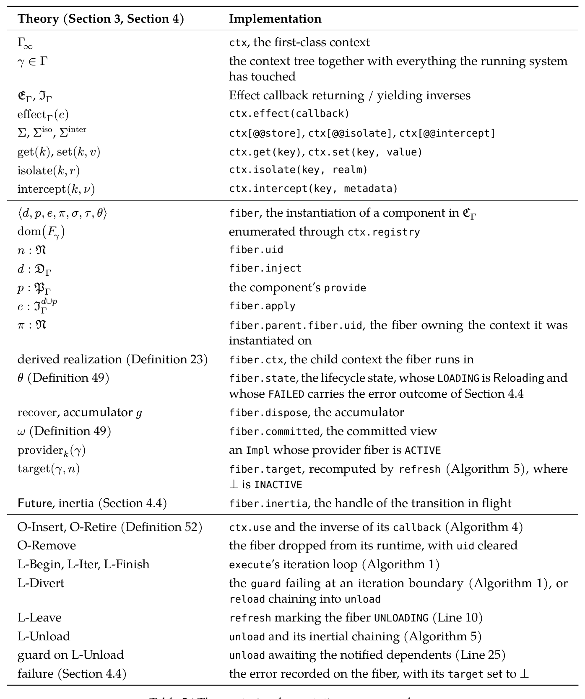

</details>

本节余下部分自底向上构建核心库。5.1.1 节实现可逆效应，它是改动上下文的唯一原语；5.1.2 节在其上实现响应式协效应；5.1.3 节把二者组合成组件生命周期；5.1.4 节则给出建立在它们之上的上下文级操作。

#### 5.1.1. 效应跟踪

本节实现可逆效应（3.1 节）。Cordis 中每一次上下文改动都经由单一原语 `ctx.effect`：协效应提供、组件实例化以及任何其他改动上下文的操作，都归约为一次 `ctx.effect` 调用，因此通过上下文执行的任何操作都会被自动跟踪，并在组件卸载时被回退。在操作层面，`ctx.effect` 是 $\mathrm{effect}^{\mathrm{iter}}_{\Gamma}$ 的实现（定义 18）：它接受类型为 $\Im_{\Gamma}$ 的回调并把它提升为 $\Im_{\partial\Gamma}$，产生一个 dispose 闭包，调用该闭包即回退该效应。Cordis 通过这一操作同时接受 $\mathfrak{E}_{\Gamma}$ 与 $\Im_{\Gamma}$（特设多态）；我们以迭代器形式为代表，因为普通效应函数就是只产生一个逆的退化迭代器。该操作不检查的是 $\mathfrak{E}_{\Gamma}^{\ast}$ 所携带的见证：回调提供一个逆，而该逆是否回退它所伴随的效应，是组件作者的义务，而非运行时验证的性质。定理 68 是演算援引它的地方，6.1 节则界定这一义务。协效应的见证（定义 46）同样不加检查：某个键上公布的各操作可交换，是提供该键的组件的义务，由 3.4.2 节的表示选择来履行。

算法 1 给出 `ctx.effect` 的构造。记 $f\circ g$ 为在 $g$ 之后运行 $f$ 的 disposer，记 `id` 为空操作；因此把每个新逆前置即得到后进先出的恢复。

**算法 1 效应跟踪**

```text
 1  async function execute(callback, guard)
 2  iter ← callback()
 3  inverse ← id
 4  while guard()
 5      (value, done) ← await iter.next()
 6      if value then inverse ← value ∘ inverse
 7      if done then break
 8  return inverse
 9  function effect(ctx, callback)
10  armed ← true
11  task ← execute(callback, () ↦ armed)
12  async function dispose()
13      if not armed then return
14      armed ← false
15      recover ← await task
16      recover()
17  ctx.dispose ← dispose ∘ ctx.dispose
18  return dispose
```

<details markdown="1"><summary>原图（PDF 矢量图渲染）</summary>

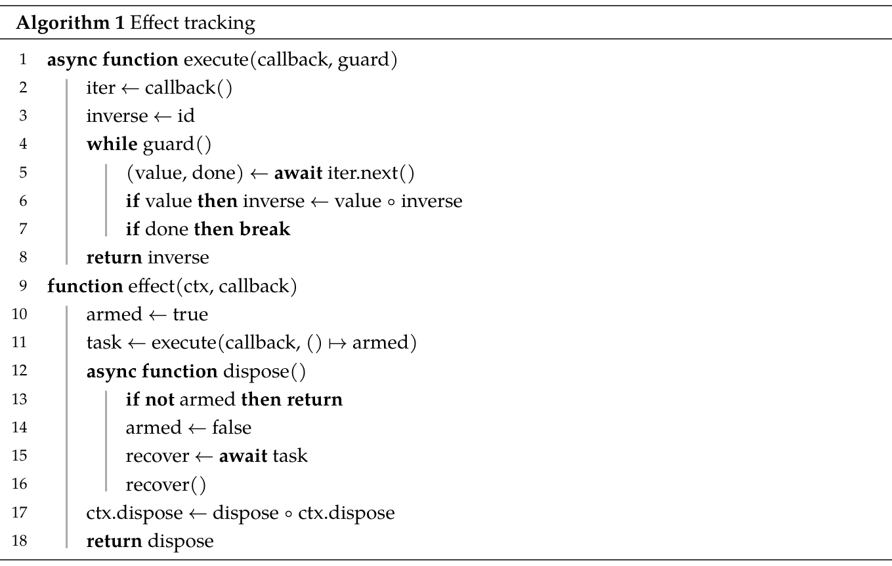

</details>

引擎 `execute` 把回调作为效应迭代器（$\Im_{\Gamma}$，定义 17）驱动，并把每一步产生的逆折叠成单个复合。每步之前它查用调用方提供的 `guard`；一旦守卫触发，迭代停止，只留下到目前为止累积的各逆。这就是 4.2.2 节的步边界中断：$\mathsf{Maybe}(\Im)$ 续延由迭代器的 `done` 标志连同 `guard` 实现。

`ctx.effect` 是 `execute` 之上的一层薄封装，增加了两件事。第一，自处置：守卫报告 `armed` 标志，返回的 `dispose` 把 `armed` 翻为假，这同时停止任何在途迭代，并使恢复至多触发一次。触发两次会在一个并非由该效应的任何施用所产生的状态上施用逆，在那里没有任何东西保证它会回退什么。第二，父级组合：把 `dispose` 前置到外围上下文累积的逆 `ctx.dispose` 上，于是子效应的逆本身也是父上的一个效应，这正是 $\partial^{2}\Gamma$ 的递归结构。组件层（5.1.3 节）复用同一个 `execute`，只是守卫检测的是 `fiber.target` 而非 `armed` 的稳定性。

#### 5.1.2. 协效应操作

本节实现响应式协效应（3.2 节）。所有协效应操作都作用于每个上下文携带的三个以符号为键的槽位：

- ```@@store`：值存储 $\sigma: (r: R) \rightharpoonup\mathcal{V}_{r}$，从领域符号到带类型的值；
- ```@@isolate`：领域表 $\rho: \mathrm{Map}(K, R)$，从协效应键到领域符号；
- ```@@intercept`：拦截表 $\iota: (k: K) \to\mathcal{M}_{k}$，为每个键指派其元数据。 前两者组合成两层解析 $k\to\rho(k) \to\sigma(\rho(k))$：`ctx.get(key)`（算法 2）先从 `@@isolate`读出领域符号 $\rho(k)$，再从`@@store`读出绑定的值 $\sigma(\rho(k))$。$\rho$ 这一层间接使隔离能把某个键重定向到独立的绑定，而`@@intercept` 只在访问绑定时被查用，调整的是绑定如何被使用，而非它解析到什么。我们分两部分实现这些操作：(1) *提供与通知*，安装或撤回绑定并把变化传播给依赖方；(2) *隔离*与*拦截*，重塑某个键的解析方式。

**提供与通知。** 由于 $\mathrm{set}(k, v)$ 的类型为 $\mathfrak{E}_{\Sigma}$（3.1 节），协效应提供就是一次 `ctx.effect` 调用，并继承其自动跟踪与恢复。算法 2 实现 `ctx.set(key, value)`，即具体的 $\mathrm{set}(k, v)$：回调把一个值按领域符号 $\rho(k)$ 绑定到存储中，返回的 dispose 函数把它移除。安装与移除都会调用 `notify`，把变化传播给依赖组件。

**算法 2 协效应操作**

```text
 1  function get(ctx, key)
 2  realm ← ctx[@@isolate][key] ▷ 𝜌(𝑘)
 3  return ctx[@@store][realm] ▷ 𝜎(𝜌(𝑘))
 4  function set(ctx, key, value)
 5  function callback()
 6      realm ← ctx[@@isolate][key] ▷ 𝜌(𝑘)
 7      ctx[@@store][realm] ← value ▷ 𝜎[𝜌(𝑘) ↦𝑣]
 8      notify(ctx, [key])
 9      return function()
10          delete ctx[@@store][realm] ▷ 𝜎∖𝜌(𝑘)
11          notify(ctx, [key])
12  return ctx.effect(callback)
```

<details markdown="1"><summary>原图（PDF 矢量图渲染）</summary>

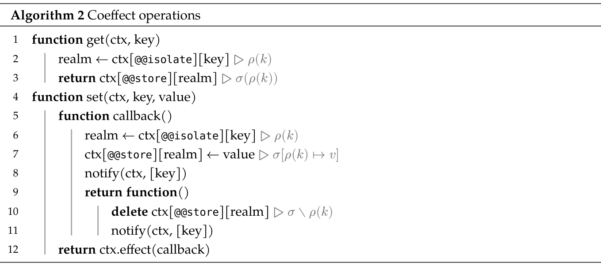

</details>

算法 3 把每次绑定变化传播给依赖方：对每条存活纤维，检测变化的键是否出现在其 `fiber.inject` 中且解析到同一领域；若是，则调用 `refresh`（5.1.3 节）针对新状态重新求值该纤维，并返回它重新求值过的纤维，以便调用方等待它们。这正是定义 22 的响应式分类：使满足性翻转的变化会激活或停用该纤维，而 `refresh` 的幂等性使中性变化无害。这种重新求值与各种控制流的交互在 5.1.3 节展开。

**算法 3 响应式通知**

```text
1  function notify(ctx, keys)
2  affected ← ⌀
3  for fiber in all_fibers do
4      for key in keys do
5          if key ∈ fiber.inject and fiber.ctx[@@isolate][key] = ctx[@@isolate][key] then
6              refresh(fiber)
7              affected ← affected ∪ {fiber}
8              break
9  return affected
```

<details markdown="1"><summary>原图（PDF 矢量图渲染）</summary>

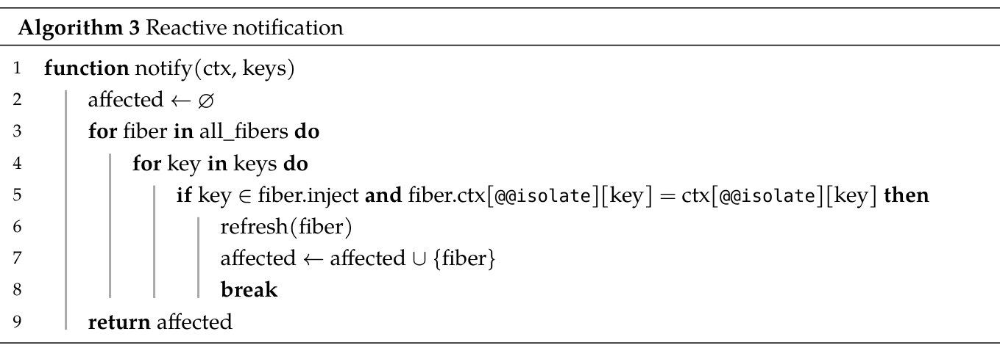

</details>

只有当安装某绑定的纤维处于 `ACTIVE` 时，该绑定才算对依赖方可用，因此 `refresh` 是针对活跃的提供者、而非仅针对存储来解析每个声明的键。这正是定义 53 的*由……提供*关系，也是撤回能在发生前一步就对依赖方可见的原因：已进入 `UNLOADING` 的提供者已停止提供，故其依赖方重算出一个未被满足的目标视图，并在它的各绑定仍全部就位时就开始自身的拆解。

**隔离与拦截。** 两个操作在结构上做同一件事：各自派生一个子上下文，为 `key` 调整一张继承来的表，而不改动父上下文，因此恢复是隐含的：丢弃该子上下文即可，无须运行显式的逆。`ctx.isolate(key, realm)` 用 `realm`（默认用新生成的符号）覆盖领域映射 $\rho$（实现 $\mathrm{isolate}$，定义 25），于是为同一个键指派不同符号的两个上下文解析到独立的绑定。`ctx.intercept(key, metadata)` 把 `metadata` 合并进拦截表 $\iota$（实现 $\mathrm{intercept}$，定义 27）：按该定义，新元数据与上下文已为 `key` 携带的内容合并，并优先于后者。

#### 5.1.3. 组件生命周期

组件由 `ctx.use` 实例化为一条*纤维*。本节赋予纤维（5.1 节引入）以操作含义，即 4.4 节的惯性状态机。驱动下述算法的是两个字段：`fiber.parent`，即构成组件层级的 `fiber.ctx` 的父上下文（$\Gamma_{\infty}$ 的递归结构，3.3.1 节）；以及 `fiber.inertia`，指向在途异步转移的句柄（空闲时为 null）。

算法 4 给出组件实例化。*组件*把协效应规格 `component.inject`（$d$）与效应函数 `component.apply` 配对；实例化把组件的 `config` 绑定到 `fiber.apply`（第 9 行），即应用了配置、随后由生命周期运行的效应函数（$e$）。`callback` 函数（第 2 行）是在*父*纤维中被跟踪的效应：执行时它通过调用 `refresh`（算法 5）启动子纤维的生命周期；回退时它把子纤维的目标强制为 $\bot$ 并触发 `unload`。这正是定义 52 的实例化原语，以 `callback` 为其 O-Insert，以 `callback` 返回的闭包为其 O-Retire：实例化是父的一个普通被跟踪效应，故卸载父会级联到其子。

**算法 4 组件实例化**

```text
 1  function use(ctx, component, config)
 2  function callback()
 3      refresh(fiber)
 4      return function()
 5          fiber.target ← ⊥
 6          unload(fiber)
 7  fiber ← Fiber(parent: ctx, inject: component.inject)
 8  fiber.ctx ← ctx[fiber ↦ fiber]
 9  fiber.apply ← () ↦ component.apply(fiber.ctx, config)
10  ctx.effect(callback)
11  return fiber
```

<details markdown="1"><summary>原图（PDF 矢量图渲染）</summary>

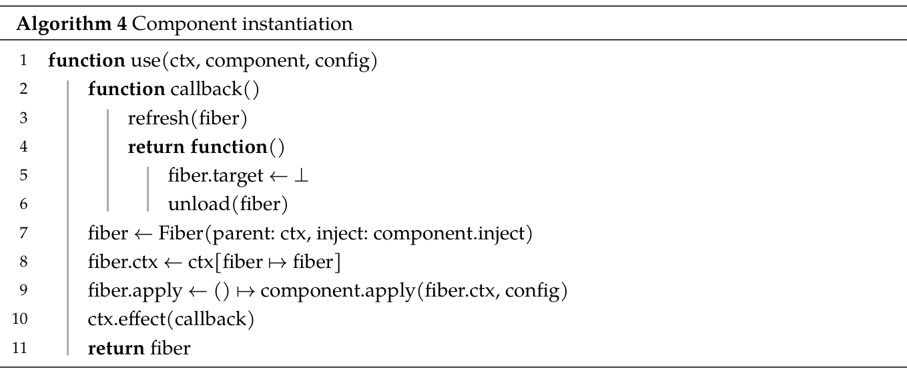

</details>

算法 5 实现 4.4 节的惯性状态机，其中 `reload` 与 `unload` 是惯性的：一旦进入，一次转移会跑完，系统才响应目标状态的变化。它使用两个针对协效应存储的辅助查询：`resolve(inject)` 返回各声明键当前解析到的绑定，`provided(fiber)` 返回本纤维安装了其绑定的那些键。`refresh` 函数从协效应存储重算 `fiber.target`，若纤维尚未处于转移中，则启动一个 `reload` 或 `unload` 任务2。`reload` 函数记录当前目标并执行组件的效应函数 `apply`。完成时它检查目标是否仍匹配：若匹配，纤维进入 `ACTIVE`；若不匹配（无论新目标是 $\bot$ 还是另一组提供者），它链接到 `unload`。对称地，`unload` 以后进先出顺序回退所有被跟踪的效应，随后或者进入 `INACTIVE`，或者链接到 `reload`。这个相互递归实现了惯性性质：一次转移一旦开始，就在任何新转移开始之前完成。

**算法 5 组件生命周期**

```text
 1  function refresh(fiber)
 2  target ← target(𝛾, 𝑛)
 3  if target = fiber.target then return
 4  fiber.target ← target
 5  if fiber.inertia then return
 6  if target ≠ ⊥ then
 7      fiber.state ← LOADING
 8      fiber.inertia ← create_task(reload(fiber))
 9  else
10      fiber.state ← UNLOADING ▷ out of service before any inverse is scheduled
11      fiber.inertia ← create_task(unload(fiber))
12  async function reload(fiber)
13  target0 ← fiber.target
14  fiber.committed ← resolve(fiber.inject) ▷ commit the view
15  recover ← await execute(fiber.apply, () ↦ fiber.target = target0)
16  fiber.dispose ← recover ∘ fiber.dispose
17  if fiber.target = target0 then
18      fiber.state ← ACTIVE
19      notify(fiber.ctx, provided(fiber))
20      fiber.inertia ← null
21  else
22      fiber.state ← UNLOADING
23      fiber.inertia ← create_task(unload(fiber))
24  async function unload(fiber)
25  await all(notify(fiber.ctx, provided(fiber)).map(f ↦ f.await())) ▷ drain dependents
26  await fiber.dispose()
27  fiber.dispose ← id
28  fiber.committed ← ⊥
29  if fiber.target = ⊥ then
30      fiber.state ← INACTIVE
31      fiber.inertia ← null
32  else
33      fiber.state ← LOADING
34      fiber.inertia ← create_task(reload(fiber))
```

<details markdown="1"><summary>原图（PDF 矢量图渲染）</summary>

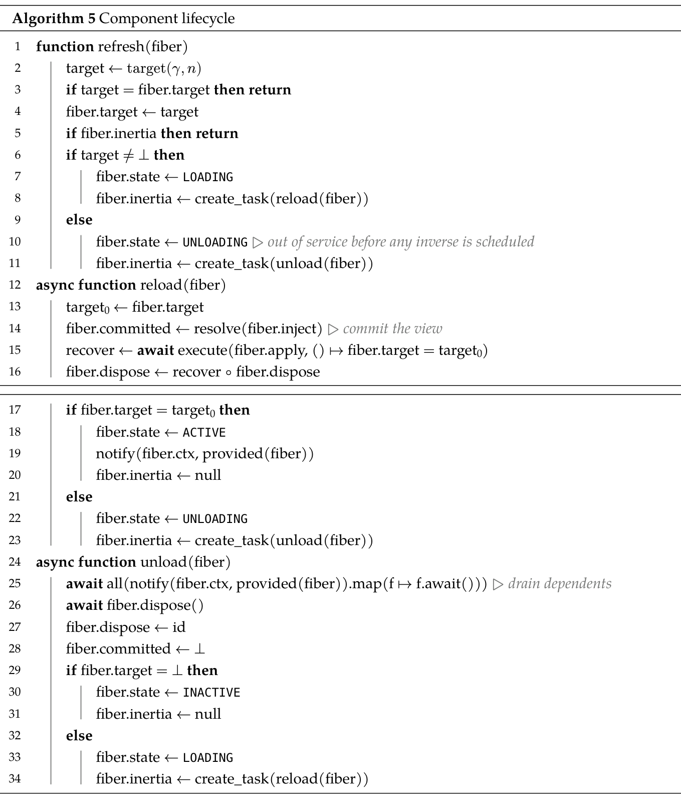

</details>

`fiber.target` 的计算方式是：针对当前协效应存储解析每个声明的键，并把提供它的纤维的 `uid` 组成元组，因此它是 $\mathrm{target}(\gamma, n)$ 的一个摘要（定义 53）。用提供者而非值来标识绑定，正是与已记录目标作一次比较即告充分的原因：`uid` 是现抽取且从不复用的，故被替换的提供者不会被误认作它所替换的那个，即便二者提供相等的值也一样。由于 `notify`（5.1.2 节）在每次协效应变化时重算目标，纤维恰在其某个声明键改由另一条纤维提供时重载。因此，就地覆盖自身绑定的提供者不会被观察到；希望替换能传播出去的组件，会先撤回该绑定再重新安装。[^2]

该算法在两个互补的层次上运作。在*转移*层，`reload` 与 `unload` 在完成时检查目标，从而实现跨转移的惯性链接。在每次转移内部的*迭代*层，效应执行（算法 1）在每个迭代边界检查目标，从而实现单次转移内的部分回滚。这两个机制分别对应 4.4 节的转移间链接，以及定理 71 所依赖的转移内陈旧性检查。

有三行承载着定理 70 的协效应定序，而它们各自所处的位置正是定序成立的原因。`reload` 在第 14 行提交解析后的视图，`unload` 只有在每个逆都运行完毕之后才丢弃它，因此纤维只要处于已加载状态（包括自身拆解期间）就读到同一组绑定。`refresh` 在创建转移任务之前的第 10 行把纤维标记为 `UNLOADING`，这就是 L-Leave 步：纤维停止提供，依赖方在它的任何逆被调度之前就据此重算。随后 `unload` 在第 25 行等待每个被通知的依赖方到达 `INACTIVE`，这正是 L-Unload 上的守卫；`notify` 只在其声明键解析到与提供者相同的领域符号时才接纳该依赖方，这是守卫要求依赖方看到*来自这条纤维*的键而非仅仅声明它的运行时形式。该等待位于整个恢复之前，而非被等待的某个逆内部，因为 `fiber.dispose` 并发启动一条纤维的各效应，若把等待放在其中之一内部，其余效应就无从定序。终止性由定理 73 得出：纤维只会等待已经不再可满足的依赖方，而本身也是提供者的依赖方以同样方式等待自己的依赖方，故提供者图是按需遍历而非预先分析的。

#### 5.1.4. 上下文访问

5.1.2 节的协效应操作构成一套*反射式* API：协效应以 `ctx.set(key, value)` 写入、以 `ctx.get(key)` 读取，二者都以名字为键。Cordis 在这套反射式 API 之上再叠加一种更原生的扩展与消费上下文的方式：*属性访问*。组件可以像访问上下文的原生结构那样，把协效应作为属性 `ctx[key]` 来访问，而不必通过方法调用。在 TypeScript 中，Cordis 用一个 `Proxy` 实现它，其 `get` trap 中介每一次属性访问。算法 6 展示上下文如何在 5.1.2 节的原语 `get` 之上，把这样的访问解析到某个协效应。

**算法 6 代理中介的上下文访问**

```text
1  function resolve(ctx, key)
2  fiber ← ctx.fiber
3  repeat
4      if key ∈ fiber.committed then return fiber.committed[key]
5      if key ∈ fiber.inject then throw INACTIVE_ACCESS
6      if fiber = root then throw UNDECLARED_ACCESS
7      fiber ← fiber.parent.fiber
```

<details markdown="1"><summary>原图（PDF 矢量图渲染）</summary>

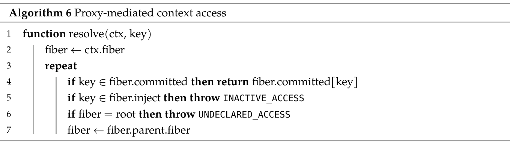

</details>

算法 6 从发起访问的上下文沿纤维链向上走：在第一个其已提交视图绑定了 `key` 的纤维处，访问获得授权并返回该绑定；若走到某条声明了 `key` 却尚未提交它的纤维，则该纤维未加载，访问失败；若走到根而没有任何声明，则访问因未声明而被拒绝。这正是代理与裸 `ctx.get` 的区别所在：`ctx.get(key)` 是对存储的一次查找，返回绑定的值或空，且从不失败；而代理按发起访问纤维自身的视图解析，并在使用点强制执行协效应规格 $d$。读视图而非读存储，也正是定理 70 所依赖之处，因为正是它使某个依赖在消失时触发了拆解的组件仍能读取该依赖。

这种拒绝是在访问点执行的*运行时*检查。由于组件的协效应规格 $d$ 是静态声明的，同一违规原则上可在编译期检测：只需在执行前把每个 `ctx[key]` 对照所声明的 $d$ 解析；6.4 节讨论宿主语言的类型级依赖声明与编译期元编程如何恰好完成这种中介。

### 5.2. 组件装载器

核心库为*组件开发者*提供用于动态组合的命令式原语，如 `ctx.effect`、`ctx.use` 与 `ctx.set`。*应用编排者*面对的则是另一重关切：他们把既有组件装配成运行中的系统，并在其生命周期内调整组合。*组件装载器*通过引入声明式配置层来应对这一关切：编排者把期望的组合指定为一个持久数据结构，装载器则把对该规格的改动翻译成相应的命令式纤维操作。

#### 5.2.1. 声明式配置

第 4 章把运行中的系统分解为纤维，每条都是一个组件的实例化。实例化所需的一切都可以声明，因此编排者可以把整个系统描述成一份*声明式配置*：一个持久记录，由装载器实现为纤维并与之保持同步。

**条目。** 配置由若干*条目*构成。每个条目指定一条纤维并管理它，且绑定是双向的：装载器通过改动纤维来响应条目字段的变化，而组件若修订自身配置或禁用自身，该变化也会被写回其条目。

**定义 81.** *条目*声明单条纤维，记录：

- ```id`——稳定标识符，在其所属组的子列表变化时用作协调键；
- ```url`——要实例化的组件模块的 URL；
- ```isolate`——施加于该条目上下文的隔离标注；
- ```intercept`——施加于该条目上下文的拦截标注；
- ```config`——绑定进组件以形成其效应函数 `apply` 的配置；
- ```disabled`——该条目是否在管理上被关闭。 条目之所以能充当忠实的规格，是因为支撑一条纤维的恰是条目所记录的内容。定义 74 的支撑集只读 $\tau$、$\pi$、$d$ 与 $p$，别无其他，而条目给出全部四者：`disabled` 给出 $\tau$，条目在树中的父给出 $\pi$，`url` 选出声明 $d$ 与 $p$ 的组件。支撑集未读的字段是纤维的运行时状态，而实例化同样不需要它；并且只要每个组件都安装它所声明的每个键（定义 76），引理 77 就把支撑集等同于静止状态下处于 $\mathsf{Active}$ 的纤维（定义 53）。

这些条目构成一棵*配置树*，是系统加载内容的权威记录。条目可以是映射到单条纤维的叶子，其组件也可以继续加载更多组件，使该条目成为分支节点。Cordis 为这种分组与嵌套加载提供了组件：`@cordisjs/group` 以一组子条目列表作为配置并把它们作为一个子组加载，`@cordisjs/include` 则加载外部配置文件（YAML 或 JSON）并把其中的条目嫁接为嵌套子树。二者都是建立在定义 52 实例化原语（算法 4）之上的普通组件，故嵌套树仍落在演算之内，下文结果对之成立。

**协调。** 当条目的记录变化时，装载器做增量协调，而非把纤维整体拆毁重建。这种做法之所以可靠，理由由元理论给出。

- 定理 80 使静止状态只成为最终配置的函数：无论装载器沿途执行了哪些实例化与退役、以何种
  次序，系统都静止在从头加载最终配置所会
  留下的位置。仅在以下限度内，最终加载了哪些组件才能从声明中读出：
  其中每个组件都安装它所声明的每个键（定义 76）；某个声明了
  键却只在某些配置下才安装它的组件，装载器仍可对其协调，
  但此时已加载组件的集合也取决于那些配置。
- 定理 73 证明系统确会静止，故一旦其
  各实例化与退役都已发出，协调即告完成。
- 推论 69 把离开的纤维对状态的贡献定为零，故重建
  一个条目会撤回其纤维所安装的内容，并让它周围的纤维保持原样。
- 定理 70 允许各条目一并实例化，编排者无须安排加载次序：声明键尚未被提供的纤维在其 L-Begin 处等待，
  而其提供者离开的纤维会先于它被停用。因此依赖约束的是
  纤维何时激活，而非其模块何时被抓取与求值，故装载器
  并发加载模块，而启动大型配置的时间正花在这里。
  在条目所声明的纤维之上，装载器按条目的哪个字段发生变化来分派，并对每种变化施加扰动最小的操作。
- ```id`、`url`——重建条目，因为其身份或组件已改变；
- ```isolate`——重新指派条目的各领域（算法 7）；
- ```intercept`——就地更新，因为拦截元数据在读取时才查用，
  无须重载；
- ```config`——交给组件，由它决定如何应用新载荷， 通常是与旧载荷作差异比较，只在实质变化时才重载。 特别地，`@cordisjs/group`条目的`config`是其子条目列表，故它把 更新作为对子`id` 的带键差异比较来应用，创建、移除或更新每个子条目；由于
  更新存续的子条目会重新进入同一套逐字段分派，组协调与
  条目更新沿树一同递归；
- ```disabled`——置位时卸载纤维，清除时重新加载。 **托管领域。** 核心中的隔离派生出一个在某个键处覆盖领域表 $\rho$ 的子上下文（5.1.2 节），在上下文树不动时这已足够。条目可能运行时在组之间移动，故装载器自行管理领域，而 `isolate`字段为每个键在两条定界规则之间作出选择。取值`true`选择一个*局部*领域，为该条目私有并以其`id` 标记，条目移到哪里都带着它；字符串则选择一个*全局*领域，由所有命名该字符串的条目共享，因此移动这样的条目改变的是它与哪些条目共享绑定，而非它属于哪个领域。一旦没有条目命名某领域，该领域即被丢弃。

重新指派条目的领域取决于三件事：哪些键改了领域、该条目本身是否是某个改动键的提供者、以及要通知哪些依赖方。中间那个问题最难，因为一个领域符号可能由若干纤维共享，而其中只有一条是提供者。装载器用*分隔符*来回答：每个键一个符号 $\delta_{k}$，各上下文在其下保存自己的标记。分隔符写在上下文上并由其后代继承，因此条目的标记与提供者的标记恰好在二者都是在同一个针对 $k$ 的 $\mathrm{isolate}$ 作用域内派生时一致，而这正是 $k$ 处的绑定属于条目自身、必须随它一起移动的情形。

**算法 7 隔离领域重新指派**

```text
 1  function patch_isolation(entry, 𝜌′)
 2  𝜌 ← entry.ctx[@@isolate]
 3  store ← entry.ctx[@@store]
 4  Δ ← {𝑘| 𝜌(𝑘) ≠𝜌′(𝑘)} ▷ keys whose realm changes
 5  for 𝑘 in Δ do
 6      entry.ctx[𝛿𝑘] ← fresh tag
 7      diff[𝑘] ← (𝜌(𝑘), 𝜌′(𝑘), entry.ctx[𝛿𝑘], store[𝜌(𝑘)].fiber.ctx[𝛿𝑘])
 8  entry.ctx[@@isolate] ← 𝜌′
 9  reload(entry.fiber)
10  for 𝑘 in Δ do
11      (𝑠1, 𝑠2, 𝑑1, 𝑑2) ← diff[𝑘]
12      if 𝑑1 = 𝑑2 and store[𝑠1] and not store[𝑠2] then ▷ the binding is the entry’s own
13          store[𝑠2] ← store[𝑠1]
14          delete store[𝑠1]
15  function affected(fiber, 𝑘)
16      (𝑠1, 𝑠2, 𝑑1, 𝑑2) ← diff[𝑘]
17      return fiber.ctx[@@isolate][𝑘] ∈ {𝑠1, 𝑠2} and (fiber.ctx[𝛿𝑘] = 𝑑1) ≠ (𝑑2 = 𝑑1)
18  notify(entry.ctx, Δ, affected) ▷ in place of the realm test of Algorithm 3
```

<details markdown="1"><summary>原图（PDF 矢量图渲染）</summary>

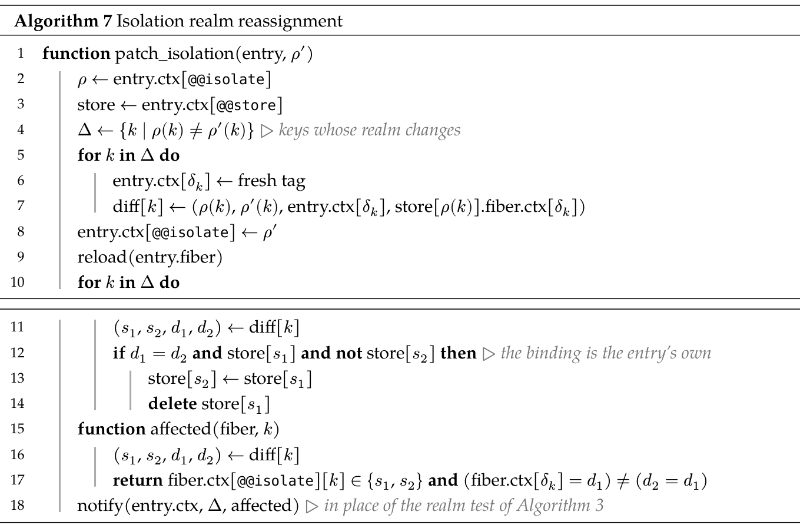

</details>

该检测依赖分隔符的一条性质。$\delta_{k}$ 下的标记写在条目的上下文上并由从它派生的每个上下文继承，且每次重新指派都会重新抽取，故对上下文 $\gamma'$ 有

$$
\gamma'[\delta_{k}] = d_{1}\Longleftrightarrow\gamma' \mathrm{is} \mathrm{derived} \mathrm{from} \mathrm{the} \mathrm{entry}'s \mathrm{context} \tag{64}
$$

记 $\mathrm{own}(\gamma')$ 表示该条件，$d_{2} = d_{1}$ 是它在提供者处的实例。重新指派把满足 $\mathrm{own}$ 的上下文从 $s_{1}$ 移到 $s_{2}$，其余保持原位；由上述循环，它恰在提供者满足 $\mathrm{own}$ 时把绑定移到 $s_{2}$。只要依赖方自身在 $k$ 处的领域正是绑定所在的领域，它就能看到该绑定。当 $\mathrm{own}$ 在依赖方与提供者处一致时，两者同移或同留，故依赖方之后能看到绑定当且仅当它之前能看到。当 $\mathrm{own}$ 把二者分开时，一侧移动而另一侧留下，故依赖方获得或失去该绑定。不等式正是这种分离，而成员检测剔除掉在两个领域中都不解析到 $k$ 的依赖方，因为这次移动的任何部分都触及不到它们。

#### 5.2.2. 热模块替换

热模块替换（HMR）把可逆效应模式应用到*模块*层面：当源文件变化时（通常发生在开发期间），系统在原地替换受影响的模块而不重启进程。由于纤维已经界定了其组件的全部效应与协效应，本身即为组件的模块可以只通过纤维操作来替换：处置旧纤维会回收该组件所安装的一切，而从重新加载的模块实例化出的新纤维会重新安装它们。因此，与 Webpack [48] 或 Vite [49] 的 HMR 不同，HMR 不需要开发者标注接受边界。

`@cordisjs/hmr` 组件提供 HMR *引擎*，它分三个阶段运作。

**阶段 1：模块分类。** 引擎接受两个输入：*暂存*集（自上次重载以来内容发生变化的文件 URL）与*外部*集（无法热替换、因而触发整体重启的模块）。记 `get_imports(url)` 为 `url` 直接导入的模块，引擎对变化的依赖子图分类，把每个模块标记为 `accepted` 或 `declined`：

**算法 8 模块分类**

```text
 1  function classify(stashed, externals)
 2  accepted ← stashed
 3  declined ← externals
 4  pending ← ⌀
 5  for url in stashed do
 6      pending ← pending ∪ (get_imports(url) ∖ (accepted ∪ declined))
 7  repeat
 8      progress ← false
 9      for url in pending do
10          if get_imports(url) ∩ accepted ≠ ⌀ then
11              accepted ← accepted ∪ {url}
12              pending ← pending ∖ {url}
13              progress ← true
14          else if get_imports(url) ⊆ declined then
15              declined ← declined ∪ {url}
16              pending ← pending ∖ {url}
17              progress ← true
18          else
19              pending ← pending ∪ (get_imports(url) ∖ (accepted ∪ declined))
20  until not progress
21  declined ← declined ∪ pending
22  return (accepted, declined)
```

<details markdown="1"><summary>原图（PDF 矢量图渲染）</summary>

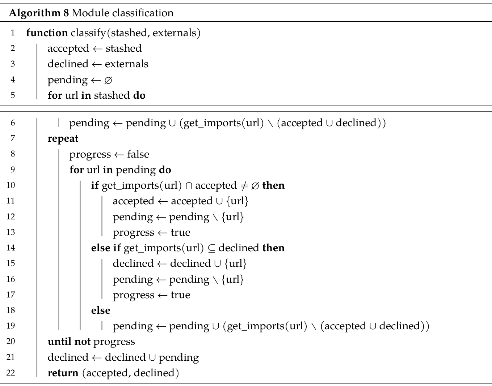

</details>

以暂存文件的各导入为种子，该不动点在某模块有一个导入被接受时就接受它，在其所有导入都被拒绝时就拒绝它；任何仍未定、陷在导入环中的模块，默认判为拒绝。

**阶段 2：陈旧条目检测。** 引擎随后用 `accepted` 与 `declined` 把组件条目筛选到*陈旧*的那些，即其依赖树触及某个已变化模块的条目。它用 `get_dependencies` 遍历每个条目的树，后者收集某模块的传递导入，同时把 `declined` 当作边界：

**算法 9 陈旧条目检测**

```text
 1  function get_dependencies(root, declined)
 2  deps ← ⌀
 3  function traverse(url)
 4      if url ∈ deps or url ∈ declined then return
 5      deps ← deps ∪ {url}
 6      for child in get_imports(url) do traverse(child)
 7  traverse(root)
 8  return deps
 9  function detect(entries, accepted, declined)
10  stale_entries ← ⌀
11  for entry in entries do
12      tree ← get_dependencies(entry.url, declined)
13      if tree ∩ accepted ≠ ⌀ then
14          accepted ← accepted ∪ tree
15          stale_entries ← stale_entries ∪ {entry}
16  return stale_entries
```

<details markdown="1"><summary>原图（PDF 矢量图渲染）</summary>

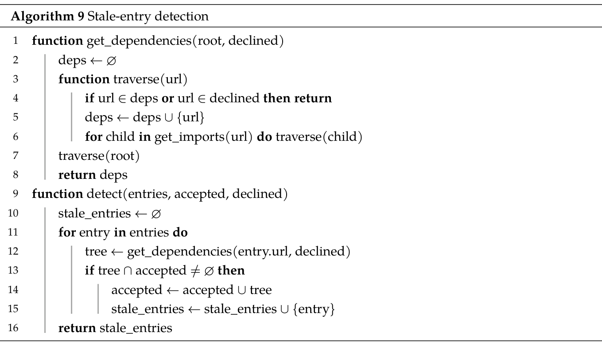

</details>

一个条目是陈旧的，当且仅当它的树与 `accepted` 相交；随后把该树折叠进 `accepted`，使沿它的每个陈旧模块在下一阶段被作废。

**阶段 3：事务式重载。** 最后，引擎重载陈旧条目。它使被接受模块的缓存作废3，备份每个被移除的模块以便回滚，然后按每个陈旧条目的 `url` 重新导入其组件模块，并换入一条新纤维：

**算法 10 事务式模块重载**

```text
 1  function reload(ctx, accepted, stale_entries)
 2  backup ← invalidate_caches(accepted)
 3  try
 4      for entry in stale_entries do
 5          entry.fiber.dispose()
 6          entry.fiber ← ctx.use(import(entry.url), entry.config)
 7  catch error
 8      restore_caches(backup)
 9      for entry in stale_entries do
10          entry.fiber.dispose()
11          entry.fiber ← ctx.use(backup[entry.url], entry.config)
12      throw error
```

<details markdown="1"><summary>原图（PDF 矢量图渲染）</summary>

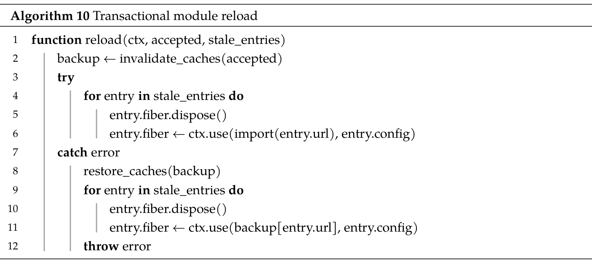

</details>

事务式保证确保系统绝不进入半重载状态：若任一模块导入失败（例如因语法错误），则恢复缓存，并从 `backup[entry.url]`（即缓存刚被恢复的先前组件）重建每个陈旧条目，撤销已经完成的换入。

### 5.3. 案例研究：Koishi

Koishi 是构建在 Cordis 之上的开源聊天机器人应用框架4。经过四年开发，它已积累 4000 多个社区贡献的插件5，涵盖即时通讯（IM）适配器与数据库驱动，到管理控制台与面向最终用户的功能。其规模与多样性使它成为 Cordis 动态可组合性在生产环境中的代表性验证。

**元框架的表达力与通用性。** Koishi 作为服务端机器人运行，其每个功能都实现为 5.1 节上下文原语之上的插件；Koishi 自身只贡献聊天机器人领域的词汇。同一模型在完全不同的运行时中重现：Koishi 的 Web 控制台是第二个独立的 Cordis 应用，其插件组合的是浏览器及其用户界面的原语，而非服务端的原语。上述迥异的设定确立了第 3 章模型的两条性质。(1) 它有表达力：其原语足以承载一个完整的生产系统，宿主框架只需提供领域词汇。(2) 它通用：它规定效应与协效应如何组合，而把其含义留给各应用，因此既不预设特定领域，也不预设特定运行时。

**无认知负担的时间可组合性。** 1.2.1 节考察的插件系统若不重启扩展宿主，就无法卸载单个扩展的效应。Koishi 经常执行这一操作：编排者在控制台禁用某插件，其效应即被原地回退；开发期间，HMR 引擎在保存时重新应用编辑过的插件，同时保留系统其他部分的缓存状态与活跃连接。Cordis 使这种移除对插件作者而言不仅是可能的，而且毫不费力。由于通过上下文执行的效应会被跟踪、其逆会被自动复合（3.1 节），即便是缺乏经验的作者，也无需编写卸载路径就能为插件的上下文中介效应获得有序的清理。这实现了 1.2.1 节指出其缺失的关注点局部性：原本要依赖每位作者勤勉程度的正确性，改由抽象一次性履行。[^4][^5]

**开放生态中的空间可组合性。** 与 1.2.1 节中插件间依赖基本缺席的插件系统不同，Koishi 的生态呈现出真实的依赖拓扑：IM 适配器提供对各消息平台的访问，数据库驱动提供持久存储，而功能性插件把这些声明为协效应并访问它们。运行时重配某提供者（如切换存储后端或重连适配器）只重新激活其已解析依赖发生变化的那些依赖方（3.2 节）；依赖不可用的插件会保持非活跃直到它出现，而不会报错。该案例研究所证实的是：这种组合在独立编写的代码之间同样成立——插件与其依赖通常由不同作者编写，他们除连接彼此的协效应之外不作任何协调，因此响应式协效应在由独立贡献者构成的开放生态中保持装配一致。

**有效性威胁。** 这里的证据来自单一宿主语言中的单一生态，因此无法把范式本身的优点与其 TypeScript 实现或 Koishi 特定领域的优点区分开；而且它是观察性的，并非与另一种架构的对照比较。因此该案例研究确立的是存在性与采纳结果，而非定量结果；以基线衡量该抽象的开销及其对开发者生产率的影响，仍是未来工作。

## 6. 讨论

前几节给出的形式模型与实现引入了一种面向动态可组合性的编程范式。本节考察该范式如何延伸到更广的工程关切，并讨论设计张力与未决问题。

### 6.1. 系统边界

3.1 节中的每个效应都带有逆，而该逆究竟意味着什么，由*系统边界*决定。边界把系统所运行于其中的环境分为两部分。(1) 当系统能够排他地改动某个位置、并能恢复该改动之前的状态时，该位置位于*内部*，于是针对它的操作被跟踪在 $\Gamma$ 中，日后可回退。(2) 当这两种能力有任一缺失时，该位置位于*外部*，于是针对它的操作相当于 $\mathrm{id}_{\Gamma}$，因此既不被跟踪也不被回退。本节展开这条边界的性质及其对恢复的影响。

**由协效应划出的边界。** 协效应通过具体化某个外部位置来移动边界：它把对该位置的每次访问限制在它所提供的一组操作内，且能为其中每个操作提供逆，于是原本相当于 $\mathrm{id}_{\Gamma}$ 的操作转而被跟踪在 $\Gamma$ 中并被回退。因此边界是按位置而非按介质划定的，因为上述两种能力都是位置的属性，而具体化改变的是位置的访问方式，介质则保持原样。例如，某内存区域在系统独占写入时位于内部，在其他进程也写入时位于外部；某文件在只有系统能触及它（如私有路径下的暂存文件）时位于内部，在它是其他程序读写的路径时位于外部。移动边界本身是一种权衡：一端是环境是否为某位置提供可逆语义，另一端是每次访问都要为提供这些语义付出什么代价。6.7 节讨论由此引出的协同设计。

**获取与排放。** 触及边界之外的操作通常分两阶段进行。(1) 在*获取*阶段，操作取得访问权并在边界内安装一条记录：`open` 安装一个描述符而 `close` 移除它，`malloc` 预留一块而 `free` 释放它，`fork` 启动一个子进程而 `kill` 终止它。该记录本身是具体化该位置的协效应的一部分，例如它所维护的映射中的一个条目，而安装该条目是一个可逆效应。这条记录同时也是数据得以离开的*通道*。(2) 在*排放*阶段，操作把数据推过该通道，如 `write` 交给文件的字节，或 `send` 放上线路的数据报；而这次推送相当于 $\mathrm{id}_{\Gamma}$，把数据留在其他参与方可读可写之处。因此两阶段落在边界的两侧：获取留在内部，排放则穿越到外部。

**扣留与补偿。** 仍须从排放中恢复的系统有两种可用办法。一是把排放扣留到产生它的状态确定会存续为止，这是回滚恢复的*输出提交问题* [50]。二是*补偿* [51]：一种把状态恢复到应用所提供的某个等价的动作，该等价比定义 33 的 $\simeq$ 更粗，例如删除已创建的文件或退还已收取的费用。这类动作与逆一样按后进先出次序复合，故 3.1 节的复合可移用过来。元理论却不能：定义 65 的可交换性是针对 $\simeq$ 证明的，必须针对更粗的等价重新确立。

### 6.2. 服务多路复用

OSGi [52] 等动态组件平台围绕*服务*组织组合：服务是提供者以某个接口发布、消费者绑定到其上的功能单元。Cordis 的协效应模型呼应了这一概念，服务对应某个键背后的接口。`provide` 某服务的组件是其*提供者*，`inject` 某服务的组件是其*消费者*。单个服务可由多个提供者实现，这种多重性有两种实现形式。(1) *独占绑定*：若干实现共享一个接口，但任一时刻至多绑定一个；编排者选择绑定哪个实现，切换时需要卸载一个提供者并加载另一个，从而短暂扰动每个消费者的依赖。(2) *服务代理*：一个作为该接口入口的中心服务，同时被背后的各提供者与消费者注入，于是多个提供者共存，代理在它们之间分派每个请求。与独占绑定相比，代理吸收了这种扰动：更新某个背后提供者时代理仍在原位，故消费者看不到依赖变化，也不触发重载。

服务代理支撑三项能力：负载均衡、滚动更新与跨进程调用。

**负载均衡。** 当多个提供者共存时，代理按可配置策略（如轮询、最少负载、延迟加权）或消费者指定的显式目标在它们之间分派请求。由于提供者是普通组件，可以添加或移除它们来伸缩容量；每个提供者都通过一个可逆效应向代理注册，故卸载它会回退注册，并自动把它从代理的路由集中剔除。

**滚动更新。** 运行时升级服务实现归约为一次受控的提供者转换 [53, 54]。为完成转换，新提供者作为附加纤维加载并向代理注册；一旦它变为 `ACTIVE`，流量便逐步从旧提供者转向新提供者（例如调整选择权重），而旧提供者一旦不再承载在途请求即被卸载。这种提供者转换把传统上属于基础设施层的操作（如容器编排、蓝绿部署）变成应用层的组合模式。

**跨进程调用。** 服务代理也可跨越进程边界应用 [55]。每个进程承载自己的 Cordis 上下文与本地提供者；一个协调组件把它们连起来，把各自当作远程提供者。跨进程服务访问由保持接口不变的 RPC 机制中介，使分布对消费者透明。需要注意一点：跨进程调用会带来延迟且可能在途中失败，因此同步暴露它会阻塞调用方。故打算跨进程暴露的接口必须按异步契约来设计。

### 6.3. 访问控制与沙箱

对于由独立组件装配而成的应用，保障其安全需要两种互补机制：(1) 约束组件可访问哪些依赖；(2) 把不可信代码与宿主环境隔离开。Cordis 通过依赖声明与拦截支持前者；后者则需要外部沙箱。

**基于能力的访问控制。** 依赖访问机制（5.1.4 节）已经构成对代理中介属性的一种访问控制：组件只能访问它已声明的依赖，未声明的访问会抛出错误。这在结构上类似于基于能力的安全 [56–58]，在那里权威由持有某个引用赋予，而非来自环境权威。`inject` 声明充当能力请求，上下文代理充当能力中介。由于这些请求是静态声明的，组件所需的全部代理中介能力在运行前就已知，使编排者能在加载时审查并批准它们，而不必在访问发生时才发现。

这种中介通过拦截机制推广到细粒度策略。访问控制元数据可由上下文携带，也可由组件声明（定义 26），提供者在依赖被调用时查用它，以决定请求是否获准。例如，文件系统依赖可携带声明组件可读写哪些路径的元数据，提供者据该元数据检查每次调用。由于这种拦截位于上下文上而非任何一方的代码中，编排者可调整它来约束任一组件对某依赖的访问，而无需修改提供者，例如给某社区组件只读数据库访问，而核心组件保留完整访问。此外，由于拦截只影响依赖如何被调用，而不影响它是否被满足，它可以在运行时安装、重配或移除，不触发任何重载，也不扰动依赖图。

**沙箱化不可信组件。** 当组件代码不可信时，语言级访问控制并不充分，因为能触及宿主运行时的恶意组件可以直接够到底层对象，使这类检查形同虚设。沙箱化需要语言级手段够不到的执行边界，如软件故障隔离 [59]、独立的语言运行时、沙箱进程或虚拟化容器 [60]。无论采用哪种机制，不可信组件都在自己的沙箱上下文中运行，并通过一座桥接触宿主提供的依赖，这是 6.2 节跨进程调用的推广：同样的透明性论证使这种桥接访问与本地注入无从区分。在宿主一侧，桥是一条普通纤维，其能力可由上述访问控制加以削弱。

### 6.4. 语言独立性与选择

尽管 Cordis 用 TypeScript 实现，上下文范式却与语言无关：时空可组合性只由它的两个可组合性维度定义，因而可在任何沿这两者满足若干要求的语言中实现。我们依次按每个维度分析这些要求。

**时间可组合性。** 最起码，时间可组合性要求*闭包*：可逆效应把一个动作与一个逆配对，而该逆必须连同它所恢复的状态一起被捕获为值，以便在拆解时重放。除此之外，组件的代码以及加载它所产生的副作用，必须能在运行时引入与撤回。

语言如何满足这第二项要求，取决于其执行模型。在托管运行时中，这表现为可编程的模块注册表：已加载的模块可从注册表逐出，并在不再被引用后被垃圾回收；例如 Node.js 就暴露了这样的注册表。6 原生代码没有模块注册表，因此引入与撤回采取显式动态链接与解除链接的形式（如 Unix 上的 `dlopen`/`dlclose`，Windows 上的 `LoadLibrary`/`FreeLibrary`）[61]，即把目标代码加载进运行中的进程，随后再将其脱离。WebAssembly 视其嵌入者而取其中一条路径：在托管嵌入者（如 JavaScript 宿主）下，模块实例由宿主的收集器回收；在原生嵌入者（如 Wasmtime）丢弃它时则被释放。在这些机制之上，可逆效应模型把加载当作上下文上的一个效应，其逆撤销该模块所引入的符号、类型或处理器的注册。

**空间可组合性。** 空间可组合性要求一种机制，让组件声明其依赖、让运行时提供并注入这些依赖。这归约为依赖注入（DI）问题 [39]，它在两个因语言而异的层次上体现：依赖如何被*定型*，以及其访问如何被*中介*。

在类型层，语言应提供一种方式，让开发者表达良类型的依赖访问。消费者通过从上下文读取某个键来获得协效应，因此上下文类型（3.2.1 节）必须记录每个键的协效应。类型类（Haskell）[62] 与 trait（Rust）[63] 通过让提供者从自己的模块出发，借助 `instance` 或 `impl` 扩展上下文类型来做到这一点 [64]。TypeScript 的模块增强 [65] 同样让提供者模块把声明合并进上下文类型。

在运行时层，依赖访问必须被动态中介：某个键背后的协效应可能随提供者加载与卸载而改变，也可能在不同上下文中解析得不同。因此语言需要一种透明地插入访问过程的办法，而让消费者的代码保持不变，例如借助 JavaScript 的 `Proxy` 对象 [66] 或 Python 的描述符协议（`__get__`）[67]。若缺少这样的原语，运行时反射 [68, 69] 也能动态中介访问，代价是类型安全与开发体验。[^6]

在这两个层次之上，元编程设施同时提供定型与中介。注解 [70] 与装饰器把元数据附加到声明上，由处理器展开为中介访问的访问器；编译期元编程（如 Rust 过程宏、Scala 宏 [71]、Zig comptime）则为每个依赖生成一份带类型的声明连同这样的访问器，从而省去通用的拦截原语。

### 6.5. 相互依赖与组件粒度

在响应式协效应模型中，依赖环只是让涉及的组件永久非活跃：给定两个组件 $A$ 与 $B$，若 $A$ 需要由 $B$ 提供的某个键，而 $B$ 需要由 $A$ 提供的某个键，则两者的满足性谓词都不可能为真。与并发系统中的死锁不同（后者依赖调度、必须在发生时检测），这种状况仅凭依赖声明即可预测，因此运行时可在加载组件时报告它。

实践中，多数表面上的相互依赖都可分解为更细粒度的组件，从而消除环。考虑两个组件：服务器（提供网络接口）与访问控制器（执行授权策略）。二者双向交互：访问控制器中介到达服务器的请求，服务器则暴露一个修改访问控制策略的端点。单体设计会让每个组件都依赖另一个。然而，两个交互方向在逻辑上是彼此独立的关注点。把它们分解可得四个组件：server-core、access-control-core、request-mediation（依赖两个核心，把访问控制施加于传入请求）与 policy-management（依赖两个核心，通过服务器暴露策略修改）。通过这种办法，环被消除，因为两个核心互不依赖，只有集成组件才同时依赖二者。

原则上这种分解总可行，因为每次双向交互都可拆成独立的单向绑定，但它会增加组件数量：一般地，给定 $n$ 个相互交互的组件，集成组件的数量可随 $n$ 平方增长，因为每对交互组件可能为每个交互方向各需一个不同组件。这不影响正确性或运行时性能（组件很轻量），而更细的粒度还可能有益：用户得以只加载自己需要的特定集成绑定，实际上提高了系统的可组合性。不过它可能影响开发体验：组件更多意味着更多配置、更多命名，以及理解依赖图时更多的认知负担。

缓解这种粒度代价是工程关切而非理论问题。实用策略包括包打包（把相关的细粒度组件归为单个可安装单元）、基于约定的装配（自动连接名字或类型匹配某种模式的组件），以及脚手架工具（从声明式规格生成样板集成组件）。这些策略保留无环模型的形式保证，同时把编写负担降低到接近单体设计的水平。

### 6.6. 依赖定型与版本管理

在形式模型中，依赖连接纯粹由键的同一性建立：提供键 $k$ 的组件满足任何在其依赖集中声明 $k$ 的组件。类型族 $\mathcal{V}_{k}$ 保证单个编译单元内的类型层一致，但当组件被独立开发与构建时（这在组件生态中是常见情形），这一保证便失效。这种失效引出两个不同的问题。

**接口漂移。** 提供者可能在不同版本之间修改与 $k$ 关联的接口（增删字段、改变方法签名、变更行为契约），而针对早期接口编译的消费者仍声明同一个键 $k$。在协效应层面该依赖已被满足（$k\in\mathrm{dom}(\sigma)$），但运行时值已不再符合消费者的预期，导致类型错误、找不到方法的失败，或无声的行为分歧 [72]。

**键冲突。** 两个独立开发的提供者可能用同一个键名 $k$ 表示完全无关的接口。由于只凭键的同一性就建立连接，期待某个提供者接口的消费者会不作任何兼容性检查就接受另一个的值。与接口漂移（其中提供者与消费者至少还有共同血统）不同，键冲突中预期类型与实际类型之间毫无关系，使得由此产生的失败不可预测且难以诊断。

两个问题指向同一个缺口：协效应模型只提供*名义*连接（按键名），而没有*带版本*或*结构化*的连接（按接口兼容性）[73]。我们讨论弥合该缺口的三种办法，从与基础设施耦合最紧的到最与语言无关的。

**键命名空间。** 把键空间从 $K$ 扩展到 $K\times P$，其中 $P$ 标识定义接口的包，可从构造上消除键冲突：具有相同局部名字的独立开发接口占据不同的键。这是最直接的解法，也是耦合最紧的：它把包命名空间嵌进形式模型本身，使系统的键同一性依赖外部包注册表。

**对等依赖。** 耦合更轻的办法是通过宿主语言的包管理器声明版本约束 [74]，这也是 Cordis 目前采用的办法。组件依赖在语义上是*对等依赖*：组件不在内部打包其依赖，而期待运行时上下文提供它们。支持对等依赖的包管理器（如 npm）可强制版本兼容：若提供某键的包的版本落在消费者声明的对等范围之外，不兼容会在安装时被发现，而不是以运行时失败的形式浮现。不过该办法有两处局限：(1) 它依赖提供者忠实遵守语义化版本，而这是无法强制执行的约定；(2) 包管理器通常把每个依赖解析为单一版本，这妨碍在同一应用内加载来自同一个包多个版本的组件。

**结构化兼容性。** 完全与语言无关的办法，是用一个兼容性谓词取代成员检测 $k\in\mathrm{dom}(\sigma)$，该谓词验证提供者的实际接口在结构上包含消费者的预期。这类似于结构化子类型 [75]：若所提供的接口是所需接口的子类型，则提供者满足消费者。难点在于以与语言无关的方式定义该谓词：结构化兼容性对记录类型（宽度子类型）直截了当，但对行为契约（如前／后条件 [76]、效应规格 [22]）就变复杂，而一旦参数多态引入受限量化即不可判定 [77]。

这三种办法处理的是问题的不同侧面。设计一个把这些办法结合起来、同时保留协效应模型动态组合保证的统一依赖模型，仍是一个未决问题。

### 6.7. 与语言及操作系统的协同设计

6.4 节确定了宿主语言为上下文范式所必须提供的最低要求。本节讨论相反的问题：与该范式协同设计的语言或操作系统，能在这一最低要求之外提供什么。

**与语言协同设计。** 围绕上下文范式设计的语言可在两方面优于库：它赋予上下文的语义，以及它赋予效应与协效应的原语。

这样的语言可以让上下文重新隐式化，同时保留 3.3 节的上下文语义。命令式语言本就针对一个隐式上下文运行每条语句，而那单个上下文既不跟踪效应也不解析协效应。上下文范式则区分多个上下文，其中一次操作或者改动它所运行的上下文，或者由它派生出另一个（定义 23）。就地实现改动环境上下文，与命令式语言所做的一样；派生实现则引入一个独立的上下文，为此语言必须提供相应的构造。让上下文隐式化同时带来人体工学与安全性上的好处。(1) 在库实现中，每个涉及效应或协效应的函数都把上下文当作普通参数或接收者，如 5.1 节所示；若语言隐式提供上下文，函数就不再需要接收它。(2) 每个上下文都带有自己的生命周期状态与已提交视图（4.1 节）。库实现把上下文当普通变量传递，因此组件可能通过闭包或全局变量误触另一个组件的上下文。它在那里安装的效应于是泄漏出自身的生命周期，它在那里读取的协效应则逃逸出其依赖规格。让上下文隐式化把这两条都堵上。

这样的语言还可以让编译器知晓效应与协效应。(1) 对效应而言，效应迭代器（定义 17）在每一步都分配一个闭包，用来把逆连同它所恢复的状态保存起来。若有效应执行语法，编译器可为整次迭代生成单个状态机，并把这些逆保存在其栈帧中。(2) 对协效应而言，可把协效应规格纳入类型系统，带来两点好处。其一，依赖环在编译期报告，而不留给运行时（6.5 节）。其二，依赖可按其类型的结构而非仅按键的同一性来比较，正如行类型所做的那样 [28]，这是 6.6 节结构化兼容性在类型层得到的支持。

**与操作系统协同设计。** 1.2.3 节注意到动态可组合性的一种粗粒度替代：操作系统在进程粒度上提供时间可组合性，其上层的容器编排器在服务粒度上提供空间可组合性。与该范式协同设计的操作系统则会支持细粒度组合：让组件声明的协效应规格成为它所能触及的全部，并把自己的资源作为协效应提供。

这样的操作系统可以提供 6.3 节推给语言之外机制的沙箱。做法是：把组件限定在它所声明的依赖之内，在组件加载时提供它们，并使从组件内部无法触及其余任何东西，正如 WebAssembly 模块在实例化时从嵌入者接收其导入 [78]。它还可以把 3.2.3 节的协效应隔离与拦截作为自身的能力提供，为每个组件以不同方式绑定某个键，并中介它所供给的访问。

这样的操作系统还能把自身资源作为协效应提供。位于边界之外的资源，只要运行时把每次获取记在发出它的组件名下，就变得可回退（6.1 节），而每个运行时都保存着自己的一份记录。把资源作为协效应提供的操作系统只需保存这一份记录，因为它正是把资源交出去、并能把它归因于请求组件的一方。内存与文件描述符是最直接的候选，而为恢复之故在内核接口处跟踪它们已有先例 [79, 80]。此外，操作系统还能让 6.1 节只能扣留或补偿的某些操作变为可逆：以事务方式执行对持久存储的写入的系统可以回滚它 [81]，而建立在写时复制或不可变存储之上的系统只需移动一个指针即可回到更早的状态 [82, 83]。

## 7. 相关工作

动态可组合性与若干成熟研究领域相交。我们考察最相关的几条工作线，并把我们的贡献与逐条区分开来。

### 7.1. 效应与协效应系统

第 2 章把效应与协效应作为本工作的理论支柱加以回顾。我们先定位当今工业实践中常见的单子式效应系统，再考察三条在与 Cordis 相关的方向上扩展效应与协效应的研究线：把代数效应重铸为能力、给效应以可逆语义、以及把效应与协效应统一在单一的分级纪律之下。

**单子式效应系统。** 有一类库在既有通用语言的类型系统中编码效应，把它们表示为由运行时执行的单子值。Scala 中的 ZIO [84] 把一次计算建模为 `ZIO[R,E,A]`，TypeScript 中的 Effect-TS [85] 建模为 `Effect<A,E,R>`，后者是一个泛型类型，其参数描述结果、带类型的错误以及其上下文必须提供的服务；fp-ts 库 [86] 则通过基于 Reader 的单子变换器编码同样的错误与需求通道。有两点把这些系统与 Cordis 区分开。第一，跟踪的代价是单子式嵌入：程序只有写在效应类型内部才能获得它，而 Cordis 把效应作为覆盖在普通宿主代码之上的一层来跟踪。第二，需求是通过解释来履行的，即由一个已安装的服务提供其操作；当该服务被撤回时，其操作所造成的效果仍留在原处。Cordis 则给每个效应配一个逆，并随提供者来去重新解析需求（3.1 节、3.2 节）。

**作为能力的代数效应。** 代数效应（2.1 节）让效应操作对类型系统可见。与我们工作最接近的扩展是 Brachthäuser 等人的 Effekt 语言，它把效应类型重新解释为*能力* [87, 88]：效应类型表达的是一次计算需要其上下文提供什么，而非它可能产生什么副作用。这一视角与我们一样，把上下文当作能力的中介。Cordis 与 Effekt 在两点上不同。(1) 目的上，代数效应让效应可见是为了实现*模块化解释*，使一个操作可有多种处理器语义；Cordis 让效应可见则是为了实现*跟踪*与*回退*，给每次上下文变换都配一个逆。(2) 设定上，Effekt 在类型层静态地规训效应，默认采用基于作用域的推理，其中能力是二等的、被限制在其词法作用域内，并通过装箱恢复一等使用——装箱在类型中跟踪被捕获的能力，从而解除该限制；Cordis 则在运行时规训效应，目标是在组件移除时完整回收资源；6.7 节讨论让上下文在这种意义上成为二等的语言会带来什么。

**可逆效应语义。** 与之并行的一条线给效应以可逆语义，而非解释性语义。Heunen 等人 [89] 通过把 Hughes 的箭头改造为*剑号箭头*与*逆箭头*，在可逆设定下建模副作用，刻画了序列化与可变存储这类其操作容许逆的效应。这是与我们的可逆效应最接近的形式说明：两者都给每个效应配上撤销它的手段，而不是通过处理器来履行它。二者的差别在于可逆性居于何处、以及要求的程度。Heunen 等人在指称的、范畴论的设定下工作，其中可逆性是全局性质，由构造保证（因为每次计算都可逆），且逆是双侧的、从范畴结构中恢复出来。Cordis 在运行时跟踪逆，对它们要求更少：不要求整个计算可逆，只要求每个原子效应容许一个单侧逆，由调用方在施用点给出而非推导出来；由此，任何复合的逆都可通过复合得到（3.1 节）。

**分级类型作为统一的效应与协效应。** Orchard 等人 [90] 提出*分级模态类型*作为一个统摄概念，涵盖效应推理（经分级单子）与协效应推理（经分级余单子），并在 Granule 语言中实现，表明单一类型系统可同时跟踪一次计算做什么与需要什么；更近的工作把协效应扩展到类 Java 的命令式语言 [91, 92] 以及 call-by-push-value [93]。这些都在类型层运作：效应与协效应是在词法固定的作用域上于编译期检查的静态标注。我们的贡献与这一分析正交：我们把同样两个概念抬升为运行时机制，使 Cordis 能处理动态组合。时间上的撤回与空间上的依赖，随已加载组件集合的演化而被重新解析，而不是在固定程序文本上一次性敲定。

### 7.2. 编程范式

上下文范式（3.3 节）通过一个显式的上下文中介每个效应与协效应。本节先把它与函数式和命令式对副作用的处理相比较，再与两个成熟范式比较：一个与我们使用相同的术语，另一个与我们对横切关注点的处理方式相同。

**显式穿线与隐式改动。** 纯函数式语言在类型中把效应显式化：`State` 单子 $S\to(A, S)$ [23] 把环境穿过每次计算，以穿线本身为代价换取等式推理——调用路径上的每个函数无论是否触及状态，都要接受并返回它；7.1 节的单子式效应系统就是这一极在工业界的形态。命令式语言在调用点把效应与依赖留为隐式，于是一个调用对系统做了什么，需要传递地读其实现才能知道，而移动或删除一个调用可能无声地破坏远处的不变量。上下文范式取第一种处理的可追溯性与第二种的人体工学：效应与协效应经由组件所持有的上下文，因此每次操作都可归因于调用它的上下文、进而归因于该组件，其余一切仍是普通宿主代码。在这个意义上该范式是一层覆盖，可在任一风格的语言之上实现：它固定每个操作的外延，把其实现留给宿主语言——宿主发生改动处为就地，宿主保持纯粹处为派生（定义 23）。

**面向上下文编程。** COP [94, 95] 为语言配备*层*——按执行上下文在运行时激活与停用的部分方法与类定义，使行为得以适配，而基础代码不必点名其上下文依赖 [96]。COP 与 Cordis 一致之处在于把上下文当作一等、运行时可变的实体，并动态地激活与停用行为；但这种相似只是名义上的。在 COP 中，“上下文”指的是周遭的执行情境（如位置、用户、模式），激活在动态定界的范围内改变方法分派；层既不跟踪它所引发的副作用，也不回退它们，且激活不由依赖满足性支配。在 Cordis 中，上下文是中介效应与协效应的 $\Gamma_{\infty}$ 实体：激活运行组件的可逆效应，并由响应式协效应满足性驱动（3.2 节），停用则把它们完整回退。COP 改变的是运行什么行为；Cordis 组合并回退的是组件安装了哪些效应与依赖。二者的差别是一种权衡。COP 把激活折进宿主语言的方法分派，以语言专属性为代价换来动态定界的层范围；而 Cordis 作为与语言无关的覆盖层，在共享上下文上以响应式方式解析激活。因此 Cordis 只能把 COP 中全局的、值驱动的那一部分表达为协效应：在实现之间依上下文选择，但不包括动态定界的激活。

**面向方面编程。** AOP [97, 98] 把一个横切关注点模块化为*方面*：一个在基础程序中对所选*连接点*量化的*切入点*，以及织入每处的*通知*。Cordis 处理的是同一个问题——否则会散落各组件之中的上下文相关行为——但它对应方面的东西是协效应：一个由许多组件声明依赖的共享中介点，使横切行为能在那里被重塑而不必改动其中任何一个。两个范式随后在两条轴上分道。(1) *声明*对*无感知*：AOP 的切入点是无感知且量化的，匹配其代码并不知道自己被通知的任意连接点；Cordis 则把横切限定在各组件所声明的协效应内，故其作用范围恰是那层被声明的表面。这带来确定性与可追溯性：应用编排者可在配置层检视并治理什么横切了某组件，而无需阅读或分析其源码；AOP 关注点则只有通过量化它的那些方面才可辨读。(2) *生命周期整合*：Cordis 中的横切变化由某个组件的效应承载，组件卸载时回退，并响应式传播给其依赖方，因此它只是动态组合模型内的一步；动态 AOP 系统 [99, 100] 也能在运行时织入与解织，但那是独立操作，既不绑定组件生命周期，也不在被通知代码中触发重新解析。

### 7.3. 时间可组合性

时间可组合性关注的是在运行的程序中替换或移除组件，同时回收它所安装的效应。既有办法按如何处理离开组件的状态与效应而分野：把状态前移给后继版本、通过开发者手写的清理回收效应、在预先固定的作用域内自动逆转效应、或依据运行时通过插入接口所累积的记录来回收资源。

**有状态前向迁移。** 有一大类系统通过跨版本前移状态，在不停机的情况下替换运行中程序的组件。它们都遵循同一条时序纪律：组件只有在到达安全的、无交互的点时才可被换出。Kramer 与 Magee 把这一判据确立为*静止* [53]，Vandewoude 等人后来把它放宽为扰动更小的*安宁* [54]；我们的滚动更新模式（6.2 节）通过在卸载提供者之前排空在途请求来落实它。动态软件更新（DSU）随后通过手写的变换函数把状态前移：Hicks 等人针对 C 的通用 DSU [101]、Stoyle 等人经由 con-freeness 分析得到的类型安全更新点 [102]，以及 Hayden 等人的 Kitsune [103]，都把旧版本数据映射到新版本表示，原地继承堆对象、打开的文件与连接，同时重新初始化未迁移的部分。同一纪律延伸到持久状态：Overeem 等人 [104] 通过手写升级操作在运行中的事件存储的数据之间作模式版本转换，同时保持系统可用。Erlang/OTP [15] 在进程层面采取同一立场，通过 `code_change/3` 迁移状态，并通过重启受监督进程而非回退其效应来从故障恢复；JavaScript 的热模块替换（如 webpack [48]、Vite [49]）在模块层面做同样的事，通过 `module.hot` 或 `import.meta.hot` API 把状态跨一次重载向前递交。与 Cordis 的模块替换（5.2 节）相比，这些办法更优雅地迁移内存状态：Cordis 回退旧组件被跟踪的效应，并从干净状态重新应用新组件的效应，因此组件自身的内存状态除非放进更长寿命的依赖中，否则不会在重载后存续；在可逆效应之上叠加 DSU 式的前向迁移是未来工作。不过 Cordis 的办法在两点上更通用：它不需要 DSU 与 HMR 所要求的那种手写迁移函数，而且支持把组件整体卸载并回收其资源，而不只是原地更新。

**开发者手写的恢复。** 第二类通过开发者手写的清理或补偿逻辑回收组件的效应。插件生命周期约定（如 OSGi [52]、Eclipse 的扩展点、IntelliJ 与 VSCode）把清理委派给开发者手写的卸载回调；命令模式 [105] 把一次操作连同一个用于撤销／重做栈的 `undo` 方法封装起来；saga 模型 [51] 把长寿命事务组织为各步都配一个补偿动作的步骤；代数效应处理器可附加在拆解时运行的终结器 [106]；事件溯源 [107] 则通过追加补偿事件而非执行逆来撤回状态。在所有这些当中，逆都是一项不强制执行的、与操作解耦的义务，于是遗漏一个会无声地泄漏资源（1.2.1 节有实证记录）。React 的 `useEffect` 钩子 [108] 最接近在结构上把效应与其逆配对：返回一个清理函数，运行时在每次重新执行前以及卸载时调用它。它的短板在可组合性：钩子只能在组件或另一个钩子的顶层调用，绝不能出现在条件、循环或嵌套函数里，且其效应体既不接受异步函数也不接受迭代器。因此效应无法由其他效应组装，也无法与控制流交错，没有任何东西可从中推导出复合逆。Cordis 的效应没有这类限制：它们是可自由复合、可异步运行的普通操作，只需为每个原子效应手写逆，任何复合的逆都由复合推导出来，因此组装既有效应完全不需要编写逆。这种把每个效应与其逆在结构上配对的做法，使完整回收成为系统的不变量，而非开发者纪律问题。

**静态定界的逆转。** 第三类通过构造自动逆转效应，但把逆转限制在预先固定的作用域内。软件事务内存 [109, 110] 承自硬件事务内存 [111]，它记录读写日志，使一组内存操作要么提交要么中止，把内存回滚到事务前的状态。可逆计算从 Landauer 与 Bennett 的热力学分析 [112, 113] 到 Janus [114] 等可逆语言走得更远，让整个计算的每一步都全局可逆。可逆进程演算把回溯内建进语义本身：RCCS [115] 为每个进程携带一份记忆，当其导致的过去在因果上等价时允许撤回一步；Phillips 与 Ulidowski [116] 在保持前向操作语义的同时，统一地为 CCS、ACP 与 CSP 导出可逆算子。它们的因果一致性判据，是 Cordis 恢复所遵循次序在并发上的对应物：累加器以后进先出次序施用组件自身的各逆，而 4.2.2 节的守卫把提供者的撤回推迟到其消费者停用之后（定理 70）。然而其可达范围由语义固定，每个已执行的动作都保持可撤销；Cordis 组件则为每个原子效应提供一个逆，其累加器把上下文带回该复合开始之处。线性类型 [117]、RAII [4] 与 Rust 的所有权系统 [63] 把资源释放绑到词法区域上。它们各自静态地固定逆转的作用域与可达范围；Cordis 则相反，不预先固定这样的作用域：它在组件的生命周期上回退任意上下文操作，并把词法资源管理视为互补的、适用于单组件内局部资源的做法。验证在数据结构粒度上提供了同样的配对。Kim 与 Rinard 为一组集合与映射实现的每个改变状态的操作指定并验证了一个逆，同时给出两个操作可交换的条件；他们在抽象状态上推理，因而使留下等价而非恒同结构的次序也算作可交换 [118]。于是 3.4 节要求协效应具备的两项要素，在多数键所公布的接口处都可机械检验；而他们偏爱逆而非保存状态副本的理由，正是 3.1 节所采取的理由。他们的逆不复合，每个只针对一个操作验证；而 Cordis 的累加器承载着整个生命周期的逆。

**插入式回收。** 第四类不要求组件自己提供逆，而是通过在运行时所控制的接口处记录其获取，来回收组件所取得的东西。Nooks [79] 包裹每一次跨越 Linux 内核与其可加载扩展之间边界的调用，使扩展所触及的内核对象都经过一个对象跟踪器，其记录告诉恢复管理器在扩展失败时该释放什么；影子驱动 [80] 从另一侧截取同样的调用，记录决定驱动状态的请求与配置，使重启后的实例能恢复到该状态。Akeso [119] 则通过编译器插桩获得该记录，把内核执行划分为可嵌套的恢复域，记录其状态变化与跨线程依赖，并把出错请求连同依赖它的每个域一起回滚。因此回收来自运行时维护的记录，而非开发者记得写的清理，这使这一类成为可逆效应在系统层面最接近的先例。它与 Cordis 的差别在词汇与可达范围。平台固定了什么可被记录——无论是每类内核对象的释放代码、每类驱动的一个影子，还是每个被插桩分配器的逆——因此组件只能持有平台已知如何释放的资源；Cordis 组件则自行引入效应，并为每个原子效应提供一个逆（3.1 节）。回收同样受限于一次提交的请求或对同一扩展的重启，而 Cordis 在组件的整个生命周期上回退，并把移除传播给其依赖方，后者又依次释放自己的效应（3.2 节）。

### 7.4. 空间可组合性

空间可组合性关注组件对其他组件的依赖如何声明与绑定。既有机制按绑定如何响应变化而分野：在初始化时一次性装配依赖、对整个组件的可用性作出反应、或以单个值的粒度传播变化。

**初始化时的依赖装配。** 有两种成熟机制在初始化时把组件装配在一起。依赖注入框架 [39]（如 Spring [120]、Guice、Angular、Inversify）在初始化时把依赖注入组件；UI 框架的上下文（如 Vue.js 的 `provide`/`inject` 与 React 的 Context API）则沿组件树传递它们。有些支持动态定界（如 Spring 的 prototype/request 作用域、Angular 的层次化注入器），但两者都不做响应式重新解析：当提供者在运行时被替换或移除时，既有的依赖方既不停用也不重新初始化，且都不提供我们组件状态机那样的生命周期管理。Cordis 的响应式协效应（3.2 节）补上了这一点：满足性谓词一变，通知机制就触发生命周期转移。

**可用性响应式组件模型。** 与我们的响应式协效应最接近的先例，是对服务可用性作出反应的模型。OSGi 的 Declarative Services 与 iPOJO [121, 122] 让组件声明所提供与所需的服务，运行时随服务的出现与消失自动激活和停用它们；iPOJO 的 Gravity 项目 [122] 明确面向对服务可用性变化的自主运行时适配，其 provide/require 模型直接预示了 Cordis 的 `ctx.provide`/`ctx.get` 模式。R-OSGi [55] 经由 RPC 把同一抽象透明地扩展到分布式环境，把网络失败映射为服务撤回事件，这是 6.2 节作为 Cordis 模型扩展讨论的模式。所有这些系统都通过停用回调来恢复，而它有两处局限。第一，回调是手写的，故资源安全取决于开发者纪律，遗漏一个会无声泄漏。第二，回调是同步的：若拆解需要与正在离开的依赖作异步交换，这些框架没有可等待它的协议，只能针对一个可能已过期的引用作阻塞等待。Cordis 的响应式协效应把两个缺口都补上：停用会回退依赖方累积的效应，其惯性 $\mathsf{Unloading}$ 状态（4.4 节）则在响应后续变化之前把异步拆解跑完。

**值级响应性。** 函数式响应式编程（FRP）[123] 及其现代形态（如 SolidJS、Vue 响应式系统、Angular Signals 中的信号 [124, 125]）在*值级*粒度上传播变化：信号一变，派生计算便同步或在调度器下重新求值 [126]。Cordis 的响应式协效应则作用在*组件级*粒度上，加入了值级传播未建模的异步生命周期语义。粒度差异在一致性上反向同样成立：在一轮之内、按依赖图固定的次序传播，使 FRP 能要求没有派生计算读到更新与陈旧输入的混合，这就是*无毛刺* [127]；而 Cordis 没有与“轮”对应的东西，编排动作是一次一个到达的，它只保证没有单次转移跨越其协效应的两种解析（定理 71）。二者是互补而非竞争：Cordis 的协效应本身可以携带响应式值，而组件只在它实际消费的部分上更新，把组件级响应性细化为横跨两个层次的更细粒度响应式协效应。

## 8. 结论

我们提出了一套动态可组合性的形式基础，做法是把效应与协效应这两个经典概念抬升为运行时机制。==可逆效应处理局部时间可组合性：每次上下文变换都带一个由运行时持有的逆，跟踪与恢复都保持复合，因此在组件移除时上下文得以恢复。== ==响应式协效应处理局部空间可组合性：每次上下文变化都对照组件的协效应规格被分类为激活、停用或中性，该分类驱动其激活与停用。== 随后我们把效应上下文与协效应上下文统一为单一上下文类型，并经由它中介每个效应与协效应，得到一套我们称为*上下文范式*的纪律；这种中介诱导出一个观察等价，在此等价下不同组件的效应获得独立性。把这些机制组合成*组件*概念后，我们给出一套动态组合演算，其元理论把时空可组合性从单个组件带到由交错组件构成的整个系统。我们把这一范式实现为 *Cordis* 元框架，其核心库提供效应跟踪与协效应解析，并配有具备配置协调与热模块替换能力的声明式组件装载器。Koishi 案例研究在一个拥有 4000 多个社区插件的生产系统中验证了 Cordis 的设计。

除人工策划的插件生态之外，一个很有吸引力的未来验证方向是**自演化智能体框架**（1.2.2 节）：AI 智能体在很少人工监督下持续生成并替换自身的框架组件。在这样的设定中应用 Cordis，可以验证快速组件替换下完整恢复的时间保证，以及频繁拓扑变化下依赖协调的空间保证。**这样的验证将表明该范式足以作为智能体框架及其他自主系统中可恢复、可协调、可持续自演化的基础。**

## 参考文献

[1] D. L. Parnas, “On the criteria to be used in decomposing systems into modules,” *Communications of the ACM*, vol. 15, no. 12, pp. 1053–1058, 1972, doi: 10.1145/361598.361623.

[2] D. Birsan, “On Plug-ins and Extensible Architectures,” *ACM Queue*, vol. 3, no. 2, pp. 40–46, 2005, doi: 10.1145/1053331.1053345.

[3] B. Burns, B. Grant, D. Oppenheimer, E. Brewer, and J. Wilkes, “Borg, Omega, and Kubernetes,” *Communications of the ACM*, vol. 59, no. 5, pp. 50–57, 2016, doi: 10.1145/2890784.

[4] B. Stroustrup, *The Design and Evolution of C++*. Addison-Wesley, 1994.

[5] S. Marlow, S. Peyton Jones, A. Moran, and J. Reppy, “Asynchronous Exceptions in Haskell,” in *Proceedings of the ACM SIGPLAN 2001 Conference on Programming LanguageDesign and Implementation*, in PLDI '01. New York, NY, USA: Association for Computing Machinery, 2001, pp. 274–285. doi: 10.1145/378795.378858.

[6] L. Cardelli, “Program Fragments, Linking, and Modularization,” in *Proceedings of the24th ACM SIGPLAN-SIGACT Symposium on Principles of Programming Languages (POPL1997)*, ACM Press, 1997, pp. 266–277. doi: 10.1145/263699.263735.

[7] C. Szyperski, *Component Software: Beyond Object-Oriented Programming*, 2nd ed. Addison-Wesley, 2002.

[8] R. Lopopolo, “Harness Engineering: Leveraging Codex in an Agent-First World.” [Online]. Available: https://openai.com/index/harness-engineering/

[9] Anthropic, “Harness Design for Long-Running Application Development.” [Online]. Available: https://www.anthropic.com/engineering/harness-design-long-running-apps

[10] L. Wang *et al.*, “A Survey on Large Language Model Based Autonomous Agents,” *Frontiers of Computer Science*, vol. 18, no. 6, p. 186345, 2024, doi: 10.1007/s11704-024-40231-1.

[11] Y. Qin *et al.*, “Tool Learning with Foundation Models,” *ACM Computing Surveys*, 2025, doi: 10.1145/3704435.

[12] C. Packer, V. Fang, S. G. Patil, K. Lin, S. Wooders, and J. E. Gonzalez, “MemGPT: Towards LLMs as Operating Systems,” *CoRR*, vol. abs/2310.08560, 2023.

[13] T. Guo *et al.*, “Large Language Model Based Multi-Agents: A Survey of Progress and Challenges,” in *Proceedings of the Thirty-Third International Joint Conference on ArtificialIntelligence*, in IJCAI 2024. 2024, pp. 8048–8057. doi: 10.24963/ijcai.2024/890.

[14] T. Cai, X. Wang, T. Ma, X. Chen, and D. Zhou, “Large Language Models as Tool Makers,” in *Proceedings of the Twelfth International Conference on Learning Representations*, in ICLR 2024. 2024. [Online]. Available: https://openreview.net/forum?id=qV83K9d5WB

[15] J. Armstrong, “Making Reliable Distributed Systems in the Presence of Software Errors,” Doctoral dissertation, 2003. [Online]. Available: https://erlang.org/download/armstrong_thesis_2003.pdf

[16] E. Moggi, “Notions of computation and monads,” *Information and Computation*, vol. 93, no. 1, pp. 55–92, 1991, doi: 10.1016/0890-5401(91)90052-4.

[17] G. Plotkin and J. Power, “Adequacy for Algebraic Effects,” in *Foundations of SoftwareScience and Computation Structures*, F. Honsell and M. Miculan, Eds., Berlin, Heidelberg: Springer Berlin Heidelberg, 2001, pp. 1–24.

[18] T. Petricek, D. Orchard, and A. Mycroft, “Coeffects: unified static analysis of context-dependence,” in *Proceedings of the 40th International Conference on Automata, Languages,and Programming -Volume Part II*, in ICALP'13. Riga, Latvia: Springer-Verlag, 2013, pp. 385–397. doi: 10.1007/978-3-642-39212-2_35.

[19] M. Gaboardi, S.-ya Katsumata, D. Orchard, F. Breuvart, and T. Uustalu, “Combining effects and coeffects via grading,” in *Proceedings of the 21st ACM SIGPLAN InternationalConference on Functional Programming*, in ICFP 2016. Nara, Japan: Association for Computing Machinery, 2016, pp. 476–489. doi: 10.1145/2951913.2951939.

[20] A. Church, “A Formulation of the Simple Theory of Types,” *The Journal of Symbolic Logic*, vol. 5, no. 2, pp. 56–68, 1940, doi: 10.2307/2266170.

[21] B. C. Pierce, *Types and Programming Languages*. MIT Press, 2002.

[22] J. M. Lucassen and D. K. Gifford, “Polymorphic Effect Systems,” in *Proceedings of the 15thACM SIGPLAN-SIGACT Symposium on Principles of Programming Languages*, in POPL '88. San Diego, California, USA: Association for Computing Machinery, 1988, pp. 47–57. doi: 10.1145/73560.73564.

[23] P. Wadler, “Monads for functional programming,” in *Program Design Calculi*, M. Broy, Ed., Berlin, Heidelberg: Springer Berlin Heidelberg, 1993, pp. 233–264.

[24] G. Plotkin and J. Power, “Notions of Computation Determine Monads,” in *Foundations ofSoftware Science and Computation Structures*, Berlin, Heidelberg: Springer Berlin Heidelberg, 2002, pp. 342–356. doi: 10.1007/3-540-45931-6_24.

[25] G. Plotkin and M. Pretnar, “Handlers of Algebraic Effects,” in *Programming Languagesand Systems (ESOP)*, Berlin, Heidelberg: Springer Berlin Heidelberg, 2009, pp. 80–94. doi: 10.1007/978-3-642-00590-9_7.

[26] M. Pretnar, “An Introduction to Algebraic Effects and Handlers. Invited tutorial paper,” *Electron. Notes Theor. Comput. Sci.*, vol. 319, no. C, pp. 19–35, Dec. 2015, doi: 10.1016/ j.entcs.2015.12.003.

[27] D. Leijen, “Koka: Programming with Row Polymorphic Effect Types,” *Electronic Proceedings in Theoretical Computer Science*, vol. 153, pp. 100–126, Jun. 2014, doi: 10.4204/ eptcs.153.8.

[28] D. Leijen, “Type directed compilation of row-typed algebraic effects,” in *Proceedings ofthe 44th ACM SIGPLAN Symposium on Principles of Programming Languages*, in POPL '17. Paris, France: Association for Computing Machinery, 2017, pp. 486–499. doi: 10.1145/3009837.3009872.

[29] A. Bauer and M. Pretnar, “Programming with algebraic effects and handlers,” *Journal ofLogical and Algebraic Methods in Programming*, vol. 84, no. 1, pp. 108–123, Jan. 2015, doi: 10.1016/j.jlamp.2014.02.001.

[30] K. Sivaramakrishnan *et al.*, “Retrofitting parallelism onto OCaml,” *Proc. ACM Program.Lang.*, vol. 4, no. ICFP, Aug. 2020, doi: 10.1145/3408995.

[31] T. Petricek, D. Orchard, and A. Mycroft, “Coeffects: a calculus of context-dependent computation,” in *Proceedings of the 19th ACM SIGPLAN International Conference onFunctional Programming*, in ICFP '14. Gothenburg, Sweden: Association for Computing Machinery, 2014, pp. 123–135. doi: 10.1145/2628136.2628160.

[32] T. Uustalu and V. Vene, “Comonadic Notions of Computation,” *Electronic Notes in Theoretical Computer Science*, vol. 203, no. 5, pp. 263–284, 2008, doi: 10.1016/j.entcs.2008.05.029.

[33] A. Brunel, M. Gaboardi, D. Mazza, and S. Zdancewic, “A Core Quantitative Coeffect Calculus,” in *Proceedings of the 23rd European Symposium on Programming Languages andSystems -Volume 8410*, Berlin, Heidelberg: Springer-Verlag, 2014, pp. 351–370. doi: 10.1007/978-3-642-54833-8_19.

[34] J. Reed and B. C. Pierce, “Distance makes the types grow stronger: a calculus for differential privacy,” *SIGPLAN Not.*, vol. 45, no. 9, pp. 157–168, Sep. 2010, doi: 10.1145/1932681.1863568.

[35] M. Abadi, A. Banerjee, N. Heintze, and J. G. Riecke, “A core calculus of dependency,” in *Proceedings of the 26th ACM SIGPLAN-SIGACT Symposium on Principles of ProgrammingLanguages*, in POPL '99. San Antonio, Texas, USA: Association for Computing Machinery, 1999, pp. 147–160. doi: 10.1145/292540.292555.

[36] D. E. Denning, “A lattice model of secure information flow,” *Commun. ACM*, vol. 19, no. 5, pp. 236–243, May 1976, doi: 10.1145/360051.360056.

[37] U. Dal Lago and F. Gavazzo, “A relational theory of effects and coeffects,” *Proc. ACMProgram. Lang.*, vol. 6, no. POPL, Jan. 2022, doi: 10.1145/3498692.

[38] R. P. James and A. Sabry, “Yield: Mainstream Delimited Continuations,” in *First International Workshop on the Theory and Practice of Delimited Continuations (TPDC 2011)*, 2011, pp. 20–32. [Online]. Available: https://homes.luddy.indiana.edu/sabry/files/yield.pdf

[39] M. Fowler, “Inversion of Control Containers and the Dependency Injection pattern.” [Online]. Available: https://martinfowler.com/articles/injection.html

[40] A. M. Pitts and I. D. B. Stark, “Observable Properties of Higher Order Functions that Dynamically Create Local Names, or What's New?,” in *Mathematical Foundations ofComputer Science 1993 (MFCS 1993)*, in Lecture Notes in Computer Science, vol. 711. Springer, 1993, pp. 122–141. doi: 10.1007/3-540-57182-5\_8.

[41] G. D. Plotkin, “LCF Considered as a Programming Language,” *Theoretical ComputerScience*, vol. 5, no. 3, pp. 223–255, 1977, doi: 10.1016/0304-3975(77)90044-5.

[42] D. R. Ghica, K. Muroya, and T. Waugh Ambridge, “A Robust Graph-Based Approach to Observational Equivalence,” *Logical Methods in Computer Science*, vol. 21, no. 2, p. 8:1–8:95, 2025, doi: 10.46298/LMCS-21(2:8)2025.

[43] M. Shapiro, N. Preguiça, C. Baquero, and M. Zawirski, “A Comprehensive Study of Convergent and Commutative Replicated Data Types,” technical report RR-7506, 2011.

[44] X. Leroy and S. Blazy, “Formal Verification of a C-like Memory Model and Its Uses for Verifying Program Transformations,” *Journal of Automated Reasoning*, vol. 41, no. 1, pp. 1–31, 2008, doi: 10.1007/s10817-008-9099-0.

[45] A. T. Clements, M. F. Kaashoek, N. Zeldovich, R. T. Morris, and E. Kohler, “The Scalable Commutativity Rule: Designing Scalable Software for Multicore Processors,” in *Proceedings of the 24th ACM Symposium on Operating Systems Principles*, 2013, pp. 1–17. doi: 10.1145/2517349.2522712.

[46] A. W. Mazurkiewicz, “Trace Theory,” in *Petri Nets: Applications and Relationships to OtherModels of Concurrency, Advances in Petri Nets 1986, Part II*, in Lecture Notes in Computer Science, vol. 255. Springer, 1987, pp. 279–324. doi: 10.1007/3-540-17906-2_30.

[47] U. A. Acar, G. E. Blelloch, and R. Harper, “Adaptive functional programming,” *ACMTransactions on Programming Languages and Systems*, vol. 28, no. 6, pp. 990–1034, 2006, doi: 10.1145/1186632.1186634.

[48] webpack, “Hot Module Replacement.” [Online]. Available: https://webpack.js.org/api/hot-module-replacement/

[49] Vite, “HMR API.” [Online]. Available: https://vite.dev/guide/api-hmr

[50] E. N. (M. Elnozahy, L. Alvisi, Y.-M. Wang, and D. B. Johnson, “A Survey of Rollback-Recovery Protocols in Message-Passing Systems,” *ACM Computing Surveys*, vol. 34, no. 3, pp. 375–408, 2002, doi: 10.1145/568522.568525.

[51] H. Garcia-Molina and K. Salem, “Sagas,” in *Proceedings of the 1987 ACM SIGMODInternational Conference on Management of Data*, in SIGMOD '87. 1987, pp. 249–259. doi: 10.1145/38713.38742.

[52] OSGi Alliance, *OSGi Core Release 8*. OSGi Alliance, 2020. [Online]. Available: https:// docs.osgi.org/specification/osgi.core/8.0.0/

[53] J. Kramer and J. Magee, “The Evolving Philosophers Problem: Dynamic Change Management,” *IEEE Transactions on Software Engineering*, vol. 16, no. 11, pp. 1293–1306, 1990, doi: 10.1109/32.60317.

[54] Y. Vandewoude, P. Ebraert, Y. Berbers, and T. D'Hondt, “Tranquility: A Low Disruptive Alternative to Quiescence for Ensuring Safe Dynamic Updates,” *IEEE Transactions onSoftware Engineering*, vol. 33, no. 12, pp. 856–868, 2007, doi: 10.1109/tse.2007.70733.

[55] J. S. Rellermeyer, G. Alonso, and T. Roscoe, “R-OSGi: Distributed Applications Through Software Modularization,” in *Proceedings of the ACM/IFIP/USENIX 8thInternational Middleware Conference*, in Middleware '07. 2007, pp. 1–20. doi: 10.1007/978-3-540-76778-7_1.

[56] J. B. Dennis and E. C. Van Horn, “Programming Semantics for Multiprogrammed Computations,” *Communications of the ACM*, vol. 9, no. 3, pp. 143–155, 1966, doi: 10.1145/365230.365252.

[57] M. S. Miller, K.-P. Yee, and J. Shapiro, “Capability Myths Demolished,” technical report SRL2003–2, 2003. [Online]. Available: http://zesty.ca/capmyths/usenix.pdf

[58] R. N. M. Watson, J. Anderson, B. Laurie, and K. Kennaway, “Capsicum: Practical Capabilities for UNIX,” in *Proceedings of the 19th USENIX Security Symposium*, 2010, pp. 29–46. [Online]. Available: https://www.usenix.org/legacy/events/sec10/tech/full_papers/Watson.pdf

[59] R. Wahbe, S. Lucco, T. E. Anderson, and S. L. Graham, “Efficient Software-Based Fault Isolation,” in *Proceedings of the 14th ACM Symposium on Operating Systems Principles*, in SOSP '93. 1993, pp. 203–216. doi: 10.1145/168619.168635.

[60] A. Barth, A. P. Felt, P. Saxena, and A. Boodman, “Protecting Browsers from Extension Vulnerabilities,” in *Proceedings of the 17th Annual Network and Distributed System SecuritySymposium*, in NDSS '10. 2010. [Online]. Available: https://www.ndss-symposium.org/ndss2010/protecting-browsers-extension-vulnerabilities/

[61] W. W. Ho and R. A. Olsson, “An Approach to Genuine Dynamic Linking,” *Software:Practice and Experience*, vol. 21, no. 4, pp. 375–390, 1991, doi: 10.1002/SPE.4380210404.

[62] P. Wadler and S. Blott, “How to Make Ad-hoc Polymorphism Less Ad Hoc,” in *Proceedings of the 16th ACM SIGPLAN-SIGACT Symposium on Principles of ProgrammingLanguages*, in POPL '89. 1989, pp. 60–76. doi: 10.1145/75277.75283.

[63] F. Klock and N. Matsakis, “The Rust Language and Type System,” in *ACM SIGPLAN MLFamily Workshop*, Gothenburg, Sweden, Sep. 2014.

[64] D. Dreyer, R. Harper, M. M. T. Chakravarty, and G. Keller, “Modular Type Classes,” in *Proceedings of the 34th ACM SIGPLAN-SIGACT Symposium on Principles of ProgrammingLanguages*, in POPL '07. 2007, pp. 63–70. doi: 10.1145/1190216.1190229.

[65] Microsoft, “Declaration Merging.” [Online]. Available: https://www.typescriptlang. org/docs/handbook/declaration-merging.html

[66] T. Van Cutsem and M. S. Miller, “Proxies: Design Principles for Robust Object-oriented Intercession APIs,” in *Proceedings of the 6th Symposium on Dynamic Languages*, in DLS '10. 2010, pp. 59–72. doi: 10.1145/1869631.1869638.

[67] R. Hettinger, “Descriptor HowTo Guide.” [Online]. Available: https://docs.python.org/3/howto/descriptor.html

[68] P. Maes, “Concepts and Experiments in Computational Reflection,” in *Conference onObject-Oriented Programming Systems, Languages, and Applications (OOPSLA)*, 1987, pp. 147–155. doi: 10.1145/38765.38821.

[69] G. Bracha and D. M. Ungar, “Mirrors: design principles for meta-level facilities of object-oriented programming languages,” in *Proceedings of the 19th Annual ACM SIGPLANConference on Object-Oriented Programming, Systems, Languages, and Applications (OOPSLA)*, 2004, pp. 331–344. doi: 10.1145/1028976.1029004.

[70] R. Rouvoy and P. Merle, “Leveraging component-based software engineering with Fraclet,” *Annals of Telecommunications*, vol. 64, no. 1–2, pp. 65–79, 2009, doi: 10.1007/ s12243-008-0072-z.

[71] E. Burmako, “Scala Macros: Let Our Powers Combine!,” in *Proceedings of the 4th Workshopon Scala*, in SCALA@ECOOP '13. 2013, p. 3:1–3:10. doi: 10.1145/2489837.2489840.

[72] S. Raemaekers, A. van Deursen, and J. Visser, “Semantic Versioning and Impact of Breaking Changes in the Maven Repository,” *Journal of Systems and Software*, vol. 129, pp. 140–158, 2017, doi: 10.1016/j.jss.2016.04.008.

[73] P. Lam, J. Dietrich, and D. J. Pearce, “Putting the Semantics into Semantic Versioning,” in *Proceedings of the 2020 ACM SIGPLAN International Symposium on New Ideas, NewParadigms, and Reflections on Programming and Software*, in Onward! '20. 2020, pp. 157–179. doi: 10.1145/3426428.3426922.

[74] P. Abate, R. Di Cosmo, R. Treinen, and S. Zacchiroli, “Dependency Solving: A Separate Concern in Component Evolution Management,” *Journal of Systems and Software*, vol. 85, no. 10, pp. 2228–2240, 2012, doi: 10.1016/j.jss.2012.02.018.

[75] L. Cardelli, “Structural Subtyping and the Notion of Power Type,” in *Proceedings of the15th ACM SIGPLAN-SIGACT Symposium on Principles of Programming Languages*, in POPL '88. 1988, pp. 70–79. doi: 10.1145/73560.73566.

[76] B. Meyer, “Applying "Design by Contract",” *Computer*, vol. 25, no. 10, pp. 40–51, 1992, doi: 10.1109/2.161279.

[77] B. C. Pierce, “Bounded Quantification is Undecidable,” *Information and Computation*, vol. 112, no. 1, pp. 131–165, 1994, doi: 10.1006/inco.1994.1055.

[78] A. Haas *et al.*, “Bringing the web up to speed with WebAssembly,” in *Proceedings ofthe 38th ACM SIGPLAN Conference on Programming Language Design and Implementation(PLDI)*, ACM, 2017, pp. 185–200. doi: 10.1145/3062341.3062363.

[79] M. M. Swift, B. N. Bershad, and H. M. Levy, “Improving the reliability of commodity operating systems,” in *Proceedings of the 19th ACM Symposium on Operating SystemsPrinciples (SOSP)*, ACM, 2003, pp. 207–222. doi: 10.1145/945445.945466.

[80] M. M. Swift, M. Annamalai, B. N. Bershad, and H. M. Levy, “Recovering device drivers,” *ACM Transactions on Computer Systems*, vol. 24, no. 4, pp. 333–360, 2006, doi: 10.1145/1189256.1189257.

[81] D. E. Porter, O. S. Hofmann, C. J. Rossbach, A. Benn, and E. Witchel, “Operating System Transactions,” in *Proceedings of the 22nd ACM Symposium on Operating Systems Principles(SOSP)*, ACM, 2009, pp. 161–176. doi: 10.1145/1629575.1629591.

[82] O. Kiselyov and C.-chieh Shan, “Delimited Continuations in Operating Systems,” in *Modeling and Using Context (CONTEXT 2007)*, in Lecture Notes in Computer Science, vol. 4635. Springer, 2007, pp. 291–302. doi: 10.1007/978-3-540-74255-5_22.

[83] E. Dolstra and A. Löh, “NixOS: a purely functional Linux distribution,” in *Proceedings ofthe 13th ACM SIGPLAN International Conference on Functional Programming (ICFP)*, ACM, 2008, pp. 367–378. doi: 10.1145/1411204.1411255.

[84] ZIO, “ZIO: Type-safe, composable asynchronous and concurrent programming for Scala.” [Online]. Available: https://zio.dev/

[85] Effect, “Effect: A TypeScript library for building robust applications.” [Online]. Available: https://effect.website/

[86] G. Canti, “fp-ts: Functional programming in TypeScript.” [Online]. Available: https:// github.com/gcanti/fp-ts

[87] J. I. Brachthäuser, P. Schuster, and K. Ostermann, “Effects as capabilities: effect handlers and lightweight effect polymorphism,” *Proc. ACM Program. Lang.*, vol. 4, no. OOPSLA, 2020, doi: 10.1145/3428194.

[88] J. I. Brachthäuser, P. Schuster, E. Lee, and A. Boruch-Gruszecki, “Effects, capabilities, and boxes: from scope-based reasoning to type-based reasoning and back,” *Proc. ACMProgram. Lang.*, vol. 6, no. OOPSLA1, 2022, doi: 10.1145/3527320.

[89] C. Heunen, R. Kaarsgaard, and M. Karvonen, “Reversible Effects as Inverse Arrows,” in *Proceedings of the Thirty-Fourth Conference on the Mathematical Foundations of ProgrammingSemantics (MFPS XXXIV)*, in Electronic Notes in Theoretical Computer Science, vol. 341. 2018, pp. 179–199. doi: 10.1016/j.entcs.2018.11.009.

[90] D. Orchard, V.-B. Liepelt, and H. Eades III, “Quantitative program reasoning with graded modal types,” *Proc. ACM Program. Lang.*, vol. 3, no. ICFP, 2019, doi: 10.1145/3341714.

[91] R. Bianchini, F. Dagnino, P. Giannini, E. Zucca, and M. Servetto, “Coeffects for sharing and mutation,” *Proc. ACM Program. Lang.*, vol. 6, no. OOPSLA2, Oct. 2022, doi: 10.1145/3563319.

[92] R. Bianchini, F. Dagnino, P. Giannini, and E. Zucca, “A Java-like calculus with heterogeneous coeffects,” *Theoretical Computer Science*, vol. 971, p. 114063, 2023, doi: 10.1016/ j.tcs.2023.114063.

[93] C. Torczon, E. Suárez Acevedo, S. Agrawal, J. Velez-Ginorio, and S. Weirich, “Effects and Coeffects in Call-by-Push-Value,” *Proc. ACM Program. Lang.*, vol. 8, no. OOPSLA2, Oct. 2024, doi: 10.1145/3689750.

[94] R. Hirschfeld, P. Costanza, and O. Nierstrasz, “Context-oriented Programming,” *Journalof Object Technology*, vol. 7, no. 3, pp. 125–151, 2008, doi: 10.5381/jot.2008.7.3.a4.

[95] P. Costanza and R. Hirschfeld, “Language constructs for context-oriented programming: an overview of ContextL,” in *Proceedings of the 2005 Symposium on Dynamic Languages(DLS '05)*, ACM, 2005, pp. 1–10. doi: 10.1145/1146841.1146842.

[96] G. Salvaneschi, C. Ghezzi, and M. Pradella, “Context-oriented programming: A software engineering perspective,” *Journal of Systems and Software*, vol. 85, no. 8, pp. 1801–1817, 2012, doi: 10.1016/j.jss.2012.03.024.

[97] G. Kiczales *et al.*, “Aspect-Oriented Programming,” in *ECOOP'97 — Object-OrientedProgramming, 11th European Conference*, in Lecture Notes in Computer Science, vol. 1241. Springer, 1997, pp. 220–242. doi: 10.1007/BFb0053381.

[98] G. Kiczales, E. Hilsdale, J. Hugunin, M. Kersten, J. Palm, and W. G. Griswold, “An Overview of AspectJ,” in *ECOOP 2001 — Object-Oriented Programming, 15th EuropeanConference*, in Lecture Notes in Computer Science, vol. 2072. Springer, 2001, pp. 327–353. doi: 10.1007/3-540-45337-7_18.

[99] A. Popovici, T. Gross, and G. Alonso, “Dynamic Weaving for Aspect-Oriented Programming,” in *Proceedings of the 1st International Conference on Aspect-Oriented SoftwareDevelopment (AOSD 2002)*, ACM, 2002, pp. 141–147. doi: 10.1145/508386.508404.

[100] J. Bonér, “What Are the Key Issues for Commercial AOP Use: How Does AspectWerkz Address Them?,” in *Proceedings of the 3rd International Conference on Aspect-OrientedSoftware Development (AOSD 2004)*, ACM, 2004, pp. 5–6. doi: 10.1145/976270.976273.

[101] M. Hicks, J. T. Moore, and S. Nettles, “Dynamic Software Updating,” in *Proceedings ofthe ACM SIGPLAN 2001 Conference on Programming Language Design and Implementation*, in PLDI '01. 2001, pp. 13–23. doi: 10.1145/378795.378798.

[102] G. Stoyle, M. Hicks, G. Bierman, P. Sewell, and I. Neamtiu, “Mutatis Mutandis: Safe and Predictable Dynamic Software Updating,” in *Proceedings of the 32nd ACM SIGPLAN-SIGACT Symposium on Principles of Programming Languages*, in POPL '05. 2005, pp. 183–194. doi: 10.1145/1040305.1040321.

[103] C. M. Hayden, K. Saur, E. K. Smith, and M. Hicks, “Kitsune: Efficient, General-Purpose Dynamic Software Updating for C,” *ACM Trans. Program. Lang. Syst.*, vol. 36, no. 4, 2014, doi: 10.1145/2629460.

[104] M. Overeem, M. Spoor, and S. Jansen, “The Dark Side of Event Sourcing: Managing Data Conversion,” in *IEEE 24th International Conference on Software Analysis, Evolutionand Reengineering*, in SANER '17. 2017, pp. 193–204. doi: 10.1109/SANER.2017.7884621.

[105] E. Gamma, R. Helm, R. Johnson, and J. Vlissides, *Design Patterns: Elements of ReusableObject-Oriented Software*. Boston, MA: Addison-Wesley, 1994.

[106] D. Leijen, “Algebraic Effect Handlers with Resources and Deep Finalization,” technical report MSR-TR-2018-10, Apr. 2018. [Online]. Available: https://www.microsoft.com/en-us/research/publication/algebraic-effect-handlers-resources-deep-finalization/

[107] M. Fowler, “Event Sourcing.” 2005.

[108] J. Lee, J. Ahn, and K. Yi, “React-tRace: A Semantics for Understanding React Hooks,” *Proc. ACM Program. Lang.*, vol. 9, no. OOPSLA2, pp. 471–498, 2025, doi: 10.1145/3763067.

[109] N. Shavit and D. Touitou, “Software Transactional Memory,” in *Proceedings of the Fourteenth Annual ACM Symposium on Principles of Distributed Computing*, in PODC '95. 1995, pp. 204–213. doi: 10.1145/224964.224987.

[110] T. Harris, S. Marlow, S. Peyton Jones, and M. Herlihy, “Composable Memory Transactions,” in *Proceedings of the Tenth ACM SIGPLAN Symposium on Principles and Practice ofParallel Programming*, in PPoPP '05. 2005, pp. 48–60. doi: 10.1145/1065944.1065952.

[111] M. Herlihy and J. E. B. Moss, “Transactional Memory: Architectural Support for Lock-Free Data Structures,” in *Proceedings of the 20th Annual International Symposium onComputer Architecture*, in ISCA '93. 1993, pp. 289–300. doi: 10.1145/165123.165164.

[112] R. Landauer, “Irreversibility and Heat Generation in the Computing Process,” *IBM Journal of Research and Development*, vol. 5, no. 3, pp. 183–191, 1961, doi: 10.1147/rd.53.0183.

[113] C. H. Bennett, “Logical Reversibility of Computation,” *IBM Journal of Research and Development*, vol. 17, no. 6, pp. 525–532, 1973, doi: 10.1147/rd.176.0525.

[114] T. Yokoyama and R. Glück, “A Reversible Programming Language and its Invertible Self-Interpreter,” in *Proceedings of the 2007 ACM SIGPLAN Workshop on Partial Evaluation and Semantics-Based Program Manipulation*, in PEPM '07. 2007, pp. 144–153. doi: 10.1145/1244381.1244404.

[115] V. Danos and J. Krivine, “Reversible Communicating Systems,” in *CONCUR 2004 —Concurrency Theory, 15th International Conference*, in Lecture Notes in Computer Science, vol. 3170. Springer, 2004, pp. 292–307. doi: 10.1007/978-3-540-28644-8_19.

[116] I. Phillips and I. Ulidowski, “Reversing Algebraic Process Calculi,” in *Foundations ofSoftware Science and Computation Structures, 9th International Conference (FOSSACS 2006)*, in Lecture Notes in Computer Science, vol. 3921. Springer, 2006, pp. 246–260. doi: 10.1007/11690634_17.

[117] P. Wadler, “Linear Types Can Change the World!,” in *Programming Concepts and Methods:Proceedings of the IFIP Working Group 2.2/2.3 Working Conference*, North-Holland, 1990, pp. 561–581. [Online]. Available: https://homepages.inf.ed.ac.uk/wadler/papers/linear/linear.ps

[118] D. Kim and M. C. Rinard, “Verification of Semantic Commutativity Conditions and Inverse Operations on Linked Data Structures,” in *Proceedings of the 32nd ACM SIGPLANConference on Programming Language Design and Implementation*, 2011, pp. 528–541. doi: 10.1145/1993498.1993561.

[119] A. Lenharth, V. S. Adve, and S. T. King, “Recovery domains: an organizing principle for recoverable operating systems,” in *Proceedings of the 14th International Conference onArchitectural Support for Programming Languages and Operating Systems (ASPLOS)*, ACM, 2009, pp. 49–60. doi: 10.1145/1508244.1508251.

[120] C. Walls, *Spring in Action*, 6th ed. Manning Publications, 2022. [Online]. Available: https://www.manning.com/books/spring-in-action-sixth-edition

[121] C. Escoffier, R. S. Hall, and P. Lalanda, “iPOJO: an Extensible Service-Oriented Component Framework,” in *IEEE International Conference on Services Computing*, 2007, pp. 474–481. doi: 10.1109/SCC.2007.74.

[122] H. Cervantes and R. S. Hall, “Autonomous Adaptation to Dynamic Availability Using a Service-Oriented Component Model,” in *Proceedings of the 26th International Conferenceon Software Engineering*, in ICSE '04. 2004, pp. 614–623. doi: 10.1109/ICSE.2004.1317483.

[123] C. Elliott and P. Hudak, “Functional Reactive Animation,” in *Proceedings of the SecondACM SIGPLAN International Conference on Functional Programming*, in ICFP '97. 1997, pp. 263–273. doi: 10.1145/258948.258973.

[124] G. H. Cooper and S. Krishnamurthi, “Embedding Dynamic Dataflow in a Call-by-Value Language,” in *Programming Languages and Systems (ESOP 2006)*, in Lecture Notes in Computer Science, vol. 3924. Springer, 2006, pp. 294–308. doi: 10.1007/11693024_20.

[125] I. Maier and M. Odersky, “Deprecating the Observer Pattern with Scala.React,” technical report EPFL-REPORT-176887, 2012. [Online]. Available: https://infoscience.epfl.ch/record/176887

[126] E. Bainomugisha, A. L. Carreton, T. Van Cutsem, W. De Meuter, and others, “A Survey on Reactive Programming,” *ACM Comput. Surv.*, vol. 45, no. 4, 2013, doi: 10.1145/2501654.2501666.

[127] A. Margara and G. Salvaneschi, “On the Semantics of Distributed Reactive Programming: The Cost of Consistency,” *IEEE Trans. Software Eng.*, vol. 44, no. 7, pp. 689–711, 2018, doi: 10.1109/TSE.2018.2833109.

## 脚注

[^1]: 数据于 2026 年 6 月 9 日取自 Visual Studio Code Marketplace。
    
[^2]: create_task 把一个异步函数调度为并发运行，并返回指向它的句柄（存于 fiber.inertia）。为与语言无关，我们把它显式写出：在急切调度（如 TypeScript promise）下该调用是隐式的，返回的 promise 就是句柄；而在惰性调度（如 Python 协程、Rust future）下，宿主必须派生该任务它才会推进。
    
[^3]: 在 Node.js 上，这意味着同时清空 ES 模块与 CommonJS 模块两个系统的缓存，因为经由 ES 加载器导入的模块可能同时出现在两者中。
    
[^4]: Koishi 目前使用 Cordis v3。本文给出的是 Cordis v4，它细化了效应与协效应语义并重新设计了装载器；核心组合模型为两个版本所共有。
    
[^5]: Koishi 用术语 plugin 指称本文形式化为 component 的概念。
    
[^6]: CommonJS 通过 require.cache 暴露模块缓存；ES 模块没有公开的逐出 API，不过模块仍可通过引擎内部接口管理。
