**DOI:** [http://dx.doi.org/10.1145/3035918.3056101](http://dx.doi.org/10.1145/3035918.3056101)

---

## 摘要

Amazon Aurora 是作为 Amazon Web Services (AWS) 一部分提供的面向 OLTP 工作负载的关系数据库服务。本文描述了 Aurora 的架构以及产生该架构的设计考量。**我们认为，高吞吐数据处理的核心瓶颈已从计算和存储转移到网络。**

Aurora 为关系数据库带来了一种新颖的架构来应对这一瓶颈，最显著的做法是**将 redo 日志处理下推到一个专为 Aurora 构建的多租户横向扩展存储服务中**。我们描述了这一做法不仅减少了网络流量，还实现了快速崩溃恢复、无数据丢失的副本故障切换以及容错自愈存储。然后我们描述了 Aurora 如何通过高效的异步方案在众多存储节点之间就持久状态达成共识，避免了昂贵且繁重的恢复协议。最后，在将 Aurora 作为生产服务运行超过 18 个月后，我们分享了从客户那里学到的关于现代云应用对其数据库层期望的经验教训。

**关键词:** 数据库; 分布式系统; 日志处理; 仲裁模型; 复制; 恢复; 性能; OLTP

---

## 1. 引言

IT 工作负载正越来越多地迁移到公有云。这一全行业转变的重要原因包括按需灵活配置容量的能力，以及采用运营支出而非资本支出模式付费的能力。许多 IT 工作负载需要关系型 OLTP 数据库；提供与本地部署数据库相当或更优的能力对于支撑这一长期转变至关重要。

在现代化分布式云服务中，弹性和可扩展性越来越多地通过将计算与存储解耦 [10][24][36][38][39] 以及跨多节点复制存储来实现。这样做让我们能够处理诸如替换行为异常或不可达的主机、添加副本、从写节点故障切换到副本、以及弹性扩缩数据库实例等操作。

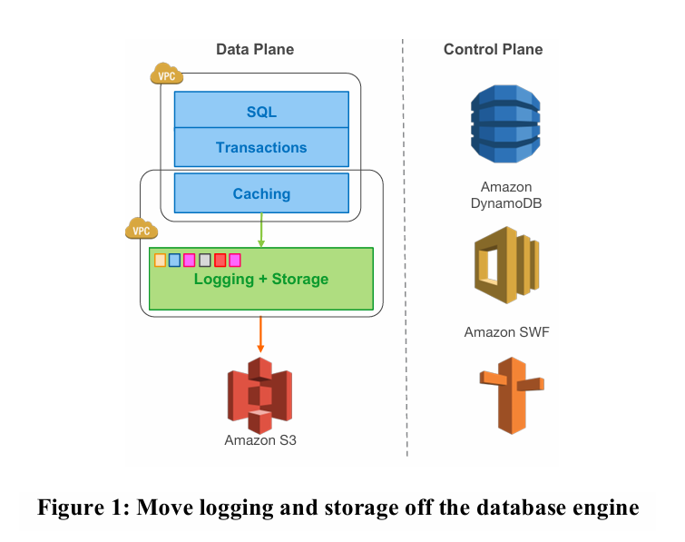

传统数据库系统面临的 I/O 瓶颈在这种环境下发生了变化。由于 I/O 可以分散到多租户集群中的众多节点和磁盘上，单个磁盘和节点不再成为热点。相反，**瓶颈转移到了请求 I/O 的数据库层与执行 I/O 的存储层之间的网络。** 除了每秒数据包数 (PPS) 和带宽这些基本瓶颈之外，由于高性能数据库会并行地向存储集群发出写操作，流量还会被放大。性能最差的存储节点、磁盘或网络路径可能会主导响应时间。

尽管数据库中的大多数操作可以相互重叠，但仍存在一些需要同步操作的场景。这些场景会导致停顿和上下文切换。其中一种场景是由于数据库缓冲区缓存未命中而触发的磁盘读取。读取线程在读取完成之前无法继续执行。缓存未命中还可能导致驱逐并刷出一个脏缓存页以容纳新页面，从而产生额外代价。后台处理（如 checkpoint 和脏页写出）可以减少这种代价的发生，但也可能引起停顿、上下文切换和资源争用。

事务提交是另一种干扰源；一个事务提交的停顿可能阻碍其他事务的推进。在多阶段同步协议（如两阶段提交 2PC）[3][4][5] 中处理提交在云规模的分布式系统中极具挑战。这些协议不耐受故障，而大规模分布式系统存在持续的软硬件故障"背景噪声"。它们也具有高延迟，因为大规模系统分布在多个数据中心之间。

在本文中，我们介绍 Amazon Aurora，这是一项通过更积极地利用 redo 日志来应对上述问题的新型数据库服务，其架构横跨一个高度分布式云环境。我们采用了一种新颖的面向服务架构（见图 1），其中包含一个多租户横向扩展存储服务，该服务抽象出一个虚拟化分段 redo 日志，并松散耦合到一组数据库实例上。**尽管每个实例仍然包含传统内核的大部分组件（查询处理器、事务、锁、缓冲区缓存、访问方法和 undo 管理），但若干功能（redo 日志记录、持久存储、崩溃恢复和备份/恢复）被卸载到存储服务中。**

我们的架构相较传统方法具有三大显著优势。第一，通过将存储构建为跨多个数据中心的独立容错自愈服务，我们保护数据库免受网络或存储层的性能波动以及瞬时或永久故障的影响。我们观察到，持久性故障可以建模为一种长时间的可用性事件，而可用性事件也可以建模为一种长时间的性能波动——一个设计良好的系统可以统一处理这些问题 [42]。第二，通过仅将 redo 日志记录写入存储，我们能够将网络 IOPS 降低一个数量级。一旦消除了这个瓶颈，我们就能积极优化其他许多争用点，从而在 MySQL 代码库的基础上获得了显著的吞吐量提升。第三，我们将一些最复杂和最关键的功能（备份和 redo 恢复）从数据库引擎中一次性昂贵操作迁移到在整个大规模分布式集群中摊销的持续性异步操作中。这实现了近乎即时的崩溃恢复而无需 checkpoint，以及不影响前台处理的廉价备份。

本文描述了三项贡献：

1. 如何在云规模下推理持久性，以及如何设计能够抵御关联故障的仲裁系统（第 2 节）。
2. 如何通过将传统数据库的底层四分之一卸载到存储层来利用智能存储（第 3 节）。
3. 如何在分布式存储中消除多阶段同步、崩溃恢复和 checkpoint（第 4 节）。

然后在第 5 节中展示如何将这三点理念结合起来设计 Aurora 的整体架构，接着在第 6 节中回顾性能结果，在第 7 节分享经验教训。最后在第 8 节简要综述相关研究，在第 9 节给出结论。

---

## 2. 规模化持久性

如果说数据库系统还有什么必须履行的契约，那就是数据一旦写入，就必须能够读取。但并非所有系统都能做到。在本节中，我们讨论仲裁模型背后的原理、为何要对存储分段，以及这两者如何结合不仅提供持久性、可用性和降低抖动，还帮助我们解决大规模管理存储集群的运维问题。

### 2.1 复制与关联故障

实例的生命周期与存储的生命周期并不相关。实例会故障，客户会关闭它们，会根据负载进行弹性扩缩。出于这些原因，将存储层与计算层解耦是有益的。

一旦这样做，**那些存储节点和磁盘也可能故障。因此必须以某种方式进行复制，以提供对故障的韧性和恢复能力。** 在大规模云环境中，节点、磁盘和网络路径的故障存在持续的低水平"背景噪声"。每个故障可能具有不同的持续时间和不同的影响范围。例如，可能出现到某个节点的短暂网络不可达、重启时的临时停机，或者磁盘、节点、机架、叶子或脊交换机甚至整个数据中心的永久故障。

**在复制系统中容错的常用方式是使用基于仲裁的投票协议** [6]。如果每个复制数据项的 V 个副本各分配一票，则读或写操作必须分别获得 Vr 票的读仲裁或 Vw 票的写仲裁。为达成一致性，仲裁必须满足两条规则。首先，每次读取必须能感知最近的写入，即满足 Vr + Vw > V。此规则确保读取所用节点集合与写入所用节点集合存在交集，读仲裁中至少包含一个具有最新版本的节点。其次，每次写入必须感知最近的写入以避免冲突写入，即满足 Vw > V/2。

容单节点丢失的常见方法是将数据复制到 (V = 3) 个节点，并依赖 2/3 (Vw = 2) 的写仲裁和 2/3 (Vr = 2) 的读仲裁。

**我们认为 2/3 仲裁是不充分的。** 要理解原因，首先需要了解 AWS 中可用区 (AZ) 的概念。AZ 是区域 (Region) 的一个子集，通过低延迟链路连接到区域内的其他 AZ，但在电力、网络、软件部署、洪水等大多数故障方面相互隔离。将数据副本分布到多个 AZ 可以确保大规模场景下的典型故障模式只影响一个数据副本。这意味着只需简单地将三个副本分别放在不同的 AZ 中，即可在抵抗较小的个别故障的同时也容忍大规模事件。

然而，在大规模存储集群中，故障的背景噪声意味着在任何给定时刻，某些磁盘或节点可能已经故障并正在被修复。这些故障可能独立地分布在 AZ A、B 和 C 的节点上。但如果 AZ C 因火灾、屋顶倒塌、洪水等原因发生故障，那么对于同时存在 AZ A 或 AZ B 中故障的副本而言，仲裁将被打破。在那时，在 2/3 读仲裁模型下，我们将丢失两个副本，无法判断第三个是否是最新版本。换句话说，当各 AZ 中的副本的单独故障是互不相关的时候，单个 AZ 的故障却是该 AZ 中所有磁盘和节点的关联故障。仲裁必须同时容忍 AZ 故障和并发发生的背景噪声故障。

在 Aurora 中，我们选择的设计点是容忍：(a) 丢失整个 AZ 和一个额外节点 (AZ+1) 而不丢失数据，以及 (b) 丢失整个 AZ 而不影响写入数据的能力。我们通过将每个数据项跨 3 个 AZ 复制 6 份，每个 AZ 中各 2 份来实现。**我们采用 6 票 (V = 6)、写仲裁 4/6 (Vw = 4)、读仲裁 3/6 (Vr = 3) 的仲裁模型。有了这个模型，我们可以 (a) 丢失单个 AZ 和一个额外节点（共 3 个节点故障）而不丧失读可用性，以及 (b) 丢失任意两个节点（包括单个 AZ 故障）且仍保持写可用性。确保读仲裁使我们能够通过添加额外的副本副本来重建写仲裁。**

### 2.2 分段存储
**让我们审视 AZ+1 是否提供了足够的持久性。要在此模型中提供足够的持久性，必须确保在修复其中一个故障所需的时间（平均修复时间 — MTTR）内，不相关故障发生双重故障的概率（平均故障间隔 — MTTF）足够低。如果双重故障概率过高，我们可能在 AZ 故障时遭遇双重故障，从而打破仲裁。在超过一定程度后，降低独立故障的 MTTF 概率非常困难。我们转而专注于降低MTTR，以缩小双重故障的脆弱窗口。我们通过将数据库卷划分为小的固定大小分段（目前为 10GB）来实现这一点。** 这些分段以 6 副本方式复制到保护组 (PG) 中，每个 PG 由 6 个 10GB 分段组成，分布在三个 AZ 中，每个 AZ 两个分段。存储卷是一组串联的 PG，物理上使用 Amazon Elastic Compute Cloud (EC2) 上配备本地 SSD 的虚拟主机构成的大型存储节点集群来实现。构成卷的 PG 随卷增长而分配。目前支持的卷最多可增长到未复制基础上的 64 TB。

分段现在是我们独立的背景噪声故障和修复单元。我们监控并自动修复服务中的故障。一个 10GB 分段可以在 10Gbps 网络链路上 10 秒内完成修复。我们需要在同一个 10 秒窗口内发生两个这样的故障，再加上一个不包含这两个独立故障的 AZ 故障，才会丢失仲裁。以我们实际观察到的故障率，即使考虑到我们为众多客户管理的数据库数量，这种情况也极不可能发生。

### 2.3 韧性的运维优势

一旦设计出对长时间故障具有天然韧性的系统，它自然也对较短时间的故障具有韧性。一个能应对 AZ 长期丢失的存储系统，也能应对电力事件或需要回滚的错误软件部署导致的短暂中断。一个能应对仲裁成员数秒不可用的系统，也能应对短暂的网络拥塞或存储节点负载。

由于我们的系统对故障有很高的容忍度，我们可以利用这一点来完成导致分段不可用的维护操作。例如，热量管理非常简单。我们可以将热磁盘或热节点上的某个分段标记为损坏，仲裁将通过迁移到集群中的其他较冷节点迅速修复。操作系统和安全补丁对该存储节点来说只是一个短暂的不可用事件。甚至存储集群的软件升级也是通过这种方式管理的。我们一次在一个 AZ 上执行升级，并确保同一 PG 中不超过一个成员同时被升级。这使我们能够在存储服务中采用敏捷方法和快速部署。

---

## 3. 日志即数据库

在本节中，我们将解释为什么在第 2 节描述的分段复制存储系统上使用传统数据库，会带来网络 I/O 和同步停顿方面的难以承受的性能负担。然后我们阐述将日志处理卸载到存储服务的方法，并通过实验证明该方法如何显著减少网络 I/O。最后，我们描述在存储服务中用于最小化同步停顿和不必要写入的各种技术。

### 3.1 写入放大的负担

将存储卷分段并对每个分段以 4/6 写仲裁进行 6 副本复制的模型给我们带来了高韧性。不幸的是，对于 MySQL 这样的传统数据库而言，每个应用写入会产生许多不同的实际 I/O，这一模型将导致难以承受的性能。高 I/O 量因复制而被放大，带来了沉重的每秒数据包数 (PPS) 负担。同时，这些 I/O 会产生同步点，导致流水线停顿和延迟增加。虽然链式复制 [8] 及其替代方案可以降低网络成本，但它们仍然面临同步停顿和累加延迟的问题。

让我们审视传统数据库中的写操作是如何工作的。像 MySQL 这样的系统会将数据页写入其暴露的对象（如堆文件、B 树等），同时将 redo 日志记录写入预写日志 (WAL)。每个 redo 日志记录由被修改页面的后像与前像之间的差异组成。日志记录可以应用到页面的前像上以生成其后像。

在实践中，还需要写入其他数据。例如，考虑一个如图 2 所示的同步镜像 MySQL 配置，该配置在数据中心之间实现高可用，并以主备模式运行。AZ1 中有一个 Active 的 MySQL 实例，其网络存储使用 Amazon Elastic Block Store (EBS)。AZ2 中有一个 Standby 的 MySQL 实例，同样使用 EBS 作为网络存储。对主 EBS 卷的写入通过软件镜像与备 EBS 卷同步。

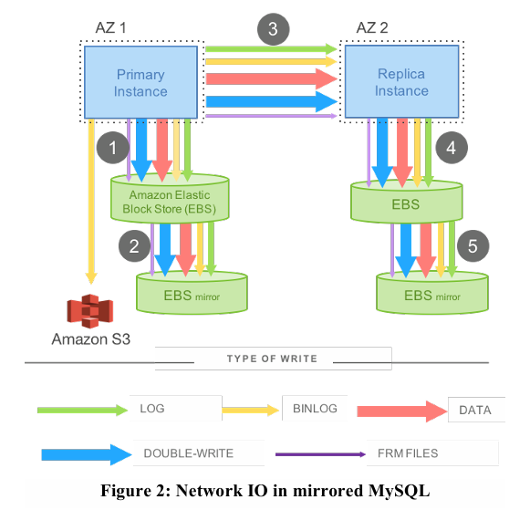

图 2 展示了引擎需要写入的各种数据类型：redo 日志、归档到 Amazon Simple Storage Service (S3) 以支持时间点恢复的二进制日志、修改后的数据页、为防止部分页写入而对数据页进行的第二次临时写入（双写），以及元数据 (FRM) 文件。该图还显示了实际 IO 流的顺序。在步骤 1 和 2 中，写入被发往 EBS，EBS 进而将其发往 AZ 本地镜像，两个都完成后收到确认。接着在步骤 3 中，写入通过同步块级软件镜像被传递到 Standby 实例。最后在步骤 4 和 5 中，写入分别被写到 Standby EBS 卷及其关联镜像上。

上述镜像 MySQL 模型不仅因为数据写入的方式而不可取，也因为写入的数据内容而不可取。首先，步骤 1、3 和 5 是顺序且同步的。由于许多写入是顺序的，延迟是累加的。即使异步写入，抖动也会被放大，因为必须等待最慢的操作完成，使系统受制于异常值。从分布式系统的角度看，该模型可以视为 4/4 写仲裁，容易受到故障和异常性能的影响。其次，OLTP 应用产生的用户操作会引发多种不同类型的写入，这些写入常常以多种方式表示相同的信息——例如，为防止存储基础设施中的部分页写入而进行的双写缓冲区的写入。

### 3.2 将 Redo 处理卸载到存储

当传统数据库修改数据页时，它会生成一条 redo 日志记录并调用日志应用器，将该 redo 日志记录应用到页面在内存中的前像以生成后像。**事务提交要求日志必须被写入，但数据页的写入可以延迟。**

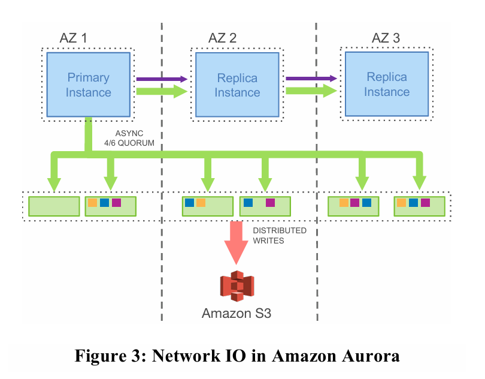

**在 Aurora 中，跨网络传输的只有 redo 日志记录。** 数据库层不会写出任何页面——不用于后台写入，不用于 checkpoint，也不用于缓存驱逐。相反，**日志回放被下推到存储层，在那里可以在后台或按需生成数据库页面。** 当然，从头开始从完整的修改链生成每个页面是极其昂贵的。因此，我们持续在后台物化数据库页面，避免每次需要时都从零重新生成。注意，后台物化从正确性的角度来看完全是可选的：对引擎而言，**日志就是数据库**，存储系统物化的任何页面只是日志应用的缓存。还要注意，与 checkpoint 不同，只有具有长修改链的页面才需要重新物化。Checkpoint由整个redo日志链的长度决定，而Aurora的页面物化由给定页面的链长度决定。

尽管为了复制而放大了写入，我们的方法仍显著减少了网络负载，并同时提供了性能和持久性保障。存储服务可以以令人尴尬的并行方式扩展 I/O，而不会影响数据库引擎的写入吞吐量。

例如，图 3 展示了一个 Aurora 集群，其中一个 Primary 实例和多个 Replica 实例部署在多个 AZ 中。在此模型中，Primary仅将日志记录写入存储服务，并将这些日志记录以及元数据更新流式传输给 Replica实例。IO流将基于共同目的地（逻辑分段，即PG）的完全有序日志记录进行批处理，并将每个批次投递到全部6个副本上，批次在磁盘上持久化后数据库引擎等待其中4个副本的确认以满足写仲裁，并将相关日志记录视为已持久化或已硬化。Replica使用redo日志记录对其缓冲区缓存应用更改。

为了度量网络 I/O，我们使用 SysBench [9] 的 write-only 工作负载对上述两种配置进行了测试：一种跨多个 AZ 的同步镜像 MySQL 配置，另一种是带有跨多 AZ Replica 的 RDS Aurora 配置。两者均使用 100GB 数据集，在 r3.8xlarge EC2 实例上运行 30 分钟。

**表 1: Aurora vs MySQL 的网络 IO**

| 配置 | 事务数 | IO/事务 |
|---|---|---|
| 镜像 MySQL | 780,000 | 7.4 |
| Aurora（含 Replica） | 27,378,000 | 0.95 |

实验结果汇总于表 1。在 30 分钟期间内，Aurora 能够维持比镜像 MySQL 多 35 倍的事务数。尽管 Aurora 将写操作放大了六倍，并且未计入 EBS 内的链式复制和 MySQL 的跨 AZ 写入，Aurora 数据库节点上每事务的 I/O 数量仍比镜像 MySQL 少 7.7 倍。每个存储节点看到的写入是未放大的（因为它只是六个副本中的一个），因此在此层需要处理的 I/O 少了 46 倍。通过向网络写入更少的数据所节省的资源，使我们能够积极复制数据以保障持久性和可用性，并并行发出请求以最小化抖动的影响。

将处理迁移到存储服务还通过缩短崩溃恢复时间来提高可用性，并消除了 checkpoint、后台数据页写出和备份等后台进程引起的抖动。

让我们审视崩溃恢复。*在传统数据库中，崩溃后系统必须从最近的 checkpoint 开始，重放日志以确保所有持久化的 redo 记录都已被应用。在 Aurora 中，持久的 redo 记录应用发生在存储层，持续地、异步地、分布在整个集群中进行。任何对数据页的读请求，如果页面不是最新的，可能就需要应用一些 redo 记录。因此，崩溃恢复的过程分散在所有正常的前台处理中。* **数据库启动时无需做任何特殊操作。**

### 3.3 存储服务设计要点

我们**存储服务的核心设计原则是最小化前台写入请求的延迟。** 我们将大部分存储处理移到后台。考虑到存储层前台请求的峰值与均值之间的自然波动，我们有足够的时间在后台路径之外完成这些任务。我们还可以用 CPU 换取磁盘资源。例如，当存储节点忙于处理前台写入请求时，不必运行旧页面版本的垃圾回收 (GC)，除非磁盘空间即将耗尽。在 Aurora 中，后台处理与前台处理呈负相关。这与传统数据库不同，在传统数据库中，后台页面写出和 checkpoint 与系统的前台负载呈正相关。如果系统积累了积压，我们会限制前台活动以防止长队列堆积。由于分段以高熵分布在我们系统中的各个存储节点上，单个存储节点的限流很容易通过我们的 4/6 仲裁写入处理，表现为一个慢节点。

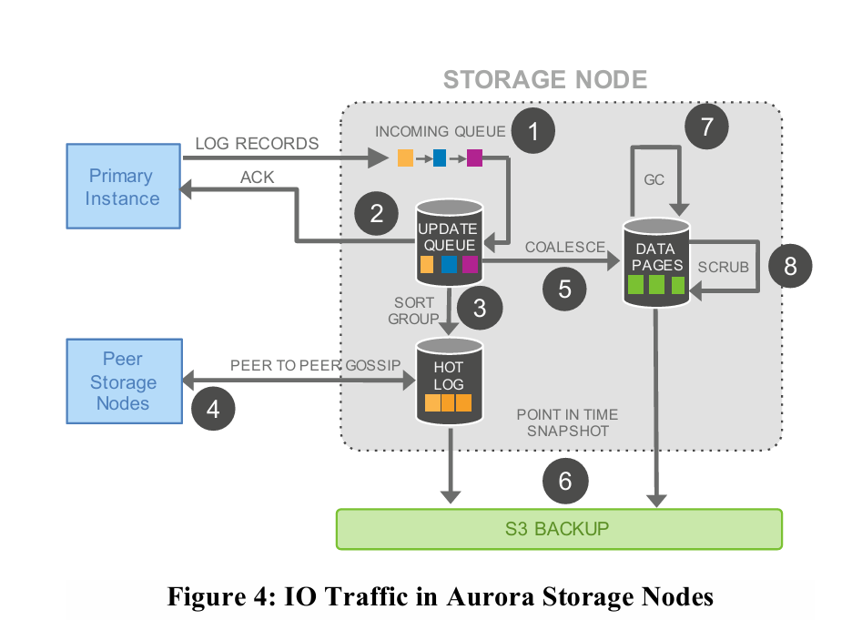

让我们更详细地审视存储节点上的各种活动。如图 4 所示，它涉及以下步骤：(1) 接收日志记录并添加到内存队列中，(2) 将记录持久化到磁盘并确认，(3) 组织记录并识别日志中的缺口（因为某些批次可能丢失），(4) 与对等节点 gossip 以填补缺口，(5) 将日志记录合并为新的数据页，(6) 定期将日志和新页面暂存至 S3，(7) 定期回收旧版本，最后 (8) 定期验证页面上的 CRC 代码。

注意，上述每个步骤不仅是异步的，只有步骤 (1) 和 (2) 处于可能影响延迟的前台路径中。

---

## 4. 日志持续向前推进

在本节中，我们将描述日志如何从数据库引擎生成，以使持久状态、运行时状态和 Replica 状态始终保持一致。特别是，我们将描述如何高效地实现一致性，无需昂贵的 2PC 协议。首先，我们展示如何避免崩溃恢复时昂贵的 redo 处理。接下来，解释正常运行以及如何维护运行时状态和 Replica 状态。最后，提供恢复过程的细节。

### 4.1 方案概述：异步处理

由于我们将数据库建模为 redo 日志流（如第 3 节所述），我们可以利用日志作为有序变更序列向前推进的事实。在实践中，每条日志记录都有一个关联的日志序列号 (LSN)，这是一个由数据库生成的单调递增的值。

这使我们能够通过异步方式而非使用诸如2PC这样繁重且不耐受故障的协议，来简化维护状态的共识协议。**在高层面上，我们维护一致性和持久性点，并在收到未完成存储请求的确认后持续推进这些点。** 由于任何单个存储节点可能丢失了一条或多条日志记录，它们会与 PG 中的其他成员进行 gossip，查找缺口并填补空洞。数据库维护的运行时状态使我们能够在非恢复场景中使用单分段读取而非仲裁读取——仅在状态已丢失且必须重建的恢复场景中才需要仲裁读取。

数据库可能有多个未完成的相互隔离的事务，这些事务可能以不同于发起顺序的顺序完成（达到完成和持久状态）。假设数据库崩溃或重启，是否回滚的决策对每个单独的事务是独立的。跟踪部分完成事务并撤销它们的逻辑保留在数据库引擎中，就像它只是在写入简单磁盘一样。然而，在重启后，在数据库被允许访问存储卷之前，存储服务会进行自己的恢复，该恢复不关注用户级事务，而是确保尽管存储具有分布式特性，数据库仍能看到一个统一的存储视图。

**存储服务确定其可以保证所有先前日志记录可用的最高LSN（这被称为VCL或Volume Complete LSN，卷完整点）。** 在存储恢复期间，所有LSN大于VCL的日志记录必须被截断。 然而，数据库可以通过标记日志记录并将其标识为CPL（Consistency Point LSN，一致性点）来进一步约束允许截断的点子集。因此，我们定义 VDL（Volume Durable LSN，卷持久点）为小于或等于VCL的最高CPL，并截断所有LSN大于VDL的日志记录。例如，即使我们拥有直到 LSN 1007 的完整数据，数据库可能只声明 900、1000 和 1100 是 CPL，此时我们必须在 1000 处截断。我们到 1007 是完整的，但只持久到 1000。

完整性和持久性因此是不同的，CPL可以被认为是划分了某种必须按顺序接受的有限形式的存储系统事务。如果客户端不需要这种区分，它可以简单地将每条日志记录标记为CPL。在实践中，数据库与存储的交互如下：
1. 每个数据库级事务被分解为多个 mini-transaction (MTR)，它们有序且必须原子执行。
2. 每个 mini-transaction 由多个连续的日志记录组成（数量根据需要）。
3. mini-transaction中的最后一条日志记录是CPL。

在恢复时，数据库与存储服务通信以确定每个 PG 的持久点，使用它来建立 VDL，然后发出命令截断 VDL 之上的日志记录。

### 4.2 正常运行

现在我们描述数据库引擎的"正常运行"，依次关注写入、读取、提交和 Replica。

#### 4.2.1 写入

在Aurora中，数据库持续与存储服务交互，并维护状态以建立仲裁、推进卷持久性，并将事务注册为已提交。例如，在正常/前向路径中，当数据库收到确认以达到每批日志记录的写仲裁时，它会推进当前的 VDL。在任何给定时刻，数据库中可能有大量并发事务处于活动状态，每个事务生成自己的 redo 日志记录。**数据库为每条日志记录分配唯一的顺序 LSN，受限于一个约束：分配的 LSN 值不得大于当前 VDL 与一个常数 LSN Allocation Limit (LAL)（当前设置为 1000 万）之和。此限制确保数据库不会远远领先于存储系统，并引入了背压，如果存储或网络跟不上，可以限制传入的写入。**

注意，每个 PG 的每个分段只看到卷中日志记录的一个子集，即那些影响该分段上页面的记录。每条日志记录包含一个回链，用于标识该 PG 的前一条日志记录。这些回链可用于跟踪已到达每个分段的日志记录的完整程度，从而建立 Segment Complete LSN (SCL)，该值标识了该 PG 的所有日志记录均已接收的最高 LSN。SCL 在存储节点相互 gossip 时用于查找和交换缺失的日志记录。

#### 4.2.2 提交

在Aurora中，事务提交是异步完成的。当客户端提交事务时，处理提交请求的线程将该事务搁置，将其"提交 LSN"记录为等待提交的事务列表的一部分，然后继续执行其他工作。相当于 WAL 协议的是：当且仅当最新的 VDL 大于或等于事务的提交 LSN 时，提交才算完成。随着 VDL 向前推进，数据库识别出符合条件的等待提交事务，并使用一个专用线程向等待的客户端发送提交确认。工作线程不会因提交而暂停，它们只是拉取其他待处理的请求并继续处理。

#### 4.2.3 读取

在 Aurora 中，与大多数数据库一样，页面从缓冲区缓存中提供，仅当所请求的页面不在缓存中时才会产生存储 IO 请求。

如果缓冲区缓存已满，系统会找到一个牺牲页从缓存中驱逐。在传统系统中，如果牺牲页是"脏页"，则在替换前将其刷入磁盘。这是为了确保后续对页面的获取始终能拿到最新数据。虽然 Aurora 数据库在驱逐时（或在任何其他地方）不会写出页面，但它强制执行类似的保证：**缓冲区缓存中的页面必须始终是最新版本**。该保证通过仅在页面的"页面 LSN"（标识与该页面最近一次更改关联的日志记录）大于或等于 VDL 时驱逐页面来实现。此协议确保：(a) 页面中的所有更改已在日志中硬化，(b) 在缓存未命中时，只需请求截至当前 VDL 的页面版本即可获得其最新持久版本。

在正常情况下，数据库不需要通过读仲裁来达成共识。当从磁盘读取页面时，数据库建立一个读点 (read-point)，代表发出请求时的 VDL。然后数据库可以选择一个相对于该读点完整的存储节点，知道它将因此接收到一个最新版本。存储节点返回的页面必须与数据库中 mini-transaction (MTR) 的预期语义一致。由于数据库直接管理向存储节点提供日志记录和跟踪进度（即每个分段的 SCL），它通常知道哪个分段能够满足读请求（SCL 大于读点的分段），因此可以直接向拥有足够数据的分段发出读请求。

鉴于数据库了解所有未完成的读请求，它可以随时按每个 PG 计算最小读点 LSN。如果有读 Replica，Writer 会与它们 gossip 以确定跨所有节点的按 PG 的最小读点 LSN。该值称为 Protection Group Min Read Point LSN (PGMRPL)，代表"低水位线"，低于该水位线的该 PG 的所有日志记录都是不需要的。换句话说，存储节点分段保证不会收到读点低于 PGMRPL 的读页面请求。每个存储节点从数据库获知 PGMRPL，因此可以通过合并较旧的日志记录然后安全地回收它们来推进磁盘上已物化的页面。实际的并发控制协议在数据库引擎中执行，就像数据库页面和 undo 分段像传统 MySQL 一样组织在本地存储中。

#### 4.2.4 Replica
在Aurora中，单个Writer和最多15个读Replica都可以挂载一个共享的存储卷。因此，读Replica不会在存储消耗或磁盘写入操作方面增加额外成本。为最小化延迟，Writer生成并发送到存储节点的日志流也会发送到所有读Replica。在Reader中，数据库通过依次处理每条日志记录来消费此日志流。如果日志记录引用Reader缓冲区缓存中的页面，它使用日志回放将指定的redo操作应用到缓存中的页面。否则直接丢弃该日志记录。注意，Replica从Writer的角度是异步消费日志记录的，Writer 在确认用户提交时不依赖于Replica。Replica在应用日志记录时遵循以下两条重要规则：(a) 只有LSN小于或等于VDL的日志记录才会被应用，(b) 属于单个mini-transaction的日志记录在Replica的缓存中原子地应用，确保 Replica 看到所有数据库对象的一致性视图。在实践中，每个 Replica 通常落后于 Writer 一个短暂的时间间隔（20 ms 或更短）。

### 4.3 恢复

大多数传统数据库使用诸如 ARIES [7] 的恢复协议，该协议依赖预写日志 (WAL) 的存在，WAL 可以表示所有已提交事务的精确内容。这些系统还会定期对数据库进行 checkpoint——以粗粒度方式将脏页刷入磁盘并将 checkpoint 记录写入日志以建立持久性点。重新启动时，任何给定页面可能缺失某些已提交数据或包含未提交数据。因此，崩溃恢复时系统使用日志应用器处理自最近 checkpoint 以来的 redo 日志记录，将每条日志记录应用到相关的数据库页面上。此过程将数据库页面恢复到故障点的一致性状态，之后可以通过执行相关的 undo 日志记录来回滚崩溃期间的在途事务。崩溃恢复可能是昂贵的操作。缩短 checkpoint 间隔有帮助，但代价是干扰前台事务。**在 Aurora 中则不需要这种权衡。**

传统数据库的一个很棒的精简原则是，在前向处理路径中使用相同的 redo 日志应用器，在恢复时也一样——只不过恢复时应用器同步地在前台运行，且数据库处于离线状态。我们在 Aurora 中也依赖相同的原则，只是 redo 日志应用器与数据库解耦，在存储节点上并行地、全天候在后台运行。一旦数据库启动，它会与存储服务协作执行卷恢复，因此 Aurora 数据库可以非常快速地恢复（通常在 10 秒内），即使它在处理每秒超过 100,000 条写语句时崩溃也是如此。

崩溃后数据库确实需要重建其运行时状态。在这种情况下，它为每个 PG 联系一个读仲裁的分段，这足以保证发现任何可能已达成写仲裁的数据。一旦数据库为每个 PG 建立了读仲裁，它就可以重新计算 VDL，在 VDL 之上截断数据——通过生成一个截断范围，使新 VDL 之后的每条日志记录失效，最多包含一个数据库可以证明至少与曾经可能出现的最高未完成日志记录一样高的结束 LSN。数据库通过它分配 LSN 并限制分配可以超过 VDL 多远（前述的 1000 万限制）来推断此上限。截断范围带有版本化的 epoch 号码，并持久写入存储服务，这样即使恢复被中断和重启，也不会对截断的持久性产生混淆。

数据库仍需要执行 undo 恢复以回滚崩溃时在途事务的操作。然而，undo 恢复可以在数据库在线后进行，系统从 undo 分段构建这些在途事务的列表后即可进行。

---

## 5. 系统总览

在本节中，我们结合图5来描述 Aurora 的构建模块。

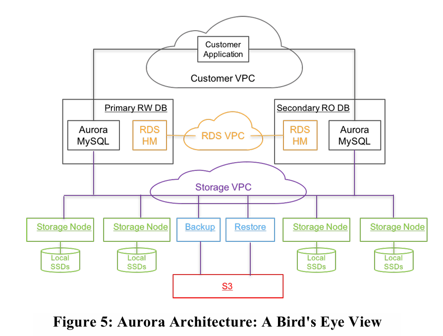

数据库引擎是"社区版"MySQL/InnoDB 的一个分支，主要在 InnoDB 如何读写数据到磁盘方面有所不同。在社区版 InnoDB 中，写操作导致数据在缓冲页面中被修改，关联的 redo 日志记录按 LSN 顺序写入 WAL 的缓冲区。事务提交时，WAL 协议仅要求事务的 redo 日志记录被持久写入磁盘。实际修改的缓冲页面最终也会通过双写技术写入磁盘以避免部分页写入。这些页面写入在后台、缓存驱逐时或进行 checkpoint 时进行。除了 I/O 子系统，InnoDB 还包括事务子系统、锁管理器、B+ 树实现以及关联的"mini-transaction"(MTR) 概念。MTR 是仅在 InnoDB 内部使用的构造，用于建模必须原子执行的操作组（例如 B+ 树页面的分裂/合并）。

在 Aurora 的 InnoDB 变体中，表示每个 MTR 中必须原子执行的更改的 redo 日志记录，被组织成按每条日志记录所属 PG 分片的批次，这些批次被写入存储服务。每个 MTR 的最后一条日志记录被标记为一致性点。Aurora 在 Writer 中支持与社区版 MySQL 完全相同的隔离级别（标准 ANSI 级别和快照隔离/一致性读）。Aurora 读 Replica 持续获取 Writer 中事务开始和提交的信息，并用这些信息为本地事务（当然只读）提供快照隔离。注意，并发控制完全在数据库引擎中实现，不影响存储服务。存储服务提供底层数据的统一视图，在逻辑上与将数据写入社区版 InnoDB 的本地存储完全相同。

Aurora 利用 Amazon Relational Database Service (RDS) 作为其控制面。RDS 在数据库实例上包含一个称为 Host Manager (HM) 的代理，该代理监控集群的健康状况，判断是否需要故障切换或替换实例。每个数据库实例是一个集群的一部分，集群包含一个 Writer 和零个或多个读 Replica。集群的实例位于单个地理区域（如 us-east-1、us-west-1 等），通常部署在不同的 AZ 中，并连接到同一区域的存储集群。出于安全考虑，我们隔离了数据库、应用和存储之间的通信。实际上，每个数据库实例可以在三个 Amazon Virtual Private Cloud (VPC) 网络上通信：客户 VPC（客户应用通过它与引擎交互）、RDS VPC（数据库引擎和控制面通过它相互交互）和存储 VPC（数据库通过它与存储服务交互）。

存储服务部署在一个 EC2 VM 集群上，这些 VM 在每个区域至少跨 3 个 AZ 部署，共同负责配置多个客户存储卷、对卷进行读写以及备份和恢复数据。存储节点操作本地 SSD，并与数据库引擎实例、其他对等存储节点以及备份/恢复服务交互，后者持续将变更数据备份到 S3 并在需要时从 S3 恢复数据。存储控制面使用 Amazon DynamoDB 数据库服务来持久存储集群和存储卷配置、卷元数据以及备份到 S3 的数据的详细描述。对于协调长期运行的操作，例如数据库卷恢复操作或存储节点故障后的修复（重复制）操作，存储控制面使用 Amazon Simple Workflow Service。维持高可用性需要主动、自动、及早发现真实和潜在问题，以免最终用户受影响。存储操作的所有关键方面都在持续使用指标收集服务监控，如果关键性能或可用性指标显示令人担忧的迹象，会触发报警。

---

## 6. 性能结果

在本节中，我们将分享自 2015 年 7 月 Aurora 正式发布 (GA) 以来作为生产服务运行的经验。我们从运行行业标准基准测试的结果摘要开始，然后展示一些来自客户的性能结果。

### 6.1 标准基准测试结果

这里展示了使用 SysBench 和 TPC-C 变体等业界标准基准来比较 Aurora 和 MySQL 性能的不同实验结果。我们在挂载了 30K 预配置 IOPS EBS 卷的实例上运行 MySQL。除特别说明外，这些都是 r3.8xlarge EC2 实例，配备 32 vCPU 和 244GB 内存，使用 Intel Xeon E5-2670 v2 (Ivy Bridge) 处理器。r3.8xlarge 上的缓冲区缓存设置为 170GB。

#### 6.1.1 按实例规模扩展

在这个实验中，我们报告 Aurora 的吞吐量可以随实例规模线性扩展，在最高规格实例大小下可达 MySQL 5.6 和 MySQL 5.7 的 5 倍。注意，Aurora 目前基于 MySQL 5.6 代码库。我们针对 1GB 数据集（250 张表）在 r3 系列的 5 个 EC2 实例（large、xlarge、2xlarge、4xlarge、8xlarge）上运行了 SysBench read-only 和 write-only 基准。每个实例规格的 vCPU 和内存恰好是相邻更大规格的一半。

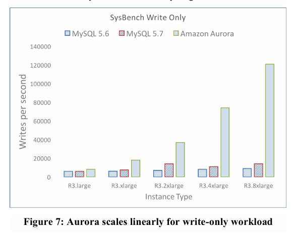

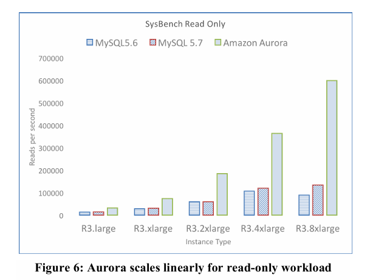

结果如图 7 和图 6 所示，分别以每秒写入和读取语句数来衡量性能。Aurora 的性能在每个更高的实例规格上翻倍，在 r3.8xlarge 上达到 121,000 writes/sec 和 600,000 reads/sec，是 MySQL 5.7（最高 20,000 reads/sec 和 125,000 writes/sec）的 5 倍。

#### 6.1.2 不同数据量下的吞吐量

在这个实验中，我们报告即使在更大数据量（包括超出缓存的工作集）下，Aurora 的吞吐量也显著超过 MySQL。表 2 显示，对于 SysBench write-only 工作负载，100GB 数据库大小下 Aurora 可以比 MySQL 快多达 67 倍。即使对于 1TB 数据库且超出缓存的工作负载，Aurora 仍比 MySQL 快 34 倍。

**表 2: SysBench Write-Only (writes/sec)**

| DB 大小 | Amazon Aurora | MySQL |
|---|---|---|
| 1 GB | 107,000 | 8,400 |
| 10 GB | 107,000 | 2,400 |
| 100 GB | 101,000 | 1,500 |
| 1 TB | 41,000 | 1,200 |

#### 6.1.3 按用户连接数扩展

在这个实验中，我们报告 Aurora 的吞吐量可以随客户端连接数扩展。表 3 显示了在连接数从 50 增长到 500 再到 5000 时，运行 SysBench OLTP 基准测试的结果（writes/sec）。Aurora 从 40,000 writes/sec 扩展到 110,000 writes/sec，而 MySQL 的吞吐量在约 500 连接时达到峰值，然后当连接数增长到 5000 时急剧下降。

**表 3: SysBench OLTP (writes/sec)**

| 连接数 | Amazon Aurora | MySQL |
|---|---|---|
| 50 | 40,000 | 10,000 |
| 500 | 71,000 | 21,000 |
| 5,000 | 110,000 | 13,000 |

#### 6.1.4 按 Replica 扩展

在这个实验中，我们报告 Aurora 读 Replica 的延迟显著低于 MySQL Replica，即使在工作负载更密集的情况下也是如此。表 4 显示，随着工作负载从 1,000 变化到 10,000 writes/second，Aurora 的 Replica 延迟从 2.62 毫秒增加到 5.38 毫秒。相比之下，MySQL 的 Replica 延迟从不足 1 秒增长到 300 秒。在 10,000 writes/second 下，Aurora 的 Replica 延迟比 MySQL 小几个数量级。Replica 延迟以已提交事务在 Replica 中可见所需时间来度量。

**表 4: SysBench Write-Only 的 Replica 延迟 (msec)**

| Writes/sec | Amazon Aurora | MySQL |
|---|---|---|
| 1,000 | 2.62 | < 1000 |
| 2,000 | 3.42 | 1000 |
| 5,000 | 3.94 | 60,000 |
| 10,000 | 5.38 | 300,000 |

#### 6.1.5 热行争用下的吞吐量

在这个实验中，我们报告 Aurora 在热行争用工作负载（如基于 TPC-C 基准的工作负载）下相比 MySQL 表现非常出色。我们在 r3.8xlarge 实例上对 Amazon Aurora 和 MySQL 5.6/5.7 运行了 Percona TPC-C 变体 [37]，MySQL 使用带有 30K 预配置 IOPS 的 EBS 卷。表 5 显示，随着工作负载从 500 连接和 10GB 数据大小变化到 5000 连接和 100GB 数据大小，Aurora 可维持 MySQL 5.7 的 2.3 倍到 16.3 倍吞吐量。

**表 5: Percona TPC-C 变体 (tpmC)**

| 连接数/大小/仓库数 | Amazon Aurora | MySQL 5.6 | MySQL 5.7 |
|---|---|---|---|
| 500/10GB/100 | 73,955 | 6,093 | 25,289 |
| 5000/10GB/100 | 42,181 | 1,671 | 2,592 |
| 500/100GB/1000 | 70,663 | 3,231 | 11,868 |
| 5000/100GB/1000 | 30,221 | 5,575 | 13,005 |

### 6.2 真实客户工作负载结果

在本节中，我们分享一些将生产工作负载从 MySQL 迁移到 Aurora 的客户所报告的结果。

#### 6.2.1 Aurora 的应用响应时间

一家互联网游戏公司将其生产服务从 MySQL 迁移到 r3.4xlarge 实例上的 Aurora。迁移前其 Web 交易的平均响应时间为 15 ms。相比之下，迁移后平均响应时间为 5.5 ms，提升了 3 倍，如图 8 所示。

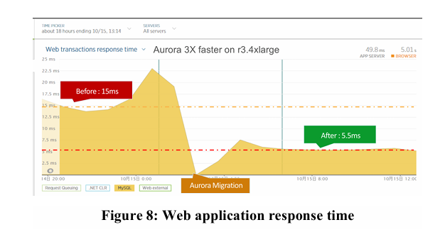

#### 6.2.2 Aurora 的语句延迟

一家帮助学校管理学生笔记本电脑的教育技术公司将其生产工作负载从 MySQL 迁移到 Aurora。迁移前后（于 14:00 时）的 SELECT 和逐条 INSERT 操作的中位数 (P50) 和第 95 百分位 (P95) 延迟如图 9 和图 10 所示。

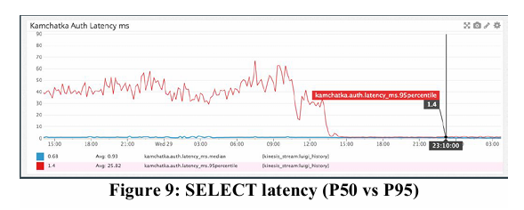

迁移前，P95 延迟在 40ms 到 80ms 之间，远比约 1ms 的 P50 延迟差得多。应用正经历本文前面所述的典型异常性能问题。

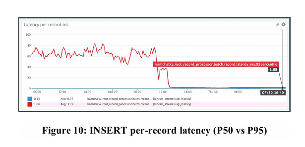

然而，迁移后两种操作的 P95 延迟都显著改善，趋近于 P50 延迟。

#### 6.2.3 多 Replica 的 Replica 延迟

MySQL Replica 通常显著落后于其 Writer，正如 Pinterest 的 Weiner [40] 所报告的，可能"引发奇怪的 bug"。对于前述教育技术公司，Replica 延迟常飙升至 12 分钟，影响应用正确性，因此该 Replica 只能作为 Standby 使用。相比之下，迁移到 Aurora 后，4 个 Replica 的最大延迟从未超过 20ms，如图 11 所示。Aurora 提供的改进 Replica 延迟使该公司能将很大一部分应用负载转移到 Replica 上，节省成本并提高可用性。

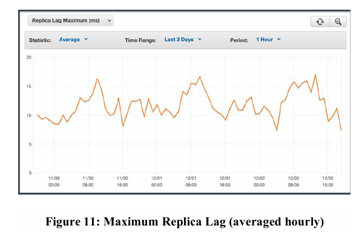

---

## 7. 经验教训

我们现在已经看到了从小型互联网公司到运营大量 Aurora 集群的高度复杂组织等各种客户运行的应用类型。虽然许多用例是标准的，但我们关注在云中常见并引领我们走向新方向的场景和期望。

### 7.1 多租户与数据库整合

我们的许多客户运营软件即服务 (SaaS) 业务，要么完全以 SaaS 模式运营，要么有一些他们试图迁移到 SaaS 模式的存量本地部署客户。我们发现这些客户通常依赖一个他们无法轻易改变的应用。因此，他们通常通过使用 schema/数据库作为租户单元，将不同客户整合到一个实例上。这种做法降低了成本：在所有客户不可能同时活跃的情况下，避免了为每个客户支付专用实例的费用。例如，我们的一些 SaaS 客户报告拥有超过 50,000 名自己的客户。

这种模式与 Salesforce.com [14] 等著名的多租户应用明显不同，后者使用多租户数据模型，将多个客户的数据打包到单一 schema 的统一表中，租户以按行方式标识。因此，我们看到许多客户拥有包含大量表的整合数据库。小型数据库拥有超过 150,000 张表的生产实例相当常见。这对管理元数据的组件（如字典缓存）产生了压力。更重要的是，这类客户需要 (a) 维持高吞吐量和大量并发用户连接，(b) 数据按需配置和付费的模式，因为很难提前预测需要多少存储空间，以及 (c) 降低抖动，使单个租户的峰值对其他租户的影响最小。Aurora 支持这些特性，非常适合此类 SaaS 应用。

### 7.2 高并发自动弹性扩缩工作负载

互联网工作负载经常需要应对基于突发意外事件的流量峰值。我们的一个重要客户在一档广受欢迎的全国性电视节目中亮相，经历了一次远超其正常峰值吞吐量的流量高峰，数据库毫无压力。为支持此类峰值，数据库必须能够处理大量并发连接。这种方法在 Aurora 中是可行的，因为底层存储系统扩展性极好。我们有多个客户的并发连接数超过 8000 个/秒。

### 7.3 Schema 演进

现代 Web 应用框架如 Ruby on Rails 深度集成了对象关系映射工具。因此，应用开发者很容易对数据库进行大量的 schema 变更，使得 DBA 难以管理 schema 的演进方式。在 Rails 应用中，这些被称为"数据库迁移"，我们一手听说有些 DBA 要么必须应对"每周几十次迁移"，要么需要制定对冲策略以确保未来的迁移能顺利进行。MySQL 本身提供宽松的 schema 演进语义并通过全表复制实现大部分变更，使问题更加恶化。由于频繁的 DDL 是一个务实的现实，我们实现了一个高效的在线 DDL 方案，该方案 (a) 按页面版本化 schema，按需根据其 schema 历史解码各个页面，(b) 使用 modify-on-write 原语惰性将各个页面升级到最新 schema。

### 7.4 可用性与软件升级

我们的客户对云原生数据库有着苛刻的期望，这可能与我们运营集群和打补丁服务器的方式产生冲突。由于客户主要将 Aurora 用作支持生产应用的 OLTP 服务，任何中断都可能是创伤性的。因此，许多客户对我们更新数据库软件的容忍度极低，即使这意味着大约每 6 周 30 秒的计划停机。因此，我们最近发布了一个新的零停机补丁 (ZDP) 功能，使我们可以在不中断正在进行中的数据库连接的情况下为用户打补丁。

如图 12 所示，ZDP 的工作方式是寻找一个没有活跃事务的瞬间，在该瞬间将应用状态暂存到本地临时存储，对引擎进行补丁，然后重新加载应用状态。在此过程中，用户会话保持活跃，不知道引擎在底层发生了变化。

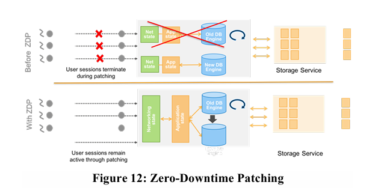

---

## 8. 相关研究

在本节中，我们讨论其他贡献及其与 Aurora 所采用方法的关联。

**计算与存储解耦。** 尽管传统系统通常作为单体内核构建 [27]，但近期有一些研究将数据库内核分解为不同的组件。例如，Deuteronomy [10] 就是这样一个系统，它将提供并发控制和恢复的事务组件 (TC) 与在 LLAMA [34]（一个无锁日志结构化缓存和存储管理器）之上提供访问方法的数据组件 (DC) 分离。Sinfonia [39] 和 Hyder [38] 是在横向扩展服务之上抽象事务性访问方法的系统，数据库系统可以使用这些抽象来实现。Yesquel [36] 系统实现了一个多版本分布式平衡树，并将并发控制与查询处理器分离。Aurora 在比 Deuteronomy、Hyder、Sinfonia 和 Yesquel 更低的层级上解耦存储。在 Aurora 中，查询处理、事务、并发、缓冲区缓存和访问方法与日志记录、存储和恢复分离，后者作为横向扩展服务实现。

**分布式系统。** 在分区条件下，正确性和可用性之间的权衡早已为人所知，主要结论是在网络分区下不可能实现单副本串行化 [15]。最近，Brewer 的 CAP 定理经 [16] 证明指出，高可用系统在网络分区存在的情况下无法提供"强"一致性保障。这些结果以及我们对云规模复杂和关联故障的经验，激励我们即使在 AZ 故障导致的分区存在的情况下也要实现一致性目标。

Bailis 等人 [12] 研究了提供高可用事务 (HAT) 的问题，这类事务在分区期间既不会不可用，也不会引发高网络延迟。他们表明，Serializability、Snapshot Isolation 和 Repeatable Read 隔离级别不符合 HAT 要求，而大多数其他隔离级别可以在高可用性下实现。Aurora 通过一个简化假设提供所有这些隔离级别，即任何时刻只有一个 Writer 从单个有序域中分配 LSN 来生成日志更新。

Google 的 Spanner [24] 提供了外部一致性 [25] 的读写以及跨数据库在某个时间戳上的全局一致性读取。这些特性使 Spanner 能够支持一致性备份、一致性分布式查询处理 [26] 和原子 schema 更新，全都在全球规模下，甚至在存在进行中事务的情况下。如 Bailis [12] 所解释的，Spanner 高度专为 Google 的读密集型工作负载设计，并依赖两阶段提交和两阶段锁定来处理读写事务。

**并发控制。** 较弱一致性 (PACELC [17]) 和隔离模型 [18][20] 在分布式数据库中已广为人知，并催生了乐观复制技术 [19] 以及最终一致性系统 [21][22][23]。在集中式系统中，其他方法包括基于锁定的经典悲观方案 [28]、乐观方案（如 Hekaton [29] 中的多版本并发控制）、分片方案（如 VoltDB [30]）以及 HyPer [31][32] 和 Deuteronomy 中的时间戳排序。Aurora 的存储服务为数据库引擎提供了持久化本地磁盘的抽象，允许引擎自行决定隔离和并发控制。

**日志结构化存储。** 日志结构化存储系统由 LFS [33] 于 1992 年提出。最近，Deuteronomy 及相关的 LLAMA [34] 和 Bw-Tree [35] 工作在存储引擎栈中以多种方式使用日志结构化技术，与 Aurora 一样，通过写入增量而非完整页面来减少写放大。Deuteronomy 和 Aurora 都实现了纯 redo 日志记录，并跟踪最高稳定 LSN 以确认提交。

**恢复。** 传统数据库依赖基于 ARIES [5] 的恢复协议，而最近一些系统出于性能考虑选择了其他路径。例如，Hekaton 和 VoltDB 使用某种形式的更新日志在崩溃后重建其内存状态。Sinfonia [39] 等系统通过使用进程对和状态机复制等技术避免了恢复。Graefe [41] 描述了一种具有逐页日志记录链的系统，可实现按需逐页 redo，使恢复变得快速。与 Aurora 类似，Deuteronomy 不需要 redo 恢复。这是因为 Deuteronomy 延迟事务，使得只有已提交的更新才会发布到持久存储。因此，与 Aurora 不同，Deuteronomy 中事务的大小可能受到限制。

---

## 9. 结论

我们将 Aurora 设计为高吞吐的 OLTP 数据库，在云规模环境中既不牺牲可用性也不牺牲持久性。**核心思想是摆脱传统数据库的单体架构，将存储与计算解耦。** 具体而言，我们将数据库内核的底层四分之一迁移到一个独立的可扩展分布式服务中，由该服务管理日志记录和存储。由于所有 I/O 都通过网络写入，我们面临的基本约束现在是网络。因此，我们需要专注于缓解网络压力和提高吞吐量的技术。我们依赖能够应对大规模云环境中发生的复杂关联故障并避免异常性能惩罚的仲裁模型，通过日志处理减少总 I/O 负担，以及异步共识来消除繁重且昂贵的多阶段同步协议、离线崩溃恢复和分布式存储中的 checkpoint。我们的方法产生了一个简化的架构，降低了复杂性，易于扩展，并为未来进步奠定了基础。

---

## 10. 致谢

我们感谢整个 Aurora 开发团队为这个项目付出的努力，包括当前成员以及我们卓越的校友（James Corey、Sam McKelvie、Yan Leshinsky、Lon Lundgren、Pradeep Madhavarapu 和 Stefano Stefani）。我们特别感谢那些在使用我们服务运营生产工作负载过程中慷慨分享经验和期望的客户。我们也感谢 shepherds 对本文成形提供的宝贵意见。

---

## 11. 参考文献

1. B. Calder, J. Wang, et al. Windows Azure storage: A highly available cloud storage service with strong consistency. In *SOSP 2011*.
2. O. Khan, R. Burns, J. Plank, W. Pierce, and C. Huang. Rethinking erasure codes for cloud file systems: Minimizing I/O for recovery and degraded reads. In *FAST 2012*.
3. P.A. Bernstein, V. Hadzilacos, and N. Goodman. *Concurrency control and recovery in database systems*, Chapter 7, Addison Wesley Publishing Company, ISBN 0-201-10715-5, 1997.
4. C. Mohan, B. Lindsay, and R. Obermarck. Transaction management in the R\* distributed database management system. *ACM TODS*, 11(4):378-396, 1986.
5. C. Mohan and B. Lindsay. Efficient commit protocols for the tree of processes model of distributed transactions. *ACM SIGOPS Operating Systems Review*, 19(2):40-52, 1985.
6. D.K. Gifford. Weighted voting for replicated data. In *SOSP 1979*.
7. C. Mohan, D.L. Haderle, B. Lindsay, H. Pirahesh, and P. Schwarz. ARIES: A transaction recovery method supporting fine-granularity locking and partial rollbacks using write-ahead logging. *ACM TODS*, 17(1): 94–162, 1992.
8. R. van Renesse and F. Schneider. Chain replication for supporting high throughput and availability. In *OSDI 2004*.
9. A. Kopytov. Sysbench Manual. Available at [http://imysql.com/wp-content/uploads/2014/10/sysbench-manual.pdf](http://imysql.com/wp-content/uploads/2014/10/sysbench-manual.pdf)
10. J. Levandoski, D. Lomet, S. Sengupta, R. Stutsman, and R. Wang. High performance transactions in deuteronomy. In *CIDR 2015*.
11. P. Bailis, A. Fekete, A. Ghodsi, J.M. Hellerstein, and I. Stoica. Scalable atomic visibility with RAMP Transactions. In *SIGMOD 2014*.
12. P. Bailis, A. Davidson, A. Fekete, A. Ghodsi, J.M. Hellerstein, and I. Stoica. Highly available transactions: virtues and limitations. In *VLDB 2014*.
13. R. Taft, E. Mansour, M. Serafini, J. Duggan, A.J. Elmore, A. Aboulnaga, A. Pavlo, and M. Stonebraker. E-Store: fine-grained elastic partitioning for distributed transaction processing systems. In *VLDB 2015*.
14. R. Woollen. The internal design of salesforce.com's multi-tenant architecture. In *SoCC 2010*.
15. S. Davidson, H. Garcia-Molina, and D. Skeen. Consistency in partitioned networks. *ACM CSUR*, 17(3):341–370, 1985.
16. S. Gilbert and N. Lynch. Brewer's conjecture and the feasibility of consistent, available, partition-tolerant web services. *SIGACT News*, 33(2):51–59, 2002.
17. D.J. Abadi. Consistency tradeoffs in modern distributed database system design: CAP is only part of the story. *IEEE Computer*, 45(2), 2012.
18. A. Adya. Weak consistency: a generalized theory and optimistic implementations for distributed transactions. PhD Thesis, MIT, 1999.
19. Y. Saito and M. Shapiro. Optimistic replication. *ACM Comput. Surv.*, 37(1), Mar. 2005.
20. H. Berenson, P. Bernstein, J. Gray, J. Melton, E. O'Neil, and P. O'Neil. A critique of ANSI SQL isolation levels. In *SIGMOD 1995*.
21. P. Bailis and A. Ghodsi. Eventual consistency today: limitations, extensions, and beyond. *ACM Queue*, 11(3), March 2013.
22. P. Bernstein and S. Das. Rethinking eventual consistency. In *SIGMOD*, 2013.
23. B. Cooper et al. PNUTS: Yahoo!'s hosted data serving platform. In *VLDB 2008*.
24. J. C. Corbett, J. Dean, et al. Spanner: Google's globally-distributed database. In *OSDI 2012*.
25. David K. Gifford. Information Storage in a Decentralized Computer System. Tech. rep. CSL-81-8. PhD dissertation. Xerox PARC, July 1982.
26. Jeffrey Dean and Sanjay Ghemawat. MapReduce: a flexible data processing tool. *CACM* 53(1):72-77, 2010.
27. J. M. Hellerstein, M. Stonebraker, and J. R. Hamilton. Architecture of a database system. *Foundations and Trends in Databases*. 1(2) pp. 141-259, 2007.
28. J. Gray, R. A. Lorie, G. R. Putzolu, I. L. Traiger. Granularity of locks in a shared data base. In *VLDB 1975*.
29. P-A Larson, et al. High-Performance Concurrency control mechanisms for main-memory databases. *PVLDB*, 5(4): 298-309, 2011.
30. M. Stonebraker and A. Weisberg. The VoltDB main memory DBMS. *IEEE Data Eng. Bull.*, 36(2): 21-27, 2013.
31. V. Leis, A. Kemper, et al. Exploiting hardware transactional memory in main-memory databases. In *ICDE 2014*.
32. H. Mühe, S. Wolf, A. Kemper, and T. Neumann: An evaluation of strict timestamp ordering concurrency control for main-memory database systems. In *IMDM 2013*.
33. M. Rosenblum and J. Ousterhout. The design and implementation of a log-structured file system. *ACM TOCS* 10(1): 26–52, 1992.
34. J. Levandoski, D. Lomet, S. Sengupta. LLAMA: A cache/storage subsystem for modern hardware. *PVLDB* 6(10): 877-888, 2013.
35. J. Levandoski, D. Lomet, and S. Sengupta. The Bw-Tree: A B-tree for new hardware platforms. In *ICDE 2013*.
36. M. Aguilera, J. Leners, and M. Walfish. Yesquel: scalable SQL storage for web applications. In *SOSP 2015*.
37. Percona Lab. TPC-C Benchmark over MySQL. Available at [https://github.com/Percona-Lab/tpcc-mysql](https://github.com/Percona-Lab/tpcc-mysql)
38. P. Bernstein, C. Reid, and S. Das. Hyder — A transactional record manager for shared flash. In *CIDR 2011*.
39. M. Aguilera, A. Merchant, M. Shah, A. Veitch, and C. Karamanolis. Sinfonia: A new paradigm for building scalable distributed systems. *ACM Trans. Comput. Syst.* 27(3): 2009.
40. M. Weiner. Sharding Pinterest: How we scaled our MySQL fleet. Pinterest Engineering Blog. Available at: [https://engineering.pinterest.com/blog/sharding-pinterest-how-we-scaled-our-mysql-fleet](https://engineering.pinterest.com/blog/sharding-pinterest-how-we-scaled-our-mysql-fleet)
41. G. Graefe. Instant recovery for data center savings. *ACM SIGMOD Record*. 44(2):29-34, 2015.
42. J. Dean and L. Barroso. The tail at scale. *CACM* 56(2):74-80, 2013.
