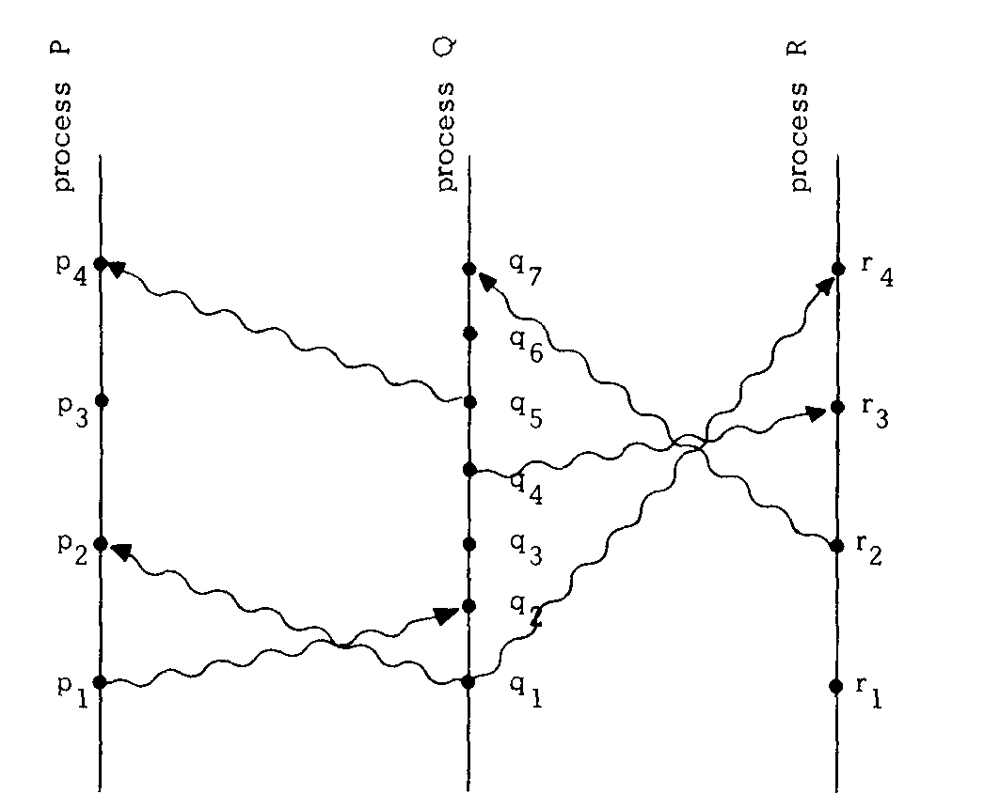
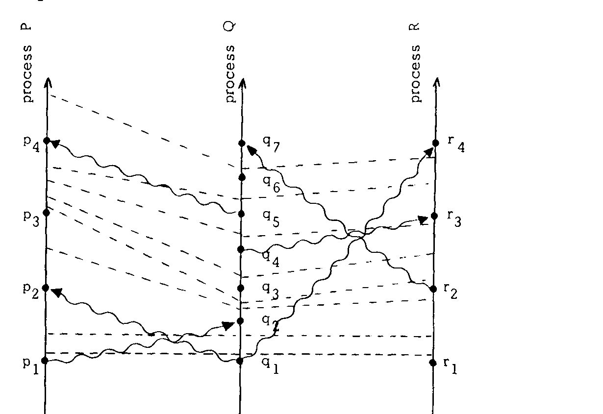
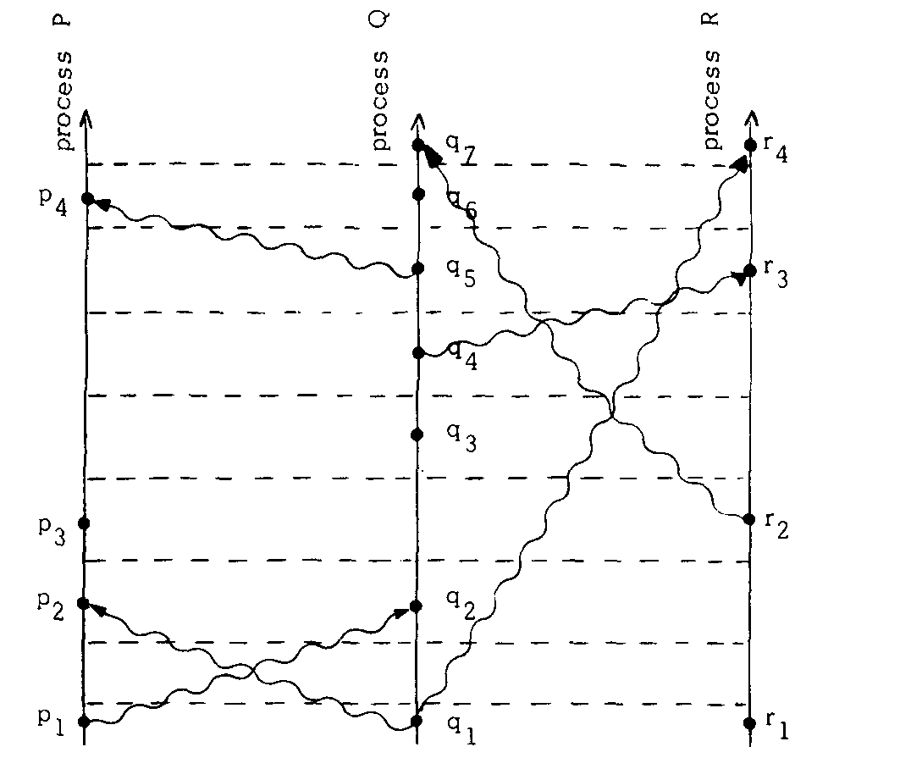

## 摘要

本文考察分布式系统中“一个事件先于另一个事件发生”的概念，并证明它定义了事件上的一个**偏序**。我们给出一个分布式算法，用于同步一组逻辑时钟；该逻辑时钟可用于为事件建立**全序**。我们用一个解决同步问题的方法说明全序的用途。随后将该算法专门化，用于同步物理时钟，并推导出时钟之间可能失步程度的一个上界。

**关键词**：分布式系统、计算机网络、时钟同步、多处理系统

## 1. 引言

时间概念是我们思维方式的基础。它源自一个更基本的概念：事件发生的先后顺序。如果说某件事发生在 3:15，我们的意思是它发生在时钟读到 3:15 之后、读到 3:16 之前。事件的时间顺序这一概念贯穿我们对系统的思考。例如，在航空订票系统中，我们规定：如果订票请求在航班满员之前提出，就应予以批准。然而，当我们考虑分布式系统中的事件时，这一概念必须被仔细重新审视。

分布式系统由一组空间上分离、通过交换消息相互通信的不同进程组成。互连计算机的网络（如 ARPAnet）就是分布式系统。单台计算机也可以看作分布式系统：中央控制单元、存储单元和输入输出通道都是彼此分离的进程。如果消息传输延迟相对于单个进程中事件之间的时间不可忽略，那么该系统就是分布式的。

本文主要关注空间上分离的计算机系统，但许多论述更具一般性。特别是，单台计算机上的多处理系统也会遇到与分布式系统类似的问题，因为某些事件发生的顺序不可预测。

在分布式系统中，有时无法断言两个事件中哪个先发生。因此，“先于发生”（happened before）关系只是事件上的一个偏序。我们发现，问题常常源于人们没有充分认识到这一事实及其含义。

本文中，我们讨论由“先于发生”关系定义的偏序，并给出一个分布式算法，将其扩展为所有事件的一致全序。该算法可作为实现分布式系统的有用机制。我们用一个简单方法说明它如何解决同步问题。如果该算法得到的顺序与用户感知的顺序不同，就可能出现意外的异常行为；引入真实的物理时钟可以避免这种情况。我们描述了一种同步物理时钟的简单方法，并推导出它们可能漂移多远的上界。

## 2. 偏序

大多数人可能会说：如果事件 $a$ 发生的物理时间早于事件 $b$，那么 $a$ 先于 $b$。他们可能会用物理时间理论来证明这一定义。然而，如果一个系统要正确满足规约，那么该规约必须用系统内部可观察的事件来表达。如果规约用物理时间表述，那么系统就必须包含真实时钟。即使系统包含真实时钟，仍然存在时钟不精确、不能保持精确物理时间的问题。因此，我们将在不使用物理时钟的前提下定义“先于发生”关系。

我们先更精确地定义系统。假设系统由一组进程组成，每个进程由一系列事件构成。根据具体应用，一个事件可以是计算机上执行一个子程序，也可以是执行一条机器指令。我们假设进程的事件形成一个序列，若 $a$ 在该序列中位于 $b$ 之前，则 $a$ 先于 $b$。换句话说，单个进程被定义为具有先验全序的一组事件。这似乎正是“进程”的一般含义。将定义扩展到进程可分裂为不同子进程的情形是平凡的，但我们不这样做。

我们假设发送或接收消息也是进程中的事件。于是可以定义“先于发生”关系，记为 $\to$：

**定义**：系统事件集合上的关系 $\to$ 是满足以下三个条件的最小关系：

1. 若 $a$ 与 $b$ 是同一进程中的事件，且 $a$ 在 $b$ 之前，则 $a \to b$；
2. 若 $a$ 是一个进程发送消息的事件，$b$ 是另一个进程接收同一消息的事件，则 $a \to b$；
3. 若 $a \to b$ 且 $b \to c$，则 $a \to c$。

若两个不同事件 $a$ 与 $b$ 既不满足 $a \to b$，也不满足 $b \to a$，则称它们是**并发的**。

我们假设对任意事件 $a$，不存在 $a \to a$（事件先于自身没有物理意义）。这意味着 $\to$ 是系统所有事件集合上的非自反偏序。

借助图 1 的“时空图”可以直观理解该定义。水平方向表示空间，垂直方向表示时间——越往上时间越晚。点表示事件，竖线表示进程，波浪线表示消息。显然，$a \to b$ 意味着可以沿进程线和消息线从 $a$ 向前走到 $b$。例如图 1 中有 $p_1 \to r_4$。

定义还有一种理解方式：$a \to b$ 意味着事件 $a$ **有可能**因果地影响事件 $b$。如果两个事件都不能因果影响对方，它们就是并发的。例如图 1 中的 $p_3$ 与 $q_3$ 是并发的。尽管图中画得好像 $q_3$ 的物理时间早于 $p_3$，但进程 P 在 $p_4$ 收到消息之前不可能知道 Q 在 $q_3$ 做了什么（在 $p_4$ 之前，P 最多只知道 Q 在 $q_3$ 计划做什么）。

这一定义对熟悉狭义相对论中不变量时空表述的读者会很自然。在相对论中，事件顺序由**可能发送**的消息定义；而我们采用更务实的做法：只考虑实际发送的消息。我们应该仅凭实际发生的事件、而不需要知道哪些事件本可能发生，就能判断系统是否正确运行。

## 3. 逻辑时钟

现在向系统中引入时钟。我们先从抽象观点出发：时钟只是给事件分配一个数，这个数被认为是事件发生的时间。 更精确地说，我们为每个进程 $P_i$ 定义一个时钟 $C_i$，它为 $P_i$ 中的任意事件 $a$ 分配数 $C_i(a)$。整个系统的时钟用函数 $C$ 表示：对任意事件 $b$，$C(b)=C_j(b)$，其中 $b$ 属于进程 $P_j$。目前我们不假设 $C_i(a)$ 与物理时间有任何关系，因此可以把 $C_i$ 看成逻辑时钟而非物理时钟。它们可以只用计数器实现，而不需要任何实际计时机制。

接下来考虑这样的时钟系统何时是正确的。我们不能基于物理时间定义正确性，因为那会要求引入走物理时间的时钟。定义必须基于事件发生的顺序。最强且合理的条件是：若事件 $a$ 先于事件 $b$，则 $a$ 应发生在一个早于 $b$ 的时间。形式化如下：

**时钟条件**：对任意事件 $a,b$，

$$
\text{若 } a \to b,\ \text{则 } C(a) < C(b).
$$

注意，不能要求逆命题成立，因为那意味着任意两个并发事件必须在同一时间发生。在图 1 中，$p_2$ 和 $p_4$ 都与 $q_3$ 并发，因此若要求逆命题成立，它们都必须与 $q_3$ 同时发生；但 $p_2 \to p_3 \to q_3$，这会违反时钟条件。

由 $\to$ 的定义可知，若以下两个条件成立，则时钟条件成立：

- **C1**：若 $a$ 与 $b$ 是进程 $P_i$ 中的事件，且 $a$ 在 $b$ 之前，则 $C_i(a) < C_i(b)$。
- **C2**：若 $a$ 是进程 $P_i$ 发送消息的事件，$b$ 是另一进程接收该消息的事件，则 $C_i(a) < C_j(b)$。

在时空图中理解时钟：可以想象进程的时钟“滴答”，而两个滴答之间的间隔构成一条“滴答线”。条件 C1 意味着同一进程任意两个事件之间必有一条滴答线；条件 C2 意味着每条消息线必须穿过一条滴答线。从 $\to$ 的直观含义可知，这两个条件蕴含时钟条件。

我们可以把滴答线看作时空中某个笛卡尔坐标系的时间坐标线。重画图 2 把这些坐标线拉直，就得到图 3。图 3 是同一事件系统的另一种有效表示。若不引入物理时间概念（这需要引入物理时钟），就无法判断哪种表示更好。

读者可以想象一个二维进程空间网络，从而得到三维时空图：进程和消息仍用线表示，但滴答线变成二维曲面。

现在假设进程就是算法，事件表示其执行中的某些动作。我们将说明如何在进程中引入满足时钟条件的时钟。进程 $P_i$ 的时钟用寄存器 $C_i$ 表示，使得 $C_i(a)$ 是事件 $a$ 发生时 $C_i$ 的值。$C_i$ 的值会在事件之间变化，因此改变 $C_i$ 本身不构成事件。

为保证时钟系统满足时钟条件，我们确保它满足 C1 和 C2。C1 很简单，进程只需遵守以下实现规则：

- **IR1**：每个进程 $P_i$ 在任意两个连续事件之间递增 $C_i$。

为满足 C2，要求每条消息 $m$ 携带一个时间戳 $T_m$，等于消息发送的时间。进程收到带时间戳 $T_m$ 的消息后，必须把自己的时钟推进到晚于 $T_m$。更精确地：

- **IR2 (a)**：若事件 $a$ 是进程 $P_i$ 发送消息 $m$，则消息 $m$ 携带时间戳 $T_m = C_i(a)$。
- **IR2 (b)**：进程 $P_i$ 收到消息 $m$ 后，设置 $C_i$ 使其大于等于当前值，且大于 $T_m$。

在 IR2(b) 中，我们认为表示收到消息 $m$ 的事件发生在设置 $C_i$ 之后。这只是记号上的麻烦，在任何实际实现中都无关紧要。显然 IR2 保证 C2 成立。因此，简单的实现规则 IR1 与 IR2 就能保证时钟条件。

## 4. 事件的全序

我们可以利用满足时钟条件的时钟系统，为所有事件建立全序。若 $a$ 是进程 $P_i$ 中的事件，$b$ 是进程 $P_j$ 中的事件，定义：

$$
a \Rightarrow b
\quad\text{当且仅当}\quad
C_i(a) < C_j(b)
\ \text{或}\
\bigl(C_i(a)=C_j(b)\ \text{且}\ P_i \prec P_j\bigr),
$$

其中 $\prec$ 是进程之间任意选取的一个全序。可以验证 $\Rightarrow$ 是一个全序，并且若 $a \to b$ 则 $a \Rightarrow b$。注意，$\Rightarrow$ 依赖于时钟值和进程间的任意排序，因此它并不是唯一的。

能够全序化事件，使我们能解决一类同步问题。考虑这样一个问题：一组进程共享一个资源，一次只能有一个进程使用该资源。我们希望满足三个条件：

1. 已获得资源但尚未释放的进程必须先释放，其他进程才能获得；
2. 请求必须按某种顺序被授予；
3. 若每个最终获得资源的进程最终都释放该资源，则每个请求最终都会被授予。

我们假设资源最初被授予给某个进程。算法如下，每个进程维护自己的请求队列：

1. 进程 $P_i$ 请求资源时，向所有进程发送消息 $T_m:P_i$，并把该请求放入自己的请求队列；
2. 进程 $P_j$ 收到请求 $T_m:P_i$ 后，把它放入自己的请求队列，并发送一条带时间戳的确认消息；
3. $P_i$ 释放资源时，从自己的队列中删除对应请求，并发送释放消息；
4. $P_j$ 收到释放消息后，从队列中删除对应请求；
5. 当 $P_i$ 的请求位于自己队列首位，且 $P_i$ 已收到来自其他每个进程的时间戳晚于该请求的消息时，$P_i$ 被授予资源。

这里“时间戳晚于”指逻辑时钟。由于消息按发送顺序到达，并且时钟满足时钟条件，这些规则保证所有进程对请求顺序达成一致。

==需要强调，这个算法并非平凡。它不能仅靠“请求先到先服务”实现，因为分布式系统中没有全局的“先到”。算法的关键在于：逻辑时钟给出的全序与偏序 $\to$ 一致，因此所有进程对哪些请求先发生有共同认识。==

类似方法可用于实现任意分布式状态机：若所有进程从相同初始状态开始，并按完全相同的顺序执行相同请求，它们就会达到相同状态。每个进程独立模拟请求的执行，请求顺序由上述全序确定。若请求是某个进程的完整状态快照或确定性的操作，那么所有副本将保持一致。

该方法还能处理故障。全序的构造不依赖任何集中式协调者，也不依赖所有进程始终健康。某个进程故障后，其他进程可停止等待其消息，或把它的请求从队列中移除。故障检测本身是一个独立问题；即使检测不完全准确，只要所有进程对“哪些请求被考虑”达成一致，状态机复制仍然成立。

## 5. 异常行为

第 4 节中的总序遍历与 $\to$ 关系一致，但不保证与系统用户感知的顺序一致。为了说明这一点，假设两个用户 $a$ 与 $b$ 分别在进程 $P_1$ 与 $P_2$ 上交互。用户 $a$ 发出请求后在终端上看到结果，随后用户 $b$ 发出请求。若 $b$ 的请求得到了比 $a$ 更早的时间戳，那么系统会先处理 $b$ 的请求。尽管从系统内部事件看没有违反因果顺序，但用户会看到异常行为：后发出的请求先被处理。

这种异常的根源是：逻辑时钟只捕捉系统内部实际消息所诱导的因果顺序，而用户之间的交互可能通过系统外部发生。解决方式有两种：

1. 在算法中显式引入用户交互产生的外部事件，使用户感知的先后顺序成为系统事件的一部分；
2. 构造真实物理时钟，使系统得到的全序尽可能接近用户基于物理时间感知的顺序。

下面讨论第二种方式。

我们要求对所有相关物理事件满足**强时钟条件**：若事件 $a$ 在物理时间上先于事件 $b$，则 $C(a) < C(b)$。由于普通时钟条件已保证 $a \to b \Rightarrow C(a)<C(b)$，我们只需考虑同一进程间没有因果关系但物理时间上有先后的事件。为此，需要物理时钟足够精确且彼此足够同步。

## 6. 物理时钟

在时空图中引入物理时间坐标，令 $C_i(t)$ 表示物理时间 $t$ 时时钟 $C_i$ 的读数。为数学方便，假设时钟连续运行而非离散“滴答”（离散时钟可看作读数误差不超过半个滴答的连续时钟）。更精确地说，假设 $C_i(t)$ 是 $t$ 的连续可微函数，除了时钟被重置时的孤立跳变。$dC_i(t)/dt$ 表示时钟在时刻 $t$ 的运行速率。

要使 $C_i$ 成为真正的物理时钟，它必须以近似正确的速率运行。即对所有 $t$ 有 $dC_i(t)/dt \approx 1$。更精确地，假设：

- **PC1**：存在常数 $\kappa \ll 1$，使得对所有 $i$：

  $$
  \left|\frac{dC_i(t)}{dt}-1\right| < \kappa.
  $$

  对典型晶振时钟，$\kappa \le 10^{-6}$。

单个时钟速率大致正确还不够，它们还必须同步，即对所有 $i,j,t$ 有 $C_i(t)=C_j(t)$。更精确地，存在足够小的常数 $\epsilon$，使得：

- **PC2**：对所有 $i,j$：

  $$
  |C_i(t)-C_j(t)| < \epsilon.
  $$

若把图 2 中的垂直距离看作物理时间，PC2 表示单条滴答线的高度变化小于 $\epsilon$。

两个不同时钟的速率不可能完全相同，因此它们会不断漂移。必须设计算法保证 PC2 始终成立。先看看为避免异常行为，$\kappa$ 与 $\epsilon$ 必须多小。

令 $\mu$ 满足：若事件 $a$ 在物理时间 $t$ 发生，另一进程中的事件 $b$ 满足 $a \to b$，则 $b$ 发生在物理时间 $t+\mu$ 之后。换句话说，$\mu$ 小于进程间消息的最短传输时间。我们总可以取 $\mu$ 为进程间最短距离除以光速；不过根据消息传输方式，$\mu$ 可能大得多。

为避免异常行为，必须保证对任意 $i,j,t$：

$$
C_i(t+\mu)-C_j(t)>0.
$$

结合 PC1 与 PC2，并假设时钟重置只会向前、不会向后（向后可能导致时钟条件被破坏），有：

$$
C_i(t+\mu)-C_i(t) > (1-\kappa)\mu.
$$

于是只要

$$
\frac{\epsilon}{1-\kappa} \le \mu,
$$

就能得到 $C_i(t+\mu)-C_j(t)>0$。该不等式与 PC1、PC2 一起保证异常行为不可能发生。

现在描述保证 PC2 的算法。设消息 $m$ 在物理时间 $t$ 发送、在 $t'$ 接收，定义消息总延迟 $\nu_m=t'-t$。接收进程当然不知道该延迟，但我们假设它知道某个最小延迟 $\mu_m\ge 0$，满足 $\nu_m\ge\mu_m$。称

$$
\xi_m = \nu_m - \mu_m
$$

为消息的**不可预测延迟**。

针对物理时钟，将 IR1、IR2 专门化为：

- **IR1'**：对每个 $i$，若 $P_i$ 在物理时间 $t$ 没有收到消息，则 $C_i$ 在 $t$ 处可微，且 $dC_i(t)/dt>0$。
- **IR2' (a)**：若 $P_i$ 在物理时间 $t$ 发送消息 $m$，则 $m$ 携带时间戳 $T_m=C_i(t)$。
- **IR2' (b)**：在物理时间 $t'$ 收到消息 $m$ 后，进程 $P_i$ 设置 $C_i(t')$ 等于 $\max\bigl(C_i(t'-0),\, T_m+\mu_m\bigr)$。

其中 $C_i(t'-0)=\lim_{\delta\to0^+}C_i(t'-\delta)$。

虽然规则以物理时间参数表述，但进程只需知道自己的时钟读数和收到消息的时间戳。为数学方便，假设每个事件发生在精确的物理瞬间，且同一进程中不同事件发生在不同时间。这些规则是 IR1、IR2 的特化，因此时钟系统仍满足时钟条件。实际事件具有有限持续时间不会带来困难；实现中唯一真正需要关心的是离散滴答足够频繁，以保持 C1。

现在说明该同步算法如何满足 PC2。假设进程系统由有向图描述，从 $P_i$ 到 $P_j$ 的弧表示一条通信线路，消息可沿它直接从 $P_i$ 发往 $P_j$。若对任意 $t$，$P_i$ 在物理时间 $t$ 到 $t+\tau$ 之间至少向 $P_j$ 发送一条消息，则称消息每 $\tau$ 秒沿该弧发送一次。有向图的直径 $d$ 是最小整数，使得任意两个不同进程 $P_i,P_k$ 之间都存在一条从 $P_i$ 到 $P_k$、弧数不超过 $d$ 的路径。

**定理**：假设进程图强连通、直径为 $d$，且始终遵守 IR1' 与 IR2'。假设对任意消息 $m$ 有 $\xi_m\le\xi$，并且对所有 $t>t_0$：(a) PC1 成立；(b) 存在常数 $\tau$ 与 $\xi$，使得每 $\tau$ 秒每条弧上都会发送一条不可预测延迟小于 $\xi$ 的消息。则对所有 $t>t_0+\tau d$，PC2 成立，且

$$
\epsilon = d(2\kappa\tau+\xi),
$$

其中近似假设 $\mu+\xi\ll\tau$。

该定理的证明相当困难，见附录。关于物理时钟同步已有大量研究，参见文献 [4]。文献中的方法可用于估计消息延迟 $\mu_m$ 以及调整时钟频率 $dC_i/dt$（对支持调整的时钟而言）。我们的情形有一个似乎区别于以往研究的要求：时钟绝不向后设置。我们相信该定理是一个新结果。

## 7. 结论

我们已经看到，“先于发生”概念在分布式多处理系统中定义了事件的一个不变偏序。我们描述了一种算法，将该偏序扩展为某种任意的全序，并说明如何用该全序解决一个简单同步问题。未来的论文将说明如何把这种方法扩展以解决任意同步问题。

该算法定义的全序有一定任意性。如果它与系统用户感知的顺序不一致，就可能产生异常行为。使用正确同步的物理时钟可以避免这一点。我们的定理说明了时钟能被同步到多高的精度。

==在分布式系统中，重要的是认识到事件顺序只是偏序。== 我们相信这一观点有助于理解任何多处理系统，也有助于独立于具体解决机制地理解多处理的基本问题。

## 附录：定理证明

对任意 $i$ 与 $t$，定义时钟 $C_i^t$：它在时刻 $t$ 被设置为等于 $C_i$，此后以与 $C_i$ 相同的速率运行，但永不被重置。即对所有 $t'\ge t$：

$$
C_i^t(t') = C_i(t) + \int_t^{t'} \frac{dC_i(s)}{ds}\,ds. \tag{1}
$$

注意对所有 $t'\ge t$：

$$
C_i(t') \ge C_i^t(t'). \tag{2}
$$

假设进程 $P_i$ 在时刻 $t_1$ 向进程 $P_j$ 发送一条消息，该消息在时刻 $t_2$ 被接收，不可预测延迟不超过 $\xi$，且 $t_0\le t_1\le t_2$。则对所有 $t\ge t_2$：

$$
\begin{aligned}
C_j(t)
&\ge C_j(t_2)+(1-\kappa)(t-t_2) &&\text{由 (1) 与 PC1}\\
&> C_i(t_1)+\mu_m+(1-\kappa)(t-t_2) &&\text{由 IR2'(b)}\\
&= C_i(t_1)+(1-\kappa)(t-t_1)-(t_2-t_1)-\xi_m+\kappa(t_2-t_1)\\
&\ge C_i(t_1)+(1-\kappa)(t-t_1)-\xi.
\end{aligned}
$$

因此，在这些假设下，对所有 $t\ge t_2$：

$$
C_j(t) \ge C_i(t_1)+(1-\kappa)(t-t_1)-\xi. \tag{3}
$$

现在假设对 $i=1,\dots,n$ 有 $t_i\le t_i'<t_{i+1}$、$t_0\le t_i'$，且在时刻 $t_i'$ 进程 $P_i$ 向 $P_{i+1}$ 发送消息，在时刻 $t_{i+1}$ 被接收，不可预测延迟小于 $\xi$。反复应用 (3) 可得，对 $t\ge t_{n+1}$：

$$
C_{n+1}(t) \ge C_1(t_1')+(1-\kappa)(t-t_1')-n\xi. \tag{4}
$$

由 PC1、IR1' 与 IR2' 可得：

$$
C_1(t_1') \ge C_1(t_1)+(1-\kappa)(t_1'-t_1).
$$

结合 (4) 并使用 (2)，对 $t\ge t_{n+1}$ 有：

$$
C_{n+1}(t) \ge C_1(t_1)+(1-\kappa)(t-t_1)-n\xi. \tag{5}
$$

对任意两个进程 $P$ 与 $P'$，可找到一条进程序列 $P=P_0,P_1,\dots,P_{n+1}=P'$，其中 $n\le d$，且相邻进程间有通信弧。由假设 (b)，可找到时刻 $t_i,t$ 满足 $t-t_i\le\tau$ 且 $t_{i+1}-t_i'\le \nu$，其中 $\nu=\mu+\xi$。因此，只要 $t\ge t_i+d(\tau+\nu)$，就有形如 (5) 的不等式成立，其中 $n\le d$。于是对任意 $i,j$ 以及 $t,t_1$（$t_1>t_0$，$t\ge t_1+d(\tau+\nu)$）：

$$
C_i(t) \ge C_j(t_1)+(1-\kappa)(t-t_1)-d\xi. \tag{6}
$$

现在令 $m$ 为任意消息，时间戳为 $T_m$，在时刻 $t$ 发送、在 $t'$ 接收。我们假装 $m$ 有一个时钟 $C_m$，它以恒定速率运行，满足 $C_m(t)=T_m$ 且 $C_m(t')=T_m+\xi_m$。由于 $\mu_m\le t'-t$，有 $dC_m/dt\le1$。规则 IR2'(b) 只是把 $C_j(t')$ 设置为 $\max(C_j(t'-0),C_m(t'))$。因此，时钟只在被设置为等于其他时钟时才会重置。

对任意时刻 $t_x\ge t_0+\xi/(1-\kappa)$，令 $C_x$ 为在 $t_x$ 时刻值最大的时钟。由于所有时钟运行速率小于 $1+\kappa$，对所有 $i$ 与 $t\ge t_x$：

$$
C_i(t)\le C_x(t_x)+(1+\kappa)(t-t_x). \tag{7}
$$

考虑两种情况：(i) $C_x$ 是某进程 $P_q$ 的时钟 $C_q$；(ii) $C_x$ 是某消息 $m$ 的时钟 $C_m$，该消息在时刻 $t_1$ 由 $P_q$ 发送。情况 (i) 中，(7) 变为：

$$
C_i(t)\le C_q(t_x)+(1+\kappa)(t-t_x). \tag{8i}
$$

情况 (ii) 中，由于 $C_m(t_x)=C_q(t_1)$ 且 $dC_m/dt\le1$，有：

$$
C_x(t_x)\le C_q(t_1)+(t_x-t_1).
$$

于是由 (7) 得：

$$
C_i(t)\le C_q(t_1)+(1+\kappa)(t-t_1). \tag{8ii}
$$

由于 $t_x\ge t_0+\xi/(1-\kappa)$，由 PC1 有：

$$
C_q\!\left(t_x-\frac{\xi}{1-\kappa}\right)\le C_q(t_x)-\xi
\le C_m(t_x)-\xi
\le T_m
= C_q(t_1).
$$

因此 $t_x-t_1\le \xi/(1-\kappa)$，从而 $t_1\ge t_0$。

在情况 (i) 中令 $t_1=t_x$，合并 (8i) 与 (8ii) 可得：对任意 $t\ge t_x\ge t_0+\xi/(1-\kappa)$，存在进程 $P_q$ 与时刻 $t_1$ 满足 $t_x-\xi/(1-\kappa)\le t_1<t_x$，且对所有 $i$：

$$
C_i(t)\le C_q(t_1)+(1+\kappa)(t-t_1). \tag{9}
$$

选取 $t$ 与 $t_x$ 使 $t\ge t_x+d(\tau+\xi)$。合并 (6) 与 (9)，可得存在 $t_1$ 与进程 $P_q$，使对所有 $i$：

$$
\begin{aligned}
C_q(t_1)+(1-\kappa)(t-t_1)-d\xi
&\le C_i(t)\\
&\le C_q(t_1)+(1+\kappa)(t-t_1).
\end{aligned} \tag{10}
$$

令 $t=t_1+d(\tau+\nu)$，得到 $d(\tau+\mu)\le t-t_1\le d(\tau+\nu)+\xi/(1-\kappa)$。将其代入 (10)：

$$
\begin{aligned}
C_q(t_1)+(t-t_1)-\kappa d(\tau+\mu)-d\xi
&\le C_i(t)\\
&\le C_q(t_1)+(t-t_1)+\kappa d(\tau+\nu)+\frac{\xi}{1-\kappa}.
\end{aligned} \tag{11}
$$

利用假设 $\kappa\ll1$ 与 $\mu\le\xi\ll\tau$，可将 (11) 写成近似不等式：

$$
C_q(t_1)+(t-t_1)-d(2\kappa\tau+\xi)
\ \lesssim\ C_i(t)\
\lesssim\ C_q(t_1)+(t-t_1)+d(2\kappa\tau+\xi). \tag{12}
$$

由于这对所有 $i$ 成立，得到：

$$
|C_i(t)-C_j(t)| \le d(2\kappa\tau+\xi),
$$

并且对所有 $t>t_0+\tau d$ 成立。这正是定理所要求的结果。

注意，当假设 $\mu+\xi\ll\tau$ 不成立时，证明中的关系 (11) 给出 $|C_i(t)-C_j(t)|$ 的精确上界。考察该证明还提示了一种快速初始化时钟、或在时钟因任何原因失步后重新同步的简单方法：每个进程发送一条消息，并被转发给所有其他进程。该过程可由任意进程发起，若每条消息的不可预测延迟小于 $\xi$，则完成同步所需时间小于 $2d(\tau+\xi)$ 秒。

## 致谢

使用时间戳为操作排序，以及异常行为的概念，归功于 Paul Johnson 与 Robert Thomas。

原稿收到日期：1976 年 3 月；修订日期：1977 年 10 月。

## 参考文献

1. Schwartz, J. T. *Relativity in Illustrations*. New York U. Press, New York, 1962.
2. Taylor, E. F., and Wheeler, J. A. *Space-Time Physics*. W. H. Freeman, San Francisco, 1966.
3. Lamport, L. The implementation of reliable distributed multiprocess systems. To appear in *Computer Networks*.
4. Ellingson, C., and Kulpinski, R. J. Dissemination of system-time. *IEEE Trans. Comm.* Com-23, 5 (May 1973), 605–624.
