## 摘要

共识算法使一组机器能够像一个一致的整体那样工作，即使其中部分成员发生故障也能继续运行。Raft 是一种用于管理复制日志的共识算法，其可理解性与 Paxos 相当甚至更好。为了让算法更容易理解，Raft 把共识问题分解为几个相对独立的子问题：领导者选举、日志复制和安全性。Raft 还引入联合共识机制来处理集群成员变更，通过让两个配置的多数派在过渡期间重叠来保证安全。

## 1. 引言

共识算法允许一组机器作为一个连贯的群体工作，即使部分成员失效也能继续运行，因此是构建可靠大规模软件系统的关键。过去十年中，Paxos 主导了共识算法的讨论：大多数实现基于 Paxos 或受其影响，Paxos 也成为教学中的主要载体。

然而，尽管已有大量改进尝试，Paxos 仍然很难理解；其架构也需要复杂改动才能支持实际系统。我们决定寻找一种新的共识算法，其首要目标是**可理解性**：能否定义一种适用于实际系统的共识算法，并以明显比 Paxos 更容易学习的方式描述它？我们还希望该算法有助于系统构建者建立必要的直觉——重要的不只是算法能工作，还要让人一眼看出它为什么能工作。

成果就是 Raft。设计中使用了两种提高可理解性的技术：**分解**（把领导者选举、日志复制和安全性分开）和**状态空间缩减**（相对于 Paxos，减少不确定性和服务器彼此不一致的方式）。一项在两所大学 43 名学生中的用户研究表明，Raft 明显比 Paxos 更容易理解。

Raft 与既有共识算法有许多相似之处（尤其是 Oki 与 Liskov 的 Viewstamped Replication），但有几个新特性：

- **强领导者**：Raft 使用比其他共识算法更强的领导关系，日志条目只从领导者流向其他服务器，简化复制日志管理。
- **领导者选举**：Raft 使用随机定时器选举领导者，只在任何共识算法都需要的心跳机制上增加少量机制，就能简单快速解决冲突。
- **成员变更**：Raft 使用联合共识方法，过渡期间两个不同配置的多数派重叠，使集群在配置变更期间仍可正常运行。

## 2. 复制状态机

共识算法通常出现在复制状态机的场景中。一组服务器上的状态机计算相同状态副本，即使部分服务器宕机也能继续运行。复制状态机用于解决各种分布式容错问题，例如 GFS、HDFS、RAMCloud 等系统通常用独立的复制状态机管理领导者选举和必须跨领导者故障存活的配置信息，Chubby 和 ZooKeeper 也是典型例子。

==复制状态机通常用复制日志实现==，如图 1：每台服务器存储包含一系列命令的日志，其状态机按序执行。所有日志包含相同顺序的相同命令，因此状态机处理相同命令序列；由于状态机是确定性的，它们计算出相同状态和相同输出序列。

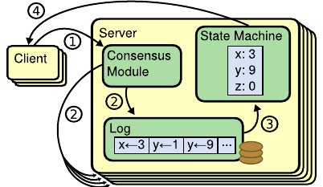

保持复制日志一致是共识算法的工作。服务器上的共识模块接收客户端命令并追加到本地日志，再与其他服务器上的共识模块通信，确保每个日志最终以相同顺序包含相同请求，即使部分服务器故障。命令被正确复制后，各状态机按日志顺序处理并返回结果。从外部看，这些服务器形成一个单一的高可靠状态机。

实用共识算法通常具有以下性质：

- 在所有非拜占庭条件下都保证安全（绝不返回错误结果），包括网络延迟、分区、丢包、重复和乱序；
- 只要多数派服务器运行且能相互并与客户端通信，系统就可用。典型 5 节点集群可容忍任意 2 台故障；
- 不依赖时序保证日志一致性，错误的时钟和极端消息延迟至多造成可用性问题；
- 常见情况下，命令只需一轮 RPC 到达多数派即可完成，少数慢服务器不影响整体性能。

## 3. Paxos 有什么问题？

过去十年，Paxos 几乎是共识算法的代名词，但很难理解，且架构复杂。Paxos 有两个主要缺点：

1. **难以理解**：Paxos 的论证晦涩，single-decree Paxos 与 multi-Paxos 之间的区别微妙，缺少直观模型；
2. **难以实现**：Paxos 的架构需要复杂改动才能构建实际系统，例如选主、成员变更、日志压缩等。

Raft 的目标是提供一个足够完整、可直接用于实现、又明显更容易理解与教学的替代方案。

## 4. 面向可理解性的设计

设计 Raft 时遵循两条原则：

- **问题分解**：把领导者选举、日志复制、安全性和成员变更拆开，使每一部分可以独立理解；
- **减少状态空间**：限制服务器的可能状态和交互方式。例如 Raft 不允许日志乱序：日志条目只能从领导者流向跟随者。

## 5. Raft 共识算法

==Raft通过选出一个领导者，再由领导者管理复制日志来实现共识。== 领导者接收客户端请求，写入日志，复制到跟随者，并在安全时提交（commit）条目。领导者故障或失去联系时，跟随者发起选举。

图 2 给出算法核心的浓缩描述，图 3 给出 Raft 保证的关键性质。

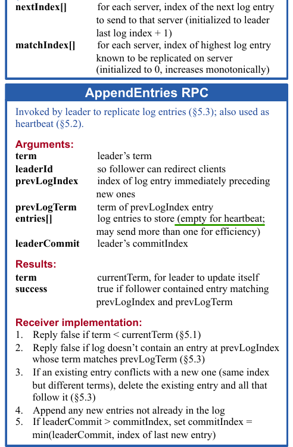

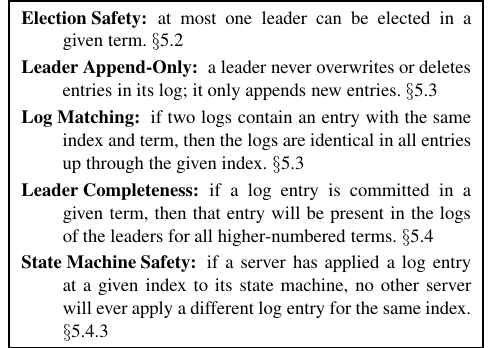

### 5.1 Raft 基础

Raft 集群包含若干服务器，典型为 5 台，可容忍 2 台故障。任意时刻每台服务器处于以下三种状态之一：**领导者（leader）**、**跟随者（follower）**或**候选人（candidate）**。正常运行时只有一个领导者，其他都是跟随者。跟随者是被动的：不主动发请求，只响应领导者和候选人的请求。领导者处理所有客户端请求（客户端联系跟随者时会被重定向）。候选人状态用于选举新领导者。

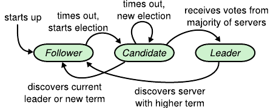

Raft 把时间划分为任意长度的**任期（term）**，任选用连续整数编号。每个任期从选举开始；候选人赢得选举后在该任期剩余时间担任领导者。若选票被瓜分，该任期没有领导者，很快开始新任期。==Raft保证给定任期至多一个领导者。==

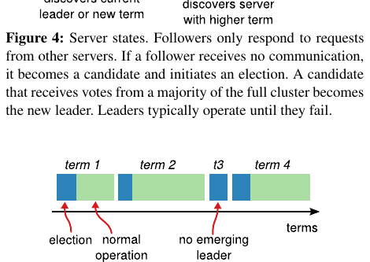

任期在 Raft 中充当逻辑时钟，帮助服务器识别过期信息。每台服务器保存当前任期号并单调递增。服务器通信时交换任期号；任期小的一方更新为较大值。候选人或领导者发现任期过期会立即退回跟随者；收到过期任期的请求会被拒绝。

基础共识算法只需要两类 RPC：

- `RequestVote`：候选人在选举期间发起；
- `AppendEntries`：领导者复制日志条目，也用作心跳。

### 5.2 领导者选举

服务器启动时都是跟随者。只要持续收到来自合法领导者或候选人的 RPC，就保持跟随者状态。领导者定期向所有跟随者发送心跳（不带日志条目的 `AppendEntries`）。若跟随者在**选举超时**时间内没有收到通信，就认为没有可用领导者，发起选举。

选举流程：跟随者增加当前任期，转为候选人，投给自己，并行向其他服务器发送 `RequestVote`。候选人保持该状态直到：(a) 赢得选举；(b) 其他服务器成为领导者；(c) 超时且无人胜出。

==候选人收到同一任期内集群多数派选票即赢得选举，成为领导者并向所有服务器发送心跳。每个服务器在给定任期内至多投一票，先到先得（另有第 5.4 节的安全限制）。多数派规则保证一个任期至多一个候选人胜出。==

等待投票时，候选人可能收到自称领导者的 `AppendEntries`：

- ==若对方任期 ≥ 自己当前任期，承认其为合法领导者并退回跟随者；==
- ==若对方任期更小，拒绝 RPC 并继续保持候选人状态。==

若多个跟随者同时成为候选人，选票可能瓜分。Raft 使用**随机选举超时**（例如 150–300ms）来降低瓜分概率并快速解决：每个候选人在每次选举开始时重新随机化超时，超时后再发起下一轮选举。

设计过程中曾考虑按固定排名选择候选人，但因复杂性和可用性问题放弃；随机重试更简单直观。

### 5.3 日志复制

领导者选举后开始服务客户端。每个请求包含要在复制状态机上执行的命令。领导者把命令作为新条目追加到日志，然后并行向其他服务器发送 `AppendEntries` 复制该条目。条目安全复制后，领导者将其应用到状态机并返回结果。若跟随者崩溃、运行慢或丢包，领导者会无限重试 `AppendEntries`，直到所有跟随者最终存储所有日志条目。

日志结构如图 6：每个条目包含状态机命令、领导者收到该命令时的任期号，以及整数索引。

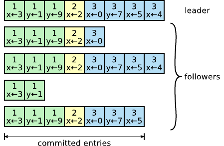

领导者决定何时可以安全应用日志条目，这样的条目称为**已提交**。Raft 保证已提交条目持久且最终会被所有可用状态机执行。当领导者把某任期条目复制到多数派服务器时，该条目被提交，并间接提交其之前所有条目。领导者维护已知最高提交索引 `commitIndex`，并在后续 `AppendEntries`（包括心跳）中携带，使其他服务器最终得知。跟随者得知条目已提交后，按日志顺序应用到本地状态机。

Raft 维护以下**日志匹配性质**：

1. 若两个日志中索引和任期相同的条目，则它们存储相同命令；
2. 若两个日志中索引和任期相同的条目，则它们在此之前的所有条目都相同。

第二条由 `AppendEntries` 的一致性检查保证：领导者发送新条目时携带紧邻新条目之前条目的索引和任期；跟随者若找不到相同索引和任期的条目，就拒绝新条目。该检查相当于归纳步骤：空日志满足日志匹配性质，每次扩展都保持该性质。

正常运行中日志一致，`AppendEntries` 检查不会失败；但领导者崩溃可能导致日志不一致。图 7 展示了跟随者日志可能缺失、多余或两者兼有的情况，且不一致可能跨多个任期。

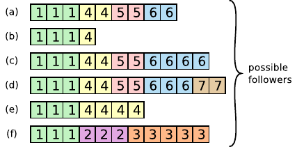

Raft 让领导者强制跟随者日志复制自身：领导者找到两份日志最后一致的位置，删除跟随者之后的条目，再发送领导者之后的条目。领导者为每个跟随者维护 `nextIndex`，表示下一条要发送的日志索引。新领导者上任时把所有 `nextIndex` 初始化为自己日志最后一条之后。若不一致，`AppendEntries` 失败，领导者递减 `nextIndex` 并重试，直到找到匹配点。成功后跟随者日志与领导者一致，并在该任期保持下去。

可优化拒绝过程：跟随者在拒绝时返回冲突条目的任期和该任期首个索引，领导者可跳过整个冲突任期。论文认为实践中不必优化，因为故障很少且不一致条目通常不多。

该机制使领导者上任时无需特殊恢复动作；只要开始正常运行，日志会通过一致性检查自动收敛。领导者从不覆盖或删除自己的日志条目。

### 5.4 安全性

前述机制尚不足以保证每台状态机以相同顺序执行相同命令。例如，跟随者可能在领导者提交若干条目时不可用，随后被选为领导者并用新条目覆盖它们。本节通过限制哪些服务器可以被选为领导者来完善算法：任意任期的领导者必须包含此前所有已提交条目（Leader Completeness Property）。

#### 5.4.1 选举限制

==Raft 利用投票过程阻止日志不够新的候选人胜出。候选人必须联系多数派，而每个已提交条目至少存在于该多数派中的一台服务器上。若候选人的日志至少与该多数派中任何其他日志一样新，它就包含所有已提交条目。==

==`RequestVote` 携带候选人日志信息。若投票者自己的日志比候选人的更新，则拒绝投票。== Raft 比较两个日志哪个更新：

- 若最后条目的任期不同，任期大的更新；
- 若任期相同，日志更长的更新。

#### 5.4.2 提交旧任期条目

领导者可以仅凭“当前任期条目复制到多数派”来提交该条目。但对于旧任期条目，即使已复制到多数派，也不能立即判定为已提交。图 8 展示了旧条目仍可能被未来领导者覆盖的情形。

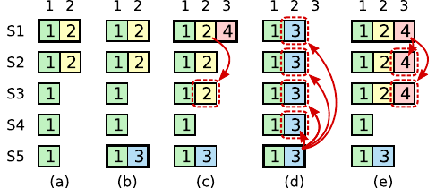

因此 Raft 只对当前任期条目按副本数提交；一旦当前任期条目提交，按日志匹配性质，之前所有条目也被间接提交。虽然某些情况下可以安全地判定旧条目已提交（例如存储在所有服务器上），但 Raft 为简单起见采取保守策略。

#### 5.4.3 安全性论证

若假设 Leader Completeness 不成立：任期 $T$ 的领导者提交了某条目，但未来任期 $U>T$ 的领导者没有它。取最小的这样的 $U$。已提交条目在 $U$ 领导者选举时不在其日志中；$T$ 领导者把条目复制到多数派，$U$ 领导者获得多数派选票，因此至少有一台服务器同时接收了该条目并投票给 $U$ 领导者（图 9 的“投票者”）。投票者在投票时必然仍持有该条目，因为它不可能删除与领导者冲突的已提交条目。由于投票者投了票，$U$ 领导者的日志至少与投票者一样新：要么末条目任期相同且更长，从而包含该条目；要么末条目任期更大，且产生该末条目的领导者按假设包含该条目，再由日志匹配性质推出 $U$ 领导者也包含它。矛盾。

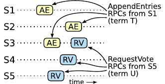

由 Leader Completeness 可证明状态机安全性质：若某服务器在给定索引应用了某日志条目，其他服务器不会在该索引应用不同条目。结合按索引顺序应用，所有服务器会以相同顺序应用相同日志条目集合。

### 5.5 跟随者与候选人崩溃

跟随者或候选人崩溃处理更简单：发给它们的 `RequestVote` 或 `AppendEntries` 会失败，Raft 无限重试；服务器重启后 RPC 成功。若服务器完成 RPC 后、响应前崩溃，重启后会再次收到同一 RPC。Raft RPC 是幂等的，例如跟随者收到已存在的日志条目会忽略。

### 5.6 时序与可用性

Raft 要求**安全性不依赖时序**，但可用性必然依赖时序。领导者选举对时序最敏感，需满足：

$$
\text{broadcastTime} \ll \text{electionTimeout} \ll \text{MTBF}
$$

其中 `broadcastTime` 是并行向所有服务器发送 RPC 并收到响应的平均时间，`electionTimeout` 是选举超时，`MTBF` 是单台服务器平均故障间隔。广播时间应比选举超时小一个数量级；选举超时应比 MTBF 小几个数量级。典型广播时间 0.5–20ms，因此选举超时约 10–500ms；典型 MTBF 为数月，容易满足要求。

## 6. 集群成员变更

之前假设集群配置固定，但实际中需要替换故障服务器或改变副本数。停机更新配置文件会造成不可用且易出错。Raft 把配置变更纳入共识算法。

直接从旧配置切换到新配置不安全：服务器不可能原子切换，过渡期可能同时出现两个多数派，分别选出同一任期的两个领导者（图 10）。

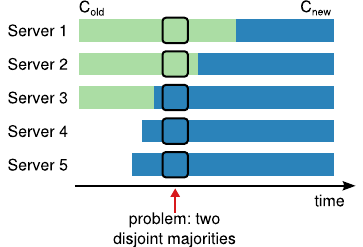

Raft 使用两阶段方法。集群先切换到**联合共识** $C_{\mathrm{old,new}}$，提交后再切换到新配置 $C_{\mathrm{new}}$。联合共识结合新旧配置：

- 日志条目复制到两个配置中的所有服务器；
- 任一配置的服务器都可成为领导者；
- 选举和提交需要分别获得旧配置和新配置的多数派。

配置以特殊日志条目存储和传播。图 11 展示了变更时间线。服务器一旦在日志中看到新配置条目，就立即使用它做后续决策（不管是否提交）。这样 $C_{\mathrm{old}}$ 与 $C_{\mathrm{new}}$ 不可能同时独立决策。

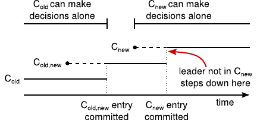

还有三个问题：

1. 新服务器可能没有日志，直接加入会导致长时间追赶。Raft 先让它们以**无投票权成员**加入，追上后再参与投票配置变更；
2. 当前领导者可能不在新配置中。提交 $C_{\mathrm{new}}$ 后，它会退回跟随者；
3. 被移除的服务器收不到心跳，会超时发起新选举干扰集群。解决方式是：若服务器认为当前领导者存在，则忽略近期收到的 `RequestVote`，不更新任期、不投票。

## 7. 日志压缩

Raft 日志会不断增长，占用空间并增加重放时间，需要丢弃过时信息。最简单方法是**快照**：把当前系统状态写入稳定存储，然后丢弃该点之前的日志。Chubby 和 ZooKeeper 都使用快照。

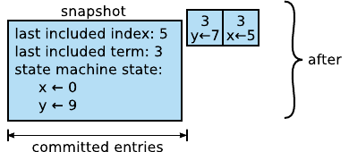

每台服务器独立对日志中已提交部分做快照。快照包含：

- 状态机当前状态；
- `lastIncludedIndex`：快照替换的最后一条日志索引；
- `lastIncludedTerm`：该条目的任期；
- 截至 `lastIncludedIndex` 的最新集群配置，以支持成员变更。

图 13 给出 `InstallSnapshot` RPC。领导者偶尔需要向落后太多的跟随者发送快照。跟随者收到快照后，若快照包含新信息，则丢弃整个日志；若快照只是已有日志的前缀，则删除被覆盖部分、保留后续条目。

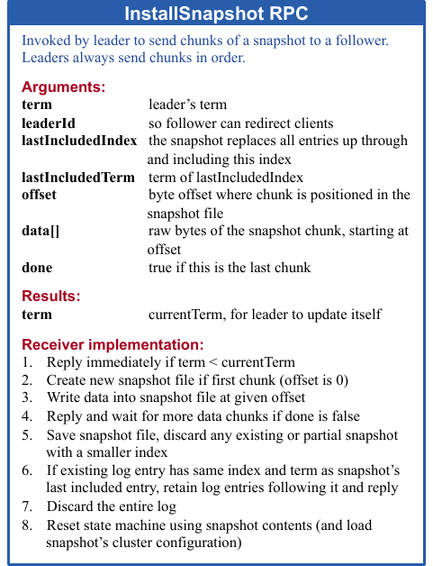

该方案偏离了强领导者原则（跟随者可独立快照），但这是合理的：共识已经达成，不会再有冲突决策，数据仍然只从领导者流向跟随者。

性能上需决定何时快照。简单策略是日志达到固定字节大小时快照；写快照可能耗时，可用写时复制技术避免阻塞正常更新。

## 8. 客户端交互

客户端把请求发给领导者。启动时随机连接一台服务器；若不是领导者，该服务器拒绝请求并返回最近已知领导者地址。领导者崩溃则客户端超时后重试其他服务器。

Raft 目标是**线性一致性**：每个操作看起来在调用与响应之间的某一瞬间执行一次。但领导者可能在提交后、响应前崩溃，导致客户端重试并重复执行。解决办法是客户端为每条命令分配唯一序列号，状态机记录每个客户端最近处理的序列号及响应；收到已执行序列号时直接返回缓存响应。

只读操作可不写日志，但要避免返回陈旧数据。Raft 需要两个额外措施：

1. 每个领导者在任期开始时提交一条空的 no-op 条目，以确定哪些条目已提交；
2. 处理只读请求前，领导者与多数派交换心跳，确认自己未被废黜。

## 9. 实现与评估

我们在 RAMCloud 的复制状态机中实现了 Raft，用于保存配置信息和协助协调者故障切换。实现约 2000 行 C++，还有约 25 个独立第三方开源实现。评估标准是可理解性、正确性和性能。

### 9.1 可理解性

在斯坦福和伯克利两门课程中，43 名学生观看 Raft 与 Paxos 视频并答题。Raft 平均得分 25.7/60，Paxos 平均 20.8/60，Raft 高 4.9 分；配对 t 检验显示 95% 置信度下 Raft 均值至少高 2.5 分。图 14 是个人得分散点图，33 人在对角线上方（Raft 更高）。

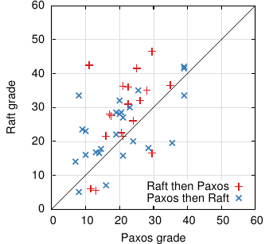

表 1 总结了为减少偏向 Paxos 的可能偏差所采取的措施。

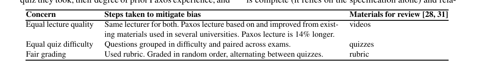

调查显示，41 名受访者中各有 33 人认为 Raft 更容易实现和讲解（图 15）。

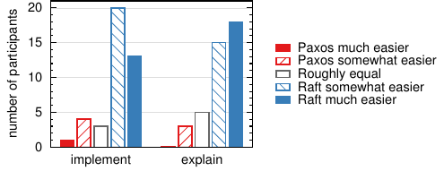

### 9.2 正确性

我们使用 TLA+ 对第 5 节共识机制做了形式化规约（约 400 行），并给出安全证明；非形式化证明约 3500 词。

### 9.3 性能

Raft 性能与其他共识算法相当。已建立领导者复制新日志条目时，只需一次到集群半数成员的往返。Raft 也容易支持批处理与流水线。

图 16 展示领导者故障检测与替换时间。实验表明，少量随机化即可避免瓜分选票：无随机化时选举常超过 10 秒；仅 5ms 随机化即可把中位停机时间降到 287ms；50ms 随机化时 1000 次试验最坏为 513ms。更小选举超时（12–24ms）可把平均选主时间降到 35ms，但会违反时序要求。论文建议保守使用 150–300ms。

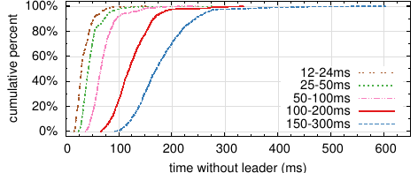

## 10. 相关工作

共识相关文献众多，大致包括：Lamport 对 Paxos 的原始描述及解释；对 Paxos 的扩展；使用 Paxos 构建实际系统等。其他算法包括 Viewstamped Replication、Zab 等。Raft 与它们的主要区别在于强领导者、随机选主和联合共识，这些设计共同提升了可理解性与可实现性。

## 11. 结论

Raft 是一种可理解、完整且实用的共识算法。它把共识问题分解为领导者选举、日志复制和安全性，使用随机化简化选主，用联合共识保证成员变更安全，并减小了服务器状态空间。用户研究表明它比 Paxos 更容易学习。我们相信 Raft 无论在教学还是在系统实现基础上都优于 Paxos。

## 12. 致谢

感谢本文档匿名评审者、用户研究参与者，以及 LogCabin 和其他实现的贡献者。

## 参考文献（节选）

1. Bolosky, W. J., et al. Paxos replicated state machines as the basis of a high-performance data store. *NSDI'11*, 141–154.
2. Burrows, M. The Chubby lock service for loosely-coupled distributed systems. *OSDI'06*, 335–350.
4. Chandra, T. D., Griesemer, R., and Redstone, J. Paxos made live: an engineering perspective. *PODC'07*, 398–407.
8. Ghemawat, S., Gobioff, H., and Leung, S.-T. The Google file system. *SOSP'03*, 29–43.
10. Herlihy, M. P., and Wing, J. M. Linearizability: a correctness condition for concurrent objects. *TOPLAS*, 1990.
11. Hunt, P., et al. ZooKeeper: wait-free coordination for internet-scale systems. *ATC'10*, 145–158.
14. Lamport, L. Time, clocks, and the ordering of events in a distributed system. *CACM* 21(7), 1978.
15. Lamport, L. The part-time parliament. *TOCS* 16(2), 1998.
16. Lamport, L. Paxos made simple. *ACM SIGACT News* 32(4), 2001.
17. Lamport, L. *Specifying Systems*. Addison-Wesley, 2002.
22. Liskov, B., and Cowling, J. Viewstamped replication revisited. MIT Tech. Rep., 2012.
23. LogCabin source code. https://github.com/logcabin/logcabin
32. Ongaro, D., and Ousterhout, J. In search of an understandable consensus algorithm. *ATC'14*, 305–319.
37. Schneider, F. B. Implementing fault-tolerant services using the state machine approach: a tutorial. *ACM Computing Surveys*, 1990.
